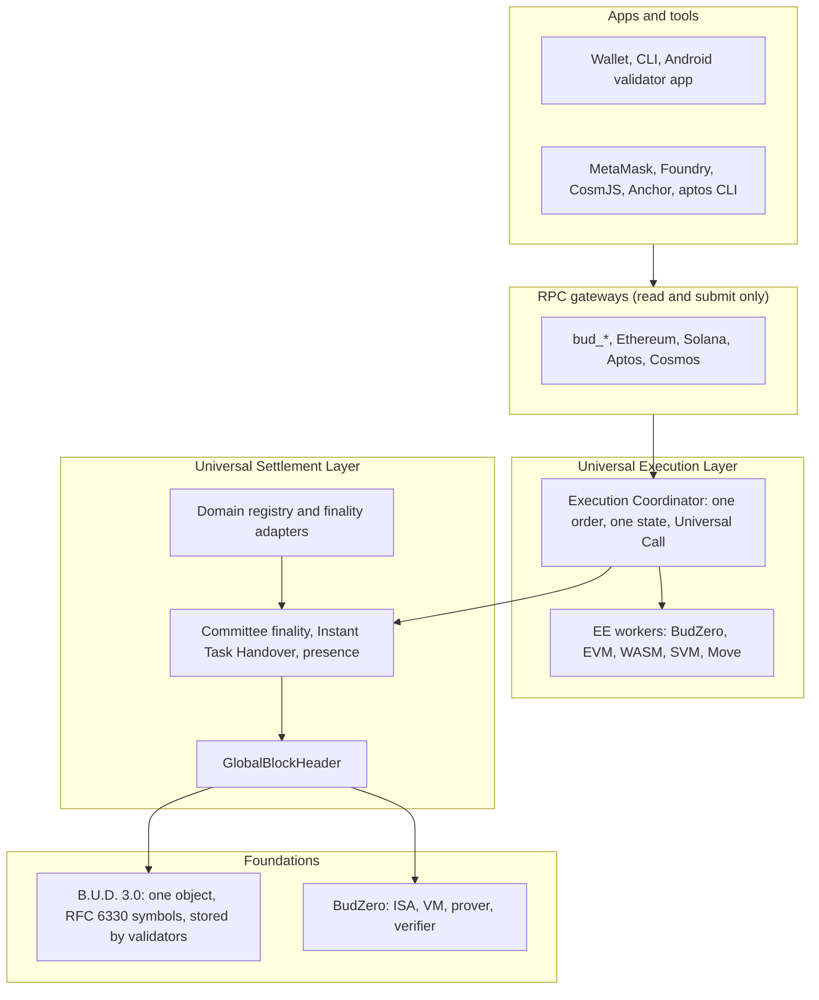

Budlum is the next layer of the internet, focused on data sovereignty and social flourishing.

Budlum is the consensus of consensuses.

Every network keeps its own rules. Budlum unifies their finality into a single proof.

PoW, PoS, PoA, BFT and ZK domains each keep their own consensus; Budlum verifies their
finality proofs and records cross-domain value transfer as a cryptographic fact on a single
`GlobalBlockHeader`. Sovereignty over data, keys and computation stays with the participants:
the layer asks which finality proof holds for a fact, never which consensus produced it, so
value moves between domains without trusting an intermediary.

[](https://github.com/budlum-xyz/budlum/actions/workflows/ci.yml?query=branch%3Amain+event%3Apush)
[](https://github.com/budlum-xyz/budlum/actions/workflows/ci.yml?query=branch%3Amain+event%3Apush)
[](rust-toolchain.toml)
[](LICENSE.md)

[Testnet](docs/TESTNET.md) · [Architecture](docs/ARCHITECTURE.md) · [Specification](docs/SPECIFICATION.md) · [Security](docs/SECURITY.md) · [Contributing](docs/CONTRIBUTING.md) · [Website](https://github.com/budlum-xyz/budlum.com) · [Türkçe](README.tr.md)

---

> [!WARNING]
> **The Budlum testnet is public. Budlum has not launched a mainnet and has not been audited
> externally.** Testnet BUD has no monetary value. The testnet can restart from a new genesis
> after a critical incident. See [Project status](#project-status) for what runs, what is
> deliberately closed on testnet, and what is not claimed.

---

## Contents

- [What Budlum is](#what-budlum-is)
- [Testnet at a glance](#testnet-at-a-glance)
- [Join the testnet](#join-the-testnet)
- [How it works](#how-it-works)
- [Validator classes](#validator-classes)
- [Testnet feature status](#testnet-feature-status)
- [Measured on the testnet rehearsal](#measured-on-the-testnet-rehearsal)
- [Repository layout](#repository-layout)
- [Build from source](#build-from-source)
- [JSON-RPC and compatibility gateways](#json-rpc-and-compatibility-gateways)
- [Engineering standards](#engineering-standards)
- [Security](#security)
- [Project status](#project-status)
- [Documentation](#documentation)
- [Contributing](#contributing)
- [License](#license)

---

## What Budlum is

Budlum is one settlement layer for many networks. It is not a bridge that moves wrapped
copies between chains. Budlum brings four things into one place:

| Layer | What it unifies | How |
| --- | --- | --- |
| **Consensus** | PoW, PoS, PoA, BFT and ZK domains | Each domain keeps its own consensus. Budlum verifies its finality proof and records the fact on one `GlobalBlockHeader`. |
| **Execution** | Programs written for EVM, CosmWasm, SVM, Move and BudZero | Each program runs with its original bytecode in its own execution environment. All environments share one state and call each other atomically in one transaction. |
| **Assets** | Tokens and NFTs of every environment | An asset lives only in its home environment. Other environments reach it through pointers that hold no balance, so no wrapped copy exists. BUD is native in every environment. |
| **Storage** | All content of the network | B.U.D. 3.0 is the only storage system. The validators themselves store the content, including validators running on Android phones. |

**The data sovereignty invariant.** No critical function of the network depends on a service
operated by the Budlum team. The test suite and the CI gates enforce this property. A pull
request that introduces an admin path fails them.

---

## Testnet at a glance

| Item | Value |
| --- | --- |
| Chain id | `45261` |
| Network id | `BDLT` |
| Slot / epoch / checkpoint | 3 s / 50 slots / every 5 blocks |
| Finality | Committee of up to 128 seats, BLS12-381 aggregate with ML-DSA-65 |
| Genesis | not set yet; the genesis ceremony sets the hash and the UTC time |
| Release | no release is published yet; the ceremony cuts `v1.0.0-testnet` |
| Budlum RPC | `https://rpc.testnet.invalid` |
| Ethereum JSON-RPC | `https://evm.testnet.invalid` (chain id `45261`) |
| Solana JSON-RPC | `https://solana.testnet.invalid` |
| Aptos REST | `https://aptos.testnet.invalid/v1` (chain id `205`) |
| Cosmos RPC / REST | `https://cosmos-rpc.testnet.invalid`, `https://cosmos-rest.testnet.invalid` (chain id `budlum-testnet-1`, prefix `bud`, denom `ubud`) |
| Faucet | `https://faucet.testnet.invalid` (100 BUD per address per day) |
| Explorer | `https://explorer.testnet.invalid` |

The testnet domain is a team decision and is not recorded yet. The endpoints above use the
reserved `testnet.invalid` stand-in for it.

---

## Join the testnet

### 1. Create a wallet and get testnet BUD

```bash
bud wallet create --key-file ./secrets/wallet.json        # ML-DSA-87, 24 words
bud faucet request --address <your address>              # solves the faucet work challenge
```

The Android app does both steps in its own interface.

### 2. Become a validator on an Android phone

Requirements: Android 10 or later, arm64, at least 4 GB RAM, the storage quota you choose plus
2 GB free space.

1. Install the app: the APK is attached to the [GitHub release](https://github.com/budlum-xyz/budlum/releases) and the Play internal testing track opens with the testnet.
2. Create or import your wallet. Request BUD from the faucet in the app.
3. Choose a storage quota (1 GiB to 64 GiB, default 4 GiB) and a policy (default: Wi-Fi only,
   charging or battery above 50 %).
4. Confirm the registration. The stake is 10 BUD.
5. The app stores pieces of content, answers storage audits, serves pieces to readers, signs
   presence and verifies the chain as a light client. It earns storage rewards.

Your phone stores pieces of content. A piece alone does not open any content. Public content
is public. Sealed content is encrypted, and your phone never holds its key. You can leave at
any second: the network moves your duties to the next validator without loss. "Leave" in the
app releases your pieces and starts unbonding. Details: [docs/MOBILE_VALIDATOR.md](docs/MOBILE_VALIDATOR.md).

### 3. Run a Full validator

Requirements (testnet default): 8 cores, 32 GB RAM, 1 TB NVMe, 100 Mbit/s symmetric.

```bash
budlum-core --config config/testnet.toml                  # sync the node
bud validator register --class full --stake 1000 --signing-chain-id 45261
bud validator status
```

A Full validator proposes blocks, runs every execution environment, holds finality seats,
stores content, repairs content and can offer relay and upload gateway service. Key handling,
HSM setup and the operator checklist: [docs/VALIDATOR_GUIDE.md](docs/VALIDATOR_GUIDE.md).

Every command that signs takes `--signing-chain-id` (`45261` testnet). It has no default. The
node's `bud_chainId` answer is only compared against it, because a seed controls the same
address on every network.

### 4. Use the tools you already use

| Ecosystem | Connect | Works unchanged |
| --- | --- | --- |
| EVM | Add a network in MetaMask: RPC `https://evm.testnet.invalid`, chain id `45261`, symbol `BUD` | Solidity and Vyper bytecode, Foundry, Hardhat, viem, ethers, MetaMask |
| CosmWasm | CosmJS `SigningCosmWasmClient` at `https://cosmos-rpc.testnet.invalid` | CosmWasm bytecode without floats, cw-plus contracts, CosmJS |
| SVM | `solana config set --url https://solana.testnet.invalid` | Program bytecode, Anchor, `@solana/web3.js`, solana CLI |
| Move | `aptos init --network custom --rest-url https://aptos.testnet.invalid/v1` | Move modules, aptos CLI, Aptos TypeScript SDK |
| BudZero | `bud exec budzero deploy` | BudL programs, `bud-cli` |

```bash
forge create --rpc-url https://evm.testnet.invalid --private-key $KEY src/Token.sol:Token
```

What changes is the RPC address and the chain id, which is what moving to a network means.
The exact limits of "unchanged" are listed in [docs/EXECUTION_LIMITS.md](docs/EXECUTION_LIMITS.md).
An EVM contract can call a CosmWasm contract in the same transaction; the result is atomic.
See [docs/EXECUTION.md](docs/EXECUTION.md). An existing EVM contract can move to Budlum with the
same address, code and storage through the Migration Kit (beta): [docs/MIGRATION.md](docs/MIGRATION.md).

Accounts signed with secp256k1 or Ed25519 keys are labelled *classical*. They move only their
own assets and can never touch a post-quantum account. `bud adopt` moves their holdings to a
post-quantum account in one step.

### 5. Store content on B.U.D. 3.0

```bash
bud storage upload ./paper.pdf --lifetime 365d            # public content
bud storage upload ./diary.txt --sealed --lifetime 365d   # sealed: encrypted on your device
bud storage view <content-id> --out ./paper.pdf
bud storage grant <nft-id> --to <address>                 # give a reader access to sealed content
```

The fee depends only on physical bytes: 1 BUD per GiB per year at the testnet default. See
[docs/STORAGE.md](docs/STORAGE.md).

---

## How it works



### Universal Settlement Layer

Blocks are produced by PoS leader rounds. Finality comes from a committee of up to 128 seats
held by Full validators. A checkpoint is final when more than two thirds of the active seats
sign. No validator holds more than a quarter of the seats. If a Full validator stops, its seats
pass to ordered standbys within three checkpoint intervals. The seat table is derived only
from finalized blocks, so two forks cannot build different tables.

**Instant Task Handover.** Every duty has a trigger, a successor and a time bound: a missed
slot passes to the next round's leader, a silent seat passes to its standby, a silent piece
holder is replaced by another holder for reads at once and by repair for durability, a repair
task that does not start in 20 blocks passes to the next candidate. No duty waits for a human
or a vote. Being offline is never slashed; a long absence only suspends the validator.

### B.U.D. 3.0

B.U.D. 3.0 is the only storage system. An upload becomes one B.U.D. 3.0 object: the shortest
complete representation of the content. The object is split into segments; each segment is
encoded with RFC 6330 (RaptorQ) into symbols. Any `k + 2` symbols rebuild a segment. Symbols
are spread over Full and Mobile validators by a class-aware wide-stripe placement, with at
least 30 % of the symbols on Mobile validators. No validator holds a whole object. Holders
answer storage audits with sub-block proofs; missed audits lose rewards; repair rebuilds lost
pieces lazily. Sealed content is encrypted on the owner's device, padded, and its length,
identity and readers are not visible on chain. The same object can be shown as a QR video
and read back with a camera; the QR video is a presentation, never a stored record.

### Universal Execution Layer

Each execution environment runs in its own worker process, so an engine panic produces a
fault receipt instead of stopping the chain. One coordinator orders transactions, meters gas
in one unit (BGU), keeps one state and one BUD ledger, and opens a frame for every Universal
Call. A transaction can call across environments; either every call applies or none does.
Assets live only in their home environment; pointer contracts expose them elsewhere with no
balance of their own.

### BudZero

BudZero is Budlum's zero-knowledge VM: a deterministic ISA, a gas-metered VM, a compiler and a
Plonky3 STARK prover and verifier. On testnet BudZero runs programs in execution mode; every
Full validator re-executes them. Proof-dependent features are closed on testnet until their
soundness work lands. See [budzero/ARCHITECTURE.md](budzero/ARCHITECTURE.md).

---

## Validator classes

| | Full validator | Mobile validator (Android) | Mobile validator (iOS, opportunistic) |
| --- | --- | --- | --- |
| Hardware | Server or desktop | Android 10+, arm64, 4 GB RAM | iPhone, iOS 17+ |
| Stake | 1,000 BUD | 10 BUD | 10 BUD |
| Proposes blocks, runs all environments | Yes | No | No |
| Finality seats | Yes | No | No |
| Stores B.U.D. 3.0 pieces | Yes | Yes (user quota) | Yes (up to 8 GiB) |
| Audit answer window | 2 epochs | 24 hours | 48 hours |
| Repair, relay, upload gateway | Yes (relay and gateway optional) | No | No |
| Suspended after | 1 day offline | 72 hours offline | 7 days offline |
| Slashed for | Double signing, proven bad repair | Double signing presence | Double signing presence |
| Status on testnet | Open | Open | Beta |

Mobile validators do not vote on finality, so all of them leaving at once never stops
finality. They store content and earn storage rewards.

---

## Testnet feature status

| Feature | Testnet |
| --- | --- |
| PoS block production, committee finality, Instant Task Handover | Open |
| Full validators, Android Mobile validators | Open |
| iOS opportunistic validators | Beta |
| B.U.D. 3.0 public and sealed content | Open |
| EVM, WASM (CosmWasm ABI), SVM, Move (Aptos dialect), BudZero environments | Open |
| Universal Call across environments; asset registry with EVM and WASM pointers | Open |
| Ethereum, Solana, Aptos and Cosmos compatible RPC | Open |
| Migration Kit for EVM contracts | Beta |
| Consensus domain registry (PoW, PoS, PoA, BFT, ZK) | Open |
| Lock, mint, burn, unlock transfers | Closed |
| On-chain AI inference layer | Closed |
| BNS names, SocialFi, Data Market, explorer, faucet | Open |
| Private transfers, AI execution proofs, cross-owner private deduplication, live streaming, shared security, remote app binding, Universal Object Layer | Closed on testnet |

A closed feature exists in code and is refused on chain id `45261`; a test proves the refusal.
Each closed feature opens later at an announced activation height.

---

## Measured on the testnet rehearsal

Every number below comes from [docs/rehearsal/RESULTS.md](docs/rehearsal/RESULTS.md) or a CI
job. None is a local estimate. The rehearsal has not run yet, so every row reads
`not measured yet`.

| Measurement | Value |
| --- | --- |
| Rehearsal | not measured yet Full validators, not measured yet Android phones, not measured yet simulated Mobile validators, not measured yet hours |
| Finality delay, median and p95 | not measured yet, not measured yet |
| All Mobile validators stopped at once | Finality delay change: not measured yet; objects lost: not measured yet |
| 10 % of Full validators stopped at once | Extra finality delay: not measured yet checkpoints |
| Android phone, default policy | Battery per day: not measured yet; data per day: not measured yet |
| Mobile connectivity | Direct not measured yet, hole punched not measured yet, relayed not measured yet |
| Storage redundancy | not measured yet |
| Full validator resources | CPU not measured yet, RAM not measured yet, disk growth not measured yet per day |

---

## Repository layout

| Path | Role |
| --- | --- |
| [`src/consensus/`](src/consensus) | PoS, PoW, PoA, BFT engines, committee, leader election |
| [`src/validators/`](src/validators) | Validator classes, duties, presence, Instant Task Handover |
| [`src/chain/`](src/chain) | Blockchain, finality, genesis, snapshots, state recovery |
| [`src/storage/bud3/`](src/storage/bud3) | B.U.D. 3.0 |
| [`src/execution/`](src/execution) | Execution Coordinator and the BudZero environment adapter |
| [`execution/`](execution) | Execution environment workers (EVM, WASM, SVM, Move) and conformance suites |
| [`src/rpc/`](src/rpc) | `bud_*` RPC and the compatibility gateways |
| [`src/domain/`](src/domain), [`src/cross_domain/`](src/cross_domain), [`src/settlement/`](src/settlement) | Domain registry, finality adapters, cross-domain messages, `GlobalBlockHeader` |
| [`src/network/`](src/network) | libp2p stack with relay, hole punching and AutoNAT |
| [`src/persistence/`](src/persistence) | The node's key-value store and state trie |
| [`mobile/`](mobile) | Mobile core (Rust, UniFFI), Android app, iOS app |
| [`budzero/`](budzero) | BudZero workspace: ISA, VM, compiler, prover, verifier |
| [`crates/`](crates) | `bud-codec`, `uel-abi`, `budlum-types`, `wallet-core`, `budlum-explorer`, and more |
| [`contracts/`](contracts) | Solidity contracts: external domain verifier, Universal Call library |
| [`xtask/`](xtask), [`fuzz/`](fuzz), [`kani/`](kani), [`benches/`](benches) | CI gates, fuzz targets, model checking, benchmarks |
| [`config/`](config), [`ops/`](ops), [`proto/`](proto), [`docs/`](docs) | Profiles and genesis, operations, wire schemas, documentation |

---

## Build from source

Prerequisites: Rust 1.97.1 (pinned in [`rust-toolchain.toml`](rust-toolchain.toml)),
`protoc`. Optional: Nix (`nix develop`).

```bash
git clone https://github.com/budlum-xyz/budlum.git
cd budlum
cargo build --release                                   # the node
cargo test --lib                                        # core tests
cargo test --manifest-path budzero/Cargo.toml --workspace
cargo run --manifest-path xtask/tools/Cargo.toml -- pre-push   # the checks CI runs
```

Execution workers are separate workspaces under `execution/`. The node starts the workers it
finds next to its binary. Release builds ship all of them.

Local networks:

```bash
cargo run --release -- --network devnet                 # one node
docker compose -f ops/docker-compose.yml up             # four nodes with Prometheus
```

---

## JSON-RPC and compatibility gateways

The node exposes the `bud_` JSON-RPC on two listeners: a public one (reads and signed
transaction submission, no key needed) and an operator one bound to loopback (node control,
key required). Compatibility gateways serve the Ethereum JSON-RPC, Solana JSON-RPC, Aptos REST
and Cosmos RPC subsets. Gateways only read state and submit signed transactions to the pool.
Every method's listener and effect is written in one table per gateway.

```bash
curl -s -X POST https://rpc.testnet.invalid \
  -H 'Content-Type: application/json' \
  -d '{"jsonrpc":"2.0","id":1,"method":"bud_getStatus","params":[]}'
```

The full method lists are in [docs/SPECIFICATION.md](docs/SPECIFICATION.md).

---

## Engineering standards

CI is the mechanism the project uses instead of trust.

- **`fmt` and `clippy -D warnings`** on the pinned toolchain, with a warning ratchet that only
  goes down.
- **Determinism.** The same block gives the same state root and execution root on x86_64 and
  aarch64. No floating point and no unordered collection in a consensus path.
- **Isolation.** Execution engines run in separate worker processes. A panic is a receipt, not a
  halt.
- **The badges cannot lie.** Every badge is checked against the file or job it names.
- **The definition cannot drift.** A gate checks the definition block at the top of this file
  byte for byte.
- **Claims need code.** A feature written here as working must have a production call site and
  a test, or the README gate fails.
- **Formal methods and fuzzing.** Kani model-checks arithmetic invariants. Every parser has a fuzz
  target. Miri runs the suite under undefined-behaviour detection.
- **Supply chain.** `cargo-deny`, `cargo-audit`, `cargo-vet`, `osv-scanner`, Grype, SBOM,
  `zizmor` and `actionlint`, per workspace.

Two rules make the rest meaningful: no gate may be vacuous (each gate has a self-test that
injects a real violation), and no gate may be orphaned (a gate that no workflow runs fails the
build). `#[allow(...)]`, `#[ignore]`, `|| true` and baseline inflation are not accepted as fixes.

---

## Security

Report vulnerabilities **privately**: see [SECURITY.md](docs/SECURITY.md). Do not open a public
issue for anything that affects consensus safety, execution determinism, networking, storage
integrity, cryptography or key handling.

The testnet launch gate requires every critical and high finding to be closed, or its feature
to be closed on testnet with a test. The register is [docs/audit/FINDINGS.md](docs/audit/FINDINGS.md);
the launch evidence is [docs/audit/TLG_REPORT.md](docs/audit/TLG_REPORT.md).

**No external audit has been performed.** Nothing in this repository claims otherwise.

---

## Project status

**Running on testnet:** committee finality with BLS12-381 and ML-DSA-65; Full and Android
Mobile validators; Instant Task Handover; B.U.D. 3.0 as the only storage system; EVM, WASM
(CosmWasm ABI), SVM, Move (Aptos dialect) and BudZero environments with atomic Universal
Calls; Ethereum, Solana, Aptos and Cosmos compatible RPC; consensus domain registry; BNS,
SocialFi, Data Market; explorer and faucet.

**Deliberately closed on testnet, each pinned by a test:** private transfers, AI execution
proofs, BudZero proof-dependent opcodes, cross-owner private deduplication, live streaming,
shared security, remote app binding, the Universal Object Layer.

**Not claimed:** an external security audit; a launched mainnet; finality votes from mobile
validators; zero-knowledge privacy on testnet; persistent background operation on iOS.

---

## Documentation

| Document | What it covers |
| --- | --- |
| [TESTNET.md](docs/TESTNET.md) | Endpoints, parameters, genesis, launch and upgrade rules |
| [VALIDATOR_GUIDE.md](docs/VALIDATOR_GUIDE.md) | Running a Full validator |
| [MOBILE_VALIDATOR.md](docs/MOBILE_VALIDATOR.md) | Running a validator on Android or iOS |
| [STORAGE.md](docs/STORAGE.md), [STORAGE_ENCRYPTION.md](docs/STORAGE_ENCRYPTION.md) | B.U.D. 3.0 and sealed content |
| [EXECUTION.md](docs/EXECUTION.md), [EXECUTION_LIMITS.md](docs/EXECUTION_LIMITS.md), [MIGRATION.md](docs/MIGRATION.md) | Execution environments, their limits, the Migration Kit |
| [LIGHT_CLIENT.md](docs/LIGHT_CLIENT.md) | The light client trust model |
| [ARCHITECTURE.md](docs/ARCHITECTURE.md), [SPECIFICATION.md](docs/SPECIFICATION.md) | Diagrams and the protocol specification |
| [OPERATIONS.md](docs/OPERATIONS.md), [VALIDATOR_ROLES.md](docs/VALIDATOR_ROLES.md) | Operating nodes, relays, gateways |
| [SECURITY.md](docs/SECURITY.md), [MAINNET_READINESS.md](docs/MAINNET_READINESS.md) | Disclosure policy and the gates between testnet and mainnet |
| [NAMING.md](docs/NAMING.md) | Terms used in the code |
| [budzero/ARCHITECTURE.md](budzero/ARCHITECTURE.md) | BudZero ISA, VM, prover and verifier |

---

## Contributing

Read [CONTRIBUTING.md](docs/CONTRIBUTING.md) first.

1. Run `cargo run --manifest-path xtask/tools/Cargo.toml -- pre-push` before pushing.
2. New behaviour arrives with a test that was observed to fail before the fix.
3. If your change makes a CI gate red, the gate is the finding. Fix the cause.

---

## License

Licensed under the **PolyForm Shield License 1.0.0**: see [LICENSE.md](LICENSE.md).

PolyForm Shield permits any use **except providing a product that competes** with
Budlum or with any product the licensor provides using it. Source remains readable,
modifiable and redistributable; only competing products are excluded.

> Required Notice: Copyright budlum-xyz (https://github.com/budlum-xyz)
