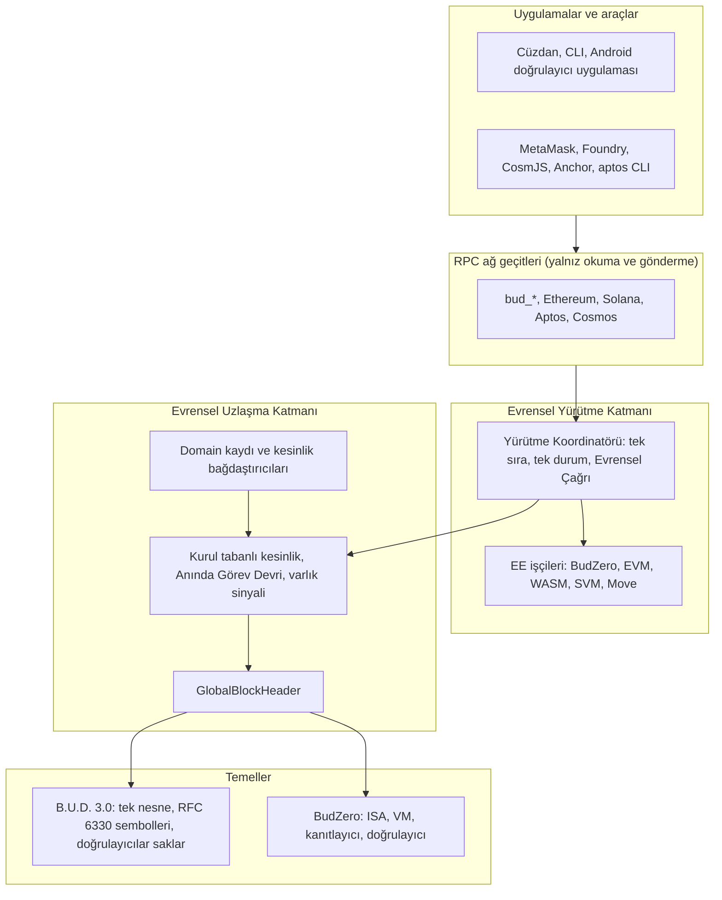

Budlum, veri egemenliğine ve toplumsal yeşermeye odaklanmış, internetin bir sonraki katmanıdır.

Budlum, konsensüslerin konsensüsüdür.

Her ağ kendi kurallarını korur. Budlum, bu ağların kesinliğini tek bir kanıtta birleştirir.

PoW, PoS, PoA, BFT ve ZK alanlarının her biri kendi konsensüsünü korur; Budlum bu alanların
kesinlik kanıtlarını doğrular ve alanlar arası değer transferini tek bir `GlobalBlockHeader`
üzerinde kriptografik bir olgu olarak kaydeder. Veri, anahtar ve hesaplama egemenliği
katılımcılarda kalır: katman, bir olguyu hangi konsensüsün ürettiğini değil, o olgu için
hangi kesinlik kanıtının geçerli olduğunu sorar. Böylece değer, bir aracıya güvenmeden
alanlar arasında hareket eder.

[](https://github.com/budlum-xyz/budlum/actions/workflows/ci.yml?query=branch%3Amain+event%3Apush)
[](https://github.com/budlum-xyz/budlum/actions/workflows/ci.yml?query=branch%3Amain+event%3Apush)
[](rust-toolchain.toml)
[](LICENSE.md)

[Testnet](docs/TESTNET.md) · [Mimari](docs/ARCHITECTURE.md) · [Belirtim](docs/SPECIFICATION.md) · [Güvenlik](docs/SECURITY.md) · [Katkı](docs/CONTRIBUTING.md) · [Web sitesi](https://github.com/budlum-xyz/budlum.com) · [English](README.md)

---

> [!WARNING]
> **Budlum testneti herkese açıktır. Budlum bir ana ağ başlatmadı ve dış denetimden geçmedi.**
> Testnet BUD'unun parasal değeri yoktur. Kritik bir olaydan sonra testnet yeni bir genesis ile
> yeniden başlayabilir. Neyin çalıştığını, neyin testnette bilerek kapalı olduğunu ve neyin
> iddia edilmediğini [Proje durumu](#proje-durumu) bölümünde görebilirsiniz.

---

## İçindekiler

- [Budlum nedir](#budlum-nedir)
- [Bir bakışta testnet](#bir-bakışta-testnet)
- [Testnete katılın](#testnete-katılın)
- [Nasıl çalışır](#nasıl-çalışır)
- [Doğrulayıcı sınıfları](#doğrulayıcı-sınıfları)
- [Testnette özelliklerin durumu](#testnette-özelliklerin-durumu)
- [Testnet provasında ölçülenler](#testnet-provasında-ölçülenler)
- [Depo yerleşimi](#depo-yerleşimi)
- [Kaynaktan derleme](#kaynaktan-derleme)
- [JSON-RPC ve uyumluluk ağ geçitleri](#json-rpc-ve-uyumluluk-ağ-geçitleri)
- [Mühendislik standartları](#mühendislik-standartları)
- [Güvenlik](#güvenlik)
- [Proje durumu](#proje-durumu)
- [Belgeler](#belgeler)
- [Katkı](#katkı)
- [Lisans](#lisans)

---

## Budlum nedir

Budlum, birçok ağ için tek bir uzlaşma katmanıdır. Budlum, zincirler arasında sarılı kopya
taşıyan bir köprü değildir. Budlum dört şeyi tek yerde birleştirir:

| Katman | Neyi birleştirir | Nasıl |
| --- | --- | --- |
| **Konsensüs** | PoW, PoS, PoA, BFT ve ZK alanları | Her alan kendi konsensüsünü korur. Budlum alanın kesinlik kanıtını doğrular ve olguyu tek bir `GlobalBlockHeader` üzerine yazar. |
| **Yürütme** | EVM, CosmWasm, SVM, Move ve BudZero için yazılmış programlar | Her program kendi özgün bayt koduyla kendi yürütme ortamında çalışır. Bütün ortamlar tek bir durumu paylaşır ve tek bir işlemde birbirini atomik olarak çağırır. |
| **Varlıklar** | Her ortamın tokenları ve NFT'leri | Bir varlık yalnızca kendi ev ortamında yaşar. Diğer ortamlar ona bakiye tutmayan işaretçilerle ulaşır. Bu nedenle sarılı kopya yoktur. BUD her ortamda yereldir. |
| **Depolama** | Ağın bütün içeriği | B.U.D. 3.0 tek depolama sistemidir. İçeriği doğrulayıcıların kendisi saklar. Android telefonda çalışan doğrulayıcılar da saklar. |

**Veri egemenliği değişmezi.** Ağın hiçbir kritik işlevi Budlum ekibinin işlettiği bir hizmete
bağlı değildir. Test paketi ve CI kapıları bu özelliği zorlar. Yönetici yolu açan bir PR bu
kapılardan geçemez.

---

## Bir bakışta testnet

| Öğe | Değer |
| --- | --- |
| Zincir kimliği | `45261` |
| Ağ kimliği | `BDLT` |
| Slot / dönem / denetim noktası | 3 sn / 50 slot / her 5 blok |
| Kesinlik | En fazla 128 koltuklu kurul, BLS12-381 toplam imza ve ML-DSA-65 |
| Genesis | henüz belirlenmedi; genesis töreni özeti ve UTC zamanını yazar |
| Sürüm | henüz sürüm yayımlanmadı; tören `v1.0.0-testnet` sürümünü keser |
| Budlum RPC | `https://rpc.testnet.invalid` |
| Ethereum JSON-RPC | `https://evm.testnet.invalid` (zincir kimliği `45261`) |
| Solana JSON-RPC | `https://solana.testnet.invalid` |
| Aptos REST | `https://aptos.testnet.invalid/v1` (zincir kimliği `205`) |
| Cosmos RPC / REST | `https://cosmos-rpc.testnet.invalid`, `https://cosmos-rest.testnet.invalid` (zincir kimliği `budlum-testnet-1`, önek `bud`, birim `ubud`) |
| Musluk | `https://faucet.testnet.invalid` (adres başına günde 100 BUD) |
| Gezgin | `https://explorer.testnet.invalid` |

Testnet alan adı bir ekip kararıdır ve henüz kayıtlı değildir. Yukarıdaki uç noktalar onun yerine
ayrılmış `testnet.invalid` yer tutucusunu kullanır.

---

## Testnete katılın

### 1. Cüzdan oluşturun ve testnet BUD'u alın

```bash
bud wallet create --key-file ./secrets/wallet.json        # ML-DSA-87, 24 kelime
bud faucet request --address <adresiniz>                 # musluğun hesap işini çözer
```

Android uygulaması bu iki adımı kendi arayüzünde yapar.

### 2. Android telefonda doğrulayıcı olun

Gereksinimler: Android 10 veya üstü, arm64, en az 4 GB RAM, seçtiğiniz saklama kotası ve
ek olarak 2 GB boş alan.

1. Uygulamayı kurun: APK [GitHub sürümüne](https://github.com/budlum-xyz/budlum/releases) eklenir ve Play iç test kanalı testnetle açılır.
2. Cüzdanınızı oluşturun veya içe aktarın. Uygulama içinden musluktan BUD isteyin.
3. Bir saklama kotası (1 GiB ile 64 GiB, varsayılan 4 GiB) ve bir politika seçin (varsayılan:
   yalnız Wi-Fi, şarjda veya pil yüzde 50 üstü).
4. Kaydı onaylayın. Stake 10 BUD'dur.
5. Uygulama içerik parçaları saklar, saklama denetimlerine cevap verir, parçaları okuyuculara
   sunar, varlık sinyali imzalar ve zinciri hafif istemci olarak doğrular. Saklama ödülü alır.

Telefonunuz içerik parçaları saklar. Tek bir parça hiçbir içeriği açmaz. Genel içerik herkese
açıktır. Mühürlü içerik şifrelidir ve telefonunuz onun anahtarını hiç tutmaz. Her an
ayrılabilirsiniz: ağ görevlerinizi kayıpsız olarak sıradaki doğrulayıcıya geçirir. Uygulamadaki
"Ayrıl" seçeneği parçalarınızı bırakır ve stake çözmeyi başlatır. Ayrıntı:
[docs/MOBILE_VALIDATOR.md](docs/MOBILE_VALIDATOR.md).

### 3. Tam doğrulayıcı çalıştırın

Gereksinimler (testnet varsayılanı): 8 çekirdek, 32 GB RAM, 1 TB NVMe, 100 Mbit/s simetrik.

```bash
budlum-core --config config/testnet.toml                  # düğümü eşitleyin
bud validator register --class full --stake 1000 --signing-chain-id 45261
bud validator status
```

Tam doğrulayıcı blok önerir, bütün yürütme ortamlarını çalıştırır, kesinlik koltuğu tutar,
içerik saklar, içerik onarır ve isteğe bağlı olarak röle ve yükleme ağ geçidi hizmeti verir.
Anahtar yönetimi, HSM kurulumu ve işletmeci kontrol listesi:
[docs/VALIDATOR_GUIDE.md](docs/VALIDATOR_GUIDE.md).

İmza atan her komut `--signing-chain-id` alır (testnet için `45261`). Varsayılan değeri yoktur.
Düğümün `bud_chainId` cevabı yalnızca bu değerle karşılaştırılır. Çünkü bir tohum her ağda
aynı adresi kontrol eder.

### 4. Zaten kullandığınız araçları kullanın

| Ekosistem | Bağlantı | Değişmeden çalışan |
| --- | --- | --- |
| EVM | MetaMask'e ağ ekleyin: RPC `https://evm.testnet.invalid`, zincir kimliği `45261`, simge `BUD` | Solidity ve Vyper bayt kodu, Foundry, Hardhat, viem, ethers, MetaMask |
| CosmWasm | CosmJS `SigningCosmWasmClient`, adres `https://cosmos-rpc.testnet.invalid` | Kayan nokta kullanmayan CosmWasm bayt kodu, cw-plus sözleşmeleri, CosmJS |
| SVM | `solana config set --url https://solana.testnet.invalid` | Program bayt kodu, Anchor, `@solana/web3.js`, solana CLI |
| Move | `aptos init --network custom --rest-url https://aptos.testnet.invalid/v1` | Move modülleri, aptos CLI, Aptos TypeScript SDK |
| BudZero | `bud exec budzero deploy` | BudL programları, `bud-cli` |

```bash
forge create --rpc-url https://evm.testnet.invalid --private-key $KEY src/Token.sol:Token
```

Değişen tek şey RPC adresi ve zincir kimliğidir. Ağ değiştirmek zaten budur. "Değişmeden"
iddiasının tam sınırları [docs/EXECUTION_LIMITS.md](docs/EXECUTION_LIMITS.md) dosyasındadır.
Bir EVM sözleşmesi aynı işlemde bir CosmWasm sözleşmesini çağırabilir ve sonuç atomiktir.
Bakınız [docs/EXECUTION.md](docs/EXECUTION.md). Var olan bir EVM sözleşmesi Göç Kiti (beta) ile
aynı adres, kod ve depolamayla Budlum'a taşınabilir: [docs/MIGRATION.md](docs/MIGRATION.md).

secp256k1 veya Ed25519 anahtarıyla imzalanan hesaplar *klasik* olarak etiketlenir. Bu hesaplar
yalnızca kendi varlıklarını hareket ettirir ve kuantum güvenli bir hesaba hiç dokunamaz.
`bud adopt` komutu bu varlıkları tek adımda kuantum güvenli bir hesaba taşır.

### 5. B.U.D. 3.0 üzerinde içerik saklayın

```bash
bud storage upload ./makale.pdf --lifetime 365d           # genel içerik
bud storage upload ./gunluk.txt --sealed --lifetime 365d  # mühürlü: cihazınızda şifrelenir
bud storage view <içerik-kimliği> --out ./makale.pdf
bud storage grant <nft-kimliği> --to <adres>              # mühürlü içerik için okuma izni
```

Ücret yalnızca fiziksel bayta bağlıdır: testnet varsayılanında yılda GiB başına 1 BUD.
Bakınız [docs/STORAGE.md](docs/STORAGE.md).

---

## Nasıl çalışır



### Evrensel Uzlaşma Katmanı

Bloklar PoS lider turlarıyla üretilir. Kesinlik, Tam doğrulayıcıların tuttuğu en fazla 128
koltuklu bir kuruldan gelir. Etkin koltukların üçte ikisinden fazlası imzalayınca denetim
noktası kesinleşir. Hiçbir doğrulayıcı koltukların dörtte birinden fazlasını tutmaz. Bir Tam
doğrulayıcı durursa koltukları üç denetim noktası aralığı içinde sıralı yedeklere geçer. Koltuk
tablosu yalnızca kesinleşmiş bloklardan türetilir. Bu nedenle iki çatal farklı tablo kuramaz.

**Anında Görev Devri.** Her görevin bir tetiği, bir halefi ve bir zaman sınırı vardır: kaçırılan
slot sonraki turun liderine geçer, sessiz koltuk yedeğine geçer, sessiz pay sahibinin yerini
okuma için hemen başka bir pay sahibi, dayanıklılık için onarım alır, 20 blokta başlamayan
onarım görevi sıradaki adaya geçer. Hiçbir görev bir insanı veya bir oylamayı beklemez.
Çevrimdışı olmak hiçbir zaman kesinti sebebi değildir. Uzun görünmeme yalnızca askıya alma
üretir.

### B.U.D. 3.0

B.U.D. 3.0 tek depolama sistemidir. Bir yükleme tek bir B.U.D. 3.0 nesnesine dönüşür: içeriğin
en kısa tam temsili. Nesne segmentlere bölünür. Her segment RFC 6330 (RaptorQ) ile sembollere
kodlanır. Herhangi `k + 2` sembol bir segmenti yeniden kurar. Semboller sınıf duyarlı geniş
şeritli yerleşimle Tam ve Mobil doğrulayıcılara dağılır. Sembollerin en az yüzde 30'u Mobil
doğrulayıcılardadır. Hiçbir doğrulayıcı bir nesnenin tamamını tutmaz. Pay sahipleri saklama
denetimlerine alt blok kanıtlarıyla cevap verir. Kaçırılan denetim ödül kaybettirir. Onarım,
kaybolan payları tembel olarak yeniden kurar. Mühürlü içerik sahibin cihazında şifrelenir ve
doldurulur. Boyu, kimliği ve okuyucuları zincirde görünmez. Aynı nesne bir QR video olarak
gösterilebilir ve kamerayla geri okunabilir. QR video bir gösterimdir, hiçbir zaman saklanan
bir kayıt değildir.

### Evrensel Yürütme Katmanı

Her yürütme ortamı kendi işçi sürecinde çalışır. Bu nedenle bir motor paniği zinciri
durdurmaz, bir hata makbuzu üretir. Tek bir koordinatör işlemleri sıralar, gazı tek birimle
(BGU) ölçer, tek bir durum ve tek bir BUD defteri tutar ve her Evrensel Çağrı için bir çerçeve
açar. Bir işlem ortamlar arasında çağrı yapabilir: ya bütün çağrılar uygulanır ya hiçbiri.
Varlıklar yalnızca ev ortamında yaşar. İşaretçi sözleşmeleri onları başka ortamlarda kendi
bakiyesi olmadan sunar.

### BudZero

BudZero, Budlum'un sıfır bilgi sanal makinesidir: belirlenimci bir ISA, gaz ölçümlü bir VM,
bir derleyici ve Plonky3 STARK kanıtlayıcı ve doğrulayıcı. Testnette BudZero programları
yürütme kipinde çalıştırır. Her Tam doğrulayıcı programları yeniden yürütür. Kanıta dayanan
özellikler, sağlamlık işleri bitene kadar testnette kapalıdır. Bakınız
[budzero/ARCHITECTURE.md](budzero/ARCHITECTURE.md).

---

## Doğrulayıcı sınıfları

| | Tam doğrulayıcı | Mobil doğrulayıcı (Android) | Mobil doğrulayıcı (iOS, fırsatçı) |
| --- | --- | --- | --- |
| Donanım | Sunucu veya masaüstü | Android 10+, arm64, 4 GB RAM | iPhone, iOS 17+ |
| Stake | 1.000 BUD | 10 BUD | 10 BUD |
| Blok önerir, bütün ortamları çalıştırır | Evet | Hayır | Hayır |
| Kesinlik koltuğu | Evet | Hayır | Hayır |
| B.U.D. 3.0 payı saklar | Evet | Evet (kullanıcı kotası) | Evet (en fazla 8 GiB) |
| Denetim cevap penceresi | 2 dönem | 24 saat | 48 saat |
| Onarım, röle, yükleme ağ geçidi | Evet (röle ve ağ geçidi isteğe bağlı) | Hayır | Hayır |
| Askıya alma | 1 gün çevrimdışı | 72 saat çevrimdışı | 7 gün çevrimdışı |
| Kesinti sebebi | Çift imza, kanıtlı hatalı onarım | Varlık sinyalinde çift imza | Varlık sinyalinde çift imza |
| Testnette durum | Açık | Açık | Beta |

Mobil doğrulayıcılar kesinlik oyu vermez. Bu nedenle hepsi aynı anda ayrılsa da kesinlik
durmaz. Mobil doğrulayıcılar içerik saklar ve saklama ödülü alır.

---

## Testnette özelliklerin durumu

| Özellik | Testnet |
| --- | --- |
| PoS blok üretimi, kurul tabanlı kesinlik, Anında Görev Devri | Açık |
| Tam doğrulayıcılar, Android Mobil doğrulayıcılar | Açık |
| iOS fırsatçı doğrulayıcılar | Beta |
| B.U.D. 3.0 genel ve mühürlü içerik | Açık |
| EVM, WASM (CosmWasm ABI), SVM, Move (Aptos lehçesi), BudZero ortamları | Açık |
| Ortamlar arası Evrensel Çağrı, EVM ve WASM işaretçileriyle varlık kaydı | Açık |
| Ethereum, Solana, Aptos ve Cosmos uyumlu RPC | Açık |
| EVM sözleşmeleri için Göç Kiti | Beta |
| Konsensüs domain kaydı (PoW, PoS, PoA, BFT, ZK) | Açık |
| Kilitle, bas, yak, aç aktarımları | Closed |
| Zincir üstü AI çıkarım katmanı | Closed |
| BNS adları, SocialFi, Veri Pazarı, gezgin, musluk | Açık |
| Gizli transferler, AI yürütme kanıtları, sahipler arası gizli tekilleştirme, canlı yayın, paylaşılan güvenlik, Uzak Uygulama Bağı, Evrensel Nesne Katmanı | Testnette kapalı |

Kapalı bir özellik kodda vardır ve `45261` zincir kimliğinde reddedilir. Bir test bu reddi
kanıtlar. Her kapalı özellik daha sonra duyurulan bir etkinleşme yüksekliğinde açılır.

---

## Testnet provasında ölçülenler

Aşağıdaki her sayı [docs/rehearsal/RESULTS.md](docs/rehearsal/RESULTS.md) dosyasından veya bir
CI işinden gelir. Hiçbiri yerel bir tahmin değildir. Prova henüz koşmadı, bu nedenle her satır `not measured yet`
yazar.

| Ölçüm | Değer |
| --- | --- |
| Prova | not measured yet Tam doğrulayıcı, not measured yet Android telefon, not measured yet benzetimli Mobil doğrulayıcı, not measured yet saat |
| Kesinlik gecikmesi, ortanca ve p95 | not measured yet, not measured yet |
| Bütün Mobil doğrulayıcılar aynı anda durdu | Kesinlik gecikmesi değişimi: not measured yet; kaybolan nesne: not measured yet |
| Tam doğrulayıcıların yüzde 10'u aynı anda durdu | Ek kesinlik gecikmesi: not measured yet denetim noktası |
| Android telefon, varsayılan politika | Günlük pil: not measured yet; günlük veri: not measured yet |
| Mobil bağlantı | Doğrudan not measured yet, delik açma not measured yet, röle not measured yet |
| Depolama fazlalığı | not measured yet |
| Tam doğrulayıcı kaynakları | CPU not measured yet, RAM not measured yet, günlük disk büyümesi not measured yet |

---

## Depo yerleşimi

| Yol | Görev |
| --- | --- |
| [`src/consensus/`](src/consensus) | PoS, PoW, PoA, BFT motorları, kurul, lider seçimi |
| [`src/validators/`](src/validators) | Doğrulayıcı sınıfları, görevler, varlık sinyali, Anında Görev Devri |
| [`src/chain/`](src/chain) | Blok zinciri, kesinlik, genesis, anlık görüntüler, durum kurtarma |
| [`src/storage/bud3/`](src/storage/bud3) | B.U.D. 3.0 |
| [`src/execution/`](src/execution) | Yürütme Koordinatörü ve BudZero ortam bağdaştırıcısı |
| [`execution/`](execution) | Yürütme ortamı işçileri (EVM, WASM, SVM, Move) ve uygunluk paketleri |
| [`src/rpc/`](src/rpc) | `bud_*` RPC ve uyumluluk ağ geçitleri |
| [`src/domain/`](src/domain), [`src/cross_domain/`](src/cross_domain), [`src/settlement/`](src/settlement) | Domain kaydı, kesinlik bağdaştırıcıları, alanlar arası iletiler, `GlobalBlockHeader` |
| [`src/network/`](src/network) | Röle, delik açma ve AutoNAT ile libp2p yığını |
| [`src/persistence/`](src/persistence) | Düğümün anahtar-değer deposu ve durum ağacı |
| [`mobile/`](mobile) | Mobil çekirdek (Rust, UniFFI), Android uygulaması, iOS uygulaması |
| [`budzero/`](budzero) | BudZero çalışma alanı: ISA, VM, derleyici, kanıtlayıcı, doğrulayıcı |
| [`crates/`](crates) | `bud-codec`, `uel-abi`, `budlum-types`, `wallet-core`, `budlum-explorer` ve diğerleri |
| [`contracts/`](contracts) | Solidity sözleşmeleri: dış domain doğrulayıcısı, Evrensel Çağrı kütüphanesi |
| [`xtask/`](xtask), [`fuzz/`](fuzz), [`kani/`](kani), [`benches/`](benches) | CI kapıları, fuzz hedefleri, model denetimi, karşılaştırma testleri |
| [`config/`](config), [`ops/`](ops), [`proto/`](proto), [`docs/`](docs) | Profiller ve genesis, işletim, tel şemaları, belgeler |

---

## Kaynaktan derleme

Ön koşullar: Rust 1.97.1 ([`rust-toolchain.toml`](rust-toolchain.toml) içinde
sabitlenir), `protoc`. İsteğe bağlı: Nix (`nix develop`).

```bash
git clone https://github.com/budlum-xyz/budlum.git
cd budlum
cargo build --release                                   # düğüm
cargo test --lib                                        # çekirdek testleri
cargo test --manifest-path budzero/Cargo.toml --workspace
cargo run --manifest-path xtask/tools/Cargo.toml -- pre-push   # CI'ın çalıştırdığı denetimler
```

Yürütme işçileri `execution/` altında ayrı çalışma alanlarıdır. Düğüm, ikilisinin yanında
bulduğu işçileri başlatır. Sürüm derlemeleri hepsini içerir.

Yerel ağlar:

```bash
cargo run --release -- --network devnet                 # tek düğüm
docker compose -f ops/docker-compose.yml up             # Prometheus ile dört düğüm
```

---

## JSON-RPC ve uyumluluk ağ geçitleri

Düğüm `bud_` JSON-RPC'yi iki dinleyicide sunar: genel dinleyici (okuma ve imzalı işlem
gönderme, anahtar gerekmez) ve yerel adrese bağlı işletmeci dinleyicisi (düğüm yönetimi,
anahtar gerekir). Uyumluluk ağ geçitleri Ethereum JSON-RPC, Solana JSON-RPC, Aptos REST ve
Cosmos RPC alt kümelerini sunar. Ağ geçitleri yalnızca durumu okur ve imzalı işlemi havuza
verir. Her yöntemin dinleyicisi ve etkisi, ağ geçidi başına tek bir tabloda yazılıdır.

```bash
curl -s -X POST https://rpc.testnet.invalid \
  -H 'Content-Type: application/json' \
  -d '{"jsonrpc":"2.0","id":1,"method":"bud_getStatus","params":[]}'
```

Tam yöntem listeleri [docs/SPECIFICATION.md](docs/SPECIFICATION.md) dosyasındadır.

---

## Mühendislik standartları

CI, projenin güven yerine kullandığı mekanizmadır.

- **`fmt` ve `clippy -D warnings`** sabitlenmiş araç zinciriyle. Uyarı sayısı yalnızca düşebilir.
- **Belirlenimcilik.** Aynı blok x86_64 ve aarch64'te aynı durum kökünü ve yürütme kökünü verir.
  Konsensüs yolunda kayan nokta ve sırasız koleksiyon yoktur.
- **Yalıtım.** Yürütme motorları ayrı işçi süreçlerinde çalışır. Panik bir makbuzdur, durma
  değildir.
- **Rozetler yalan söyleyemez.** Her rozet, adını verdiği dosyaya veya işe karşı denetlenir.
- **Tanım kaymaz.** Bir kapı bu dosyanın başındaki tanım bloğunu bayt bayt denetler.
- **İddia kod ister.** Burada çalışır diye yazılan her özelliğin bir üretim çağrı yeri ve bir
  testi vardır. Yoksa README kapısı kırmızıdır.
- **Biçimsel yöntemler ve fuzz.** Kani aritmetik değişmezleri denetler. Her ayrıştırıcının bir
  fuzz hedefi vardır. Miri test paketini tanımsız davranış denetimiyle çalıştırır.
- **Tedarik zinciri.** Her çalışma alanı için `cargo-deny`, `cargo-audit`, `cargo-vet`,
  `osv-scanner`, Grype, SBOM, `zizmor` ve `actionlint`.

İki kural geri kalanı anlamlı kılar: hiçbir kapı boş olamaz (her kapı gerçek bir ihlal enjekte
eden bir öz test taşır) ve hiçbir kapı sahipsiz kalamaz (hiçbir iş akışının çalıştırmadığı kapı
derlemeyi kırar). `#[allow(...)]`, `#[ignore]`, `|| true` ve taban şişirme düzeltme olarak
kabul edilmez.

---

## Güvenlik

Açıkları **gizli olarak** bildirin: bakınız [SECURITY.md](docs/SECURITY.md). Konsensüs güvenliği,
yürütme belirlenimciliği, ağ, depolama bütünlüğü, kriptografi veya anahtar yönetimini etkileyen
hiçbir konu için herkese açık kayıt açmayın.

Testnet açılış kapısı, her kritik ve yüksek bulgunun kapanmasını veya özelliğinin testnette
bir testle kapalı olmasını ister. Kayıt [docs/audit/FINDINGS.md](docs/audit/FINDINGS.md)
dosyasıdır. Açılış kanıtı [docs/audit/TLG_REPORT.md](docs/audit/TLG_REPORT.md) dosyasıdır.

**Dış güvenlik denetimi yapılmadı.** Bu depoda bunun aksini söyleyen bir iddia yoktur.

---

## Proje durumu

**Testnette çalışan:** BLS12-381 ve ML-DSA-65 ile kurul tabanlı kesinlik; Tam ve Android Mobil
doğrulayıcılar; Anında Görev Devri; tek depolama sistemi olarak B.U.D. 3.0; atomik Evrensel
Çağrılarla EVM, WASM (CosmWasm ABI), SVM, Move (Aptos lehçesi) ve BudZero ortamları; Ethereum,
Solana, Aptos ve Cosmos uyumlu RPC; konsensüs domain kaydı; BNS, SocialFi, Veri Pazarı; gezgin
ve musluk.

**Testnette bilerek kapalı olan, her biri bir testle sabitlenen:** gizli transferler, AI
yürütme kanıtları, BudZero'nun kanıta dayanan opkodları, sahipler arası gizli tekilleştirme,
canlı yayın, paylaşılan güvenlik, Uzak Uygulama Bağı, Evrensel Nesne Katmanı.

**İddia edilmeyen:** dış güvenlik denetimi; başlatılmış bir ana ağ; mobil doğrulayıcıların
kesinlik oyu; testnette sıfır bilgi gizliliği; iOS'ta kalıcı arka plan çalışması.

---

## Belgeler

| Belge | Kapsamı |
| --- | --- |
| [TESTNET.md](docs/TESTNET.md) | Uç noktalar, parametreler, genesis, açılış ve yükseltme kuralları |
| [VALIDATOR_GUIDE.md](docs/VALIDATOR_GUIDE.md) | Tam doğrulayıcı çalıştırma |
| [MOBILE_VALIDATOR.md](docs/MOBILE_VALIDATOR.md) | Android veya iOS üzerinde doğrulayıcı çalıştırma |
| [STORAGE.md](docs/STORAGE.md), [STORAGE_ENCRYPTION.md](docs/STORAGE_ENCRYPTION.md) | B.U.D. 3.0 ve mühürlü içerik |
| [EXECUTION.md](docs/EXECUTION.md), [EXECUTION_LIMITS.md](docs/EXECUTION_LIMITS.md), [MIGRATION.md](docs/MIGRATION.md) | Yürütme ortamları, sınırları, Göç Kiti |
| [LIGHT_CLIENT.md](docs/LIGHT_CLIENT.md) | Hafif istemci güven modeli |
| [ARCHITECTURE.md](docs/ARCHITECTURE.md), [SPECIFICATION.md](docs/SPECIFICATION.md) | Diyagramlar ve protokol belirtimi |
| [OPERATIONS.md](docs/OPERATIONS.md), [VALIDATOR_ROLES.md](docs/VALIDATOR_ROLES.md) | Düğüm, röle ve ağ geçidi işletimi |
| [SECURITY.md](docs/SECURITY.md), [MAINNET_READINESS.md](docs/MAINNET_READINESS.md) | Bildirim politikası ve testnet ile ana ağ arasındaki kapılar |
| [NAMING.md](docs/NAMING.md) | Kodda kullanılan terimler |
| [budzero/ARCHITECTURE.md](budzero/ARCHITECTURE.md) | BudZero ISA, VM, kanıtlayıcı ve doğrulayıcı |

---

## Katkı

Önce [CONTRIBUTING.md](docs/CONTRIBUTING.md) dosyasını okuyun.

1. Göndermeden önce `cargo run --manifest-path xtask/tools/Cargo.toml -- pre-push` çalıştırın.
2. Yeni davranış, düzeltmeden önce kırmızı olduğu gözlenen bir testle gelir.
3. Değişikliğiniz bir CI kapısını kırmızı yaparsa bulgu kapının kendisidir. Nedeni düzeltin.

---

## Lisans

**PolyForm Shield License 1.0.0** ile lisanslanmıştır: bakınız [LICENSE.md](LICENSE.md).

PolyForm Shield, Budlum ile veya lisans verenin onu kullanarak sağladığı herhangi bir ürünle
**rekabet eden bir ürün sunmak dışında** her kullanıma izin verir. Kaynak kod okunabilir,
değiştirilebilir ve yeniden dağıtılabilir kalır. Yalnızca rakip ürünler hariç tutulur.

> Required Notice: Copyright budlum-xyz (https://github.com/budlum-xyz)
