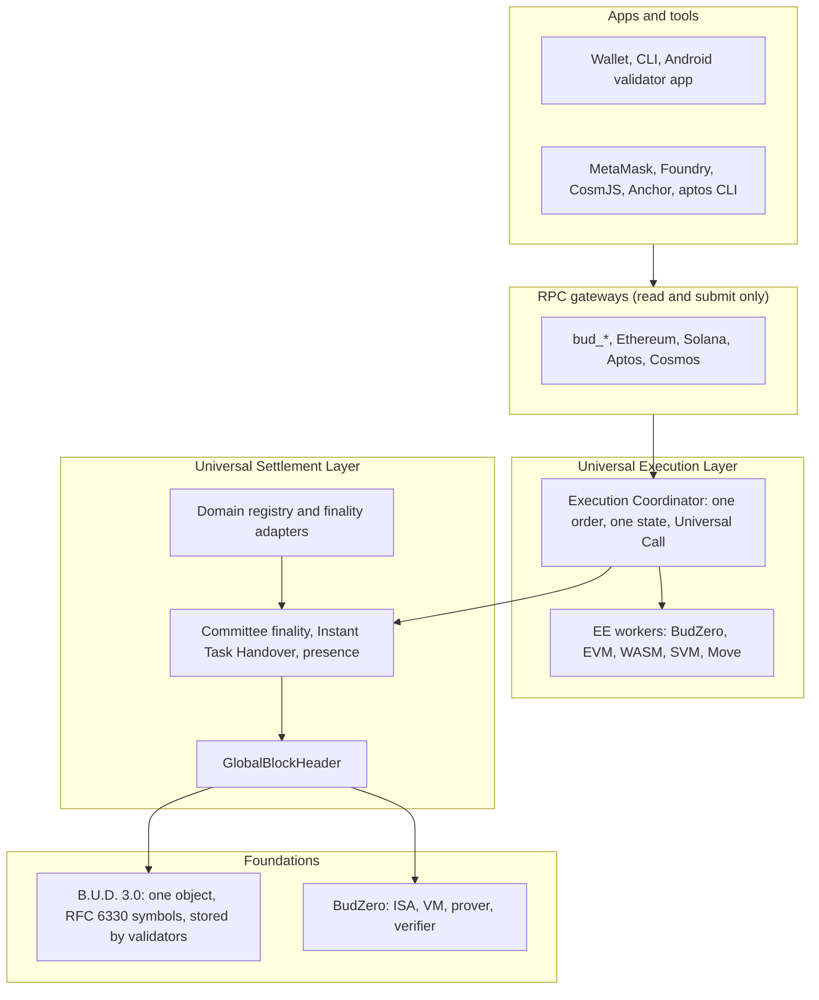
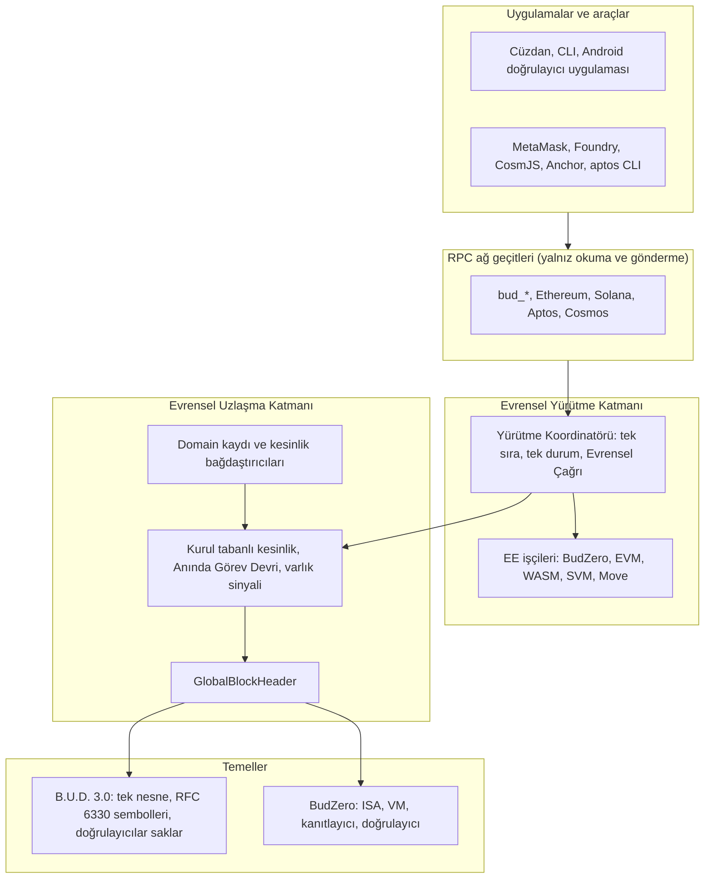

# THE BUDLUM DİREKTİF

| Alan | Değer |
|---|---|
| Belge | THE BUDLUM DİREKTİF |
| Sürüm | 1.0 |
| Tarih | 2026-11-04 |
| Hedef okur | Budlum kodlama ajanları (dört ajan) |
| Niteliği | Bağlayıcı. Tek yetkili direktif. |
| Analiz tabanı | `budlum-testnet-quantum.zip` anlık görüntüsü. Dosya tarihi 2026-11-02. 842 `.rs` dosyası. Yaklaşık 470 000 Rust satırı. |
| Yerine geçtiği belgeler | B.U.D. 3.0 Tek Tarif Direktifi (sürüm 2.5), Budlum Core Direktifi: Sera Mimarisi (SERA-D1), BudZero Gonca Direktifi (sürüm 1.0), Bulgu Defteri (`main` `c5b06799`) |
| Yazım kuralı | ASD-STE100 ilkeleri: kısa cümle, tek anlam, etken çatı, şimdiki zaman. Bu belgede uzun tire yoktur. |
| İş modeli | 64 iş paketi (İP-01 ile İP-64). Dört ajan. Her paketi tek ajan yürütür. Paket bitince ajan hemen sıradaki paketi alır (Bölüm 15). |
| Bulgu defteri | 267 bulgu (BLG-001 ile BLG-267) ve 44 arşiv kaydı (Bölüm 14) |
| Bitiş koşulu | Testnet Açılış Kapısının (TLG) bütün maddeleri yeşil (Bölüm 18) |

## İçindekiler

| Bölüm | Konu |
|---|---|
| 0 | Belge bilgisi ve okuma kuralları |
| 1 | Hedef ve testnet tanımı, yedi köklü değişiklik, testnet özellik matrisi |
| 2 | Terim politikası ve yeniden adlandırma |
| 3 | Değişmezler |
| 4 | Hedef mimari ve depo yerleşimi |
| 5 | Kaldırma planı: B.U.D. 3.0 dışındaki depolama sistemleri |
| 6 | B.U.D. 3.0: tek depolama sistemi |
| 7 | Doğrulayıcı ağı: sınıflar, Android mobil doğrulayıcı, Anında Görev Devri |
| 8 | Evrensel Yürütme Katmanı (UEL): çok dilli yürütme |
| 9 | Evrensel Nesne Katmanı (UOL) |
| 10 | BudZero: güvenlik, gizlilik ve doğrulama paketi |
| 11 | Ekonomi |
| 12 | Çekirdek sertleştirme |
| 13 | Pre-mortem |
| 14 | Birleşik bulgu defteri |
| 15 | İş paketleri ve dört ajan modeli |
| 16 | Testler ve CI kapıları |
| 17 | Testnet açılış planı |
| 18 | Testnet Açılış Kapısı (TLG) |
| 19 | Kararlar |
| 20 | Kaynaklar |
| Ek A | `README.md` hedef metni |
| Ek B | `README.tr.md` hedef metni |
| Ek C | Kavram adı haritası (`config/naming/concept_map.toml`) |
| Ek D | Ar-Ge kaydı |

---

## 0. Belge bilgisi ve okuma kuralları

### 0.1 Konum

1. Bu belge Budlum için tek yetkili direktiftir.
2. Bu belge dört eski belgenin yerine geçer: B.U.D. 3.0 Tek Tarif Direktifi, SERA-D1, BudZero Gonca Direktifi ve Bulgu Defteri.
3. Eski belgeler yalnızca kaynak kaydıdır. Eski belge ile bu belge çelişirse bu belge geçerlidir.
4. Eski belgelerdeki her bağlayıcı kural bu belgeye taşındı. Taşınmayan kural geçersizdir.
5. Bu belge depoya girmez. Depo İngilizcedir (`tree_is_english` kapısı). Ajan bu belgeden İngilizce depo belgeleri üretir (Bölüm 15, İP-43).
6. Koddaki bütün yeni adlar İngilizcedir. Bu belgedeki Türkçe terimlerin kod adları Bölüm 2'dedir.

### 0.2 Bağlayıcılık

1. Bölüm 0 ile Bölüm 19 arası bağlayıcıdır.
2. Ek A ve Ek B, README dosyalarının hedef metnidir. Bağlayıcıdır.
3. Ek C, kavram adı haritasıdır. Bağlayıcıdır.
4. Ek D bir Ar-Ge kaydıdır. Bağlayıcı değildir. Ajan Ek D'deki hiçbir yapıyı, Bölüm 19'a karar olarak yazılmadan uygulamaz.

### 0.3 Ajanın davranışı

1. Ajan bir maddeyi atlamaz, yumuşatmaz ve ertelemez.
2. Ajan yalnızca dört durumda durur: mimari çelişki, ekonomik karar ihtiyacı, çelişen gereksinim, somut kapsam çatışması.
3. Bu belge mimari ve ekonomik kararların hepsini verir (Bölüm 11 ve Bölüm 19). Bu nedenle bu konularda durma meşru değildir.
4. Ajan durursa, durma raporu yazar. Rapor şu alanları taşır: çelişen iki madde, kanıt (dosya, satır, test çıktısı), önerilen çözüm.
5. Ajan "tamamlandı" demek için commit SHA ve CI çalıştırma numarası verir. Kendi beyanı kanıt değildir.

### 0.4 Canlı durum kuralı

1. Dosya ve satır atıfları analiz tabanına aittir.
2. Ajan işe başlamadan önce canlı dalı doğrular. Satır kaymışsa atfı içerikle bulur.
3. Bellekteki veya bu belgedeki durum varsayılmaz. Dal, commit, CI ve PR durumu her seferinde canlı doğrulanır.
4. Bulgu Defteri `main` `c5b06799` üzerinde yazıldı. Analiz tabanı `testnet-quantum` dalının anlık görüntüsüdür. Bu dal birçok düzeltme içerir. Örnek: BLG-001, BLG-006, BLG-019, BLG-029 ve BLG-030 için düzeltme izi vardır. Bu nedenle her bulgunun durumu İP-01 ile İP-04 arasında yeniden doğrulanır (Bölüm 14.1).

### 0.5 Ölçü kuralı

1. Ölçülmemiş sayı README'ye ve belgeye yazılmaz.
2. Bu belgedeki "TESTNET-DEFAULT" etiketli değerler başlangıç parametresidir. Ölçüm gelince yönetişim değeri değiştirir.
3. Bu belgedeki hesap tabloları hesaptır, ölçüm değildir. Tablo başlığı bunu yazar.

---

## 1. Hedef ve testnet tanımı

### 1.1 Budlum'un tanımı

Budlum'un tanımı değişmez. README'deki tanım bloğu aynen korunur (Ek A ve Ek B). Tanımın özü şudur:

1. Budlum, veri egemenliğine ve toplumsal yeşermeye odaklanmış, internetin bir sonraki katmanıdır.
2. Budlum, konsensüslerin konsensüsüdür.
3. Her ağ kendi kurallarını korur. Budlum, bu ağların kesinliğini tek bir kanıtta birleştirir.

Budlum kendisini köprü olarak tanımlamaz. Budlum, blokzincirdeki bütün yapıları tek yerde birleştiren katmandır. Bu direktif o yapıyı kurar.

### 1.2 Yedi köklü değişiklik

| No | Değişiklik | Bu belgedeki yeri |
|---|---|---|
| KD-1 | B.U.D. 3.0, Budlum'un tek depolama sistemidir. Diğer depolama sistemleri depodan kaldırılır. B.U.D. 3.0 sertleştirilir ve testnete hazır hale gelir. | Bölüm 5, Bölüm 6 |
| KD-1.5 | Herkes doğrulayıcı olabilir. Bir Android telefon da doğrulayıcıdır. Bir doğrulayıcı her an ayrılabilir. Anında Görev Devri sistemi, ayrılmayı zararsız kılar. İçeriği saklayan, doğrulayıcıdır. | Bölüm 7 |
| KD-2 | README ve README.tr testnet adımlarını yazar. Metin bu direktifin sonundaki duruma göre yeniden yazılır. Tanım bloğu değişmez. | Ek A, Ek B, İP-43 |
| KD-3 | Pre-mortem yapılır. Bütün bulgular tek defterde toplanır. Her iş bir iş paketidir. Dört ajan paralel çalışır. | Bölüm 13, Bölüm 14, Bölüm 15 |
| KD-4 | Evrensel Yürütme Katmanı kurulur. Farklı dillerde yazılmış uygulamalar Budlum'da değişmeden çalışır ve birbirini çağırır. | Bölüm 8 |
| KD-5 | Ekonomik ve diğer bütün kararlar bu belgede verilir. | Bölüm 11, Bölüm 19 |
| KD-6 | Kavram adları kaldırılır. BudZero ve B.U.D. dışındaki her mimari adı profesyonel bir terimdir. | Bölüm 2, Ek C |
| KD-7 | Budlum, konsensüsleri, yürütme ortamlarını, varlıkları ve depolamayı tek yerde birleştirir. Bu sistem baştan sona kurulur. | Bölüm 4, Bölüm 8, Bölüm 9 |

### 1.3 Testnet'e hazır tanımı

"Budlum testnete hazırdır" cümlesi yalnızca Testnet Açılış Kapısı (TLG) geçince kurulur. TLG'nin tam listesi Bölüm 18'dedir. Özeti şudur:

1. Bütün Kritik ve Yüksek bulgular kapalıdır. Kapanmayan bulgunun özelliği testnette kapalıdır ve kapalı olduğu bir testle kanıtlanır.
2. B.U.D. 3.0 tek depolama sistemidir. Eski depolama kodu depoda yoktur.
3. Android telefon, gerçek bir testnet provasında doğrulayıcı olarak çalışır: içerik saklar, denetime cevap verir, sembol sunar, ödül alır.
4. Prova sırasında mobil doğrulayıcıların tamamı aniden ayrılır. Kesinlik durmaz. Hiçbir içerik kaybolmaz.
5. Prova sırasında Tam doğrulayıcıların yüzde 10'u aniden ayrılır. Kesinlik en fazla iki denetim noktası gecikir.
6. EVM, WASM (CosmWasm ABI), SVM, Move (Aptos lehçesi) ve BudZero yürütme ortamları çalışır. Her biri kendi ekosisteminin standart aracıyla, kod değişmeden kullanılır.
7. Bir EVM sözleşmesi, aynı işlemde bir CosmWasm sözleşmesini çağırır. Sonuç atomiktir.
8. README.md ve README.tr.md, Ek A ve Ek B'ye eşittir. Sayılar CI çıktısından gelir.
9. CI yeşildir. Gece iş akışları yeşildir.

### 1.4 Kapsam katmanları

| Katman | Anlamı |
|---|---|
| T-Açılış | Testnet açılışı için zorunlu iş. TLG bu işleri ister. |
| T-Genişleme | Testnet açıkken yapılan iş. Etkinleşme yüksekliğiyle canlı testnete girer. Bu belgede tam tanımlıdır. Ajan T-Açılış biter bitmez bu işlere geçer. |
| Ar-Ge | Uygulanmaz. Ek D'de kayıtlıdır. |

### 1.5 Testnet özellik matrisi

Açılışta her özelliğin durumu bu tablodadır. "Kapalı" özellik kodda vardır, ama testnet zincir kimliğinde (`45261`) reddedilir. Ret bir testle kanıtlanır (`<özellik>_is_closed_on_testnet`).

| Özellik | Açılışta | Açma koşulu |
|---|---|---|
| PoS, kurul tabanlı kesinlik, anında koltuk devri | Açık | İP-12, İP-13, İP-14 |
| Tam doğrulayıcı | Açık | İP-08 |
| Mobil doğrulayıcı (Android) | Açık | İP-08, İP-20, İP-36 |
| Mobil doğrulayıcı (iOS, fırsatçı sınıf) | Beta | İP-38. Açılışı engellemez. |
| B.U.D. 3.0 genel içerik | Açık | İP-18 ile İP-25 |
| B.U.D. 3.0 mühürlü içerik (aynı sahip içinde tekilleştirme) | Açık | İP-22 |
| B.U.D. 3.0 sahipler arası gizli tekilleştirme | Kapalı | İP-54 |
| B.U.D. 2.0 biçime özel kodekleri (14 ile 22) | Açık (İP-24 kapısı geçerse) | İP-24 |
| Paylaşılan sıkıştırma bağlamı (kodek 12 ve 13), CM kodeği (8), preflate (6), kayıpsız ses (7), genom (23), Office OPC (24), nokta bulutu (25), kayıpsız görüntü (26) | Kapalı | İP-54 |
| Canlı yayın | Kapalı | İP-55 |
| EVM yürütme ortamı ve Ethereum JSON-RPC | Açık | İP-27, İP-28 |
| WASM yürütme ortamı (CosmWasm ABI) ve Cosmos uyumlu RPC alt kümesi | Açık | İP-29 |
| SVM yürütme ortamı ve Solana RPC alt kümesi | Açık | İP-31 |
| Move yürütme ortamı (Aptos lehçesi) ve Aptos REST alt kümesi | Açık | İP-32 |
| BudZero yürütme ortamı (yalnız yürütme kipi) | Açık | İP-33 |
| Evrensel Çağrı (yürütme ortamları arası) | Açık | İP-30 |
| Evrensel Varlık Kaydı, EVM ve WASM işaretçileri | Açık | İP-30 |
| SVM ve Move işaretçileri | Kapalı | İP-52 |
| Göç Kiti (EVM doğrulanmış durum aktarımı) | Beta | İP-34 |
| Konsensüs domainleri (PoW, PoS, PoA, BFT, ZK) kaydı | Açık | İP-44 |
| Köprü (kilitle, bas, yak, aç) | Koşullu | BLG-043, BLG-057, BLG-105 ve BLG-194 kapanırsa açık. Aksi halde kapalı. |
| Evrensel Nesne Katmanı (`object_layer`) | Kapalı | İP-49 |
| Uzak Uygulama Bağı (`app_binding`) | Kapalı | İP-49 sonrası ayrı karar |
| Paylaşılan güvenlik (`shared_security`) | Kapalı | Mevcut durum. Sepolia uçtan uca testi geçince açılır. |
| Gizli transfer | Kapalı | İP-56 (PTP-1) |
| AI çıkarım katmanı (zincir üstü) | Koşullu | BLG-059, BLG-060, BLG-061 ve BLG-062 kapanır ve VL-1 koşulları kurulursa (İP-45) VL-1 düzeyinde açık. Aksi halde kapalı. |
| BNS, SocialFi, Veri Pazarı | Açık | İP-23 (B.U.D. 3.0 geçişi) |
| Gezgin ve dizinleyici | Açık | İP-40 |
| Musluk | Açık | İP-41 |

---

## 2. Terim politikası ve yeniden adlandırma

### 2.1 Kural

1. Mimaride yalnızca iki kavram adı kalır: **BudZero** ve **B.U.D.**
2. Şu adlar marka veya standart addır ve kalır: Budlum, BUD (token simgesi), BudL (BudZero'nun dili), `bud-*` crate öneki, BUD3 (B.U.D. 3.0 kısaltması), EVM, SVM, Move, CosmWasm, WASM, BNS, SocialFi, PoW, PoS, PoA, BFT, ZK.
3. Diğer her kavram adı kaldırılır. Yerine işi tarif eden profesyonel bir terim gelir.
4. Kod adı İngilizcedir. Türkçe terim yalnızca bu belgede ve README.tr.md içinde geçer.
5. Bir terim tek kavramı adlandırır. Bir kavramın tek terimi vardır.
6. B.U.D. 3.0 içindeki "nesne" sözcüğü depolama nesnesidir. Evrensel Nesne Katmanındaki nesneye "varlık" denir. İki anlam karışmaz.

### 2.2 Yeniden adlandırma tablosu

Makinece okunan tam liste Ek C'dedir. Bu tablo ana eşlemedir.

| Eski ad | Yeni Türkçe terim | Kod adı | Alan |
|---|---|---|---|
| Sera | Evrensel Nesne Katmanı (UOL) | `object_layer` | Nesne katmanı |
| Köklü domain | Sözleşmeli domain | `chartered_domain` | Nesne katmanı |
| Köksüz ağ | Sözleşmesiz ağ | `unchartered_network` | Nesne katmanı |
| Kök Sözleşmesi | Domain sözleşmesi | `DomainCharter` | Nesne katmanı |
| Ksilem | Giriş kanıt yolu | `inbound_proofs` | Nesne katmanı |
| Floem | Çıkış kanıt yolu | `outbound_proofs` | Nesne katmanı |
| Floem uç noktası | Uzlaşma uç noktası sözleşmesi | `BudlumSettlementEndpoint` | Sözleşmeler |
| Yuva | Ev domaini | `home_domain` | Nesne katmanı |
| Sınıf (Sera) | Varlık sınıfı | `AssetClass` | Nesne katmanı |
| Köken Kimliği | Varlık sınıfı kimliği, varlık kimliği | `AssetClassId`, `AssetId` | Nesne katmanı |
| Dilim | Durum dilimi | `StateSlice` | Nesne katmanı |
| Genotip | Sınıf kuralı | `ClassRule` | Nesne katmanı |
| Fenotip | Standart arayüz | `StandardInterface` | Nesne katmanı |
| Değer, Eser, Kayıt (fenotipler) | Misli, Tekil, Kayıt | `Fungible`, `Unique`, `Record` | Nesne katmanı |
| Ayna örneği | Referans geçiş örneği | `ReferenceSample` | Nesne katmanı |
| Sadakat itirazı | Kural sadakati itirazı | `FidelityChallenge` | Nesne katmanı |
| Konum (Sera) | Varlık yeri | `AssetLocation` | Nesne katmanı |
| Nakil | Yer değiştirme | `Relocation` | Nesne katmanı |
| Ayna eşitliği | Emanet eşitliği | `custody_parity` | Nesne katmanı |
| Kaçış kapısı | Acil çıkış | `EscapeHatch` | Nesne katmanı |
| Tomurcuk, Çiçek, Meyve | Geçici evre, Kesin evre, Denetim noktalı evre | `Phase::Tentative`, `Phase::Final`, `Checkpointed` | Nesne katmanı |
| Düşüş | Geri sarma | `Rollback` | Nesne katmanı |
| Yuva çağrısı, Yuva kimliği | Ev çağrısı, Ev kimliği | `HomeCall`, `HomeIdentity` | Nesne katmanı |
| Sahiplenme | Kimlik devralma | `Adopt` | Nesne katmanı |
| Aşı, Graft | Uzak Uygulama Bağı | `app_binding` | Uzlaşma |
| Mikoriza | Paylaşılan güvenlik | `shared_security` | Uzlaşma |
| Gonca | Mühürlü nesne | `sealed_object` | BudZero gizlilik |
| Kabuk | Şifreli parçalar | `ciphertext_chunks` | BudZero gizlilik |
| Kabuk-A, Kabuk-Z | AEAD profili, alan içi profil | `CipherProfile::Aead`, `CipherProfile::FieldNative` | BudZero gizlilik |
| Öz kökü | Düz metin taahhüt kökü | `plaintext_root` | BudZero gizlilik |
| Gonca kanıtı | Yüklem kanıtı | `PredicateProof` | BudZero gizlilik |
| Emanet açma | Eşikli emanet açma | `EscrowedDisclosure` | BudZero gizlilik |
| Mezar kümesi | Silme kümesi | `deletion_set` | BudZero gizlilik |
| GT-1 | Gizli Transfer Protokolü 1 (PTP-1) | `private_transfer_v1` | BudZero gizlilik |
| Anaç, Anaç kanıtı | Domain kesinlik kanıtı | `DomainFinalityProof` | BudZero |
| Tek kanıt | Blok toplu kanıtı | `BlockAggregateProof` | BudZero |
| Kök görünüm | Uzak durum görünümü | `RemoteStateView` | BudZero |
| Fotosentez | AI Doğrulama Katmanı | `ai_verification` | AI |
| DS-0 ile DS-3 | Doğrulama düzeyi VL-0 ile VL-3 | `VerificationLevel` | AI |
| BÇP | Belirlenimci Çıkarım Profili (DIP) | `DeterministicInferenceProfile` | AI |
| YKP | Yanıt Kanıt Paketi (APB) | `AnswerProofBundle` | AI |
| Lubot | Cihaz içi asistan | `on_device_assistant` | AI |
| Gövde | BudZero çekirdeği | `budzero` | BudZero |
| Gövde-RV32, govde-konuk | BudZero RV32, BudZero konuk SDK | `budzero-rv32`, `budzero-guest` | BudZero |
| Cep kanıtçısı | Mobil kanıtlayıcı profili | `MobileProverProfile` | BudZero |
| PUL, PUL-Full, Pul-Lite | İmza toplama kanıtı (tam, hafif) | `sigagg`, `SigAggProof::{Full, Lite}`, crate `bud-sigagg` | BudZero |
| Filiz (lider seçimi) | Hash zinciri lider seçimi (HCLE) | `hash_chain_election` | Konsensüs |
| Filiz (musluk adı) | Testnet musluğu | `faucet` | Operasyon |
| Kırağı, Don, Zemheri | Kuantum alarm düzeyi 1, 2, 3 (Uyarı, Kısıtlı, Yalıtılmış) | `QuantumAlertLevel::{Advisory, Restricted, Isolated}` | Güvenlik |
| Regeneration, Turritopsis modeli | Düğüm durum kurtarma | `state_recovery` | Düğüm |
| Tarif | B.U.D. 3.0 nesnesi | `bud3::Object` | Depolama |
| Tarif taahhüdü | Nesne taahhüdü | `ObjectCommitment` | Depolama |
| TARIF-3 | BUD3 Nesne Biçimi 1 (BOF-1) | `bof1` | Depolama |
| Paket (A0 çıktısı) | Yük | `Payload` | Depolama |
| Parça (doğrulayıcı payı) | Saklama payı | `CustodyShare` | Depolama |
| Sıvı depolama | Geniş şeritli yerleşim | `wide_stripe` | Depolama |
| Hacim | Toplama hacmi | `AggregationVolume` | Depolama |
| Yaşayan Eşik | Erişim katmanı politikası | `access_tiering` | Depolama |
| Sıcaklık geçişi | Katman geçişi (sıcak, soğuk) | `TierTransition` | Depolama |
| Bağlam | Paylaşılan sıkıştırma bağlamı | `compression_context` | Depolama |
| Manifesto | Bağlam manifestosu | `ContextManifest` | Depolama |
| Dönüm | Bağlam yenileme | `ContextRotation` | Depolama |
| Tasarruf payı | Bağlam tasarruf ücreti | `context_savings_fee` | Depolama |
| Gizli eşleşme | Gizli sahipler arası tekilleştirme | `private_dedup` | Depolama |
| `three_*` modülleri | `bud3` modülleri | `src/storage/bud3/*` | Depolama |
| Mobile Self, Server Admission | (kaldırılır) | yok | Depolama |
| Pollen | Veri Pazarı | `data_market` | Uygulama |
| Budscan | Budlum Gezgini | crate `budlum-explorer`, modül `explorer` | Uygulama |
| Atlas | Gezgin kanıt modeli | `explorer_evidence` | Uygulama |
| D-Web Passport | Kimlik profili | `identity_profile` | Uygulama |
| Vault (SocialFi) | NFT klasörleri | `nft_folders` | Uygulama |
| DeEd | Eğitim domaini | `education_domain` | Uygulama |
| budlumxyz | Uygulama kaydı | `app_registry` | Uygulama |
| Developer OS | Proje bildirimi | `project_manifest` | Araç |
| Universal Gateway (BudGateway) | İçerik ağ geçidi | `content_gateway` | Depolama |

### 2.3 Yeniden adlandırma yöntemi

1. İP-05, eşleme dosyasını yazar: `config/naming/concept_map.toml` (biçim Ek C'de).
2. İP-05, `concept-names` kapısını yazar (`xtask/gates/src/gates/concept_names.rs`). Kapı eski adları arar. Arama büyük ve küçük harfe duyarsızdır ve sözcük sınırına bakar.
3. Kapı önce sayaç kipindedir. Sayaç taban dosyası `.github/concept-names-baseline.txt` olur. Sayaç yalnızca düşer. Artış CI'ı kırmızı yapar.
4. Her iş paketi, kendi kilit yolundaki eski adları değiştirir. Paket kartı bunu yazar.
5. İP-43 son adımda sayacı sıfıra çeker ve kapıyı mutlak kipe alır. Bundan sonra tek bir eski ad CI'ı kırmızı yapar.
6. Testnet yeni genesis ile açılır. Bu nedenle tel adları, serde adları, RPC adları ve alan etiketleri değişebilir.
7. Alan etiketi değişimi örneği: `BDLM_FILIZ_LINK_V1` yerine `BDLM_HCLE_LINK_V1`. Her yeni etiket `src/crypto/domain_tags.rs` envanterine yazılır (`domain_tags` kapısı).
8. RPC adı değişimi örneği: `bud_pollenGetDataAssets` yerine `bud_dataMarketGetAssets`. Eski RPC adı silinir. Takma ad (alias) tutulmaz.
9. Eşleme dosyası her eski adın yeni adını ve gerekçesini taşır. Kapı, eşleme dosyasındaki eski adları yasak listesi olarak okur.

### 2.4 Ana terimler sözlüğü

| Terim | Tanım |
|---|---|
| Tam doğrulayıcı | Sürekli açık bir sunucu veya masaüstü düğümü. Blok önerir, bütün yürütme ortamlarını çalıştırır, kesinlik oyu verir, B.U.D. 3.0 sembolü saklar, onarım yapar. |
| Mobil doğrulayıcı | Bir Android telefon (iOS için fırsatçı sınıf). B.U.D. 3.0 sembolü saklar, denetime cevap verir, sembol sunar, varlık sinyali yayar, zinciri hafif istemci olarak doğrular. Kesinlik oyu vermez. |
| Görev | Bir doğrulayıcıya atanan iş: blok önerisi, kesinlik koltuğu, saklama payı, onarım, röle hizmeti. |
| Koltuk | Kesinlik kurulundaki bir oy hakkı. Her koltuğun bir sahibi ve sıralı yedekleri vardır. |
| Anında Görev Devri (AGD) | Bir doğrulayıcı ayrılınca görevinin, bekleme veya insan müdahalesi olmadan, sıradaki adaya geçmesi. |
| Varlık sinyali | Bir doğrulayıcının çevrimiçi olduğunu gösteren imzalı ileti. |
| Askıya alma | Uzun süre görünmeyen doğrulayıcının görev almaması. Stake kesilmez. |
| Yürütme ortamı (EE) | Bir sanal makine ve onun durum modeli. Örnek: EVM, SVM, Move, WASM, BudZero. |
| Yürütme Koordinatörü | Düğümün içinde işlemleri sıralayan, durumu tutan ve yürütme ortamı işçilerini yöneten bileşen. |
| EE işçisi | Bir yürütme ortamını ayrı bir süreçte çalıştıran program. |
| Evrensel Çağrı | Bir yürütme ortamındaki sözleşmenin, aynı işlemde başka bir yürütme ortamındaki sözleşmeyi çağırması. |
| Takma adres | Bir Budlum hesabının bir yürütme ortamındaki adresi. Deterministik türetilir. |
| Yabancı hesap | Klasik imzalı (secp256k1, Ed25519) bir dış ağ anahtarının Budlum'daki hesabı. Kuantum sınıfı "klasik"tir. |
| B.U.D. 3.0 nesnesi | Ağın tuttuğu tek kalıcı depolama nesnesi. İçeriğin en kısa tam temsilini taşır. |
| Saklama payı | Bir doğrulayıcının bir segment için tuttuğu sembol kümesi. |

---

## 3. Değişmezler

Değişmezler bütün paketlerin üstündedir. Bir değişiklik bir değişmezi bozarsa değişiklik reddedilir. Eski belgelerin değişmezleri buraya taşındı ve yeni adlarla yazıldı.

### 3.1 Genel

| Kod | Değişmez |
|---|---|
| G-1 | **Tek durum değişim yolu.** Konsensüs durumu yalnızca blok içinde değişir. RPC yalnızca okur veya imzalı işlemi havuza verir (`consensus_state_only_changes_in_blocks`, `no_out_of_block_consensus_writes`). |
| G-2 | **Belirlenimcilik.** Konsensüs yolunda kayan nokta yoktur. Sırasız koleksiyon özetlenmez. Aynı blok her mimaride aynı kökü verir (x86_64 ve aarch64). |
| G-3 | **Para basılmaz.** Arz 100 000 000 BUD'dur. Yeni bir basım yolu açılmaz. Her bakiye artışı bir transfer veya havuz ödemesidir (`minting_paths_are_counted`). |
| G-4 | **Ret durumu değiştirmez.** Reddedilen işlem hiçbir durum alanına dokunmaz (`refusals_no_mutate`). |
| G-5 | **Uzunluk önekli özet.** Her özet girdisi uzunluk öneklidir. Her alan etiketi envanterdedir (`hash_inputs_are_length_prefixed`, `domain_tags`). |
| G-6 | **Bağlanmayan kod yoktur.** Bir paketin kodu aynı PR içinde üretim yolundan çağrılır (`no_idle_code`, `capability_modules_are_wired`). |
| G-7 | **Kapalı özellik reddeder.** Testnette kapalı bir özellik, işlemi açık bir ret nedeniyle reddeder. Sessiz kabul yoktur. |
| G-8 | **Egemenlik.** Budlum hiçbir domainin konsensüsünü, kuralını veya yönetimini değiştirmez. Ağın hiçbir kritik işlevi Budlum ekibinin işlettiği bir hizmete bağlı değildir. |

### 3.2 Depolama (B.U.D. 3.0)

| Kod | Değişmez |
|---|---|
| D-1 | **Tek nesne.** Ağın tuttuğu tek kalıcı depolama nesnesi B.U.D. 3.0 nesnesidir. İçerik ve QR video kalıcı olarak yazılmaz. |
| D-2 | **Kendine yeterlilik.** Nesne ve başvurduğu nesneler başka girdi olmadan QR videoyu ve içeriği üretir. Genel üretim API'si yalnızca nesneyi ve nesne çözücüsünü alır. |
| D-3 | **Bit eşitliği.** Nesne, QR video ve içerik zinciri bit düzeyinde eşittir. Her yüklemede ve her nesne değişiminde doğrulanır. |
| D-4 | **İki yol eşitliği.** Videodan okunarak yazılan nesne, kodlayıcı durumundan yazılan nesneyle bayt bayt aynıdır. |
| D-5 | **Bilgi yasası.** Nesne, içeriğin en kısa tam temsilinden küçük olamaz. Kod bu sınırı aşmaz ve aştığını iddia etmez. |
| D-6 | **Evrensellik.** İstisna biçim yoktur. 0 baytlık içerik dahildir. |
| D-7 | **Kalıcı çözücü.** Kayıtlı bir kodek kimliği silinmez ve anlamı değişmez. |
| D-8 | **Gizlilik.** Mühürlü içeriğin düz özeti ve anahtarı genel veriye yazılmaz. |
| D-9 | **Tek uygulama.** B.U.D. 3.0 kodu yalnızca `src/storage/bud3/` ve `crates/bud-codec/` içindedir. İkinci uygulama yoktur. |
| D-10 | **Tek nesne, en az fazlalık.** Nesnenin ağda tek örneği vardır. Hiçbir doğrulayıcı nesnenin tamamını tutmaz. Fazlalık, dayanıklılık ve erişilebilirlik hedefini sağlayan en küçük değerdir. |
| D-11 | **Sabit kimlik.** İçerik kimliği hiç değişmez. Nesne değişebilir. Her değişim içerik kimliğine karşı doğrulanır. |
| D-12 | **İstemcide çözme.** Nesneden içeriğe çözme varsayılan olarak izleyicinin cihazında yapılır. |
| D-13 | **Zincirle yaşam.** Zincir yaşadıkça nesne yaşar. Onarım, ağ küçülürken nesneyi kalan doğrulayıcılara yayar. |
| D-14 | **Sahip gizliliği.** Ücret, ödül, kanıt ve sayaç kayıtları paylaşılan baytların sahibini adlandırmaz. |
| D-15 | **Saklayan doğrulayıcıdır.** Bir B.U.D. 3.0 sembolünü saklayan her düğüm kayıtlı ve stake'li bir doğrulayıcıdır. Kayıtsız depolama sağlayıcısı yoktur. |

### 3.3 Doğrulayıcı ağı

| Kod | Değişmez |
|---|---|
| V-1 | **Ayrılma zararsızdır.** Tek bir doğrulayıcının ani ayrılması kesinliği durdurmaz ve içerik kaybettirmez. |
| V-2 | **Mobil sınıf kesinliği durduramaz.** Mobil doğrulayıcıların tamamı aynı anda ayrılsa da kesinlik sürer. Mobil doğrulayıcı kesinlik koltuğu tutmaz. |
| V-3 | **Devir yalnızca kesinleşmiş veriye dayanır.** Bir kesinlik koltuğunun sahibi yalnızca kesinleşmiş bloklardaki katılım kaydına göre değişir. Böylece iki çatal farklı koltuk tablosu kuramaz. |
| V-4 | **Görünmemek ceza değildir.** Varlık sinyali kesilen doğrulayıcı askıya alınır. Stake'i kesilmez. Kesinti yalnızca kanıtlı çift imza ve kanıtlı hatalı onarım içindir. |
| V-5 | **Tek kayıt.** Bütün doğrulayıcılar tek stake kaydındadır. Sınıf, kaydın bir alanıdır. Ayrı depolama operatörü rolü yoktur. |

### 3.4 Yürütme

| Kod | Değişmez |
|---|---|
| Y-1 | **Değişmeden çalışma.** Bir yürütme ortamına yüklenen program, kendi ekosistemindeki bayt koduyla aynı bayt koduyla çalışır. Budlum programa ek bir derleme adımı dayatmaz. |
| Y-2 | **Tek durum, tek sıra.** Bütün yürütme ortamları tek bir durum köküne yazar. Bir bloktaki işlemler tek bir sırayla yürür. |
| Y-3 | **Atomiklik.** Bir işlemdeki bütün Evrensel Çağrılar birlikte uygulanır veya birlikte geri alınır. |
| Y-4 | **Tek BUD defteri.** Yerel BUD bakiyesi tek defterdedir. Her yürütme ortamı bu defteri kendi biriminde görür. Yürütme ortamı başına ayrı BUD bakiyesi yoktur. |
| Y-5 | **Temsil basılmaz.** Bir varlık yalnızca ev yürütme ortamında yaşar. Diğer ortamlardaki işaretçiler bakiye tutmaz. |
| Y-6 | **Yalıtım.** Bir yürütme ortamının hatası düğümü düşürmez. Deterministik bir hata, deterministik bir hata makbuzu üretir. |
| Y-7 | **Kuantum sınıfı görünür.** Klasik imzalı bir işlemin kaynağı yabancı hesaptır ve kuantum sınıfı "klasik" olarak etiketlenir. Yabancı hesap, kuantum güvenli bir hesabın varlığına dokunamaz. |

### 3.5 Kriptografi ve gizlilik

| Kod | Değişmez |
|---|---|
| K-1 | **Kanıtsız iddia yoktur.** Kod veya belge "gizli", "sıfır bilgi" veya "kanıtlı" diyorsa bunu adı verilen bir test doğrular (`pq_claims_are_backed`, `binding_claims`). |
| K-2 | **Rıza tek kapıdır.** İçerik anahtarı veya düz metin döndüren her fonksiyon bir rıza kanıtı ister. Bu kural tür sistemiyle zorlanır. |
| K-3 | **Klasik kripto eşlenir.** Hiçbir varlık yalnızca klasik imzayla kuantum güvenli bir hesaptan çıkmaz (`classical_crypto_is_paired`). Klasik imza yalnızca yabancı hesabın kendi varlığını hareket ettirir. |
| K-4 | **Tek tanım.** Her kriptografik ilkel tek bir yerde tanımlıdır. Cüzdan, zincir ve VM aynı tanımı çağırır. |

### 3.6 Süreç

| Kod | Değişmez |
|---|---|
| S-1 | **CI tek doğrulayıcıdır.** `fmt`, `clippy -D warnings`, test ve bütün `xtask` kapıları geçer. |
| S-2 | **CI gevşetme yasaktır.** Yeni `#[allow(...)]`, yeni `#[ignore]`, `\|\| true`, taban şişirme, kapı zayıflatma ve eski commit sabitleme ihlaldir. |
| S-3 | **Önce test.** Her bulgu düzeltmesi, düzeltmeden önce kırmızı olduğu gözlenen bir testle gelir. PR açıklaması kırmızı çıktıyı içerir. |
| S-4 | **Kabuk betiği yok.** Yeni kapı ve araç Rust ile yazılır (`no_new_shell_gates`). |
| S-5 | **Güvenli kod.** Düğüm çekirdeğinde `#![forbid(unsafe_code)]` korunur. Yeni bağımlılık `cargo-deny`, `cargo-vet` ve `cargo-geiger` denetiminden geçer. |

---

## 4. Hedef mimari

### 4.1 Katmanlar

```text
+-------------------------------------------------------------------------------+
|                         Uygulamalar ve istemciler                             |
|  Cüzdan çekirdeği | CLI | Android doğrulayıcı uygulaması | iOS (fırsatçı)     |
|  Gezgin | Musluk | BNS | SocialFi | Veri Pazarı | İçerik ağ geçidi            |
+-------------------------------------------------------------------------------+
|  Uyumluluk RPC ağ geçitleri: Budlum (bud_*), Ethereum (eth_*), Solana,        |
|  Aptos REST, Cosmos (CometBFT RPC ve ABCI sorgu alt kümesi)                   |
+--------------------------------------+----------------------------------------+
|  Evrensel Yürütme Katmanı (UEL)      |  Evrensel Nesne Katmanı (UOL)          |
|  Yürütme Koordinatörü                |  Sözleşmeli domainlerin varlıkları,    |
|  EE işçileri: BudZero | EVM | WASM   |  kendi sınıf kurallarıyla              |
|  | SVM | Move | (genişleme)          |  (T-Genişleme)                         |
|  Evrensel Çağrı, Varlık Kaydı        |                                        |
+--------------------------------------+----------------------------------------+
|  Evrensel Uzlaşma Katmanı (USL)                                               |
|  PoS blok üretimi | Kurul tabanlı kesinlik (BLS + ML-DSA-65)                  |
|  Anında Görev Devri | Varlık protokolü | Stake kaydı (Tam ve Mobil sınıf)     |
|  Domain kaydı ve kesinlik bağdaştırıcıları (PoW, PoS, PoA, BFT, ZK, dış ağ)   |
|  GlobalBlockHeader: durum, uzlaşma, depolama, yürütme kökleri                 |
+--------------------------------------+----------------------------------------+
|  B.U.D. 3.0                          |  BudZero                               |
|  Nesne, segment, RFC 6330 sembolü    |  ISA, VM, kanıtlayıcı, doğrulayıcı     |
|  Geniş şeritli sınıf duyarlı         |  Gizlilik ve doğrulama paketi          |
|  yerleşim, denetim, onarım           |  (T-Genişleme)                         |
+--------------------------------------+----------------------------------------+
|  Ağ: libp2p (TCP, QUIC, Noise, TLS, Yamux, Gossipsub, Kademlia,               |
|  istek-yanıt, röle v2, DCUtR, AutoNAT)                                        |
|  Kalıcılık: düğüm içi anahtar-değer deposu (`src/persistence/`)               |
+-------------------------------------------------------------------------------+
```

### 4.2 Bir uygulamanın Budlum'a gelmesinin üç yolu

| Yol | Ne olur | Ne değişmez | Bölüm |
|---|---|---|---|
| Yerel dağıtım | Uygulama, sözleşmesini Budlum'daki ilgili yürütme ortamına yükler. Göç Kiti eski durumu doğrulanmış biçimde getirir. | Bayt kodu, araçlar, cüzdan biçimi, RPC biçimi | Bölüm 8 |
| Sözleşmeli domain | Uygulama kendi ağında kalır. Varlıkları Budlum'da kendi kuralıyla yaşar. | Ev ağının konsensüsü ve kuralı | Bölüm 9 |
| Egemen domain | Uygulama kendi konsensüsüyle bir domain olur. Kesinliği Budlum'a bağlanır. | Uygulamanın konsensüsü | Bölüm 12.6 |

### 4.3 Hedef depo yerleşimi

Bu yerleşim T-Açılış sonunda geçerlidir. Satır sonundaki not, dizinin hangi paketle oluştuğunu yazar.

```text
budlum/
  Cargo.toml                    düğüm çekirdeği (budlum-core)
  src/
    consensus/                  PoS, PoW, PoA, BFT motorları, hash_chain_election, qc, committee (İP-12)
    validators/                 sınıflar, görevler, varlık, koltuk devri (İP-08, İP-13, İP-14)
    chain/                      blok zinciri, kesinlik, genesis, snapshot
    core/                       hesap, blok, işlem, zincir yapılandırması
    persistence/                düğüm içi anahtar-değer deposu (İP-06; bugün src/storage/db.rs)
    storage/
      bud3/                     B.U.D. 3.0 (İP-10, İP-18 ile İP-25)
    execution/
      coordinator/              Yürütme Koordinatörü (İP-26)
      budzero_ee/               BudZero yürütme ortamı bağdaştırıcısı (İP-33)
    rpc/
      bud/                      bud_* yöntemleri
      compat/                   ethereum, solana, aptos, cosmos ağ geçitleri (İP-28, İP-29, İP-31, İP-32)
    network/                    libp2p, röle, NAT geçişi (İP-15)
    registry/                   stake kaydı, kanıt, kimlik
    domain/                     domain kaydı ve kesinlik bağdaştırıcıları
    cross_domain/               köprü, mesajlar, dış domainler, EVM doğrulama
    settlement/                 GlobalBlockHeader, PQ çapa, kanıt pazarı, paylaşılan güvenlik, app_binding
    object_layer/               Evrensel Nesne Katmanı (İP-49, T-Genişleme)
    ai/ ai_inference/           AI katmanı
    privacy/ account_abstraction/
    data_market/                eski src/pollen
    bns/ socialfi/ app_registry/ education_domain/
    tokenomics/ mempool/ light_client/ security/ sharding/ sdk/ wallet/ bin/ cli/
  crates/
    bud-codec/                  A0 kodek kayıt defteri ve sıkıştırma zinciri (İP-24)
    uel-abi/                    yürütme ortamı arayüz sözleşmesi (İP-09)
    wallet-core/ budlum-explorer/ note-packing/ bpqs/ ai-inference/
  execution/                    ayrı Cargo çalışma alanları (her biri kendi kilit dosyasıyla)
    evm/                        budlum-ee-evm (revm) (İP-27)
    wasm/                       budlum-ee-wasm (wasmi, CosmWasm ABI) (İP-29)
    svm/                        budlum-ee-svm (solana-svm) (İP-31)
    move/                       budlum-ee-move (aptos-vm) (İP-32)
    conformance/                uygunluk test paketleri (İP-35)
  mobile/
    core/                       budlum-mobile-core (Rust, UniFFI) (İP-11)
    android/                    Android uygulaması (Kotlin) (İP-36)
    ios/                        iOS uygulaması (Swift) (İP-38)
  budzero/                      BudZero çalışma alanı (bud-node hariç)
  contracts/                    Solidity sözleşmeleri (external-domain, app-binding, shared-security, lib)
  xtask/ kani/ fuzz/ benches/ proto/ ops/ config/ docs/ supply-chain/ release/ tests/
```

Kaldırılan ağaçlar: `bud/` (bud-core), `budzero/bud-node/`, `src/storage/` altındaki B.U.D. 1.0 ve 2.0 modülleri, `src/domain/storage_*`, `src/chain/storage_*`. Liste Bölüm 5'tedir.

---

## 5. Kaldırma planı: B.U.D. 3.0 dışındaki depolama sistemleri

### 5.1 İlke

1. Depoda tek depolama sistemi kalır: B.U.D. 3.0.
2. Şu sistemler kaldırılır: B.U.D. 1.0 (cihazda kendi içeriğini barındırma ve paylaşım işareti), B.U.D. 2.0 (`.bud` kapsayıcısı, Reed-Solomon, LRC, MSR, anlaşma, meydan okuma, kodlama denetimi, yeniden tahsis), üretken içerik sürümü (`BudStorageEdition`), `bud/` çalışma alanındaki ikinci 3.0 uygulaması, `budzero/bud-node` (Bitswap ve Kademlia içerik düğümü).
3. Düğüm içi anahtar-değer deposu bir içerik depolama sistemi değildir. Kalır ve `src/persistence/` altına taşınır.
4. Kaldırma, işlev kaybı yaratmaz. Kaldırılan bir yeteneğin karşılığı B.U.D. 3.0'da yoksa, önce taşınır. Taşıma hedefi bu tabloda yazılıdır.
5. Kaldırma sırası bağlayıcıdır: önce taşıma (İP-06), sonra silme (İP-07), sonra yeniden kurma (İP-10 ve İP-18 ile İP-25).
6. Testnet yeni genesis ile açılır. Eski depolama durumunun göçü yapılmaz. Eski depolama işlem türleri tel biçiminden silinir.

### 5.2 Dosya düzeyinde karar tablosu

"Taşı" dosyayı davranış değiştirmeden yeni yere koyar. "Göç" dosyanın işlevini B.U.D. 3.0 içinde yeniden yazar ve eski dosyayı siler. "Sil" dosyayı kaldırır.

| Yol | Karar | Hedef | Gerekçe | Kapanan bulgular |
|---|---|---|---|---|
| `src/storage/db.rs`, `traits.rs`, `merkle_trie.rs`, `pruning.rs` | Taşı | `src/persistence/{db,traits,state_trie,pruning}.rs` | Düğüm içi kalıcılıktır. `merkle_trie` hesap kanıtı üretir (`chain_actor.rs`). | İP-06 sonrası İP-17 kapsamı |
| `src/storage/witness_retention.rs` | Taşı | `src/persistence/witness_retention.rs` | Blok tanığı budama kuralıdır. İçerik depolama değildir. | |
| `src/storage/content_id.rs` | Göç | `src/storage/bud3/content_id.rs` | İçerik kimliği B.U.D. 3.0 kuralına göre yeniden tanımlanır (Bölüm 6.3). | BLG-073 (üçlü `content_id` uyumsuzluğu) |
| `src/storage/manifest.rs` | Sil | Yerine `bud3::Object` ve `bud3::ObjectRecord` | `ContentManifest` parçalı Reed-Solomon modelidir. | BLG-047, BLG-109, BLG-168 |
| `src/storage/erasure.rs`, `lrc.rs`, `msr.rs`, `column_commitment.rs` | Sil | Yerine RFC 6330 (Bölüm 6.7) | 2.0 fazlalık şeması. 256 parça sınırı (H13). | BLG-049, BLG-089, BLG-144, BLG-220 |
| `src/storage/provider.rs`, `lifecycle.rs` | Sil | Yerine `bud3::custody` | Anlaşma tabanlı sağlayıcı modeli. | BLG-045, BLG-046 |
| `src/storage/one_share.rs`, `one_view.rs` | Sil | Yok | B.U.D. 1.0 paylaşım işareti. | BLG-049 (`OneShare` kota atlatması) |
| `src/storage/mobile_self.rs`, `server_admission.rs` | Sil | Yerine mobil doğrulayıcı (Bölüm 7) | 1.0 kendi içeriğini barındırma modeli. Doğrulayıcı görevi taşımaz. | BLG-253 |
| `src/storage/generated.rs`, `render.rs`, `fixed_point.rs` | Sil | Üretken kodek adayı Ek D'ye yazılır | 3.0'ı "yalnız üretken tarif" sayan yanlış model (H1). | BLG-048, BLG-208 |
| `src/storage/pact_binding.rs` | Sil | Yok | `bud/` PACT bağı. | |
| `src/storage/three_regime.rs` | Sil | Yerine `bud3::fees` (Bölüm 6.18) | Tutulan bayt 0 döner (H2). | BLG-209 |
| `src/storage/three_recipe.rs`, `qr_recipe.rs`, `qr_payload.rs`, `qr_reemit.rs` | Göç | `bud3::object`, `bud3::bof1` | Üç ayrı tarif modeli (H3, H4). | BLG-210, BLG-211 |
| `src/storage/qr_carousel.rs` | Göç | `bud3::fountain` (RFC 6330) | Düşük dereceli XOR onarımı (H9), `u8` derece doygunluğu. | BLG-049, BLG-216 |
| `src/storage/qr_frame.rs`, `qr_encode.rs`, `qr_matrix.rs`, `qr_png.rs`, `qr_codec.rs`, `qr_receive.rs`, `qr_verify.rs`, `qr_verify_indep.rs`, `qr_video.rs` | Göç | `bud3::{frame, qr, video, receive, verify}` | 3.0 optik yolu korunur. Video kimliği mantıksal karelere bağlanır (H7). | BLG-214 |
| `src/storage/emit.rs`, `three_pipe.rs` | Göç | `bud3::upload` | Yükleme hattı. Tavanlar segmentlemeyle değişir (H6). | BLG-213, BLG-218 |
| `src/storage/three_nft.rs` | Göç | `bud3::nft` (zincir durumunda) | Bellekte `BTreeMap` (H5). | BLG-212 |
| `src/storage/three_reveal.rs`, `three_rpc.rs`, `reveal_gateway.rs` | Göç | `bud3::view` | Görüntüleme oturumu NFT ile başlar. | BLG-125 |
| `src/storage/three_gate.rs`, `three_hooks.rs`, `three_meter.rs`, `three_visibility.rs` | Göç | `bud3::{classify, hooks, meter, visibility}` | Bütçe ve görünürlük kuralları korunur. | |
| `src/storage/assignment.rs` | Göç | `bud3::placement` | Rendezvous seçimi korunur. Sınıf duyarlı olur (Bölüm 6.9). | BLG-047 (`assign_shard`) |
| `src/storage/dictionary.rs` | Göç | `crates/bud-codec` kodek 3 ve `bud3::dictionary` | Sözlük kodeği. 3.0 yoluna bağlı değildir (H15). | BLG-141, BLG-222 |
| `src/storage/derived.rs` | Göç | `crates/bud-codec` kodek 10 | Türetme kodeği. 3.0 yoluna bağlı değildir (H15). | BLG-222 |
| `src/storage/transformed.rs` | Göç | `crates/bud-codec` seçim kuralı | Yalnız zlib uygular (H12). | BLG-219 |
| `src/storage/living_threshold.rs` | Göç | `bud3::access_tiering` | Katman geçişi (Bölüm 6.14). | BLG-222 |
| `src/storage/key_package.rs`, `payload_crypt.rs`, `view_grant.rs`, `social_delete.rs` | Göç | `bud3::{keys, seal, grants, delete}` | Mühürlü içerik, izin ve kripto imha. | BLG-049 (`ViewGrant` epoch-0), BLG-125 |
| `src/domain/storage_deal.rs`, `storage_params.rs`, `deal_open.rs` | Sil | Yerine `bud3::registry` | Anlaşma, meydan okuma, yeniden tahsis ekonomisi. | BLG-045, BLG-046, BLG-047, BLG-102, BLG-183 |
| `src/domain/storage_tx.rs` | Göç | `src/storage/bud3/tx.rs` (`StorageTx` v3) | İşlem kapısı yeniden yazılır (Bölüm 6.22). | BLG-183 |
| `src/chain/storage_economics_tests.rs`, `storage_maintenance.rs` | Sil | Yerine `bud3::maintenance` | 2.0 anlaşma bakımı. | BLG-041 (`run_storage_maintenance`) |
| `src/domain/regeneration_stage.rs`, `regen_health.rs`, `regen_mempool.rs`, `src/network/regen_health_tick.rs` | Taşı ve yeniden adlandır | `src/chain/state_recovery/` | Düğüm durum kurtarmadır. İçerik depolama değildir. | |
| `src/gateway/service.rs` | Göç | `src/storage/bud3/content_gateway.rs` | Bitswap ve yerel `sled` aramasına bağlıdır. | BLG-032, BLG-262 |
| `budzero/bud-node/` | Sil | Yerine `bud3` sembol protokolü (Bölüm 6.11) | Ayrı P2P içerik düğümü. Tek depolama ilkesini bozar. | BLG-035, BLG-258 |
| `bud/` (bud-core, 112 dosya, testler, fuzz, kani) | Göç ve sil | Kayıpsız sıkıştırma yöntemleri `crates/bud-codec` içine göç eder. Liste Bölüm 6.6.5'tedir. Kodek 4 (`bud_format_columnar.rs`) bu listenin parçasıdır. Derlem `bud/tests/fixtures/` dosyaları `tests/vectors/bud3/corpus/` altına taşınır. Alınmayan yöntemler Bölüm 6.6.6'dadır. Sonra ağaç silinir. | İkinci 3.0 uygulaması (H10). "depolama kavramı yok" ve "STORAGE-ZERO" iddiaları (H10, Bölüm 3.1 yasak ifadeleri). | BLG-073 ile BLG-080, BLG-142 ile BLG-145, BLG-217 |
| `docs/BUD_STORAGE_ROADMAP.md`, `docs/BUD_CONTENT_ENCRYPTION.md` | Göç | `docs/STORAGE.md`, `docs/STORAGE_ENCRYPTION.md` | Yeni sisteme göre yeniden yazılır. | |

### 5.3 İşlem ve RPC değişimi

1. `TransactionType::Storage(StorageTx)` kalır. `StorageTx` içeriği tamamen değişir (Bölüm 6.22).
2. Silinen `StorageTx` türleri: `RegisterManifest`, `DeclareOperatorClass`, `DeclareSelfHostPolicy`, `OpenDeal`, `AnswerCodingAudit`, `AcceptReallocation`, `OpenChallenge`, `AnswerChallenge`, `CommitConfidentialBody`.
3. Korunan ve yeniden yazılan türler: `IssueViewGrant`, `RevokeViewGrant`, `SocialDelete`.
4. `TransactionType::RoleBond` içindeki `STORAGE_OPERATOR` (5) ve `CONTENT_VALIDATOR` (9) rolleri silinir. Depolama görevi doğrulayıcı kaydının parçasıdır (V-5). Rol kimlikleri 5 ve 9 ayrılmış kalır ve başka role verilmez.
5. Silinen RPC yöntemleri: `bud_storageAcceptReallocation`, `bud_storageActiveOperators`, `bud_storageAnswerChallenge`, `bud_storageGetChallenges`, `bud_storageGetConfidentialCommit`, `bud_storageGetDealsByManifest`, `bud_storageGetDealsByShard`, `bud_storageGetEconomicsEvents`, `bud_storageGetEconomicsSummary`, `bud_storageGetManifest`, `bud_storageGetOperatorEconomics`, `bud_storageGetOutcome`, `bud_storageOpenChallenge`, `bud_storageOpenDeal`, `bud_storageRegisterConfidentialCommit`, `bud_storageRegisterManifest`, `bud_storageRepairBand`, `bud_storageVerifyEncoding`, `bud_storageQrFeedFrames`, `bud_storageQrFeedPreview`.
6. Yeni RPC yöntemleri Bölüm 6.22'dedir.
7. `src/rpc/method_class.rs` tablosu aynı PR içinde güncellenir. Tablo ile kayıtlı yöntemler eşit kalır.
8. `proto/budlum/network/protocol.proto` içindeki 2.0 depolama iletileri silinir. Yeni B.U.D. 3.0 iletileri `proto/budlum/storage/v3/bud3.proto` dosyasına yazılır.

### 5.4 CI kapısı değişimi

| Kapı | Karar | Yeni hali |
|---|---|---|
| `three_is_recipe_only` | Sil | Yerine `bud3_object_is_universal`: her içerik sınıfı nesneye girer, 0 bayt dahil. |
| `zero_storage_frozen`, `generated_content` | Sil | Yok. Üretken içerik kaldırılır. |
| `qr_is_derivative_only` | Yeniden yaz | `bud3_qr_is_presentation`: QR video ve PNG baytları hiçbir kimliğe ve hiçbir kalıcı kayda girmez. |
| `storage_priced` | Yeniden yaz | `bud3_fee_uses_physical_bytes`: ücret girdisi fiziksel bayttır (Bölüm 6.18). |
| `storage_provider_gate`, `storage_proof_boundary`, `coding_audit_samples_the_relationship`, `paid_content` | Sil | Yerine `bud3_custody_proofs` ve `bud3_paid_view` kapıları. |
| `shard_placement` | Yeniden yaz | `bud3_placement`: yerleşim türetilmiş, yapışkan, stake ağırlıklı ve sınıf duyarlıdır. Bir hesap bir segmentte sınırı aşan pay tutamaz. |
| `repair_fires` | Yeniden yaz | `bud3_repair_fires`: kayıp eşiği aşılınca onarım görevi üretilir. |
| `storage_penalties` | Yeniden yaz | `bud3_custody_rewards`: denetim kaçırma ödül kaybı ve askıya alma üretir. Stake kesmez (V-4). |
| `content_encryption_is_declared_and_bound` | Yeniden yaz | Mühürlü bayrak (BOF-1 `flags` bit0) içerik kimliğine ve nesne taahhüdüne bağlıdır. |
| `derived_content` | Koru | Kodek 10 için. |
| `bud_e2e` | Yeniden yaz | Bölüm 6.23 testlerinden `bud3_e2e_*` adları. |
| `regeneration`, `zkvm_immune_regeneration`, `regen_health_door` | Yeniden adlandır | `canonical_programs_reproduce`, `zkvm_refuses_untrusted_proofs`, `state_recovery_door` |
| `budscan_parity`, `budscan_patchset` | Yeniden adlandır | `explorer_parity`, `explorer_patchset` |
| Yeni | Ekle | `no_legacy_storage`: Bölüm 5.5 listesindeki tanımlayıcılar ve yollar depoda bulunmaz. |
| Yeni | Ekle | `bud3_forbidden_phrases`: Bölüm 6.1.4 yasak ifadeleri bulunmaz. |

Silinen her kapı aynı PR içinde iş akışından da çıkarılır (`gates_are_wired`). Yeni her kapı bir öz test taşır. Öz test gerçek bir ihlal enjekte eder ve kapının onu yakaladığını gösterir.

### 5.5 `no_legacy_storage` kapısının yasak listesi

Kapı şu tanımlayıcıları `src/`, `crates/`, `budzero/`, `xtask/` ve `docs/` altında arar. Bulursa CI kırmızıdır.

```text
ContentManifest ErasureScheme ReedSolomon EncodedObject LrcLayout MsrError
StorageRegistry StorageDealOpen OpenDeal AnswerCodingAudit AcceptReallocation
OpenChallenge AnswerChallenge StorageProvider InMemoryStorageProvider
BudStorageEdition GeneratedSpec MobileSelfProfile MobileSelfContentPolicy
CustodyLedger ServerAdmission OneShareRegistry SingleScreenView PactBinding
BudBitswap MemoryContentStore ContentDiscovery VideoRecipe ThreeRecipePublic
bud_storageOpenDeal bud_storageRegisterManifest bud_storageQrFeedPreview
```

Yol yasakları: `bud/`, `budzero/bud-node/`, `src/domain/storage_deal.rs`, `src/domain/deal_open.rs`, `src/chain/storage_maintenance.rs`.

### 5.6 Bağımlı modüllerin geçişi

| Modül | Bugünkü bağ | Geçiş | Paket |
|---|---|---|---|
| BNS (`src/bns`) | `BnsSetContent` ve `BnsSetStorage` bir 2.0 manifest kimliği taşır. | Kayıt bir `ContentId` ve isteğe bağlı bir NFT kimliği taşır. Çözümleme `bud3::view` ile yapılır. | İP-23 |
| SocialFi (`src/socialfi`) | NFT içerik alanı 2.0 manifestine bağlıdır. Klasör yapısı (`Vault`) NFT kaydı üstündedir. | NFT içerik kimliği ve nesne taahhüdü taşır (Bölüm 6.4 Y15). Klasörler `nft_folders` adını alır. | İP-23 |
| Veri Pazarı (`src/pollen`) | Satış ve erişim izni 2.0 içeriğine bağlıdır. | Satış nesnesi bir `ContentId`'dir. Erişim `bud3::grants` ile verilir. AI okuma referansı aynı kimliği kullanır. | İP-23 |
| Eğitim domaini (`src/deed`) | Eser baytları `StorageTx::RegisterManifest` ile kaydedilir. | Eser bir `ContentId`'dir. Kayıt `StorageTx::RegisterObject` ile yapılır. | İP-23 |
| İçerik ağ geçidi (`src/gateway`) | Bitswap ve yerel `sled` araması. | Sembol protokolüyle `k + 2` sembol toplar ve istemcide çözer (Bölüm 6.5). | İP-23 |
| AI girdi referansı (`src/ai_inference/storage.rs`) | 2.0 içerik referansı. | `ContentId` ve görüntüleme izni. | İP-45 |
| Cüzdan çekirdeği ve CLI | 2.0 RPC çağrıları. | B.U.D. 3.0 yükleme, görüntüleme ve silme komutları (Bölüm 6.22). | İP-39 |
| Gezgin (`crates/budscan`) | `storage_root` yedeğine "doğrulandı" rozeti. | Nesne kaydı ve yerleşim kaydı kanıtla gösterilir. | İP-40 |

### 5.7 Geçici arayüz

İP-07 ile İP-21 arasında bağımlı modüller derlenmeye devam eder. Bunun için İP-07 şu geçici arayüzü kurar:

1. `src/storage/bud3/content_ref.rs` içinde `ContentRef { content_id: ContentId }` tipi.
2. Bağımlı modüller yalnızca bu tipi kullanır.
3. İçerik kaydı isteyen her işlem, İP-21 birleşene kadar `StorageError::Bud3NotReady` ile reddedilir. Bu ret testle kanıtlanır.
4. İP-21 birleşince geçici ret kalkar. `content_ref.rs` kalıcı tip olarak kalır.

---

## 6. B.U.D. 3.0: tek depolama sistemi

Bu bölüm B.U.D. 3.0 Tek Tarif Direktifinin (sürüm 2.5) bağlayıcı içeriğini yeni terimlerle taşır ve sertleştirir. Yeni kurallar mobil doğrulayıcı, sınıf duyarlı yerleşim, saklama kanıtı, kötüye kullanım sınırları ve testnet kapsamıdır.

### 6.1 Amaç ve ilkeler

#### 6.1.1 Amaç

1. Kullanıcı bir içerik yükler. Biçim sınırı yoktur. Boy sınırı bir yönetişim parametresidir (Bölüm 6.21).
2. Sistem içeriğin en kısa tam temsilini bulur (A0). A0, B.U.D. 2.0'ın kayıpsız sıkıştırma yöntemlerini tek bir zincirde çalıştırır (Bölüm 6.6.4). Bu temsil yüktür.
3. Sistem yükü ve başlığı B.U.D. 3.0 nesnesine yazar (A1).
4. Sistem nesneyi segmentlere böler ve RFC 6330 ile kodlar (A2).
5. Kaynak ve onarım sembolleri QR karelerinin yükleridir (A3, A4). Aynı semboller depolama paylarıdır.
6. Sistem QR videoyu kare kare okur ve nesneyi videodan yazar. Ağa giden nesne, videodan yazılan nesnedir. Sistem bu nesneyi kodlayıcı durumundan yazılan nesneyle karşılaştırır. Nesneden içeriği yeniden üretir ve bit düzeyinde karşılaştırır.
7. Kapılar geçerse sistem içeriği ve videoyu bırakır. Ağ yalnızca nesnenin sembollerini tutar.
8. Semboller doğrulayıcılara dağılır. Doğrulayıcılar Tam ve Mobil sınıftır. Hiçbir doğrulayıcı nesnenin tamamını tutmaz.
9. NFT içerik kimliğini ve güncel nesne taahhüdünü taşır.
10. İzleyicinin cihazı sembolleri toplar, nesneyi ve içeriği üretir. İçerik, NFT'deki içerik kimliğine eşitse gösterilir.

#### 6.1.2 Tasarım cevapları

1. Nesne içerikten küçüktür veya ona eşittir. En fazla başlık kadar büyüktür. Başlık en fazla 32 bayt ve 32 baytlık içerik özetidir.
2. Ağdaki toplam bayt = nesne baytı × fazlalık. Doğrulayıcı başına bayt ≈ toplam bayt / doğrulayıcı sayısı.
3. Nesnenin küçülmesinin dört yolu vardır: biçime özel kodek, paylaşılan sözlük, tekilleştirme ve sürüm deltası, en az fazlalık.
4. QR katmanı bilgi eklemez. Nesne, QR videonun en küçük halidir. QR katmanının kazancı depolama tarafındadır: ayrı bir silme kodu katmanı gerekmez, 256 parça sınırı yoktur, onarım yeni sembol üretir, her sembol tek başına denetlenir.

#### 6.1.3 Ölçülmüş oranlar (kaynak direktif, laboratuvar, Python)

Bu değerler depo dışında ölçüldü. Rust uygulaması İP-24 içinde yeniden ölçer. Rust ölçümü yayımlanmadan README'ye sayı yazılmaz.

| İçerik sınıfı | Nesne / içerik |
|---|---|
| Kaynak kod ve metin (LZMA2) | 0,168 |
| Küçük gönderi (575 B, sözlüklü) | 0,363 |
| Aynı sahibin yeni sürümü | Tek başına sıkıştırmanın 0,158'i |
| Ağda aynısı olan içerik | 0 yeni bayt |
| JPEG fotoğraf (Lepton, yayımlanmış) | 0,78 |
| H.264 video, şifreli içerik, rastgele bayt | ~1,00 |

B.U.D. 2.0 ağacının (`bud/`) biçime özel değerleri Bölüm 6.6.5'tedir. Bu değerler de yeniden ölçülmeden README'ye yazılmaz.

#### 6.1.4 Yasak ifadeler

Şu ifadeler kodda, testlerde ve belgelerde yasaktır. `bud3_forbidden_phrases` kapısı arar.

- "sıfır depolama", "zero storage", "STORAGE-ZERO"
- "sabit boyutlu tarif", "fixed-size recipe", "fixed-size object"
- "hiçbir şey tutulmaz", "nothing is held", "holds nothing"
- "depolama kavramı yok", "no notion of storage"
- "gövde tutmadan üretir", "without holding the body"

Taahhüt sabit boyutludur (32 bayt). Nesne sabit boyutlu değildir. Belgeler bu ayrımı açık yazar.

### 6.2 Terimler

| Terim | Kod adı | Tanım |
|---|---|---|
| İçerik | `content` | Kullanıcının yüklediği özgün baytlar. |
| İçerik kimliği | `ContentId` | Genel içerikte SHA-256 ve boy. Mühürlü içerikte içerik anahtarından türetilen anahtarla HMAC-SHA-256 ve boy. Değişmez. |
| Yük | `Payload` | İçeriğin en kısa tam temsili (A0 çıktısı). Mühürlü içerikte şifrelidir. |
| Kodek | `CodecId` | A0'ın kayıtlı ve dondurulmuş bir temsil yöntemi. |
| B.U.D. 3.0 nesnesi | `bud3::Object` | Ağın tuttuğu tek kalıcı nesne: BOF-1 başlığı ve yük. |
| Nesne taahhüdü | `ObjectCommitment` | Segment özetleri üzerinde 32 baytlık Merkle kökü. |
| Segment | `Segment` | Nesne baytlarının bağımsız kodlanan parçası. RFC 6330 kaynak bloğudur. En fazla `K_MAX` kaynak sembol içerir. |
| Sembol | `Symbol` | Bir segmentin sabit boyutlu bayt bloğu. Bir QR karesinin yüküdür. |
| Kaynak sembol, onarım sembolü | `SourceSymbol`, `RepairSymbol` | ESI `k`'den küçükse kaynak, değilse onarım. |
| Kare | `Frame` | Optik kare: başlık ve sembol. |
| QR video | `QrVideo` | Karelerin QR görüntüleri. Gösterim biçimidir. Kalıcı değildir. |
| Saklama payı | `CustodyShare` | Bir doğrulayıcının bir segment için tuttuğu farklı ESI'li semboller. |
| Yerleşim grubu | `PlacementGroup` | Bir segmentin paylarını tutan doğrulayıcılar. |
| Yerleşim tablosu | `PlacementTable` | Ağ büyüklüğü ve sınıf karışımına göre pay sayısı ve pay boyu. Yönetişim parametresidir. |
| Profil | `Profile` | QR sürümü, ECC seviyesi, mod, maske kuralı, sembol boyu, fps, `K_MAX`. |
| Başvuru sayacı | `RefCount` | Bir nesneye başvuran NFT ve bağımlı nesne sayısı. |
| Toplama hacmi | `AggregationVolume` | Küçük nesneleri tek segment gibi kodlanan bir kapta birleştiren yapı. |
| Mantıksal yol | `LogicalPath` | Nesne, kareler, içerik. Piksel üretilmez. |
| Optik yol | `OpticalPath` | Nesne, QR görüntüleri, ekran, kamera, kareler, içerik. |
| Fiziksel bayt | `physical_bytes` | Nesne baytı × fazlalık. Ücretin girdisidir. |

### 6.3 Nesne biçimi: BOF-1

#### 6.3.1 İlke

Nesne yalnızca türetilemeyen bilgiyi taşır. Segment sayısı, kare sayısı ve video taahhüdü nesne boyundan ve profilden hesaplanır. Bu nedenle nesneye yazılmaz. Tek başlık vardır: BOF-1 başlığı.

#### 6.3.2 Kanonik ikili biçim

Tamsayılar LEB128 varint veya küçük sonlu yazılır.

| Alan | Kod adı | Tip | Koşul | Açıklama |
|---|---|---|---|---|
| Sihirli değer | `magic` | `[2]` | Her zaman | `B3` |
| Sürüm | `version` | `u8` | Her zaman | `1` |
| Bayraklar | `flags` | `u8` | Her zaman | bit0 mühürlü, bit1 canlı segment, bit2 temel nesneye bağlı, bit3 bağlama bağlı. Diğer bitler 0 olmak zorundadır. |
| Profil | `profile` | varint | Her zaman | Kayıtlı profil kimliği. P0 = 0. |
| Kodek | `codec` | varint | Her zaman | A0 kodek kimliği (Bölüm 6.6). |
| Sözlük | `dictionary` | varint | Her zaman | 0 = sözlük yok. Diğer değer: sözlük kayıt dizini. |
| Temel | `base` | `[32]` | bit2 açıksa | Temel nesnenin içerik kimliği (delta veya türetme). |
| İçerik boyu | `content_len` | varint | Her zaman | İçeriğin bayt sayısı. `u64`. Mühürlü nesnede 0'dır (Bölüm 6.21.4). |
| İçerik özeti | `content_digest` | `[32]` | Her zaman | Genel içerikte SHA-256. Mühürlü içerikte HMAC-SHA-256. |
| Yük boyu | `payload_len` | varint | Her zaman | Yükün bayt sayısı. `u64`. |
| Önceki nesne | `prev_object` | `[32]` | bit1 açıksa | Canlı zincirde önceki segmentin nesne taahhüdü. |
| Bağlam manifestosu | `context_manifest` | `[32]` | bit3 açıksa | Kullanılan bağlamın manifesto kimliği. Testnet açılışında bit3 reddedilir. |
| Yük | `payload` | `payload_len` bayt | Her zaman | Yük baytları. Onarım sembolleri burada yoktur. |

Kurallar:

1. Segment özeti = SHA-256(`BDLM_BUD3_SEGMENT_V1` ‖ uzunluk ‖ segment sırası ‖ uzunluk ‖ segment baytları).
2. Nesne taahhüdü = segment özetleri üzerinde ikili Merkle kökü. Alan etiketi `BDLM_BUD3_OBJECT_V1`. Segment özetleri nesneye yazılmaz. Nesne baytlarından hesaplanır.
3. Varint alanları sınırlıdır: `profile` ve `codec` en fazla 2 bayt, `dictionary` en fazla 4 bayt, boylar en fazla 9 bayt.
4. Ayrıştırıcı panik üretmez. Güvenilmeyen uzunluk alanından önceden bellek ayırmaz. Her alan sınır denetiminden geçer.
5. Bilinmeyen bayrak biti, bilinmeyen kodek, sözlük, profil veya manifesto ret nedenidir.
6. Onarım sembolleri nesneye yazılmaz. Kaynak sembollerden deterministik üretilir.
7. Bütün alan etiketleri `src/crypto/domain_tags.rs` envanterine yazılır.

#### 6.3.3 Metin biçimi

Metin biçimi ikili biçimin birebir karşılığıdır. Kimlik ve depolama ikili biçimi kullanır.

```text
BUD3-OBJECT 1
profile 0 codec 2 dictionary 0
content len=159214 digest=<64 hex>
payload len=35711
second 0
 S 0 0 <base64url>
 S 0 1 <base64url>
second 1
 S 0 12 <base64url>
 R 0 13 derived
end commitment=<64 hex>
```

1. `S` satırı bir kaynak kareyi ve yükünü taşır. `R` satırı bir onarım karesini adlandırır ve yük taşımaz.
2. `second N` satırı `N × fps` ile `(N + 1) × fps - 1` arasındaki kareleri gruplar.
3. Metinden ikiliye dönüşüm bayt bayt aynı nesneyi verir. Tek karakter değişirse taahhüt tutmaz ve nesne reddedilir.

### 6.4 Yükleme akışı

Zincirin özeti. Aşama kuralları Bölüm 6.6.4'tedir.

```text
İçerik
  |  S0 Tanıma: imza, uzantı, entropi, boy, içerik sınıfı
  |  S1 Tekilleştirme ve ilişki: tam eşleşme, türetme, sürüm deltası
  |  S2 Biçime özel dönüşüm: sütunlama, alan ayırma, delta, akış ayırma
  |  S3 Entropi kodlama: zstd, LZMA2, sözlüklü zstd, Huffman
  |  S4 Küçük nesne: toplama hacmi
  |  S5 Mühürleme (yalnız mühürlü içerik)
  v
Yük
  |  A1 BOF-1 başlığı
  v
Aday nesne baytları
  |  Segmentleme, A2 RFC 6330, A3 ve A4 QR kareleri
  v
QR video
  |  Videodan okuma (Y10), iki yol kapısı (Y11), gidiş-dönüş kapısı (Y12)
  v
B.U.D. 3.0 nesnesi (kalıcı)
  |  Yerleşim (Y13), bırakma (Y14), kayıt (Y15)
  v
Ağ yalnızca nesnenin sembollerini tutar
```

| Adım | İş | Kaynak kod |
|---|---|---|
| Y1 | **Oturum.** İstemci bir Tam doğrulayıcıda yükleme oturumu açar (`bud_storageUploadOpen`). İçerik, oturum kimliğiyle parçalar halinde gelir (`bud_storageUploadAppend` veya `/budlum/bud3/upload/1` akış protokolü). Uzunluklar `u64`'tür. İçeriğin tamamı tek çağrıda taşınmaz. | Yeni |
| Y2 | **Kimlik.** İçerik akış halinde özetlenir. Genel içerikte SHA-256. Mühürlü içerikte iki anahtarlı özet: içerik kimliği için içerik anahtarından türetilen anahtar, sahip içi tekilleştirme için sahip tekilleştirme anahtarı. | `content_id.rs` |
| Y3 | **Tekilleştirme.** Bölüm 6.8 uygulanır. Eşleşme varsa yeni NFT var olan nesneye başvurur. Akış Y15'e atlar. | Yeni |
| Y4 | **A0.** Bölüm 6.6 uygulanır. Sıkıştırma zinciri S0 ile S4 aşamalarını çalıştırır (Bölüm 6.6.4). | `transformed.rs`, `dictionary.rs`, `derived.rs`, `bud/src/` göç listesi (Bölüm 6.6.5) |
| Y5 | **Şifreleme.** Mühürlü içerikte yük, içerik anahtarıyla XChaCha20-Poly1305 ile şifrelenir. Sıkıştırma şifrelemeden önce yapılır. Mühürlü içerikte Y2, Y4 ve Y5 istemcide yapılır. Doğrulayıcı düz içeriği görmez. | `payload_crypt.rs`, `key_package.rs`, `view_grant.rs` |
| Y6 | **A1.** BOF-1 başlığı yazılır. | `qr_payload.rs` göçü |
| Y7 | **Segmentleme.** Nesne baytları segmentlere bölünür. Her segment bağımsız kodlanır. | Yeni |
| Y8 | **A2.** Her segment RFC 6330 ile kodlanır (Bölüm 6.7). | `qr_carousel.rs` yerine |
| Y9 | **A3, A4.** Her kare tek başına okunur bir başlık taşır. Kareler ağaç içi QR kodlayıcıyla QR sembolüne dönüşür: bayt modu, ECC L, sabit maske sırası. | `qr_frame.rs`, `qr_encode.rs`, `qr_matrix.rs`, `qr_png.rs` |
| Y10 | **Nesne çıkarımı.** Sistem QR videoyu saniye saniye okur. Kaynak karelerin yükünü nesneye yazar. Her onarım karesini kaynak sembollerden yeniden üretir ve okunan kareyle karşılaştırır. Videodan yazılan nesne kalıcı nesnedir. Y13 bu nesnenin sembollerini yerleştirir. | `qr_receive.rs`, `qr_verify_indep.rs`, `qr_video.rs` |
| Y11 | **İki yol kapısı.** Y10'un yazdığı nesne, kodlayıcı durumundan yazılan nesneyle bayt bayt aynıdır. Değilse yükleme reddedilir. | Yeni |
| Y12 | **Gidiş-dönüş kapısı.** Nesneden karelere: video taahhüdü eşittir. Karelerden içeriğe: içerik kimliği eşittir. Değilse yükleme reddedilir. Mühürlü içerikte bu kapı istemcide çalışır ve istemci kapı özetini imzalar. | `qr_verify.rs` |
| Y13 | **Yerleşim.** Semboller Bölüm 6.9'a göre paylara bölünür ve doğrulayıcılara yazılır. Paylar "onaysız" durumdadır. | `assignment.rs` göçü |
| Y14 | **Bırakma.** İçerik ve video arabellekleri silinir. Mühürlü içerikte bellek sıfırlanır (`zeroize`). İçerik ve video diske yazılmaz. | Yeni |
| Y15 | **Kayıt.** İstemci `StorageTx::RegisterObject` işlemini imzalar ve ücreti öder. İşlem şu alanları taşır: içerik kimliği, nesne taahhüdü, nesne boyu, içerik boyu, profil, kodek, görünürlük, segment sayısı, yerleşim dönemi, ömür, ücret, yükleme ağ geçidi adresi. Mühürlü içerikte içerik kimliği ve nesne taahhüdü körleştirilmiş yazılır. Anahtar ve düz özet yazılmaz. | `three_nft.rs` göçü |
| Y16 | **Dayanıklılık onayı.** Her segment için en az `d` pay onaylanınca nesne "dayanıklı" duruma geçer. Onay, payın ilk saklama kanıtıdır (Bölüm 6.11). Onaylanmayan pay 3 dönem içinde başka doğrulayıcıya yazılır. | Yeni |

Kurallar:

1. **Akış kuralı.** Y2 ile Y13 segment segment çalışır. Sistem içeriğin tamamını bellekte tutmaz. Bellek tavanı en fazla iki segment ve kodek pencereleridir.
2. **Piksel doğrulama kuralı.** Mantıksal doğrulama her karede yapılır. Yük 64 MiB veya daha küçükse her kare QR görüntüsüne dönüştürülür ve bağımsız çözücüyle geri okunur. Yük 64 MiB'tan büyükse her segmentten en az 32 kare ve toplamın en az yüzde 1'i piksel düzeyinde doğrulanır. Örnek kareler nesne taahhüdünden deterministik seçilir.
3. **Ağ geçidi ücreti.** Y15 işlemini sunan yükleme ağ geçidi, saklama ücretinin yüzde 5'ini alır (Bölüm 11.5).
4. **Ağ geçidi seçimi.** İstemci herhangi bir Tam doğrulayıcıyı ağ geçidi seçer. Ağ geçidi yanıt vermezse istemci başka birine geçer. Oturum durumu ağ geçidinde yereldir. Zincire yazılmaz.

### 6.5 Görüntüleme akışı

| Adım | İş |
|---|---|
| G1 | NFT, içerik kimliğini ve nesne taahhüdünü verir. |
| G2 | Erişim denetlenir. `may_view` ve görüntüleme izni kullanılır. Mühürlü nesne izinsiz açılmaz. |
| G3 | İstemci yerleşim grubundan herhangi `k + 2` sembol toplar. Tek bir doğrulayıcıya bağlı kalmaz. Önce Tam sınıftan, sonra Mobil sınıftan ister. |
| G4 | **Mantıksal yol (varsayılan).** İstemci sembolleri çözer: semboller, nesne, yük, (mühürlü ise şifre çözme), içerik. Her segment akış sırasında Merkle kanıtıyla nesne taahhüdüne karşı doğrulanır. |
| G5 | **Optik yol (isteğe bağlı).** Semboller QR görüntüsü olarak ekranda oynatılır. Başka bir cihaz kamerayla okur. Fountain kodu kayıp kareleri onarır. |
| G6 | İçerik NFT'deki içerik kimliğine eşittir. Değilse içerik gösterilmez. |
| G7 | Görüntüleme kalıcı hiçbir veri yazmaz. |
| G8 | İstemci çözemiyorsa bir Tam doğrulayıcı mantıksal yolu çalıştırır (yedek çözme). Bu iş erişim ücretine girer. Mühürlü içerikte bu seçenek yoktur. |

G4 ve G5 aynı içeriği üretir. Bu eşitlik test edilir (T5).

### 6.6 A0: kodek kayıt defteri

#### 6.6.1 Kayıt defteri

A0 kodekleri `crates/bud-codec` içinde yaşar.

| Kimlik | Kodek | Uygulandığı içerik | Hız sınıfı | Testnet açılışı |
|---|---|---|---|---|
| 0 | Ham | Her içerik. Her zaman adaydır. | H | Açık |
| 1 | zstd (seviye 19, uzun menzil, sabit pencere) | Genel içerik | H | Açık |
| 2 | LZMA2 (xz, ön ayar 9e) | Genel içerik | O | Açık |
| 3 | Sözlüklü zstd | 16 KiB altı nesne, sınıf sözlüğüyle | H | Açık |
| 4 | Sütunlu JSON ve zstd | JSON kayıt dizileri (`bud_format_columnar.rs` göçü, "Exact" kipi) | O | Açık |
| 5 | lepton_jpeg | JPEG (taban ve aşamalı) | O | Açık (lisans denetimi geçerse) |
| 6 | preflate-rs ve LZMA2 | DEFLATE akışı taşıyan içerik | O | Kapalı (İP-54, lisans kararı) |
| 7 | Kayıpsız ses ve başlık | PCM WAV ve AIFF | O | Kapalı (İP-54) |
| 8 | Bağlam karıştırma (CM) | Metin, kod, kayıt, JSON | Y | Kapalı (İP-54) |
| 9 | Ayrılmış | Hiçbir içerik | Yok | Yok |
| 10 | Türetme | Bir ana içeriğin bölgesi (`derived.rs`) | O | Açık |
| 11 | Sürüm deltası | Aynı sahibin önceki içeriğine göre | O | Açık |
| 12 | LZ ve bağlam | Genel içerik, korpus sözlüğü | O | Kapalı (İP-54) |
| 13 | Bağlam makinesi | Genel içerik, bağlam durumu | Y | Kapalı (İP-54) |
| 14 | Log alanı sütunlama ve zstd | Bilinen log biçimleri: nginx erişim, syslog (`bud_format_logfield.rs` göçü) | O (hedef) | Açık (İP-24 kapısı geçerse) |
| 15 | Zaman serisi: zaman deltası, değer XOR'u ve zstd | `(zaman, değer)` kayıt dizileri, telemetri (`bud_format_timeseries.rs` göçü) | O (hedef) | Açık (İP-24 kapısı geçerse) |
| 16 | Ekleme günlüğü sütunlama ve zstd | WAL, defter, ekleme kipli kayıt akışı (`bud_format_wal.rs` göçü) | O (hedef) | Açık (İP-24 kapısı geçerse) |
| 17 | PCAP alan sütunlama ve zstd | libpcap yakalama dosyası (`bud_format_pcap.rs` göçü) | O (hedef) | Açık (İP-24 kapısı geçerse) |
| 18 | Sayfa XOR deltası ve zstd | Sayfa yapılı veritabanı dosyası, SQLite (`bud_format_dbdelta.rs` göçü) | O (hedef) | Açık (İP-24 kapısı geçerse) |
| 19 | Kayan nokta üs ayırma: üs akışı Huffman, işaret ve mantis zstd | BF16 ve FP32 model ağırlıkları (`bud_format_model.rs` ve `bud_format_huffman.rs` göçü) | O (hedef) | Açık (İP-24 kapısı geçerse) |
| 20 | Yürütülebilir bölüm ayırma ve zstd | PE ve ELF (`bud_format_exepdf.rs` EXE ayağı göçü) | O (hedef) | Açık (İP-24 kapısı geçerse) |
| 21 | PDF akış ayırma: metin LZMA2, akışlar ham | PDF (`bud_format_exepdf.rs` PDF ayağı göçü) | O (hedef) | Açık (İP-24 kapısı geçerse) |
| 22 | Markdown bölüm akışı ve zstd | Markdown ve yapılı metin (`bud_format_markdown.rs` göçü, derlenmiş görünüm hariç) | O (hedef) | Açık (İP-24 kapısı geçerse) |
| 23 | Genom: referans deltası, 2 bit baz kodu ve zstd | FASTA ve FASTQ (`bud_format_genomic.rs` göçü) | O (hedef) | Kapalı (İP-54) |
| 24 | Office OPC yeniden paketleme ve zstd | DOCX, XLSX, PPTX (`bud_format_office.rs` göçü) | O (hedef) | Kapalı (İP-54, kodek 6'ya bağlı) |
| 25 | Nokta bulutu: ızgara, tam artık ve zstd | Nokta bulutu, yalnız kayıpsız kip (`bud_format_pointcloud.rs` göçü) | O (hedef) | Kapalı (İP-54) |
| 26 | Kayıpsız görüntü ve başlık | Ham piksel taşıyan görüntü: BMP, TIFF (`bud_format_media.rs` kayıpsız satırları) | Y (hedef) | Kapalı (İP-54, lisans ve bağımlılık kararı) |

Hız sınıfları referans istemcide tek çekirdekte ölçülür: H en az 50 MB/s, O en az 5 MB/s, Y en az 0,5 MB/s.

Kodek 14 ile 26'nın hız sınıfı bir hedeftir. İP-24 ve İP-54 ölçer. Ölçüm hedefi karşılamazsa kodek kapalı kalır. Bu koşul testnet açılışını bekletmez.

#### 6.6.2 Seçim kuralı

1. Sistem içerik sınıfını belirler: imza, uzantı, entropi ve boy. Sınıflandırıcı `bud_format_catalog.rs` imza tablosundan göç eder (S0, Bölüm 6.6.4).
2. Sistem sınıfa uyan adayları çalıştırır.
3. Her aday için `decode(aday) == içerik` doğrulanır. Doğrulanmayan aday atılır.
4. Yeni yüklemede taban O sınıfıdır. Sistem O veya H sınıfındaki en küçük doğrulanmış adayı seçer.
5. Eşitlikte küçük kimlik seçilir.
6. A0 süresi bir bütçeyle sınırlıdır (`bud3::meter`). Bütçe aşılırsa kodek 1 veya 0 seçilir.
7. İçerik 64 MiB'tan büyükse kodek ilk 64 MiB üzerinde seçilir ve içeriğin tamamına akış halinde uygulanır. Akış penceresinin sınırı yapısal bir sınıra oturur: JSON kaydı, satır, sayfa veya bölüm. Yapısal sınır yoksa pencere sabit boyludur.
8. Biçime özel kodeği olmayan ve entropisi bayt başına 7,9 bitin üstünde olan içerikte genel sıkıştırıcı denenmez. Kodek 0 seçilir.
9. Sıkıştırma çıktısının sürümler arası aynı olması gerekmez. Yalnızca çözücü dondurulur (D-7).
10. Kapalı kodek seçim kuralına girmez. Kapalı kodek kimliği taşıyan nesne kayıtta reddedilir.
11. **Hızlı yoklama.** Biçime özel kodeği olmayan içerikte sistem önce zstd seviye 3 ile dener. Kazanç yüzde 5 veya daha azsa O sınıfı adaylar çalıştırılmaz. Kodek 0 ile kodek 1 arasında küçük olan seçilir. Biçime özel kodeği olan içerikte (örnek: JPEG ve kodek 5) bu kural uygulanmaz. Kaynak: `bud_format_autozstd.rs`.
12. Biçime özel kodek (4, 5, 7, 14 ile 26) yalnızca sınıfı eşleşen içerikte aday olur. Düzensiz girdide dönüşüm reddeder. Aday düşer ve içerik genel kodeklerle yine kaydedilir. Hiçbir biçim kayıttan dışlanmaz (D-6).

#### 6.6.3 Kodek kuralları

1. **Sözlük (3).** Sözlükler sınıf başına, genel veriden eğitilir. Sözlük sıradan bir içerik nesnesidir ve kayıt defterinde dizinlenir. Bir sözlük, ona başvuran nesne kaldıkça silinmez.
2. **Sütunlu JSON (4).** Kayıt sırası korunur. "OrderFree" kipi kullanılmaz.
3. **lepton_jpeg (5).** Apache-2.0 lisanslı Rust uygulamasıdır. `cargo-deny` politikası karar verir. Politika reddederse kodek 5 kapalı kalır.
4. **Sürüm deltası (11).** Temel nesne aynı sahibe aittir. Sahipler arası bağımlılık yasaktır.
5. Her kodek için altın vektörler ve çözme hızı ölçümü CI'da koşar.
6. **Sözlük eğitimi (3).** Eğitim deterministiktir. Aynı örnek kümesi, aynı parametreler ve aynı zstd sürümü aynı sözlük baytlarını verir. CI sözlüğü yeniden eğitir ve bayt eşitliğini denetler. Sözlük baytları yine bir nesne olarak saklanır (D-2). Kaynak: `bud_format_dictionary.rs`.
7. **Türetme (10).** Türetme yalnızca MCU hizalı JPEG kırpmasında geçerlidir. 4:2:0 renk örneklemede MCU 16 × 16 pikseldir. Kenarları MCU sınırına oturmayan kırpma yeni içeriktir ve kendi nesnesini alır. Kaynak: `bud_format_crop.rs`.
8. **Sürüm deltası (11).** Parça sınırları FastCDC ile bulunur: en az 4 KiB, ortalama 16 KiB, en fazla 64 KiB. Temel nesnedeki aynı parçalar içerik kimliğiyle yeniden kullanılır. Değişen parçalar delta olarak yazılır. Temel ve delta yeni sürümü bayt bayt verir. Kaynak: `bud_format_fastcdc.rs`, `bud_format_multifile.rs`.
9. **Göç edilen dönüşümler.** `bud/` dönüşümleri kendi sihirli değerlerini, sürüm baytlarını ve iç SHA3 özetlerini taşımaz. Kimlik ve bütünlük BOF-1 alanlarındadır (`codec`, `content_digest`). Bu kural nesneyi en kısa temsile yaklaştırır.
10. **İP-24 kapısı.** Kodek 14 ile 22 şu beş koşulu sağlarsa açılır: altın vektörler, `bud/tests/fixtures/` derleminde bayt bayt gidiş-dönüş, bir fuzz hedefi, hız sınıfı ölçümü, `budlum-mobile-core` hedeflerinde derleme. Koşulu sağlamayan kodek kapalı kalır (G-7).
11. **Mobil çözücü.** Her açık kodeğin çözücüsü saf Rust'tır ve `unsafe` kullanmaz. Çözücü Android ve iOS hedeflerinde derlenir. Nedeni D-12'dir: içerik izleyicinin cihazında çözülür.

#### 6.6.4 Sıkıştırma zinciri: içerikten QR videoya, QR videodan nesneye

A0 tek bir zincirdir. Zincir, B.U.D. 2.0'ın kayıpsız sıkıştırma yöntemlerini sırayla uygular. Zincirin çıktısı yüktür. Yük QR videoya dönüşür. QR video B.U.D. 3.0 nesnesine dönüşür. Ağ yalnızca bu nesnenin sembollerini tutar.

| Aşama | İş | Kural | Kaynak (`bud/src/`) | Hedef |
|---|---|---|---|---|
| S0 | **Tanıma.** Sistem içerik sınıfını belirler. | Sihirli bayt ve imza, uzantı, entropi, boy. Sınıf dört gruptan biridir: yapılı, zamansal, durağan, keyfi. Yanlış sınıf güvenlidir: aday `decode == içerik` denetimini geçmezse düşer. | `bud_format_catalog.rs`, `bud_format_ratioconsensus.rs` (yalnızca `class_of`), `bud_format_jpegre.rs` (JPEG segment çözümlemesi) | `crates/bud-codec/src/classify.rs` |
| S1 | **Tekilleştirme ve ilişki.** | Önce tam eşleşme aranır (Bölüm 6.8). Eşleşme varsa zincir durur ve yeni NFT var olan nesneye başvurur. Eşleşme yoksa türetme (kodek 10) ve sürüm deltası (kodek 11) aday olur. İlişki yalnızca aynı sahip içindedir. | `bud_format_crop.rs`, `bud_format_fastcdc.rs`, `bud_format_multifile.rs`, `bud_format_bloom.rs`, `bud_format_pgm.rs` | `crates/bud-codec/src/{derive,delta}.rs`, `src/storage/bud3/dedup_index.rs` |
| S2 | **Biçime özel dönüşüm.** | Dönüşüm, entropi kodlayıcının göremediği yapıyı açar: kayıtları sütunlara böler, sayısal alanları ikiliye çevirir, ardışık değerlerin farkını alır, sıkıştırılmış akışları ayırır. Dönüşüm yalnızca bayt bayt geri dönüyorsa kullanılır. Kodekler: 4, 14 ile 26. | `bud_format_columnar.rs`, `bud_format_logfield.rs`, `bud_format_timeseries.rs`, `bud_format_wal.rs`, `bud_format_pcap.rs`, `bud_format_dbdelta.rs`, `bud_format_model.rs`, `bud_format_exepdf.rs`, `bud_format_markdown.rs`, `bud_format_genomic.rs`, `bud_format_office.rs`, `bud_format_pointcloud.rs` | `crates/bud-codec/src/transform/` |
| S3 | **Entropi kodlama.** | zstd seviye 19 (kodek 1), LZMA2 (kodek 2), sözlüklü zstd (kodek 3). Huffman (BUD-HFM1) yalnızca kodek 19'un üs akışında çalışır. Hızlı yoklama kuralı uygulanır (Bölüm 6.6.2 madde 11). Çözücü çıktısı `content_len` ile sınırlıdır. | `bud_format_real.rs` (güvenli zstd çözme), `bud_format_huffman.rs`, `bud_format_dictionary.rs`, `bud_format_autozstd.rs`, `bud_format_container.rs` (yalnızca yapısal bölme) | `crates/bud-codec/src/entropy/` |
| S4 | **Küçük nesne.** | Tek sembolden küçük yük tek başına yerleşmez. Toplama hacmine girer (Bölüm 6.12). 16 KiB altı nesnede kodek 3 adaydır. | `bud_format_tiny.rs` | `src/storage/bud3/volume.rs` |
| S5 | **Mühürleme.** | Mühürlü içerikte yük şifrelenir (Y5). Sıkıştırma şifrelemeden önce yapılır. Mühürlü içerikte S0 ile S5 istemcide çalışır. | Yok | `src/storage/bud3/seal.rs` |

Zincir kuralları:

1. **Tek kodek alanı.** BOF-1 başlığı tek bir `codec` alanı taşır. Bu alan S1, S2 ve S3 adımlarının tamamını adlandırır. Bu nedenle BOF-1 biçimi değişmez.
2. **Dondurulmuş adım dizisi.** Bir kodek kimliği dondurulmuş bir adım dizisidir: dönüşüm, bölme kuralı, entropi kodlayıcı ve bunların sürümleri (D-7).
3. **Kayıpsızlık.** Zincirin çıktısı yalnızca `decode(yük) == içerik` ise yük olur (Bölüm 6.6.2 madde 3). Kayıplı adım zincire girmez (D-3).
4. **Yükten QR videoya.** BOF-1 başlığı ve yük aday nesne baytlarıdır. Bu baytlar segmentlere bölünür (Y7). Her segment RFC 6330 ile kodlanır (Y8). Her sembol bir QR karesinin yüküdür. Karelerin sırası QR videodur (Y9).
5. **QR videodan nesneye.** Sistem QR videoyu saniye saniye okur ve nesneyi videodan yazar (Y10). Ağa giden nesne, videodan yazılan nesnedir. Kodlayıcı durumundan yazılan nesne yalnızca karşılaştırma içindir. İki nesne bayt bayt aynı değilse yükleme reddedilir (Y11, D-4).
6. **Gidiş-dönüş.** Nesneden kareler yeniden üretilir ve video taahhüdü eşittir. Karelerden içerik yeniden üretilir ve içerik kimliği eşittir (Y12, D-3).
7. **Video kalıcı değildir.** B.U.D. 2.0 ölçümünde QR video sıkıştırılmış baytı 12 ile 18 kat büyütür (`bud_format_qrvideo.rs`). Sıkıştırma kazancı nesnede kalır. QR video bir gösterim ve doğrulama yoludur. Kalıcı yazılmaz (D-1, `bud3_qr_is_presentation`).
8. **Akış.** Zincir segment segment çalışır. Bellek tavanı Bölüm 6.4 akış kuralıdır.

#### 6.6.5 B.U.D. 2.0 kaynak eşlemesi

Bu tablo `bud/src/` içindeki sıkıştırma yöntemlerinin hedefini yazar. "Göç" kararı Bölüm 5.2'deki anlamı taşır. Değer sütunu `bud/` belgelerindeki kat değeridir (içerik boyu / çıktı boyu). Nesne / içerik oranı bu değerin tersidir. Değerler Rust uygulamasında yeniden ölçülür (İP-24). Ölçülmeden README'ye yazılmaz.

| Kaynak (`bud/src/`) | Yöntem | Karar | Hedef | `bud/` değeri |
|---|---|---|---|---|
| `bud_format_catalog.rs` | İmza ve biçim tablosu, 30'dan fazla biçim | Göç | S0 sınıflandırıcı | Yok (tablo) |
| `bud_format_ratioconsensus.rs` | `class_of`: dört içerik sınıfı | Göç (yalnız `class_of`) | S0 | Yok |
| `bud_format_jpegre.rs` | JPEG segment çözümlemesi | Göç (yalnız çözümleme) | S0, kodek 5 ön denetimi | Yok |
| `bud_format_columnar.rs` | Sütunlu JSON, "Exact" kipi | Göç | Kodek 4 | JSON 7,83 kattan 8,53 kata (tohum 7, 50 000 kayıt) |
| `bud_format_logfield.rs` | Log alanı sütunlama, sayısal alan ikili | Göç | Kodek 14 | nginx logu 7,4 ile 8,0 kat (katalog) |
| `bud_format_timeseries.rs` | Zaman deltası ve değer XOR'u | Göç | Kodek 15 | 8,0 ile 12,8 kat (katalog) |
| `bud_format_wal.rs` | Ekleme günlüğü sütunlama | Göç | Kodek 16 | Ölçüm yok |
| `bud_format_pcap.rs` | PCAP alan sütunlama, `orig_len` korunur | Göç | Kodek 17 | Ölçüm yok |
| `bud_format_dbdelta.rs` | Ardışık sayfalar arası XOR deltası | Göç | Kodek 18 | Ölçüm yok |
| `bud_format_model.rs` | BF16 ve FP32 üs ayırma | Göç | Kodek 19 | BF16 1,3 ile 1,6 kat, FP32 1,1 ile 1,3 kat (katalog) |
| `bud_format_huffman.rs` | Kanonik Huffman (BUD-HFM1) | Göç | Kodek 19 içinde üs akışı | Log 1,69 kat (tek başına) |
| `bud_format_exepdf.rs` | PE ve ELF bölüm ayırma, PDF akış ayırma | Göç | Kodek 20, kodek 21 | EXE 1,3 ile 2,0 kat, PDF 1,1 ile 1,5 kat (katalog) |
| `bud_format_markdown.rs` | Markdown bölüm akışı | Göç (derlenmiş görünüm hariç) | Kodek 22 | Ölçüm yok |
| `bud_format_genomic.rs` | Referans deltası, 2 bit baz kodu | Göç | Kodek 23 (kapalı) | FASTQ 3 ile 6 kat (katalog) |
| `bud_format_office.rs` | OPC yeniden paketleme, yalnız STORE ZIP | Göç | Kodek 24 (kapalı, kodek 6'ya bağlı) | DOCX 1,0 ile 1,1 kat, XLSX 1,0 ile 1,6 kat (katalog) |
| `bud_format_pointcloud.rs` | Izgara ve tam artık, yalnız kayıpsız kip | Göç | Kodek 25 (kapalı) | Kayıpsız kipte ölçüm yok |
| `bud_format_media.rs` | Ham piksel görüntüde kayıpsız kodlama | Göç (yalnız kayıpsız satırlar) | Kodek 26 (kapalı) | BMP ve TIFF 15,84 kat (yalnız piksel, başlık hariç) |
| `bud_format_media.rs`, `bud_format_r3fix.rs` | WAV ses için FLAC | Göç | Kodek 7 (kapalı) | 6,04 ile 6,26 kat (sentetik ton) |
| `bud_format_dictionary.rs` | Deterministik zstd sözlüğü | Göç | Kodek 3, Bölüm 6.6.3 madde 6 | Küçük JSON 1,20 kattan 2,75 kata |
| `bud_format_autozstd.rs` | Hızlı seviye, yüzde 5 atlama eşiği | Göç | Bölüm 6.6.2 madde 11 | Yok (karar kuralı) |
| `bud_format_real.rs` | Güvenli zstd çözme, çıktı tavanı | Göç | S3 | zstd log 6,55 kat |
| `bud_format_container.rs` | Yapısal bölme (JSON, CSV, log, metin) | Göç (yalnız `structural_split`) | Bölüm 6.6.2 madde 7 | JSON 7,83 kat, CSV 3,55 kat, log 6,17 kat (zstd 19) |
| `bud_format_fastcdc.rs` | İçerik tanımlı parça sınırı | Göç | Kodek 11 | Yok |
| `bud_format_multifile.rs` | Parça tekilleştirme ve sürüm deltası | Göç | Kodek 11 | Günlük yüzde 1 değişimde 66 kat, yüzde 5 değişimde 13,7 kat (V7 senaryosu) |
| `bud_format_crop.rs` | MCU hizalı kırpma türetmesi | Göç | Kodek 10 | Yok |
| `bud_format_tiny.rs` | Küçük nesne sınıfı | Göç | S4, Bölüm 6.12 | Yok |
| `bud_format_bloom.rs`, `bud_format_pgm.rs` | Tekilleştirme dizininin bellek yapısı | Göç | Bölüm 6.8.1 madde 6 | Bloom süzgeci dizin belleğini yüzde 94 ile 97 azaltır |
| `bud_format_r3fix.rs` | "Sıkıştır, QR videoya çevir, nesneye bağla" zinciri | Göç (yalnız zincir sırası) | Bölüm 6.6.4 | Yok |
| `bud_format_qrvideo.rs` | QR videonun büyüme ölçümü | Kanıt olarak alınır | Bölüm 6.6.4 kural 7 | Sıkıştırılmış bayta göre 12 ile 18 kat büyüme |

#### 6.6.6 Alınmayan B.U.D. 2.0 yöntemleri

Şu yöntemler zincire girmez. Gerekçe bir değişmeze veya bir ölçüme dayanır.

| Kaynak (`bud/src/`) | Yöntem | Gerekçe |
|---|---|---|
| `bud_format_r3fix.rs` (AVIF, AV1 eşlemesi), `bud_format_media.rs` (AVIF crf 30 satırları), `bud_format_fidelitygate.rs`, `bud_format_video.rs`, `bud_format_videopipe.rs`, `bud_format_av2.rs`, `bud_format_nvc.rs` | Kayıplı görüntü ve video kodlama | Bit eşitliği bozulur (D-3). İçerik kimliği tutmaz. Zaten sıkıştırılmış videoda kayıpsız kazanç yoktur (Bölüm 6.1.3). |
| `bud_format_pointcloud.rs` (kayıplı kip) | Hata sınırlı nicemleme | Kayıplıdır (D-3). Kayıpsız kip kodek 25'tir. |
| `bud_format_lowrank.rs` | Düşük ranklı ayrıştırma | Gidiş-dönüş yaklaşık 1 ULP sapar. Bayt bayt eşit değildir. Kayan nokta kullanır. |
| `bud_format_columnar.rs` ("OrderFree" kipi) | Kayıt sırasını değiştiren sütunlama | Bayt eşitliği bozulur (Bölüm 6.6.3 madde 2). |
| `bud_format_optical.rs`, `bud_format_ultra.rs`, `bud_format_transpile.rs`, `bud_format_revolutionary.rs` | İstem, şablon ve kod üretimi, sır maskeleme, ölçülmemiş oranlar | İçeriği tam temsil etmez veya ölçümle doğrulanmaz (D-5, K-1). `bud_format_transpile.rs` ölçümde büyütür. BLG-079 ve BLG-157 kayıtlıdır. |
| `bud_format_pact.rs`, `bud_format_recipe.rs`, `bud_format_regeneration.rs`, `bud_format_shamir.rs`, `bud_format_guardian.rs`, `bud_format_zkbridge.rs`, `bud_format_zkproof.rs` | Üretken içerik, üretim sözleşmesi, tohum paylaşımı | Özgün içeriği temsil etmez. Yalnızca kodek olarak girebilir (Ek D, AR-01). |
| `bud_format_dictionary.rs` (I5 kipi) | Sözlük baytlarını saklamadan, istek anında yeniden eğitme | Nesne başka girdi olmadan içeriği üretmelidir (D-2). Sözlük baytları nesne olarak saklanır. |
| `bud_format_securededup.rs` | Yakınsak şifreleme ile tekilleştirme | Yakınsak şifreleme saldırılarına açıktır. Sahipler arası mühürlü tekilleştirme İP-54 yoludur (Bölüm 6.8.1 madde 4). |
| `bud_format_dedup.rs` | İş kanıtı ile sahiplik | Tekilleştirme sunucu tarafında yapılır. Sistem özeti kendisi hesaplar (Bölüm 6.8.1 madde 1). |
| `bud_format_bft.rs`, `bud_format_ratioconsensus.rs` (oylama), `bud_format_production.rs`, `bud_format_registry.rs` (`RatioProof`) | Oran oylaması ve oran beyanı | Kodek seçimi yereldir ve sonucu bit eşitliğiyle doğrulanır. Oran beyan edilmez. Oran, kayıttaki içerik boyu ve nesne boyundan hesaplanır (Bölüm 6.4 Y15). |
| `bud_format_erasure.rs`, `bud_format_lrc.rs`, `bud_format_msr.rs`, `bud_format_lazyrepair.rs`, `bud_format_repairband.rs`, `bud_format_das.rs`, `bud_format_por.rs` | Fazlalık, onarım ve saklama kanıtı | Sıkıştırma değildir. Yerine RFC 6330 (Bölüm 6.7), onarım (Bölüm 6.10) ve saklama kanıtı (Bölüm 6.11) gelir. |
| `bud_format_culling.rs`, `bud_format_telemetry.rs`, `bud_format_edge.rs`, `bud_format_serviceclass.rs`, `bud_format_hw.rs` | Erişim ve ortam katmanı | Sıkıştırma değildir. Karşılığı erişim katmanıdır (Bölüm 6.14 madde 8). |
| `bud_format_view.rs`, `bud_format_markdown.rs` (derlenmiş görünüm) | LLM için özet görünüm | Ek veridir. Nesneye girmez. |
| `bud_format_container.rs` (`BudV2File`) | `.bud` v2 kapsayıcısı | Parça başına 40 bayt ek yük taşır. Tek başlık BOF-1'dir (Bölüm 6.3.1). |

### 6.7 A2: fountain kodu (RFC 6330)

1. A2, RFC 6330 (RaptorQ) anlamını kullanır. Segment, RFC 6330 kaynak bloğudur. Kare sırası ESI'dir.
2. Kod sistematiktir. İlk `k` sembol kaynak sembollerdir.
3. Uygulama `raptorq` crate'idir (Apache-2.0). Sürüm `=` ile sabitlenir. Bağımlılık denetimi reddederse RFC 6330 ağaç içinde yazılır.
4. Altın vektörler: sabit girdi, sabit semboller. Testler crate sürümünü kilitler.
5. `K_MAX` varsayılanı 4096'dır. RFC 6330 sınırı (kaynak blok başına 56 403 sembol) aşılmaz.
6. Her segment ayrı bir RFC 6330 kodlama nesnesidir. Bu nedenle nesne başına 256 kaynak blok sınırı uygulanmaz.
7. Eski onarım kuralı (`d = 4 + (prng mod 21)`) silinir. Gerekçe: `k = 370` ve yüzde 5 kayıpta, yüzde 30 onarım payıyla bile 10 denemenin 4'ü başarısızdı (kaynak: B.U.D. 3.0 Tek Tarif Direktifi, Bölüm 9.5).

### 6.8 Tekilleştirme, başvuru, silme

#### 6.8.1 Tekilleştirme

1. Tekilleştirme sunucu tarafında yapılır. Sistem içeriğin tamamını alır ve özetini kendisi hesaplar. İstemcinin bildirdiği özet sahiplik kanıtı sayılmaz.
2. **Genel içerik.** Genel dizin şunu eşler: içerik SHA-256, nesne taahhüdü. Eşleşme varsa yeni NFT var olan nesneye başvurur.
3. **Mühürlü içerik, aynı sahip.** Sahip dizini şunu eşler: HMAC-SHA-256(sahip tekilleştirme anahtarı, içerik), nesne taahhüdü. Anahtar cüzdan tohumundan türetilir. Dizin genel değildir. Bu dizin sahibin istemcisinde tutulur ve şifreli yedeği sahibin kendi mühürlü nesnesidir.
4. **Mühürlü içerik, sahipler arası.** Testnet açılışında kapalıdır. İP-54 gizli sahipler arası tekilleştirmeyi kurar (eşik OPRF, hız sınırı, BudZero sahiplik kanıtı, körleştirilmiş NFT alanları, toplu sayaç, mühürlü havuz ortalaması).
5. Tekilleştirme durumu yükleyene ücret, süre veya yanıt farkıyla açıklanmaz. Mühürlü yüklemede genel dizine bakılmaz.
6. **Dizin belleği.** Genel dizinin önünde bir Bloom süzgeci vardır. Süzgeç "yok" derse içerik yenidir. Süzgeç "var" derse sistem tam dizine bakar. Süzgeç tek başına eşleşme kararı vermez. Sıralı parça konumları için parçalı doğrusal dizin (PGM) kullanılabilir. Kaynak: `bud_format_bloom.rs`, `bud_format_pgm.rs`. Süzgeç ve dizin düğüm yereldir. Zincire yazılmaz.

#### 6.8.2 Başvuru sayacı

1. Her nesnenin bir başvuru sayacı vardır. Sayaç zincir durumundadır.
2. Sayacı artıranlar: nesneye başvuran her NFT, nesneye bağlı her delta ve türetme nesnesi.
3. Bağımlılık (delta, türetme) yalnızca aynı sahip içinde yaşar. Bağımlı bir NFT başka sahibe devredilirse devirden önce bağımsız nesneye dönüştürülür.

#### 6.8.3 Silme

1. NFT yakılınca o NFT'nin başvurusu silinir. O NFT üzerinden erişim biter.
2. Başvuru sayacı sıfıra inerse nesnenin bütün payları fiziksel olarak silinir ve bir silme kaydı (tombstone) yazılır.
3. **Mühürlü içerik (kripto imha).** Yakma o NFT'nin bütün görüntüleme izinlerini iptal eder. O NFT'nin anahtar paketleri silinir. Ağ bu andan sonra o NFT için anahtar paketi sunmaz. Daha önce anahtar almış bir izleyicinin cihazındaki kopya geri alınamaz.
4. Bir temel nesne yakılırsa ona bağlı aynı sahip nesneleri önce bağımsız nesneye dönüştürülür.
5. DAO bir genel içerik kimliğini hedefleyebilir. Bu durumda o içeriğe başvuran bütün NFT'lerin verisi silinir. Bu yol kötüye kullanım ve hukuki talep yoludur (Bölüm 6.21.6).
6. Silme geri döndürülemez.
7. Ömrü dolan NFT, yakılmış gibi işlenir.

### 6.9 Sınıf duyarlı geniş şeritli yerleşim

#### 6.9.1 İlke

1. Bir segmentin sembolleri `n = n_F + n_M` doğrulayıcıya dağılır. `n_F` Tam, `n_M` Mobil sınıftır.
2. Tam sınıftaki her pay `s_F` sembol, Mobil sınıftaki her pay `s_M` sembol tutar. Bir paydaki ESI'ler birbirinden farklıdır.
3. Segment, payların toplamından herhangi `k + 2` sembol toplanınca geri kurulur.
4. Fazlalık = `(n_F × s_F + n_M × s_M) / k`.
5. Yerleşim grubu rendezvous karmasıyla seçilir. Seçim stake ağırlıklıdır ve sabit noktalı aritmetik kullanır. Seçim yapışkandır: ağ değişince yalnızca etkilenen paylar yer değiştirir.
6. Her doğrulayıcı bir saklama kotası bildirir (bayt). Kotası dolan doğrulayıcı aday değildir.
7. Çeşitlilik kuralı: bir hesap bir segmentte en fazla `max(1, n / 64)` pay tutar. Aynı IPv4 /24 veya IPv6 /48 ağından bir segmentte en fazla `max(2, n / 32)` pay olur. Ağ bilgisi varlık sinyalinden gelir ve bir sezgidir. Güvenlik iddiası stake ağırlığına dayanır.

#### 6.9.2 Hedefler

| Hedef | Değer | Etiket |
|---|---|---|
| Segment başına yıllık kayıp olasılığı | En fazla 10⁻¹² | TESTNET-DEFAULT |
| Okuma anında erişilemezlik olasılığı | En fazla 10⁻⁴ | TESTNET-DEFAULT |
| Mobil sınıfın sembol payı alt sınırı (`φ`) | Yüzde 30 | TESTNET-DEFAULT |

Mobil alt sınırın gerekçesi: yalnız maliyet en aza indirilirse, Tam doğrulayıcı sayısı büyüdükçe hesap Mobil sınıfa hiç pay vermez (Bölüm 6.9.4 hesabı). Bu, "içeriği saklayan doğrulayıcıdır" ilkesini telefonlar için boşaltır. Alt sınır, merkeziyetsizlik ve dayanıklılık payı satın alır.

#### 6.9.3 Girdiler ve yerleşim tablosu

1. Girdiler: sınıf başına yıllık kalıcı kayıp `λ_c`, çevrimiçi oranı `a_c`, kayıp algılama penceresi `T_c`, sınıf başına aday sayısı.
2. Başlangıç değerleri: `λ_F` yılda yüzde 50, `λ_M` yılda yüzde 200, `a_F` 0,97, `a_M` 0,35, `T_F` 1 gün, `T_M` 7 gün. Hepsi TESTNET-DEFAULT'tur. Ölçülen değerler 90 günlük veri biriktikçe bu değerlerin yerini alır.
3. Konsensüs yolu kayan nokta kullanmaz (G-2). Bu nedenle hesap zincir dışında yapılır.
4. `xtask` aracı `placement-table` hesabı yapar. Çıktı `PlacementTable`'dır: ağ büyüklüğü kovası ve sınıf karışımı kovası başına `(n_F, s_F, n_M, s_M, f)`.
5. Tablo genesis parametresidir. Yönetişim tabloyu yeni ölçümlerle günceller. CI tabloyu parametrelerden yeniden hesaplar ve eşitliği denetler.
6. Konsensüs yolu yalnızca tabloyu okur. Kova seçimi tamsayı karşılaştırmasıdır.

#### 6.9.4 Hesap tablosu (ölçüm değildir)

Varsayımlar: `k = 4096`, `λ_F` yılda yüzde 20, `λ_M` yılda yüzde 100, `a_F` 0,99, `a_M` 0,50, tek bir 7 günlük kayıp penceresi (temkinli), hedefler Bölüm 6.9.2.

| Tam pay sayısı | Mobil pay sayısı | Mobil alt sınırı | `s_F` | `s_M` | Fazlalık | Mobil sembol payı | Yıllık kayıp | Erişilemezlik |
|---|---|---|---|---|---|---|---|---|
| 8 | 256 | yok | 443 | 13 | 1,678 | %48 | 3·10⁻¹³ | 9·10⁻⁵ |
| 16 | 0 | yok | 456 | 0 | 1,781 | %0 | 3·10⁻¹⁴ | 1·10⁻¹² |
| 16 | 256 | %30 | 242 | 8 | 1,445 | %35 | 3·10⁻¹⁴ | 7·10⁻⁵ |
| 32 | 0 | yok | 171 | 0 | 1,336 | %0 | 2·10⁻¹³ | 2·10⁻¹¹ |
| 32 | 256 | %30 | 116 | 7 | 1,344 | %33 | 9·10⁻²⁰ | 8·10⁻⁵ |
| 64 | 0 | yok | 76 | 0 | 1,188 | %0 | 8·10⁻¹⁴ | 5·10⁻¹¹ |
| 64 | 512 | %30 | 54 | 4 | 1,344 | %37 | 5·10⁻⁴³ | 9·10⁻⁶ |
| 128 | 0 | yok | 36 | 0 | 1,125 | %0 | 3·10⁻¹⁶ | 5·10⁻¹² |
| 128 | 1024 | %30 | 26 | 2 | 1,312 | %38 | 8·10⁻⁷⁹ | 1·10⁻⁵ |

Okuma:

1. Erken testnette (8 Tam doğrulayıcı) Mobil sınıf olmadan hedef sağlanmaz. 256 telefon ile fazlalık 1,678 olur. Telefonlar küçük ağı uygulanabilir kılar.
2. Ağ büyüyünce yüzde 30 alt sınırı fazlalığı yaklaşık 0,2 artırır. Karşılığında kayıp olasılığı onlarca basamak düşer.
3. Eski (10,16) Reed-Solomon şeması 1,600 kattır.

#### 6.9.5 Alt sınırın ücreti

1. Kullanıcı, alt sınırsız en küçük fazlalığın fiziksel baytını öder.
2. Alt sınırın getirdiği ek fiziksel bayt, Ağ Güvenliği Havuzundan ödenir (Bölüm 11.4).
3. Bu ayrım ücret kaydında iki alan olarak yazılır: `user_physical_bytes`, `decentralization_physical_bytes`.

### 6.10 Onarım

1. Onarım tembeldir. Bir segmentte kaybolan pay sayısı `f / 2`'ye ulaşınca onarım görevi oluşur.
2. Pay kaybı: Tam sınıfta pay sahibi 1 gün (`T_F`) görünmezse veya iki denetim penceresini kaçırırsa. Mobil sınıfta pay sahibi 7 gün (`T_M`) görünmezse veya üç denetim penceresini kaçırırsa.
3. Onarım görevi bir Tam doğrulayıcıya atanır. Atama rendezvous karmasıyla yapılır. Görevli 20 blok içinde başlamazsa görev sıradaki adaya geçer (Anında Görev Devri, Bölüm 7.6).
4. Onarıcı segmenti `k + 2` sembolden çözer. Yeni pay sahipleri için yeni ESI'lerle yeni semboller üretir. Kaybolan ESI'ler yeniden üretilmez.
5. Onarıcı `StorageTx::RecordRepair` işlemini yazar: segment, yeni ESI aralıkları, yeni sembollerin alt blok kökleri, yeni pay sahipleri.
6. Yeni pay sahipleri sembolleri onarıcıdan alır ve "onaysız" tutar. İlk saklama kanıtı payı onaylar.
7. Eski paylar, yeni paylar onaylanmadan silinmez.
8. Onarım doğrulaması: denetimlerin bir kısmı (her dönem rastgele yüzde 1) bir onarım sembolünü kaynak sembollerden yeniden üretir ve karşılaştırır. Uyuşmazlık, onarıcı için kanıtlı hatalı onarımdır ve stake'inin yüzde 1'i kesilir (Bölüm 11.7).
9. Onarım işi Onarım ve Röle havuzundan ödenir (Bölüm 11.4).

### 6.11 Saklama kanıtı ve sembol protokolü

#### 6.11.1 Alt blok ağacı

1. Her sembol 64 baytlık alt bloklara bölünür. Son alt blok sıfırla doldurulur.
2. Sembol yaprağı = alt bloklar üzerinde Merkle kökü. Etiket `BDLM_BUD3_SYMBOL_V1`.
3. Segmentin sembol kökü = yerleşimdeki sembol yaprakları üzerinde Merkle kökü. Etiket `BDLM_BUD3_SYMBOLS_V1`. Bu kök nesne kaydında (yükleme anındaki semboller) ve onarım kayıtlarında (yeni semboller) tutulur.

#### 6.11.2 Denetim

1. Her dönem, denetim tohumu dönem rastgeleliğinden türetilir.
2. Tohum her saklama payı için en fazla bir denetim seçer. Seçim olasılığı sınıf başına parametredir: Tam yüzde 2, Mobil yüzde 1 (TESTNET-DEFAULT).
3. Denetim bir sembol ve bir alt blok seçer.
4. Pay sahibi `StorageTx::CustodyProofBatch` işlemini yazar. Toplu işlem birçok kanıtı taşır. Her kanıt: segment, ESI, alt blok, alt blok baytları, sembol içi yol, sembol kökü yolu. Bir kanıt yaklaşık 640 bayttır.
5. Yanıt penceresi: Tam sınıfta 2 dönem, Mobil Android sınıfında 24 saat, Mobil iOS fırsatçı sınıfında 48 saat (TESTNET-DEFAULT).
6. Blok yürütmesi kanıtı doğrular. Doğru kanıt payı "geçti" işaretler. Pencere dolar ve kanıt yoksa pay "kaçırdı" işaretlenir.
7. Kaçırma stake kesmez. Kaçırılan payın o pencereye düşen ödülü verilmez (Bölüm 11.4).
8. Kalan risk: bir doğrulayıcı payını silip denetimde segmenti `k + 2` sembolden yeniden kurabilir. Bu her denetimde yaklaşık 12 MB indirme ister. Kısa pencere bu saldırıyı pahalı kılar. Risk R-17 olarak kayıtlıdır (Bölüm 13). Çoğaltma kanıtı Ek D'dedir.

#### 6.11.3 Sembol protokolleri (libp2p istek-yanıt)

| Protokol | İş | Sınırlar |
|---|---|---|
| `/budlum/bud3/symbols/1` | İstemci bir segmentten ESI aralığı ister. Yanıt semboller ve Merkle yollarıdır. | İstek başına en fazla 64 sembol. Eş başına saniyede 16 istek. |
| `/budlum/bud3/custody/1` | Ağ geçidi veya onarıcı, yeni pay sahibine sembolleri iter. | Pay başına bir akış. Toplam akış eş başına 4. |
| `/budlum/bud3/upload/1` | İstemci yükleme oturumuna içerik akıtır. | Oturum başına en fazla 16 GiB. IP başına eşzamanlı 2 oturum. |

Mobil doğrulayıcı varsayılan olarak yalnızca ölçümsüz (Wi-Fi) ağda sembol sunar. Kullanıcı mobil veri için günlük bir tavan açabilir.

### 6.12 Toplama hacmi

1. Tek sembolden küçük nesne tek başına yerleştirilmez. Tam kopya olarak da tutulmaz.
2. Küçük nesneler bir toplama hacminde birleşir. Hacim bir segment gibi kodlanır ve yerleşir.
3. Her küçük nesne hacim içinde konumu ve Merkle kanıtıyla bulunur. Nesne taahhüdü değişmez.
4. Hacim yalnızca aynı görünürlükteki nesneleri taşır: genel hacim veya aynı sahibin mühürlü hacmi.
5. Silme: başvuru sayacı sıfıra inen nesne hacimden çıkar. Hacim en geç 7 gün içinde yeniden kodlanır. Mühürlü nesnede kripto imha silmeyi anında etkili kılar.
6. Hacim boyu varsayılan 4 MiB'tır (TESTNET-DEFAULT).

### 6.13 Ağ küçülmesi

1. Zincir tek Tam doğrulayıcıyla devam edebilir. Nesne de aynı kuralla yaşar.
2. Doğrulayıcı ayrılınca onarım kalan doğrulayıcılara yeni semboller üretir.
3. `n` küçüldükçe her doğrulayıcı daha çok sembol tutar. Yerleşim tablosu yeni kovayı seçer.
4. Tek Tam doğrulayıcı kalırsa o doğrulayıcı her segmentten en az `k + 2` sembol tutar.
5. Koşul: iki onarım arasında aynı anda kaybolan pay sayısı `f`'yi aşmaz.
6. Ağ küçülürken onarım önceliği `f` sınırına en yakın segmentlerdedir.

### 6.14 Nesne değişimi ve erişim katmanı

1. Nesne değişimi şu durumlarda yapılır: katman geçişi, yeni kodek, yeni tekilleştirme eşleşmesi.
2. Öneren Tam doğrulayıcı yeni nesneyi üretir ve Y10 ile Y12 kapılarını çalıştırır.
3. Yerleşim grubundan en az 3 bağımsız Tam doğrulayıcı yeni nesneyi çözer ve içerik kimliğini doğrular.
4. Doğrulama geçerse `StorageTx::ReplaceObject` yazılır: içerik kimliği, eski taahhüt, yeni taahhüt, boylar.
5. NFT'nin nesne taahhüdü atomik olarak güncellenir. İçerik kimliği değişmez.
6. Eski paylar yeni paylar onaylanmadan silinmez.
7. Farklı içerik üreten değişim reddedilir ve öneren kanıtlı hatalı onarım kuralıyla cezalandırılır.
8. **Katman geçişi.** Erişim tahmini her nesne için tutulur. Soğuk eşik: son 90 günde en fazla 1 erişim. Sıcak eşik: son 7 günde en az 5 erişim. Nesne soğuk eşiğin altında 30 gün kalırsa sistem genel nesneyi Y sınıfı en küçük temsile dönüştürür. Testnet açılışında Y sınıfı kodek kapalıdır. Bu nedenle katman geçişi açılışta yalnızca kayıt tutar ve dönüşüm yapmaz.
9. Mühürlü nesnenin dönüşümünü yalnızca sahibin istemcisi yapar.

### 6.15 Video taahhüdü

1. Video taahhüdü mantıksal karelerden hesaplanır. Her segment için `fold_frame_digests` kuralı kullanılır. Segment sonuçları sırayla tek özete bağlanır.
2. Video taahhüdü nesneye yazılmaz. Nesneden ve profilden hesaplanır.
3. PNG, BDLV ve H.264 baytları video taahhüdüne girmez.

### 6.16 Canlı yayın (T-Genişleme, İP-55)

1. Canlı kaynak zaman segmentlerine bölünür. Varsayılan segment süresi 2 saniyedir.
2. Her segment kendi nesnesini üretir. Bayrak bit1 açıktır. `prev_object` segmentleri zincire bağlar.
3. Yayın oransızdır: önce kaynak kareler, sonra sürekli onarım kareleri gönderilir.
4. İzleyici akışa istediği anda katılır. Gecikme hedefi en fazla iki segment süresidir.
5. Yayın bitince zincirin son nesne taahhüdü NFT'ye bağlanır.
6. Testnet açılışında bit1 taşıyan nesne reddedilir.

### 6.17 Profiller

| Profil | Kullanım | Değerler |
|---|---|---|
| P0 Kanonik | Kimlik, depolama sembolü, mantıksal yol | QR sürüm 40, ECC L, bayt modu, maske sırası 0 ile 7, sembol 2911 bayt, fps 10, `K_MAX` 4096 |
| P1 Optik | Ekrandan kameraya aktarım, canlı yayın | QR sürüm 25 ile 30, ECC L, sembol 550 ile 900 bayt, fps 10 ile 30, oransız onarım |

P0 nesne içinde profil kimliğiyle sabitlenir. P1 nesneden istek anında türetilir.

### 6.18 Ücretler ve saklama ödülleri

1. Ücretin girdisi fiziksel bayttır. Formül ve değerler Bölüm 11.5'tedir.
2. Paylaşılan bir genel nesnenin fiziksel baytı ona başvuran NFT'ler arasında eşit bölünür.
3. Tam eşleşmede tekilleştirme toplam ücreti artırmaz. Aynı sahibin aynı mühürlü içeriğe ikinci ve sonraki başvuruları ek ücret üretmez.
4. Ücret yükleme anında Saklama Vakfına (endowment) yatırılır. Vakıf ücreti nesne ömrü boyunca dönem dönem pay sahiplerine dağıtır. Dağıtım, denetimi geçen pay sembol baytıyla orantılıdır.
5. Her nesne değişiminde ücret girdileri yeniden hesaplanır. Fark iade edilmez ve istenmez. Fark Ağ Güvenliği Havuzuna yazılır.

### 6.19 Doğrulayıcının depolama görevleri

| No | Görev | Sıklık | Tam | Mobil | Kaynak |
|---|---|---|---|---|---|
| V1 | Ağa katılma, kota bildirme | Tek seferlik | Evet | Evet | 6.9.1 |
| V2 | Çözücü kurulumu (dondurulmuş kodek sürümleri) | Kodek sürümü başına | Evet | Hayır (Mobil pay çözmez) | 6.6 |
| V3 | Pay tutma | Sürekli | Evet | Evet | 6.9 |
| V4 | Sembol sunma | Sürekli | Evet | Evet (ölçümsüz ağda) | 6.11.3 |
| V5 | Denetime cevap | Sürekli | Evet | Evet | 6.11.2 |
| V6 | Onarım | Olay başına | Evet | Hayır | 6.10 |
| V7 | Yeni pay kabulü | Olay başına | Evet | Evet | 6.10 |
| V8 | Yükleme ağ geçidi | Olay başına | İsteğe bağlı | Hayır | 6.4 |
| V9 | Nesne değişimi doğrulama | Olay başına | Evet | Hayır | 6.14 |
| V10 | Hacim yeniden kodlama | Olay başına | Evet | Hayır | 6.12 |
| V11 | Silme | Olay başına | Evet | Evet | 6.8.3 |
| V12 | Yedek çözme (G8) | Olay başına, yalnız genel içerik | İsteğe bağlı | Hayır | 6.5 |

Doğrulayıcının yapmadığı işler:

1. Doğrulayıcı nesnenin tam kopyasını tutmaz. Tek Tam doğrulayıcı kalırsa her segmentten `k + 2` sembol tutar.
2. Doğrulayıcı içeriği ve QR videoyu kalıcı yazmaz.
3. Doğrulayıcı mühürlü içeriği çözmez.
4. Doğrulayıcı mühürlü içeriğin anahtarını ve düz özetini genel veriye yazmaz.

### 6.20 Paylaşılan sıkıştırma bağlamı ve gizli tekilleştirme (T-Genişleme)

1. Bu iki yapı testnet açılışında kapalıdır. İP-54 bunları kurar.
2. Bağlayıcı tasarım şudur ve kaynak direktifteki K15 ile K20 kararlarını taşır:
   1. Bağlam, bir içerik sınıfı için ağın ortak belleğidir. Bir manifestoyla tanımlanır. Ağ yalnızca manifestoyu saklar. Bağlam durumu her düğümün yerel önbelleğidir.
   2. Her genel içerik varsayılan olarak korpus adayıdır. Yakılan korpus içeriği bir sonraki bağlam yenilemesinde çıkar. Bağımlı nesneler NFT altında değişir. İçerik kimliği değişmez.
   3. Bağlam kodekleri (12 ve 13) yalnızca genel nesnede kullanılır. Mühürlü içerik bağlama girmez.
   4. Kodek 13 Y tabanını sağlamazsa yalnızca soğuk nesnede seçilir.
   5. Bağlam kodekli nesne bağlam tasarruf ücreti öder. Ücret Bağlam Bakım Havuzuna gider. Tam eşleşmede ek ücret yoktur.
   6. Mühürlü içerik sahipler arası yalnızca gizli tekilleştirmeyle tekilleştirilir: eşik OPRF, hesap ve dönem başına hız sınırı, BudZero sahiplik kanıtı, körleştirilmiş NFT alanları, dönem başına toplu sayaç, mühürlü havuz ortalaması. Yükleme doğrulayıcısının eşleşmeyi görmesi kabul edilen kalan risktir.
3. Bu yapıların ölçüm kaydı ve prototip sonuçları Ek D'dedir.

### 6.21 Sertleştirme kuralları

Bu kurallar testnet için zorunludur.

#### 6.21.1 Sınırlar

| Sınır | Değer | Etiket |
|---|---|---|
| Azami içerik boyu | 16 GiB | TESTNET-DEFAULT |
| Azami segment | `K_MAX` × sembol boyu (P0'da yaklaşık 11,9 MB) | Sabit |
| Yükleme oturumu ömrü | 6 saat | TESTNET-DEFAULT |
| Hesap başına açık oturum | 4 | TESTNET-DEFAULT |
| Hesap başına günlük yükleme | 64 GiB | TESTNET-DEFAULT |
| Ağ geçidi başına eşzamanlı oturum | 64 | TESTNET-DEFAULT |
| Asgari ömür | 30 gün | TESTNET-DEFAULT |
| Azami ömür | 10 yıl | TESTNET-DEFAULT |
| Mobil kota | 1 GiB ile 64 GiB, kullanıcı seçer | TESTNET-DEFAULT |

#### 6.21.2 Bellek ve CPU

1. Her ayrıştırıcı ve kod çözücü bir bütçe altında çalışır (`bud3::meter`).
2. Hiçbir yol güvenilmeyen uzunluktan bellek ayırmaz.
3. Her ayrıştırıcının bir fuzz hedefi vardır: BOF-1 ikili, BOF-1 metin, kare, sembol protokolü iletileri, kanıt toplu işlemi.

#### 6.21.3 Zaman

1. Konsensüs kararı duvar saatine bağlı değildir. Pencereler blok yüksekliği ve dönemle ölçülür.
2. Mobil pencereler saat olarak yazılmıştır. Kod bunları dönem sayısına çevirir: `ceil(saat × 3600 / (slot × dönem uzunluğu))`.

#### 6.21.4 Gizlilik

1. Mühürlü nesnede yük, şifrelemeden önce Padmé kovasına doldurulur. `payload_len` kova boyudur.
2. Mühürlü nesnede başlıktaki `content_len` alanı 0 yazılır. Gerçek içerik boyu şifreli yükün ilk alanıdır (varint). Böylece pay sahibi doğrulayıcı gerçek boyu görmez.
3. Zincir kaydındaki boy alanları mühürlü nesnede kova değeridir.
4. Mühürlü nesnenin MIME türü, dosya adı veya düz özeti zincire ve başlığa yazılmaz.

#### 6.21.5 Anahtar yönetimi

1. İçerik anahtarı cüzdan tohumundan nesne başına türetilir. Rastgele anahtar da desteklenir.
2. Anahtar paketi HPKE ile gönderilir: KEM 0x647a (X-Wing), HKDF-SHA256, ChaCha20-Poly1305.

#### 6.21.6 Kötüye kullanım ve hukuki talep

1. Genel içerik herkese açıktır. Mobil doğrulayıcı yalnızca sembol parçası tutar ve içeriği çözmez. Uygulama bunu kullanıcıya kayıt sırasında açık yazar.
2. DAO silme yolu (6.8.3 madde 5) bir yönetişim teklifiyle çalışır. Testnette teklif eşiği ve süresi kısa tutulur: 1 dönem oylama.
3. Bir doğrulayıcı yerel hukuk nedeniyle belirli bir içerik kimliğinin paylarını tutmayı reddedebilir (`StorageTx::DeclineContent`). Reddedilen pay başka doğrulayıcıya yerleşir. Reddeden doğrulayıcı o payın ödülünü almaz ve ceza almaz. Bu kayıt herkese açıktır.
4. Mühürlü içerik taranmaz. Bu bilinçli bir tercihtir.

### 6.22 İşlemler ve RPC

#### 6.22.1 `StorageTx` v3

| Tür | Alanlar | Kim imzalar |
|---|---|---|
| `RegisterObject` | Bölüm 6.4 Y15 | Yükleyen |
| `CustodyAck` | segment listesi, pay kimlikleri | Pay sahibi |
| `CustodyProofBatch` | kanıt listesi (6.11.2) | Pay sahibi |
| `RecordRepair` | segment, yeni ESI aralıkları, yeni kökler, yeni sahipler | Onarıcı |
| `ReplaceObject` | içerik kimliği, eski ve yeni taahhüt, boylar, üç doğrulama imzası | Öneren |
| `BindNft` | NFT kimliği, içerik kimliği, nesne taahhüdü | NFT sahibi |
| `BurnReference` | NFT kimliği | NFT sahibi |
| `IssueViewGrant`, `RevokeViewGrant` | izin alanları | Sahip |
| `SocialDelete` | içerik kimliği | Sahip |
| `RenewObject` | içerik kimliği, ek ömür, ücret | Herkes |
| `DeclineContent` | içerik kimliği | Doğrulayıcı |
| `ReleaseShares` | pay listesi, yeni kota | Pay sahibi |

#### 6.22.2 RPC

| Yöntem | Etki | Dinleyici |
|---|---|---|
| `bud_storageUploadOpen`, `bud_storageUploadAppend`, `bud_storageUploadFinish` | Düğüm yerel iş (oturum). Kayıt işlemini hazırlar. | Genel (oran sınırlı) |
| `bud_storageGetObject` | Nesne kaydı: başlık, segment özetleri, yerleşim | Genel |
| `bud_storageGetSymbols` | Segment ve ESI aralığı için semboller ve yollar | Genel |
| `bud_storageGetContent` | Yedek çözme (G8), yalnız genel içerik | Genel (ücretli) |
| `bud_storageGetPlacement` | Yerleşim grubu ve pay durumları | Genel |
| `bud_storageGetCustody` | Bir doğrulayıcının payları ve denetim durumu | Genel |
| `bud_storagePrepareRegister`, `bud_storagePrepareBurn`, `bud_storagePrepareRenew` | İmzasız işlem hazırlar | Genel |
| `bud_storageIssueViewGrant`, `bud_storageRevokeViewGrant`, `bud_storageMayView`, `bud_storageListViewGrants` | İzin işlemleri ve okuma | Genel |
| `bud_storageOpenReveal`, `bud_storageRevealFrames`, `bud_storageCloseReveal` | Görüntüleme oturumu (düğüm yerel) | Genel |

### 6.23 Kabul testleri

Testler Rust ile yazılır ve CI'da koşar. `#[ignore]` yasaktır. Uzun testler gece iş akışındadır.

| No | Test | Geçme ölçütü |
|---|---|---|
| T1 | `bud3_every_format_round_trips` | Metin, JSON, kayıt, CSV, kaynak kod, PNG, JPEG, MP4, WAV, MP3, ZIP, DOCX, PDF, rastgele bayt, 0 bayt, 1 bayt: içerik, video, nesne, video, içerik bit eşit. |
| T2 | `bud3_two_paths_are_identical` | Videodan yazılan nesne = kodlayıcıdan yazılan nesne. |
| T3 | `bud3_old_ceilings_are_gone` | 64 MiB + 1 bayt ve 4 GiB + 1 bayt içerik (gece). Bellek tepe değeri tavanın altında. |
| T4 | `bud3_sixteen_gib_object` | 16 GiB (gece). |
| T5 | `bud3_logical_equals_optical` | G4 ve G5 aynı içeriği verir. |
| T6 | `bud3_fountain_acceptance` | 10 000 deneme, `k ∈ {100, 1000, 4096}`, bağımsız ve patlama kaybı: `k + 2` farklı sembolde başarı en az yüzde 99,99. |
| T7 | `bud3_lossy_channel` | Video H.264 CRF 28 ile kodlanır ve geri okunur. İçerik geri gelir. |
| T8 | `bud3_golden_vectors_cross_arch` | x86_64 ve aarch64'te aynı taahhüt ve kareler. |
| T9 | `bud3_information_law_canary` | Rastgele bayt ve şifreli içerik: nesne boyu ≥ içerik boyu. |
| T10 | `bud3_text_format_round_trips` | Metin, ikili, metin eşit. Tek karakter değişimi ret üretir. |
| T11 | `bud3_sealed_needs_grant` | İzinsiz mühürlü nesne çözülemez. |
| T12 | `bud3_burn_deletes_at_zero` | Sayaç sıfırsa paylar silinir ve tombstone yazılır. |
| T14 | `bud3_parsers_fuzz` | Panik yok. Bellek bombası yok. |
| T15 | `bud3_forbidden_phrases_gate` | Bölüm 6.1.4 ifadeleri yoktur. |
| T16 | `bud3_cost_regression` | Sabit derlem (`tests/vectors/bud3/corpus/`). Tavanlar: depo `.rs` derlemi ≤ 0,170, JPEG ≤ 0,80, rastgele ≤ 1,001. Bir sınıfta yüzde 1'den fazla artış CI'ı kırmızı yapar. |
| T17 | `bud3_durability_simulation` | Hızlandırılmış kayıp, tembel onarım, hesap kümeleri. Ölçülen kayıp hedefle uyumludur. |
| T18 | `bud3_public_dedup` | İki sahip aynı genel içeriği yükler: tek nesne, sayaç 2. |
| T19 | `bud3_sealed_isolation` | İki sahip aynı mühürlü içeriği yükler: genel veride eşitlik gözlenmez. |
| T20 | `bud3_crypto_shredding` | Mühürlü NFT yakılır: o NFT'nin izni ve paketi kalmaz, diğerleri sürer. |
| T21 | `bud3_codec_vectors` | Her açık kodek altın vektörleri ve hız tabanını geçer. |
| T22 | `bud3_object_replacement` | Geçerli değişimde içerik kimliği aynıdır. Farklı içerik üreten değişim reddedilir. |
| T23 | `bud3_dependency_rules` | Delta temeli yakılır, bağımlı NFT devredilir: bağımlılar önce bağımsız olur. |
| T24 | `bud3_server_side_dedup` | Yalnız özet gönderen istemci sahiplik kazanmaz. |
| T25 | `bud3_aggregation_volume` | 10 000 küçük nesne hacimde. Yakılanlar 7 gün içinde çıkar. Hiçbir nesne tam kopya tutulmaz. |
| T26 | `bud3_network_shrink` | 128 doğrulayıcı tek doğrulayıcıya iner. Her nesne bit eşit çözülür. |
| T34 | `bud3_mobile_floor_holds` | Yerleşim, her kovada Mobil sembol payının en az yüzde 30 olduğunu gösterir. |
| T35 | `bud3_mobile_churn_no_loss` | 1000 benzetimli Mobil doğrulayıcı rastgele çevrimiçi ve çevrimdışı olur. Yüzde 100'ü aynı anda kaybolur. Hiçbir nesne kaybolmaz. Okumalar Tam sınıftan sürer. |
| T36 | `bud3_custody_proof_verifies` | Doğru kanıt geçer. Tek bayt değişimi reddedilir. Pencere dışı kanıt reddedilir. |
| T37 | `bud3_missed_audit_does_not_slash` | Kaçırılan denetim stake kesmez ve ödülü düşürür. |
| T38 | `bud3_bad_repair_is_slashed` | Yanlış onarım sembolü yüzde 1 kesinti üretir. |
| T39 | `bud3_placement_table_reproduces` | CI tabloyu parametrelerden yeniden hesaplar ve eşitliği bulur. |
| T40 | `bud3_decline_content_reassigns` | `DeclineContent` payı başka doğrulayıcıya taşır ve ceza üretmez. |
| T41 | `bud3_closed_features_refuse` | Bit1, bit3, kapalı kodek ve sahipler arası gizli tekilleştirme testnette reddedilir. |
| T42 | `bud3_bud2_transforms_round_trip` | Kodek 4 ve 14 ile 22: `bud/tests/fixtures/` derlemi ve fuzz girdileri bayt bayt geri döner. Düzensiz girdide dönüşüm reddeder, aday düşer ve içerik genel kodekle kaydedilir. |
| T43 | `bud3_chain_content_to_video_to_object` | Her açık kodek için: içerik, zincir, yük, QR video, videodan yazılan nesne. Videodan yazılan nesne kalıcı nesneye eşittir. Nesneden üretilen içerik bit eşittir. |
| T44 | `bud3_fast_probe_skips_slow_candidates` | Biçime özel kodeği olmayan içerikte seviye 3 kazancı yüzde 5 veya daha azsa O sınıfı aday çalışmaz. Seçilen kodek 0 veya 1'dir. JPEG içerikte kodek 5 yine aday olur. |
| T45 | `bud3_dictionary_training_reproduces` | Aynı örnekler ve parametreler aynı sözlük baytlarını verir. |

T13 (canlı yayın) ve T27 ile T33 (bağlam, gizli tekilleştirme) İP-54 ve İP-55 ile gelir.

---

## 7. Doğrulayıcı ağı: sınıflar, mobil doğrulayıcı ve Anında Görev Devri

### 7.1 Temel karar

1. Budlum'da içeriği saklayan doğrulayıcıdır (D-15). Ayrı bir depolama operatörü yoktur.
2. Doğrulayıcının iki sınıfı vardır: Tam ve Mobil. Mobil sınıfın iki alt sınıfı vardır: Android ve iOS fırsatçı.
3. Bir Android telefon, bir uygulama kurarak doğrulayıcı olur. Teknik bilgi gerekmez. Stake alt sınırı düşüktür (Bölüm 11.6).
4. Mobil doğrulayıcı içerik saklar, denetime cevap verir, sembol sunar, varlık sinyali yayar ve zinciri hafif istemci olarak doğrular. Ödül alır.
5. Mobil doğrulayıcı kesinlik koltuğu tutmaz. Gerekçe: mobil doğrulayıcı blokları yürütmez. Yürütmeyen bir oy, geçersiz bir durum geçişine karşı güvenlik vermez. Mobil oy kesinlik nisabına girerse, kötü niyetli Tam doğrulayıcıların ihtiyaç duyduğu ağırlık düşer. Bu nedenle mobil kesinlik oyu, durum geçişinin kanıtı (BudZero blok toplu kanıtı) üretime girince açılır (Ek D, AR-13).
6. Bu karar V-2'yi kurar: Mobil sınıfın tamamı aynı anda ayrılsa da kesinlik durmaz.
7. Herhangi bir doğrulayıcı her an ayrılabilir. Anında Görev Devri (AGD) her görevi sıradaki adaya geçirir (Bölüm 7.6).

### 7.2 Sınıflar

| Özellik | Tam doğrulayıcı | Mobil doğrulayıcı (Android) | Mobil doğrulayıcı (iOS fırsatçı) |
|---|---|---|---|
| Kod adı | `ValidatorClass::Full` | `ValidatorClass::Mobile` | `ValidatorClass::MobileOpportunistic` |
| Donanım | En az 8 çekirdek, 32 GB RAM, 1 TB NVMe, 100 Mbit/s simetrik (TESTNET-DEFAULT) | arm64-v8a, en az 4 GB RAM, kota artı 2 GB boş alan, Android 10 (API 29) veya üstü | iPhone, iOS 17 veya üstü |
| Çalışma süresi | Sürekli | Kullanıcı politikasıyla (varsayılan: Wi-Fi ve şarj veya pil yüzde 50 üstü) | Uygulama açıkken ve gece şarjda |
| Stake alt sınırı | 1 000 BUD | 10 BUD | 10 BUD |
| Blok önerisi | Evet | Hayır | Hayır |
| Bütün yürütme ortamlarını çalıştırma | Evet | Hayır | Hayır |
| Kesinlik koltuğu | Evet | Hayır | Hayır |
| B.U.D. 3.0 payı | Evet (büyük kota) | Evet (kullanıcı kotası) | Evet (küçük kota, en fazla 8 GiB) |
| Denetim yanıt penceresi | 2 dönem | 24 saat | 48 saat |
| Onarım | Evet | Hayır | Hayır |
| Röle hizmeti | İsteğe bağlı | Hayır | Hayır |
| Yükleme ağ geçidi | İsteğe bağlı | Hayır | Hayır |
| Varlık sinyali | Her dönem | Her 10 dakika (çevrimiçiyken) | Uygulama açıkken ve arka plan görevinde |
| Askıya alma eşiği | 1 gün görünmeme | 72 saat görünmeme | 7 gün görünmeme |
| Kesinti nedenleri | Çift imza, kanıtlı hatalı onarım | Varlık sinyalinde çift imza | Varlık sinyalinde çift imza |
| Delege kabulü | Evet | Hayır | Hayır |

### 7.3 Kayıt

1. Kayıt tek işlemdir: `TransactionType::RegisterValidator(ValidatorRegistration)`.
2. Alanlar:

| Alan | Tam | Mobil | Açıklama |
|---|---|---|---|
| `owner` | Evet | Evet | Stake sahibi hesap (V5, ML-DSA-87). Ödül bu hesaba yazılır. |
| `class` | Evet | Evet | `Full`, `Mobile` veya `MobileOpportunistic` |
| `operator_key` | Evet | Evet | İşletmeci anahtarı (ML-DSA-65). Görev işlemlerini imzalar. Sahip anahtarından ayrıdır. |
| `bls_key`, `bls_pop` | Evet | Evet | Tam sınıfta kesinlik oyu. Mobil sınıfta varlık sinyali toplama. |
| `pq_vote_key` | Evet | Hayır | Kesinlik oyunun ML-DSA-65 kısmı |
| `leader_commitment` | Evet | Hayır | Hash zinciri lider seçimi taahhüdü (Bölüm 7.4.7) |
| `custody_quota_bytes` | Evet | Evet | Saklama kotası |
| `relay_offer` | İsteğe bağlı | Hayır | Röle çoklu adresleri ve kapasitesi |
| `gateway_offer` | İsteğe bağlı | Hayır | Yükleme ağ geçidi adresi |
| `peer_id` | Evet | Evet | libp2p Ed25519 eş kimliği (yalnız taşıma) |

3. Kayıt, sahip hesabından stake'i bağlar. Stake alt sınırı sınıfa göredir.
4. Sınıf değişimi `ChangeValidatorClass` işlemiyle yapılır. Değişim bir dönem sonra etkinleşir. Tam sınıfa geçiş, Tam sınıf stake alt sınırını ister.
5. `STORAGE_OPERATOR` (5) ve `CONTENT_VALIDATOR` (9) rolleri silinir (Bölüm 5.3).
6. Mobil sınıfın görev işlemleri (`CustodyAck`, `CustodyProofBatch`, `PresenceSignal` toplamı) ücretsizdir. Bu işlemler ayrı bir havuz şeridinde oran sınırlıdır: doğrulayıcı başına pencere başına bir toplu işlem. Bu şeridin blok bütçesi blok baytının yüzde 20'sidir (TESTNET-DEFAULT).

### 7.4 Kurul tabanlı kesinlik

#### 7.4.1 Bulgu

Mevcut kesinlik toplayıcısı iki nisap ister: stake'in üçte ikisi ve doğrulayıcı sayısının üçte ikisi (`ValidatorSetSnapshot::quorum_count`, `src/chain/finality.rs`). Bütün doğrulayıcı kümesi oy verir. Binlerce düşük stake'li doğrulayıcı katılınca sayı nisabı onlara bağlanır. Telefonlar ayrılınca kesinlik durur. Bu bulgu BLG-246'dır.

#### 7.4.2 Kurul

1. Her dönem `e` için bir kesinlik kurulu vardır. Kurul `S` koltuktan oluşur.
2. `S = min(S_max, 4 × |E_e|)`. `S_max` testnette 128'dir (TESTNET-DEFAULT). `E_e` uygun Tam doğrulayıcı kümesidir.
3. Uygunluk: Tam sınıf, etkin, askıda değil, hapiste değil, geçerli BLS ve PQ anahtarı, geçerli PoP, stake alt sınırının üstünde, son iki dönemde en az bir kesinleşmiş katılım kaydında veya varlık toplamında görünmüş.
4. Kurul, dönem `e - 2` sonundaki kesinleşmiş durumdan hesaplanır. Rastgelelik dönem rastgeleliğidir.
5. Koltuk dağıtımı en büyük kalan yöntemiyle yapılır: `seats_v = floor(S × w_v / W)`, kalan koltuklar kesir büyüklüğüne göre dağılır. Eşitlikte `SHA3-256(BDLM_SEAT_TIE_V1 ‖ rastgelelik ‖ adres)` küçük olan kazanır.
6. Bir doğrulayıcı en fazla `floor(S / 4)` koltuk tutar. Gerekçe: tek doğrulayıcının ayrılması, kalan koltukların üçte iki altına düşmesine yol açmaz. Bu nedenle testnet açılışı en az 8 Tam doğrulayıcı ister (TLG).
7. Her koltuğun sıralı bir yedek listesi vardır. Liste uzunluğu `R = 3`'tür (TESTNET-DEFAULT). Yedekler, koltuk sahibinden farklı doğrulayıcılardır. Sıra stake ağırlıklı rendezvous karmasıyla belirlenir: `BDLM_SEAT_STANDBY_V1 ‖ rastgelelik ‖ dönem ‖ koltuk sırası ‖ adres`.

#### 7.4.3 Nisap

1. Bir denetim noktası `x` için etkin koltuk sayısı `A_x`'tir. Boş koltuk sayılmaz.
2. Nisap `Q_x = floor(2 × A_x / 3) + 1` koltuktur.
3. Doğrulayıcı sayısı nisabı kaldırılır. Stake nisabı koltuk dağıtımının içindedir.
4. Birden çok koltuk tutan doğrulayıcı tek imza atar. İmza, tuttuğu bütün koltukları kapsar. Sertifika bir koltuk bit haritası taşır.

#### 7.4.4 Oy iletisi

1. Ön oy ve kesin oy iletileri şu alanları ekler: koltuk tablosu sürümü (tablonun türetildiği kesinleşmiş denetim noktası yüksekliği), oy veren doğrulayıcının koltuk listesi özeti.
2. BLS kısmı mevcut RFC 9380 yolunu kullanır. PQ kısmı ML-DSA-65'tir. Her imzacı doğrulayıcı bir PQ imzası verir. PQ imza sayısı koltuk sayısı değil, imzacı doğrulayıcı sayısıdır.
3. Etiketler: `BUDLUM_PREVOTE_V3`, `BUDLUM_PRECOMMIT_V3`.

#### 7.4.5 Sıralı kesinlik

1. Bir doğrulayıcı `h_{j+1}` denetim noktasına ancak `h_j` kesinleştikten sonra oy verir.
2. Bu kural, koltuk tablosunun her zaman kesinleşmiş veriden türetilmesini sağlar (Bölüm 7.5).

#### 7.4.6 Devir sertifikası

1. Mevcut `HandoffCertificate` (dönem geçişi, PQ, kalıcı) korunur.
2. Sertifikayı kurulun koltuk sahipleri imzalar. `COMMITTEE_SIZE = 512` sabiti kurul boyuna bağlanır.
3. Hafif istemci (mobil dahil) devir sertifikalarını izler ve her denetim noktasında BLS toplam imzasını doğrular. PQ imzalarını her denetim noktasında indirmez.

#### 7.4.7 Lider seçimi

1. Testnet açılışında lider seçimi mevcut VRF ve tur yoludur (`MAX_LEADER_ROUNDS`, `ROUND_TIMEOUT_MS`).
2. Hash zinciri lider seçimi (bugün `src/consensus/filiz.rs`) gölge kipte çalışır: her blokta hesaplanır, kaydedilir, kullanılmaz.
3. Gölge kip 10 000 blok boyunca VRF ile aynı uygunluk dağılımını verirse, etkinleşme yüksekliğiyle birincil yol olur (İP-12 ölçümü, T-Genişleme kararı).

### 7.5 Anında Koltuk Devri

#### 7.5.1 Kural

1. Denetim noktaları `h_j = j × I` yüksekliklerindedir. `I` testnette 5 bloktur.
2. `h_j` yüksekliğindeki blok, bir katılım kaydı taşır: `SeatParticipation { checkpoint: h_{j-1}, seats: bitmap }`. Kayıt, önerenin topladığı `h_{j-1}` kesin oylarının koltuk bit haritasıdır. Dürüst öneren gördüğü bütün oyları toplar.
3. `h_{j+1}` için koltuk tablosu `T_{j+1}`, kesinleşmiş `h_j` ve `h_{j-1}` bloklarındaki katılım kayıtlarından türetilir.
4. Bir koltuk iki ardışık katılım kaydında yoksa (`h_{j-1}` ve `h_{j-2}` kayıtları), `T_{j+1}` içinde koltuk sıradaki yedeğe geçer.
5. Yedek listesi biterse koltuk boş olur ve `A_x`'e girmez.
6. Bir denetim noktasında en fazla `ceil(S / 10)` koltuk devredilir. Sıra koltuk dizinine göredir. Kalanlar sonraki denetim noktasında devredilir.
7. Koltuğu kaybeden doğrulayıcı aynı dönemde koltuğu geri almaz. Sonraki dönemde uygunluk yeniden hesaplanır.

#### 7.5.2 Güvenlik gerekçesi

1. Koltuk tablosu yalnızca kesinleşmiş bloklardan türetilir (V-3). Kesinleşmiş blok tektir. Bu nedenle bütün dürüst düğümler aynı tabloyu kurar.
2. Aynı tablo altında iki çelişen sertifika, etkin koltukların en az üçte birinin iki kez imzalandığını gösterir. Bu imzalar kesinti kanıtıdır. Hesap verebilir güvenlik korunur.
3. Kötü niyetli öneren katılım kaydından dürüst oyları çıkarabilir. Bu, dürüst koltukların yedeğe geçmesine yol açar. Zarar canlılık ve adalet düzeyindedir, güvenlik düzeyinde değildir. İki ardışık kayıt kuralı ve devir sınırı bu zararı sınırlar. Kayıttan oy çıkaran öneren, oyu taşıyan bir sonraki öneren tarafından gösterilebilir. Bu durum `ParticipationOmission` kanıtıdır ve önerenin o dönem önerme ödülünü siler.

#### 7.5.3 Gecikme

Bir Tam doğrulayıcı aniden ayrılırsa koltukları en fazla üç denetim noktası aralığı içinde yedeğe geçer. Testnette bu süre en fazla 45 saniyedir. Bu sürede kesinlik sürer, çünkü kalan koltuklar nisabın üstündedir (tek doğrulayıcı en fazla yüzde 25 koltuk tutar).

### 7.6 Anında Görev Devri (bütün görevler)

| Görev | Tetik | Devir | En fazla gecikme |
|---|---|---|---|
| Blok önerisi | Lider slotta blok yayımlamaz | Sonraki turun lideri | 1 tur (3 saniye) |
| Kesinlik koltuğu | İki ardışık kesinleşmiş katılım kaydında yok | Sıradaki yedek | 3 denetim noktası aralığı (45 saniye) |
| Saklama payı, okuma | Pay sahibi 2 saniyede yanıt vermez | İstemci başka pay sahibinden ister | Anında |
| Saklama payı, dayanıklılık | Pay kaybı kuralı (6.10 madde 2) | Onarım yeni sahibe yazar | Tam 1 gün, Mobil 7 gün. Fazlalık bu süreyi karşılar. |
| Yeni pay ataması | Atanan 3 dönem içinde onaylamaz | Sıradaki aday | 3 dönem |
| Onarım görevi | Görevli 20 blokta `RecordRepair` başlatmaz | Sıradaki aday | 20 blok |
| Yükleme ağ geçidi | Yanıt yok | İstemci başka ağ geçidi seçer | Anında |
| Röle | Rezervasyon düşer | Mobil doğrulayıcı başka röleye bağlanır | Yeniden bağlanma süresi |
| Varlık toplama | Öneren toplamı koymaz | Sonraki blok önereni koyar | 1 blok |

Bu tablo AGD'nin tamamıdır. Görevlerin hiçbiri insan müdahalesi veya yönetişim oyu istemez.

### 7.7 Felaket durumu

1. Etkin koltukların üçte birinden fazlası aynı anda ayrılırsa kesinlik durur. Bu, bütün BFT kesinlik sistemlerinin sınırıdır.
2. Blok üretimi sürer. Ağ, kullanılabilir zincir üzerinde ilerler.
3. 8 denetim noktası aralığı (40 blok) kesinlik yoksa düğüm "kurtarma kipine" girer ve işletmeciye alarm verir (Prometheus `budlum_finality_stalled`).
4. Kurtarma kipinde bir dönem geçerse, sonraki dönemin kurulu kullanılabilir zincirdeki varlık kayıtlarıyla hesaplanır.
5. Kalan risk: bu hesap çatala bağlıdır. Bir dönemden uzun bir ağ bölünmesinde, her iki tarafta da kurtarma kurulu kurulabilir. Bu risk Ethereum'un eylemsizlik sızıntısıyla aynı sınıftadır. Risk R-03 olarak kayıtlıdır ve belgelerde açık yazılır.

### 7.8 Varlık protokolü

1. **İleti.** `PresenceSignal { validator, window, class, network_hint, sig_bls }`. `window` pencere sırasıdır. Mobil pencere 4 dönemdir (testnette 10 dakika). Tam pencere 1 dönemdir. `network_hint`, IPv4 /24 veya IPv6 /48 önekinin özetidir.
2. **İmza.** BLS imzası şu iletiyi imzalar: `SHA3-256(BDLM_PRESENCE_V1 ‖ chain_id ‖ window ‖ class)`. Aynı pencere için aynı ileti imzalanır. Bu nedenle imzalar toplanabilir.
3. **Yayım.** Gossip konusu `/budlum/presence/1`. Doğrulayıcı başına pencere başına bir ileti. Fazlası düşürülür ve eş puanı düşer.
4. **Toplama.** `w + 1` penceresinin ilk bloğunu öneren, `PresenceAggregate { window: w, bitmap, aggregate_sig }` ekler. Doğrulama tek bir toplam BLS denetimidir.
5. **Sayaç.** Her doğrulayıcının son görüldüğü pencere zincir durumundadır. Tam sınıfta kesinleşmiş katılım kaydı da varlık sayılır.
6. **Askıya alma.** Eşik aşılınca (Bölüm 7.2) doğrulayıcı `Suspended` olur. Yeni görev almaz. Koltuk uygunluğu düşer. Payları, pay kaybı kuralına göre onarılır. Stake kesilmez (V-4).
7. **Dönüş.** `ResumeValidator` işlemi doğrulayıcıyı bir dönem sonra etkinleştirir. Mobil uygulama bu işlemi kendiliğinden gönderir.
8. **Çift imza.** Aynı pencere için iki farklı ileti imzalamak mümkün değildir (ileti pencereye göre sabittir). Farklı sınıf alanıyla iki imza çift imzadır ve kesinti nedenidir (yüzde 1, Bölüm 11.7).
9. **Ödül etkisi.** Ödül döneminde görünülen pencere oranı, saklama ödülünün çarpanıdır.

### 7.9 Android mobil doğrulayıcı uygulaması

#### 7.9.1 Bileşenler

| Bileşen | Yol | Dil | İş |
|---|---|---|---|
| Mobil çekirdek | `mobile/core` (crate `budlum-mobile-core`) | Rust | libp2p düğümü, saklama payı deposu, denetim yanıtlayıcı, hafif istemci, varlık imzacısı, cüzdan imzacısı, politika motoru, ölçümler |
| Bağlama | UniFFI | Rust, Kotlin, Swift | `start`, `stop`, `status`, `set_policy`, `register_validator`, `resume`, `claim_rewards`, `leave`, olay geri çağrısı |
| Android uygulaması | `mobile/android` | Kotlin, Jetpack Compose | Arayüz, ön plan hizmeti, WorkManager işleri, anahtar sarmalama |

#### 7.9.2 Rust hedefleri ve derleme

1. Zorunlu hedef: `aarch64-linux-android`. Öykünücü için `x86_64-linux-android`. İsteğe bağlı: `armv7-linux-androideabi`.
2. `minSdk` 29 (Android 10). `targetSdk` Google Play'in güncel hedef API şartıdır. Ajan şartı İP-36 başında Play belgesinden doğrular. Analiz anında hedef 36'dır.
3. Derleme `cargo-ndk` ile yapılır. NDK sürümü sabitlenir.
4. Mobil çekirdek düğüm çekirdeğinin (`budlum-core`) tamamını bağlamaz. Yalnızca gereken crate'leri bağlar: işlem ve imza tipleri, hafif istemci, B.U.D. 3.0 sembol ve kanıt tipleri. Bunun için İP-11, bu tipleri `crates/budlum-types` crate'ine ayırır.

#### 7.9.3 Ön plan hizmeti ve arka plan işleri

1. Hizmet türü `specialUse`'dur. Manifest şu özelliği taşır:

```xml
<service android:name=".ValidatorService"
         android:foregroundServiceType="specialUse"
         android:exported="false">
  <property android:name="android.app.PROPERTY_SPECIAL_USE_FGS_SUBTYPE"
            android:value="budlum_storage_validator: keeps peer-to-peer connections open to serve stored data shares and to answer storage audits of the Budlum network"/>
</service>
```

2. Gerekçe: Android 15 ve üstünü hedefleyen uygulamada `dataSync` ve `mediaProcessing` hizmetleri 24 saatte 6 saatle sınırlıdır. Sınır dolunca sistem `Service.onTimeout` çağırır ve hizmet ön plan hizmeti olmaktan çıkar. Uzun süreli doğrulayıcı hizmeti bu türlere uymaz.
3. `specialUse` türü Play Console'da beyan edilir ve incelenir. İP-36 beyan metnini ve inceleme notunu hazırlar.
4. Hizmet yalnızca kullanıcı uygulamayı ön planda açıkken başlatılır. Arka plandan ön plan hizmeti başlatma kısıtları uygulanır.
5. Cihaz yeniden başlayınca: ajan, hedef API düzeyinde `BOOT_COMPLETED` alıcısının `specialUse` hizmetini başlatıp başlatamayacağını resmi belgeden doğrular. Başlatamıyorsa uygulama bir bildirim gösterir ve WorkManager işleri devam eder.
6. Hizmet kapalıyken WorkManager periyodik işi çalışır: 15 dakika aralık, ölçümsüz ağ kısıtı. İş denetimlere cevap verir, varlık sinyali yayar ve yeni payları alır.
7. Kalıcı bildirim şu bilgiyi gösterir: saklanan bayt, son denetim sonucu, bağlantı durumu.

#### 7.9.4 Çalışma politikası

| Politika | Varsayılan | Kullanıcı seçimi |
|---|---|---|
| Ağ | Yalnız ölçümsüz (Wi-Fi) | Mobil veri açılabilir. Günlük tavan MB olarak seçilir. |
| Güç | Şarjda veya pil yüzde 50 üstü ve güç tasarrufu kapalı | Yalnız şarjda |
| Sıcaklık | `PowerManager` termal durumu `THERMAL_STATUS_MODERATE` veya üstüyse duraklat | Değiştirilemez |
| Kota | 4 GiB | 1 GiB ile 64 GiB |
| Sembol sunumu | Açık (ölçümsüz ağda) | Kapatılabilir. Kapatılırsa saklama ödülü yarıya iner. |

#### 7.9.5 Depolama

1. Paylar uygulama içi depolamada tutulur: `noBackupFilesDir/bud3/`. Bulut yedeğine girmez.
2. Düzen: segment başına bir pay dosyası. Dosya adı segment kimliğinin onaltılık yazımıdır. Dizin bir gömülü veritabanındadır.
3. Gömülü veritabanı seçimi İP-11 içinde ölçülür. Ölçütler: çökme güvenliği, saf Rust, lisans, ikili boyu. Adaylar: `redb`, düz dosya ve günlük. `sled` kullanılmaz (bakım durumu).
4. Kota aşılmaz. Kullanıcı kotayı düşürürse fazla paylar `StorageTx::ReleaseShares` ile bırakılır ve onarım tetiklenir. Bırakma ceza değildir.

#### 7.9.6 Anahtarlar

1. Sahip anahtarı (ML-DSA-87, 24 kelime) cüzdandır. Harcama için kullanıcı doğrulaması (biyometri veya PIN) ister.
2. İşletmeci anahtarı (ML-DSA-65) ve BLS varlık anahtarı cihazda üretilir. Android Keystore'daki bir AES-256-GCM anahtarıyla şifrelenir. StrongBox varsa StrongBox kullanılır.
3. İşletmeci anahtarı arka planda kullanılır. Bu nedenle `setUserAuthenticationRequired(false)` ve `setUnlockedDeviceRequired(false)` seçilir. Bu ödünleşim belgeye yazılır: cihazı ele geçiren kişi görev işlemlerini imzalayabilir, stake'i harcayamaz.
4. Kullanıcı cihazı kaybederse sahip hesabından `RotateOperatorKey` işlemi gönderir.

#### 7.9.7 Ağ

1. Taşıma: QUIC öncelikli, TCP yedek. Noise ve TLS 1.3.
2. NAT geçişi: libp2p röle v2 istemcisi, DCUtR delik açma, AutoNAT.
3. Ölçülmüş gerçek: IPFS ağındaki büyük ölçekli ölçümde DCUtR koşullu başarı oranı yüzde 70 (± 7,1) bulundu. NAT arkasındaki ve DCUtR ilan eden eşlerin yaklaşık yüzde 36'sı hiç röle rezervasyonu alamadı. Bu nedenle mobil doğrulayıcıların bir kısmı sürekli röle üzerinden çalışır. Röle kapasitesi bir testnet parametresidir (Bölüm 7.11).
4. Mobil doğrulayıcı blok ve işlem gossip'ine abone olmaz. Yalnızca `/budlum/presence/1` ve `/budlum/bud3/assign/1` konularına abone olur. Başlıkları istek-yanıt ile Tam doğrulayıcılardan alır.

#### 7.9.8 Hafif istemci doğrulaması

1. Mobil çekirdek devir sertifikası zincirini izler (PQ, kalıcı).
2. Her denetim noktasında BLS toplam imzasını ve koltuk bit haritasını doğrular.
3. Kesinleşmiş başlıktaki depolama kökü üzerinden kendi pay atamalarını Merkle kanıtıyla doğrular.
4. Geçersiz kesinlik gören mobil çekirdek o eşten gelen atamayı kabul etmez ve olayı kaydeder.

#### 7.9.9 Kullanıcı akışları

1. **Kurulum.** Uygulama açılır. Kullanıcı 24 kelimelik cüzdan oluşturur veya içe aktarır. Uygulama testnet musluğunun adresini gösterir.
2. **Kayıt.** Kullanıcı kota ve politika seçer. Uygulama işletmeci anahtarlarını üretir. Kullanıcı `RegisterValidator` işlemini onaylar (10 BUD stake).
3. **Çalışma.** Hizmet başlar. Paylar gelir. Denetimler cevaplanır. Panel saklanan baytı, denetim sonuçlarını, ödülü ve bağlantı durumunu gösterir.
4. **Ayrılma.** Kullanıcı "Ayrıl" seçer. Uygulama payları bırakır ve stake çözme başlatır. Kullanıcı uygulamayı silse de ağ zarar görmez (V-1). Stake çözme süresi sonunda stake sahibine döner.
5. **Açıklama.** Kayıt ekranı şunu açık yazar: telefon içerik parçaları saklar, bu parçalar içeriği tek başına açmaz, genel içerik herkesin içeriğidir, mühürlü içerik şifrelidir.

#### 7.9.10 Dağıtım

1. İmzalı APK GitHub sürümlerinde yayımlanır. Derleme yeniden üretilebilirdir.
2. Google Play iç test kanalı, sonra açık test kanalı kullanılır.
3. F-Droid uyumluluğu T-Genişleme işidir (İP-58).

#### 7.9.11 Üretici pil kısıtları

1. Bazı üreticiler arka plan hizmetlerini ek kurallarla durdurur.
2. Uygulama, cihaz üreticisine göre bir rehber sayfası gösterir. Rehber, pil ayarını "kısıtlamasız" yapmanın yolunu anlatır.
3. Uygulama `REQUEST_IGNORE_BATTERY_OPTIMIZATIONS` iznini istemez. Gerekçe: Play politikası bu izni dar amaçlara bırakır.

### 7.10 iOS fırsatçı mobil doğrulayıcı

1. iOS kalıcı arka plan ağ bağlantısına izin vermez. Bu bir platform sınırıdır. Kod bu sınırı aşmaz ve aştığını iddia etmez.
2. Uygulama SwiftUI ile yazılır. Aynı Rust çekirdeğini UniFFI ile kullanır.
3. Uygulama açıkken: paylar alınır, semboller sunulur, denetimler cevaplanır, varlık sinyali yayılır.
4. Arka planda: `BGProcessingTaskRequest` kullanılır. Koşullar: `requiresExternalPower = true`, `requiresNetworkConnectivity = true`. Görev denetimlere cevap verir ve varlık sinyali yayar.
5. Sınıf `MobileOpportunistic`'tir: denetim penceresi 48 saat, kota en fazla 8 GiB, askıya alma eşiği 7 gün.
6. Ödül, denetimi geçen bayta ve varlık oranına göre hesaplanır. Bu nedenle iOS doğrulayıcı doğal olarak daha az ödül alır.
7. App Store inceleme riski R-22 olarak kayıtlıdır. Uygulama cihazda madencilik yapmaz. Arayüz bunu açık yazar.

### 7.11 Ağ değişiklikleri

1. `Cargo.toml` libp2p özelliklerine şunlar eklenir: `relay`, `dcutr`, `autonat`.
2. Tam doğrulayıcı yapılandırmasına `[relay]` bölümü eklenir:

```toml
[relay]
enabled = true
max_reservations = 128
max_circuits = 256
max_circuit_bytes = 16777216
max_circuit_duration_secs = 120
```

3. Testnet `SecurityConfig.enable_circuit_relay` değeri, röle sunan düğümde `true` olur.
4. Röle sunan doğrulayıcılar zincirdeki kayıt alanında (`relay_offer`) ilan edilir. Mobil çekirdek röleleri buradan seçer.
5. Röle kapasitesi hedefi: her mobil doğrulayıcı için en az bir rezervasyon. Örnek: 2 000 mobil doğrulayıcı için en az 16 röle.
6. Röle hizmeti Onarım ve Röle havuzundan ödenir. Ölçü, röle üzerinden geçen ve denetimle doğrulanan sembol baytıdır. Testnet açılışında ölçü basittir: rezervasyon başına dönem başına sabit pay (Bölüm 11.4).

### 7.12 Testler

| Test | Geçme ölçütü |
|---|---|
| `committee_quorum_ignores_validator_count` | 8 Tam ve 5 000 Mobil doğrulayıcıyla nisap yalnız koltuklara bakar. BLG-246 kapanır. |
| `seat_table_derives_only_from_finalized_blocks` | Kesinleşmemiş bloktaki katılım kaydı tabloyu değiştirmez. |
| `conflicting_certificates_imply_one_third_double_sign` | Özellik testi: aynı tabloda iki çelişen sertifika üretmenin tek yolu etkin koltukların üçte birinden fazlasının çift imzasıdır. |
| `single_validator_seat_cap_is_one_quarter` | Hiçbir doğrulayıcı `floor(S / 4)` üstü koltuk almaz. |
| `ten_percent_full_departure_keeps_finality` | Tam doğrulayıcıların yüzde 10'u aniden durur. Kesinlik gecikmesi en fazla 2 denetim noktası aralığıdır. |
| `all_mobile_departure_does_not_touch_finality` | Bütün Mobil doğrulayıcılar durur. Kesinlik gecikmesi değişmez. |
| `seat_handover_limit_per_checkpoint` | Bir denetim noktasında `ceil(S / 10)` üstü devir olmaz. |
| `participation_omission_is_provable` | Kayıttan çıkarılan oy, sonraki önerenin kaydıyla kanıtlanır. |
| `presence_aggregate_verifies` | Toplam BLS doğrulanır. Sahte bit reddedilir. |
| `absent_validator_is_suspended_not_slashed` | Eşik aşılınca durum `Suspended` olur. Stake aynıdır. |
| `resume_restores_after_one_epoch` | `ResumeValidator` bir dönem sonra etkindir. |
| `proposer_round_handover` | Lider yoksa sonraki tur lideri blok üretir. |
| `repair_task_handover_after_20_blocks` | Görevli başlamazsa görev sıradaki adaya geçer. |
| `mobile_duty_tx_lane_is_rate_limited` | Pencere başına ikinci toplu işlem reddedilir. Şerit bütçesi aşılmaz. |
| `android_specialuse_service_runs_24h` (cihaz testi) | Hizmet 24 saat ön planda kalır. `onTimeout` çağrılmaz. |
| `android_battery_budget` (cihaz testi) | Varsayılan politikada günlük pil tüketimi ölçülür ve rapora yazılır. Hedef: şarjsız günde en fazla yüzde 5. |
| `mobile_nat_matrix` (cihaz testi) | Ev NAT, operatör NAT (CGNAT) ve IPv6 ağlarında bağlantı kurulur. Doğrudan, delik açma ve röle oranları rapora yazılır. |

---

## 8. Evrensel Yürütme Katmanı (UEL)

### 8.1 Amaç ve ilke

1. Her ağın uygulaması kendi dilinde ve kendi bayt koduyla yazılır. Budlum bu uygulamaları değiştirmeden çalıştırır.
2. Farklı dillerdeki uygulamalar aynı durumda yaşar ve aynı işlemde birbirini çağırır. Sonuç atomiktir. Sonuç her ekosistemin kendi biçiminde okunur.
3. Bir uygulama eski ağını bırakıp Budlum'a geçtiğinde bayt kodunu, araçlarını, cüzdan biçimini ve RPC istemcisini değiştirmez. Değişen tek şey RPC adresi ve zincir kimliğidir.
4. "Değişmeden" iddiasının sınırları Bölüm 8.15'te açık yazılır. Belgeler bu sınırları gizlemez.
5. Bugünkü kodda genel amaçlı, durumlu akıllı sözleşme yoktur. `ContractCall`, işlemin içindeki BudZero bayt kodunu durumsuz çalıştırır. Dağıtım, kalıcı depolama ve sözleşme adresi yoktur (`src/execution/executor.rs`, `src/execution/zkvm.rs`). Bu bulgu BLG-248'dir. Bu bölüm o boşluğu kapatır.

### 8.2 Yürütme ortamı kataloğu

| Kimlik | Ortam | Diller | Motor | Lisans | Kip | Durum |
|---|---|---|---|---|---|---|
| `0x00` | BudZero | BudL | `budzero/bud-vm` (ağaç içi) | PolyForm Shield | Yalnız yürütme. Kanıt isteğe bağlı. | T-Açılış |
| `0x01` | EVM | Solidity, Vyper, Yul, Huff, Fe | `revm` (sürüm `=43.x`, analiz anında en yeni 43.0.3) | MIT | Yorumlayıcı | T-Açılış |
| `0x02` | WASM (CosmWasm ABI) | Rust (cosmwasm-std), CosmWasm derleyen diller | `wasmi` (yorumlayıcı) ve ağaç içi CosmWasm ABI katmanı | MIT veya Apache-2.0 | Yorumlayıcı, float yasak | T-Açılış |
| `0x03` | SVM | Rust (Anchor dahil), C | `solana-svm` ve `solana-sbpf` (Agave sürüm hattı sabitlenir) | Apache-2.0 | Yorumlayıcı (JIT kapalı) | T-Açılış |
| `0x04` | Move (Aptos lehçesi) | Move | `aptos-vm` (aptos-core, sabit commit) | Apache-2.0 | Sıralı yürütme (Block-STM kapalı) | T-Açılış |
| `0x05` | Move (Sui lehçesi) | Move | `sui-execution` (sabit commit) | Apache-2.0 | Sıralı | T-Genişleme (İP-50) |
| `0x06` | Cairo (Starknet) | Cairo | `cairo-vm`, `blockifier` | Apache-2.0 (lisans dosyası denetlenir) | Sıralı | T-Genişleme (İP-51) |
| `0x07` | NEAR WASM | Rust, AssemblyScript | `near-vm-runner` | MIT veya Apache-2.0 | Yorumlayıcı | T-Genişleme (İP-53) |
| `0x08` | PolkaVM (ink!, Solidity `resolc`) | ink!, Solidity | `polkavm` | MIT veya Apache-2.0 | Yorumlayıcı | T-Genişleme (İP-53) |
| `0x09` | TVM (TON) | FunC, Tact, Tolk | `tycho-vm` | MIT veya Apache-2.0 | Yorumlayıcı | T-Genişleme (İP-53) |
| `0x0A` | UTXO betiği (Bitcoin) | Bitcoin Script, Miniscript | `bitcoinkernel` bağlaması veya saf Rust yorumlayıcı | MIT | Doğrulama | T-Genişleme (İP-53) |
| `0x0B` | Plutus (UPLC) | Aiken, Plutus | `uplc` | Apache-2.0 (denetlenir) | Yorumlayıcı | T-Genişleme (İP-53) |
| `0x0C` | BudZero RV32 | Rust (`no_std`) | BudZero RV32 ön yüzü | PolyForm Shield | Kanıtlı | T-Genişleme (İP-60) |

Kurallar:

1. Bir ortam ancak uygunluk test paketini geçince açılır (Bölüm 8.13).
2. Lisansı `cargo-deny` politikasına uymayan motor eklenmez. GPL, AGPL ve LGPL lisanslı kod düğüm ikilisine ve işçi ikililerine girmez.
3. Konsensüs yolunda JIT kullanılmaz. Yorumlayıcı kullanılır. Gerekçe: aarch64 ve x86_64 düğümleri aynı sonucu verir ve aynı kod yolunu çalıştırır.
4. Yeni ortam eklemek çekirdeği değiştirmez. Yeni ortam yalnızca `ExecutionEnvironment` arayüzünü uygular (Bölüm 8.3.3).

### 8.3 Mimari

#### 8.3.1 Bileşenler

```text
            Düğüm süreci (budlum-core, panic = abort)
+----------------------------------------------------------------+
|  Blok yürütücü                                                 |
|     |                                                          |
|  Yürütme Koordinatörü                                          |
|     - işlem sırası, gaz bütçesi, Evrensel Çağrı yığını         |
|     - örtü (overlay) günlüğü, çerçeve geri alma                |
|     - BUD defteri, takma adres kaydı, varlık kaydı             |
|     - durum ad alanları, yürütme kökü                          |
+------+-------------+-------------+-------------+---------------+
       | UDS + protobuf (proto/budlum/execution/v1/ee.proto)
+------+---+  +------+---+  +------+---+  +------+---+  +--------+
| ee-evm   |  | ee-wasm  |  | ee-svm   |  | ee-move  |  | ee-bud |
| revm     |  | wasmi    |  | solana-  |  | aptos-vm |  | zero   |
|          |  | CosmWasm |  | svm      |  |          |  |        |
+----------+  +----------+  +----------+  +----------+  +--------+
   İşçi süreçleri (panic = unwind, catch_unwind sınırı)
```

#### 8.3.2 İşçi süreçleri

1. Her yürütme ortamı ayrı bir ikilide çalışır: `budlum-ee-evm`, `budlum-ee-wasm`, `budlum-ee-svm`, `budlum-ee-move`, `budlum-ee-budzero`.
2. Gerekçe 1: düğüm ikilisi `panic = "abort"` ile derlenir. Bir motor panik verirse ve motor düğümün içindeyse düğüm düşer. Aynı işlem bütün düğümlerde aynı paniği verir. Zincir durur. Bu bulgu BLG-250'dir.
3. Gerekçe 2: büyük bağımlılık ağaçları (Agave, aptos-core) düğüm çekirdeğinin tedarik zinciri politikasından ayrılır.
4. İşçi ikilileri `panic = "unwind"` ile derlenir. Her istek `catch_unwind` sınırında işlenir.
5. Düğüm işçileri başlangıçta başlatır. Mobil doğrulayıcı işçi çalıştırmaz.
6. İşçi Unix alan soketiyle konuşur. Çerçeve: `u32` uzunluk ve protobuf ileti. Azami çerçeve 16 MiB.
7. İşçi duvar saati, rastgelelik ve iş parçacığı zamanlamasına bağlı sonuç üretmez.

#### 8.3.3 Arayüz

`crates/uel-abi` şu sözleşmeyi tanımlar. Kesin imza İP-09'da yazılır.

```rust
// Kavramsal arayüz. Kesin imza İP-09'da yazılır.
pub trait ExecutionEnvironment {
    fn id(&self) -> EeId;
    fn validate_deploy(&self, code: &[u8]) -> Result<CodeInfo, EeRefusal>;
    fn execute(
        &mut self,
        ctx: &BlockContext,
        call: &EeCall,
        host: &mut dyn HostApi,
    ) -> Result<EeOutcome, EeFault>;
    fn query(&self, ctx: &BlockContext, q: &EeQuery, host: &dyn HostRead) -> Result<Vec<u8>, EeRefusal>;
}

pub trait HostApi: HostRead {
    fn write(&mut self, ns: Namespace, key: &[u8], value: Option<&[u8]>) -> Result<(), HostError>;
    fn universal_call(&mut self, call: UniversalCall) -> Result<UniversalResult, HostError>;
    fn emit_log(&mut self, log: EeLog) -> Result<(), HostError>;
    fn charge(&mut self, bgu: u64) -> Result<(), OutOfGas>;
    fn bud_balance(&self, who: &EeIdentity) -> Result<BudAmount, HostError>;
    fn bud_transfer(&mut self, from: &EeIdentity, to: &EeIdentity, attos: u128) -> Result<(), HostError>;
}
```

1. İşçi durumu kendisi tutmaz. Her okuma ve yazma Koordinatörden geçer.
2. Koordinatör, okuma önbelleğini blok başına tutar. Önbellek, yazma ve Evrensel Çağrı sonrası geçersiz kılınan anahtar listesiyle güncellenir.

#### 8.3.4 Örtü günlüğü ve atomiklik

1. Koordinatör her işlem için bir örtü açar.
2. Her Evrensel Çağrı bir çerçeve açar. Çağrı başarısızsa çerçeve atılır. Başarılıysa üst çerçeveye birleşir.
3. İşlem sonunda örtü blok örtüsüne birleşir. Blok sonunda durum veritabanına yazılır.
4. İşlem başarısızsa ücret dışında hiçbir yazı kalmaz (G-4).

#### 8.3.5 Hata sınıfları

| Hata | Örnek | Sonuç |
|---|---|---|
| Deterministik ret | Gaz bitti, geri alma (revert), geçersiz bayt kodu | Normal başarısız makbuz. Ücret alınır. |
| Deterministik panik | Motor içinde yakalanan panik | Hata makbuzu `EeFault { ee, panic_digest }`. Gaz sınırı kadar ücret alınır. İşçi yeniden başlar. Blok devam eder. |
| Deterministik olmayan hata | İşçi süreci öldü (bellek, sinyal), soket koptu, zaman aşımı | Düğüm bloğu işlemez. İşçiyi yeniden başlatır ve bloğu 3 kez yeniden dener. Yine olmazsa düğüm durur ve alarm verir. Hiçbir zaman yazmaz. |

1. Bellek sınırı motorun kendi ölçüsüyle zorlanır: EVM bellek gazı, WASM sayfa sınırı (64 MiB), SVM yığın sınırı, Move bellek ölçüsü.
2. Süreç düzeyindeki sınır (`RLIMIT_AS`, 4 GiB) motor sınırının çok üstündedir. Normal işlemde tetiklenmez.
3. Duvar saati bekçisi (2 saniye) yalnızca deterministik olmayan hata sınıfını tetikler. Gaz ölçüsü sonlanmayı deterministik olarak garanti eder.

### 8.4 Birleşik hesap ve adres modeli

#### 8.4.1 Hesap türleri

| Tür | Adres | Kuantum sınıfı | Nasıl oluşur |
|---|---|---|---|
| Yerel hesap | 32 bayt Budlum adresi (Address V3, ML-DSA) | PQ | Cüzdan |
| Yabancı hesap | `SHA3-256(BDLM_FOREIGN_ACCOUNT_V1 ‖ şema ‖ uzunluk ‖ yerel_kimlik)` | Klasik | İlk yabancı imzalı işlemle kendiliğinden |
| Sözleşme hesabı | `SHA3-256(BDLM_CONTRACT_ACCOUNT_V1 ‖ ee ‖ uzunluk ‖ yerel_adres)` | Yok (sözleşme) | Dağıtımla |

Yabancı hesabın `yerel_kimlik` alanı: EVM için 20 baytlık secp256k1 adresi, SVM için 32 baytlık Ed25519 açık anahtarı, Aptos için 32 baytlık hesap adresi, Cosmos için 20 baytlık secp256k1 adresi.

#### 8.4.2 Takma adresler

Bir hesabın her ortamdaki adresi deterministik türetilir.

| Ortam | Yerel hesabın takma adresi | Yabancı hesabın adresi |
|---|---|---|
| EVM | `keccak256(BDLM_EVM_ALIAS_V1 ‖ adres32)[12..32]` | Kendi EVM adresi |
| WASM | `bech32("bud", adres32)` | Kendi Cosmos adresi (`bech32("bud", 20 bayt)`) |
| SVM | Eğri dışı adres: `SHA256(BDLM_SVM_ALIAS_V1 ‖ adres32 ‖ tohum)`, tohum 255'ten aşağı, ilk eğri dışı sonuç | Kendi Ed25519 açık anahtarı |
| Move | `SHA3-256(adres32 ‖ 0xBD)` | Kendi Aptos adresi |
| BudZero | `adres32` | `adres32` (yabancı hesap adresi) |

Kurallar:

1. SVM takma adresi eğri dışıdır. Bu nedenle onun Ed25519 özel anahtarı yoktur.
2. Move takma adresinde `0xBD` şema baytı ayrılmıştır. Aptos kimlik doğrulama anahtarı şemalarında bu bayt kullanılmaz. İP-32 bunu sabitlenen aptos-core sürümünde doğrular.
3. EVM takma adresi kayıtta tutulur. Bir secp256k1 işleminin göndereni kayıtlı bir takma adrese eşitse işlem reddedilir. `CREATE` ve `CREATE2` kayıtlı bir takma adrese sözleşme kuramaz.
4. Takma adres kaydı (`uel/alias`) ilk kullanımda yazılır. Kayıt yürütme köküne girer.
5. Yerel hesap bir ortamda imzacıdır. Koordinatör zarfın ML-DSA imzasını doğrular. Ortam, takma adresi imzacı olarak görür. EVM'de `tx.origin` ve `msg.sender` takma adrestir. SVM'de takma adres hesabı `is_signer = true` taşır. Move'da `signer` takma adrestir. WASM'da `info.sender` takma adrestir.
6. Yabancı hesap kuantum güvenli bir hesabın varlığına dokunamaz (Y-7, K-3).
7. Yabancı hesap `Adopt` işlemiyle varlıklarını bir yerel hesaba tek seferde taşır. Adopt işlemini hem yabancı anahtar hem yerel anahtar imzalar.

### 8.5 BUD her ortamda

1. BUD bakiyesi tek defterdedir (Y-4). Defter mevcut hesap bakiyesidir: `balance: u64` (atom, 10⁻⁶ BUD).
2. Her hesaba bir kesir alanı eklenir: `frac_attos: u64`. Değer 10¹²'den küçüktür. Birim attoBUD'dur (10⁻¹⁸ BUD).
3. Bir hesabın tam değeri `balance × 10¹² + frac_attos` attoBUD'dur.
4. Ortamlar bu değeri kendi biriminde görür:

| Ortam | Birim | Ondalık | Görünen değer |
|---|---|---|---|
| EVM | wei | 18 | `balance × 10¹² + frac_attos` |
| SVM | lamport | 9 | `floor(tam değer / 10⁹)` |
| Move | octa | 8 | `floor(tam değer / 10¹⁰)` |
| WASM | `ubud` | 6 | `balance` |
| BudZero | atom | 6 | `balance` |

5. Bir ortam yalnızca kendi birimine bölünebilen miktarı aktarır. Örnek: SVM 10⁹ attoBUD katlarını aktarır.
6. Arz değişmezi şudur: bütün hesaplarda `Σ (balance × 10¹² + frac_attos)` sabittir. `economy_invariants` kapısı bu formülü denetler.
7. Yerel işlemler yalnızca tam atom aktarır.

### 8.6 İşlem zarfları

#### 8.6.1 Yerel zarf

1. Yeni işlem türü: `TransactionType::Execute(ExecuteCall)`.
2. `ExecuteCall { ee, payload, gas_limit_bgu, max_fee_per_bgu, max_priority_fee_per_bgu, value_attos }`.
3. `payload` ortamın yerel çağrı biçimidir:

| Ortam | `payload` |
|---|---|
| EVM | `to` (yoksa dağıtım) ve `input` |
| WASM | Cosmos ileti alt kümesi: `MsgStoreCode`, `MsgInstantiateContract`, `MsgInstantiateContract2`, `MsgExecuteContract`, `MsgMigrateContract`, `MsgSend` |
| SVM | İmzasız bir Solana `Message` (legacy veya v0). İmzacı hesaplar gönderenin SVM takma adresidir. |
| Move | BCS kodlu `EntryFunction` veya `Script` veya modül yayımlama yükü |
| BudZero | Program kimliği ve girdi, veya dağıtım baytları |

#### 8.6.2 Yabancı zarf

1. Yeni işlem türü: `TransactionType::Foreign(ForeignTx)`.
2. Varyantlar ve kurallar:

| Varyant | Biçim | İmza | Tekrar koruması | Kabul edilen türler |
|---|---|---|---|---|
| `Ethereum` | RLP ham işlem | secp256k1 | EIP-155 zincir kimliği 45261, EVM hesap nonce'u | Tip 0 (yalnız EIP-155), 1, 2, 4. Tip 3 (blob) reddedilir. |
| `Solana` | Sürümlü işlem (bincode) | Ed25519 | Son 150 Budlum blok özetinden biri, imza tekrar önbelleği | Eski ve v0 iletiler, adres arama tabloları |
| `Aptos` | BCS `SignedTransaction` | Ed25519, MultiEd25519, SingleKey secp256k1 | Aptos zincir kimliği 205 (45261 mod 256), sıra numarası, son geçerlilik zamanı | Giriş fonksiyonu, betik, modül yayımlama |
| `Cosmos` | `cosmos.tx.v1beta1.TxRaw` | secp256k1, `SIGN_MODE_DIRECT` | Zincir kimliği `budlum-testnet-1`, hesap numarası, sıra | Bölüm 8.6.1 WASM iletileri |

3. Koordinatör yabancı imzayı doğrular, yabancı hesabı bulur veya kurar ve işlemi ilgili ortama verir.
4. Ücret BUD ile ödenir. Ücret birimi ortamın birimidir ve Bölüm 8.9'a göre çevrilir.
5. Kuantum alarm düzeyi etkisi:

| Düzey | Yabancı zarf |
|---|---|
| 0 | Açık |
| 1 Uyarı | Açık. Cüzdan ve gezgin uyarı gösterir. |
| 2 Kısıtlı | Yalnızca yerel hesaba aktarım ve `Adopt` kabul edilir. |
| 3 Yalıtılmış | Yalnızca `Adopt` kabul edilir. |

#### 8.6.3 İşlem havuzu şeritleri

1. Her zarf biçiminin bir şeridi vardır: yerel, Ethereum, Solana, Aptos, Cosmos, görev (Bölüm 7.3).
2. Her şerit kendi sıra kuralını uygular: nonce, sıra numarası veya blok özeti penceresi.
3. Blok öneren şeritler arasında BGU başına etkin öncelik ücretine göre seçer.
4. Şerit başına havuz bütçesi vardır. Bir şeridin dolması diğer şeritleri etkilemez.

### 8.7 Evrensel Çağrı

#### 8.7.1 İleti

```text
UniversalCall   { target_ee: u8, target: bytes, input: bytes, value_attos: u128, gas_limit_bgu: u64, static: bool }
UniversalResult { success: bool, return_data: bytes, gas_used_bgu: u64 }
```

`input` hedef ortamın yerel çağrı kodlamasıdır: EVM için ABI kodlu çağrı verisi, WASM için JSON yürütme iletisi, SVM için talimat verisi ve hesap listesi, Move için BCS giriş fonksiyonu çağrısı.

#### 8.7.2 Ortam giriş noktaları

| Ortam | Giriş noktası |
|---|---|
| EVM | Önceden derlenmiş sözleşme `0x000000000000000000000000000000000000B001`. Arayüz: `call(uint8 ee, bytes target, bytes input, uint256 valueAttos, uint64 gasBgu) returns (bool ok, bytes ret)` ve `staticCall(...)`. Solidity kütüphanesi `contracts/uel/BudlumUniversal.sol`. |
| WASM | `CosmosMsg::Custom(BudlumMsg::UniversalCall { .. })`. Sonuç `SubMsg` yanıtıyla gelir (CosmWasm'ın kendi ileti modeli). Salt okuma: `QueryRequest::Custom(BudlumQuery::UniversalView { .. })`. |
| SVM | Yerleşik program. Program kimliği `SHA256(BDLM_SVM_UNIVERSAL_PROGRAM_V1)` değerinin base58 yazımıdır. Talimat verisi Borsh kodlu `UniversalCall`'dur. Çağrı CPI ile yapılır. |
| Move | Yerel modül `0x1::budlum_universal`. Fonksiyon: `call(caller: &signer, ee: u8, target: vector<u8>, input: vector<u8>, value_octas: u64, gas_bgu: u64): (bool, vector<u8>)`. |
| BudZero | Sistem çağrısı `UNIVERSAL_CALL` (kod `0x40`). |

#### 8.7.3 Anlam

1. Çağıranın kimliği, hedef ortamda çağıran sözleşmenin takma adresidir.
2. `value_attos` çağrı anında çağırandan hedefe aktarılır. Hedef başarısızsa aktarım geri alınır.
3. Hedef başarısızsa çağıran `success = false` alır ve kendi kararını verir. Çağıran geri alırsa hedefin bütün etkileri de geri alınır.
4. Gaz hedefe BGU olarak verilir. Kullanılmayan gaz geri döner. Çağıran ortam kendi biriminde ödeme yapar.
5. Çağrı derinliği en fazla 8 ortam arası çerçevedir. Ortamın kendi içindeki çağrılar bu sayıya girmez.
6. **Yeniden giriş kuralı (T-Açılış).** Çağrı yığınında zaten bulunan bir ortama Evrensel Çağrı ile tekrar girilmez. Örnek: EVM, WASM'ı çağırır. WASM, EVM'i çağıramaz. Sonuç `ReentrancyForbidden` hatasıdır. Gerekçe: bir işçi süreci tek bir yürütme yığını tutar. Kural İP-52'de gözden geçirilir.
7. `static = true` çağrı durum yazamaz. Yazma denemesi hatadır.
8. Günlükler birleşik makbuza ortam etiketiyle yazılır. EVM makbuzu, önceden derlenmiş sözleşme adresinden bir `UniversalCallExecuted(uint8 ee, bytes target, bool ok)` günlüğü de taşır. Böylece EVM dizinleyicileri çağrıyı görür.

### 8.8 Evrensel Varlık Kaydı ve işaretçiler

1. Bir varlık yalnızca ev ortamında yaşar (Y-5). Örnek: bir ERC-20 yalnızca EVM'de bakiye tutar.
2. Kayıt (`uel/assets`) her varlık için şunu tutar: `asset_id`, ev ortamı, ev referansı, standart (misli veya tekil), ondalık, simge, ad, işaretçiler.
3. `asset_id = SHA3-256(BDLM_UEL_ASSET_V1 ‖ ev_ortamı ‖ uzunluk ‖ ev_referansı)`.
4. Kayıt izinsizdir: `RegisterAsset { home_ee, home_ref }`. Koordinatör meta veriyi ev ortamından salt okuma çağrısıyla alır.
5. İşaretçi: `CreatePointer { asset_id, target_ee }`. Kayıt, hedef ortama değişmez bir işaretçi sözleşmesi kurar. Adres deterministiktir.
6. İşaretçi bakiye tutmaz. Her işlem ev ortamına Evrensel Çağrı yapar.
7. T-Açılış işaretçileri:

| Ev | Hedef | İşaretçi | Ev çağrısı |
|---|---|---|---|
| WASM (CW20) | EVM | ERC-20 | `transfer`, `transfer_from`, `increase_allowance`, `balance`, `allowance`, `token_info` |
| WASM (CW721) | EVM | ERC-721 | `transfer_nft`, `approve`, `owner_of`, `nft_info` |
| EVM (ERC-20) | WASM | CW20 | `transfer`, `transferFrom`, `approve`, `balanceOf`, `allowance`, `decimals` |
| EVM (ERC-721) | WASM | CW721 | `safeTransferFrom`, `approve`, `ownerOf`, `tokenURI` |

8. İzin (allowance) yalnızca evde tutulur. İşaretçinin onayı evde onaydır. Bu nedenle iki ayrı izin defteri oluşmaz.
9. SVM ve Move işaretçileri İP-52 ile gelir.
10. BUD işaretçi gerektirmez. Her ortam BUD'u yerel varlık olarak görür (Bölüm 8.5).

### 8.9 Gaz ve ücret

1. Ortak birim BGU'dur (Budlum Gaz Birimi).
2. Blok sınırı 60 000 000 BGU'dur (TESTNET-DEFAULT). Slot 3 saniyedir.
3. Ortam başına yumuşak sınır vardır. Toplam blok sınırını aşamaz.

| Ortam | Yerel birim | Başlangıç çevrimi | Ortam yumuşak sınırı |
|---|---|---|---|
| EVM | gas | 1 gas = 1 BGU | 30 000 000 BGU |
| WASM | wasmi yakıtı | 1 yakıt = 1 BGU | 24 000 000 BGU |
| SVM | işlem birimi (CU) | 1 CU = 1 BGU | 24 000 000 BGU |
| Move | Aptos gaz birimi | 1 birim = 100 BGU | 24 000 000 BGU |
| BudZero | BudZero gaz | 1 gaz = 1 BGU | Mevcut `MAX_BLOCK_CONTRACT_GAS` |

4. Başlangıç çevrimleri TESTNET-DEFAULT'tur. İP-35 bunları ölçer. Ölçüt: referans makinede (8 çekirdek, sıralı yürütme) en pahalı yüzde 5 işlem türünde 1 BGU en fazla 16 ns sürer. Böylece 60 000 000 BGU'luk blok en fazla yaklaşık 1 saniyede yürür.
5. Ücret modeli EIP-1559 biçimindedir. Taban ücret BGU başına attoBUD'dur. Hedef doluluk yüzde 50'dir. Blok başına en fazla değişim yüzde 12,5'tir.
6. Taban ücretin yüzde 10'u yakılır. Yüzde 90'ı Ağ Güvenliği Havuzuna gider (Bölüm 11.4). Öncelik ücreti bloğu önerene gider.
7. EVM `eth_gasPrice` ve `eth_feeHistory`, taban ücreti wei biriminde gösterir.
8. SVM imza başına taban ücreti ve CU fiyatı aynı taban ücretten türetilir.

### 8.10 Durum taahhüdü

1. `execution_root = H(BDLM_UEL_ROOT_V1, evm_root, wasm_root, svm_root, move_root, budzero_root, alias_root, asset_root)`. Her alt kök uzunluk öneklidir.
2. Her alt kök, ilgili ad alanı üzerinde seyrek Merkle ağacının köküdür. Ağaç `src/persistence/state_trie.rs` uygulamasıdır.
3. Ad alanları:

| Ad alanı | Anahtar |
|---|---|
| `ee/evm/account` | 20 bayt adres |
| `ee/evm/code` | kod özeti |
| `ee/evm/storage` | 20 bayt adres, 32 bayt yuva |
| `ee/wasm/code` | kod kimliği |
| `ee/wasm/contract` | sözleşme adresi |
| `ee/wasm/store` | sözleşme adresi, anahtar |
| `ee/svm/account` | 32 bayt açık anahtar |
| `ee/move/state` | BCS `StateKey` |
| `ee/budzero/program`, `ee/budzero/storage` | program kimliği, anahtar |
| `uel/alias` | yerel adres, ortam |
| `uel/assets` | `asset_id` |

4. `GlobalBlockHeader` yeni bir sürüm alır ve `execution_root` alanını taşır. Etiket `BDLM_GLOBAL_BLOCK_V8` olur. Testnet yeni genesis ile açılır.
5. Ethereum RPC'deki `stateRoot` alanı `execution_root` değeridir. Bu kök MPT değildir. Belgeler bunu yazar.
6. `eth_getProof` T-Açılışta `-32601` (yöntem yok) döner. Budlum yerel kanıtı `bud_getExecutionProof` ile alınır.

### 8.11 Uyumluluk RPC ağ geçitleri

#### 8.11.1 Uç noktalar

| Ağ geçidi | Yerel dinleyici | Genel adres | Kod |
|---|---|---|---|
| Budlum (`bud_*`) | `127.0.0.1:18545` | `https://rpc.<TESTNET_DOMAIN>` | `src/rpc/bud` |
| Ethereum JSON-RPC | `127.0.0.1:18547` (HTTP ve WebSocket) | `https://evm.<TESTNET_DOMAIN>` | `src/rpc/compat/ethereum` |
| Solana JSON-RPC | `127.0.0.1:18548` (HTTP ve WebSocket) | `https://solana.<TESTNET_DOMAIN>` | `src/rpc/compat/solana` |
| Aptos REST | `127.0.0.1:18549` | `https://aptos.<TESTNET_DOMAIN>/v1` | `src/rpc/compat/aptos` |
| CometBFT RPC alt kümesi | `127.0.0.1:18550` | `https://cosmos-rpc.<TESTNET_DOMAIN>` | `src/rpc/compat/cosmos` |
| Cosmos REST (LCD) alt kümesi | `127.0.0.1:18551` | `https://cosmos-rest.<TESTNET_DOMAIN>` | `src/rpc/compat/cosmos` |

Her ağ geçidi `method_class.rs` desenini kullanır: her yöntemin dinleyicisi ve etkisi tek tabloda yazılıdır. Uyumluluk ağ geçitleri yalnızca okur ve imzalı işlemi havuza verir.

#### 8.11.2 Ethereum yöntemleri (T-Açılış)

`web3_clientVersion`, `net_version`, `net_listening`, `eth_chainId`, `eth_syncing`, `eth_blockNumber`, `eth_getBalance`, `eth_getCode`, `eth_getStorageAt`, `eth_getTransactionCount`, `eth_call`, `eth_estimateGas`, `eth_createAccessList`, `eth_gasPrice`, `eth_maxPriorityFeePerGas`, `eth_feeHistory`, `eth_sendRawTransaction`, `eth_getBlockByNumber`, `eth_getBlockByHash`, `eth_getBlockTransactionCountByNumber`, `eth_getBlockTransactionCountByHash`, `eth_getTransactionByHash`, `eth_getTransactionByBlockNumberAndIndex`, `eth_getTransactionReceipt`, `eth_getBlockReceipts`, `eth_getLogs`, `eth_newFilter`, `eth_newBlockFilter`, `eth_getFilterChanges`, `eth_getFilterLogs`, `eth_uninstallFilter`, `eth_subscribe` (`newHeads`, `logs`, `newPendingTransactions`), `eth_unsubscribe`, `eth_accounts` (boş liste). İşletmeci dinleyicisinde: `debug_traceTransaction`, `debug_traceCall`.

#### 8.11.3 Solana yöntemleri (T-Açılış)

`getHealth`, `getVersion`, `getGenesisHash`, `getSlot`, `getBlockHeight`, `getEpochInfo`, `getLatestBlockhash`, `isBlockhashValid`, `getBalance`, `getAccountInfo`, `getMultipleAccounts`, `getProgramAccounts` (filtreli, sınırlı), `getTokenAccountsByOwner`, `getTokenAccountBalance`, `getTokenSupply`, `getMinimumBalanceForRentExemption`, `getFeeForMessage`, `getRecentPrioritizationFees`, `sendTransaction`, `simulateTransaction`, `getSignatureStatuses`, `getSignaturesForAddress`, `getTransaction`, `getBlock`, `requestAirdrop` (yalnız testnet, musluğa yönlenir). WebSocket: `accountSubscribe`, `signatureSubscribe`, `slotSubscribe`, `logsSubscribe`, `programSubscribe`.

#### 8.11.4 Aptos REST (T-Açılış)

`GET /v1`, `GET /v1/-/healthy`, `GET /v1/accounts/{addr}`, `GET /v1/accounts/{addr}/resources`, `GET /v1/accounts/{addr}/resource/{type}`, `GET /v1/accounts/{addr}/modules`, `GET /v1/accounts/{addr}/module/{name}`, `GET /v1/accounts/{addr}/transactions`, `POST /v1/transactions` (BCS), `POST /v1/transactions/simulate`, `GET /v1/transactions/by_hash/{h}`, `GET /v1/transactions/wait_by_hash/{h}`, `GET /v1/transactions/by_version/{v}`, `POST /v1/view`, `GET /v1/estimate_gas_price`, `GET /v1/blocks/by_height/{h}`, `POST /v1/tables/{handle}/item`, `GET /v1/accounts/{addr}/events/{creation_number}`.

#### 8.11.5 Cosmos alt kümesi (T-Açılış)

1. CometBFT RPC: `status`, `abci_info`, `abci_query`, `broadcast_tx_sync`, `broadcast_tx_async`, `broadcast_tx_commit`, `tx`, `tx_search` (sınırlı), `block`, `block_results`, `blockchain`, `validators` (Budlum kurulunu gösterir).
2. `abci_query` yolları: `/cosmos.auth.v1beta1.Query/Account`, `/cosmos.bank.v1beta1.Query/Balance`, `/cosmos.bank.v1beta1.Query/AllBalances`, `/cosmwasm.wasm.v1.Query/SmartContractState`, `/RawContractState`, `/ContractInfo`, `/ContractsByCode`, `/Code`, `/Codes`, `/cosmos.tx.v1beta1.Service/Simulate`.
3. Hedef: CosmJS `SigningCosmWasmClient` değişmeden çalışır.

### 8.12 Göç Kiti

#### 8.12.1 Amaç

Bir EVM uygulaması eski ağını bırakır. Sözleşmesi Budlum'da aynı adreste, aynı kodla ve aynı depolamayla devam eder. Kullanıcı bakiyeleri sözleşme depolamasının parçası olarak gelir.

#### 8.12.2 Akış

1. Eski ağ Budlum'da bir dış domain olarak kayıtlıdır ve kesinlik bağdaştırıcısı vardır (Ethereum ve Sepolia için mevcut EVM yolu).
2. **Yetki.** Göç yetkisi sözleşmeyi dağıtan hesabındır. Kanıt: dağıtım işleminin makbuz kanıtı (`contractAddress` ve gönderen) ve gönderenin EIP-712 `MigrationAuthorization { contract, budlumChainId, sourceBlock }` imzası. Fabrika ile dağıtılan sözleşmede yetki fabrikayı dağıtan hesabındır. Diğer durumlar T-Açılışta desteklenmez.
3. **Hesap kanıtı.** Kesinleşmiş `N` bloğunda sözleşme hesabının kod özeti, nonce ve depolama kökü MPT hesap kanıtıyla gösterilir (`src/cross_domain/evm/account_proof.rs`, yeni).
4. **Depolama kanıtı.** Depolama yuvaları parçalar halinde depolama kanıtıyla gelir: `MigrationTx::ImportEvmStorageChunk`.
5. **Tamamlama.** `MigrationTx::FinalizeEvmImport`: sözleşme aynı adreste kurulur. Kod özeti kanıttakine eşittir. Depolama kökü kanıttakine eşittir. Kayıt `imported_from { domain, block, address }` alanını taşır.
6. Adres Budlum'da doluysa göç reddedilir.
7. Eski ağdaki yerel para (ETH) bakiyesi gelmez. Sözleşmenin ETH bakiyesi 0 olur.
8. Bağımlılık raporu: kit, sözleşmenin çağırdığı dış sözleşme adreslerini statik ve iz tabanlı olarak listeler. Rapor, hangi bağımlılıkların da göç etmesi gerektiğini yazar.
9. Göç ücreti göçü yapandan alınır: kanıt doğrulama gazı ve depolama baytı.

#### 8.12.3 Kapsam

| Ortam | Göç | Durum |
|---|---|---|
| EVM | Doğrulanmış durum aktarımı | T-Açılış (beta) |
| WASM (Cosmos) | ICS-23 kanıtıyla durum aktarımı | T-Genişleme |
| SVM | Hesap verisinin kanıtlı aktarımı | T-Genişleme (kanıt yolu kesinlik bağdaştırıcısına bağlı) |
| Move (Aptos) | Kaynak aktarımı | T-Genişleme |

### 8.13 Araç uyumluluğu ve uygunluk

| Ekosistem | Uygunluk paketi | Araç testi |
|---|---|---|
| EVM | `ethereum/execution-spec-tests` durum testleri (sabitlenen revm'in desteklediği çatallar) | Foundry (`forge create`, `forge script`, `cast`), Hardhat (`deploy`), viem ve ethers ile gönderim, MetaMask el testi, OpenZeppelin sözleşmeleri, Uniswap v2 çekirdeği |
| WASM | `cw-plus` sözleşmeleri (cw20-base, cw721-base, cw1, cw3, cw4), CosmWasm `hackatom` örneği | CosmJS `SigningCosmWasmClient` ile yükleme, kurulum, yürütme, sorgu |
| SVM | SPL Token, Token-2022, Associated Token Account, Memo programlarının kendi testleri | `solana program deploy`, Anchor `anchor deploy` ve `anchor test`, `@solana/web3.js` ile aktarım |
| Move | Sabitlenen aptos-framework'ün Move birim testleri, örnek `hello_blockchain`, `coin`, `fungible_asset` | `aptos move publish`, `aptos move run`, Aptos TypeScript SDK ile aktarım |
| BudZero | Mevcut BudZero test paketi | `bud-cli` |

Kurallar:

1. Uygunluk paketleri `execution/conformance/` altında Rust ile sürülür. Dış araçlar (Foundry, Anchor, aptos CLI, CosmJS) CI kapsayıcısında sabit sürümle kurulur.
2. Ağır paketler gece iş akışındadır. Gece iş akışı zorunlu kapıdır.
3. Bir ortam uygunluk paketinin yüzde 100'ünü geçer. Geçmeyen test, Bölüm 8.15 sınır tablosunda bir satırla açıklanır ve testin adı yazılır.

### 8.14 Güvenlik ve tedarik zinciri

1. Her ortam ayrı bir Cargo çalışma alanıdır: `execution/<ortam>/`. Her birinin kendi `Cargo.lock`, `deny.toml` ve `supply-chain/` dizini vardır.
2. Düğüm çekirdeğinin tedarik zinciri politikası değişmez.
3. `cargo-vet` için güvenilen denetim kayıtları içe aktarılır. Kalan muafiyetler gerekçesiyle `supply-chain/config.toml` dosyasına yazılır.
4. `aptos-vm` git bağımlılığıdır. `unknown-git` istisnası yalnızca `execution/move/deny.toml` içinde ve tam commit ile verilir.
5. `cargo-geiger` raporu her işçi için üretilir ve CI çıktısında yayımlanır.
6. CI bellek ihtiyacı: işçi çalışma alanları en az 16 GiB RAM'li koşucu ister. Bulgu defteri 2 GiB kapsayıcıda derleyici öldürülmesi kaydetti (KK-003).
7. Ortamlar arası yeniden giriş yasağı (8.7.3 madde 6) ve derinlik sınırı güvenlik özelliğidir. Kaldırılması bir İP ve güvenlik incelemesi ister.

### 8.15 "Değişmeden çalışır" iddiasının sınırları

| Ekosistem | Değişmeden çalışan | Çalışmayan veya değişmesi gereken |
|---|---|---|
| EVM | Bayt kodu, Solidity ve Vyper, Foundry, Hardhat, viem, ethers, MetaMask (özel ağ olarak) | Blob işlemleri (tip 3), `eth_getProof` (MPT), eski zincir kimliğine sabitlenmiş imzalar, eski ağa özgü dış sözleşmeler (fiyat beslemeleri, köprüler), EIP-4788 işaret kökü |
| WASM | Float kullanmayan CosmWasm bayt kodu, CosmJS, cw-plus | IBC giriş noktaları, `StakingMsg`, `DistributionMsg`, `GovMsg` (reddedilir), float kullanan sözleşme |
| SVM | Program bayt kodu, Anchor, `@solana/web3.js`, solana CLI | Solana'ya özgü programlar (oy, stake), eski ağa özgü dış programlar, 400 ms slot süresine bağlı zamanlama varsayımları |
| Move | Move modülleri, aptos CLI, TypeScript SDK | Aptos'a özgü staking ve yönetişim modülleri, OIDC anahtarsız hesaplar, Aptos rastgelelik API'sinin birebir zamanlaması (Budlum dönem rastgeleliğine bağlanır) |
| Hepsi | Uygulama kodu | RPC adresi ve zincir kimliği değişir. Bu, ağ değiştirmenin kendisidir. |

### 8.16 Testler

| Test | Geçme ölçütü |
|---|---|
| `uel_worker_panic_yields_fault_receipt` | Enjekte edilen panik hata makbuzu üretir. Düğüm düşmez. Sonraki işlem yürür. |
| `uel_worker_death_does_not_commit` | İşçi süreci öldürülür. Düğüm bloğu yazmaz, yeniden dener, kök değişmez. |
| `uel_cross_arch_roots_equal` | Aynı blok x86_64 ve aarch64'te aynı `execution_root` verir. |
| `uel_evm_calls_wasm_atomically` | EVM, aynı işlemde bir CW20 aktarımı yapar. EVM geri alırsa CW20 aktarımı da geri alınır. |
| `uel_reentrancy_forbidden` | EVM, WASM, EVM zinciri `ReentrancyForbidden` verir. |
| `uel_depth_limit` | 9. ortam arası çerçeve reddedilir. |
| `uel_bud_conservation` | Ortamlar arası rastgele BUD aktarımlarında arz değişmezi korunur. |
| `uel_alias_collision_refused` | Kayıtlı EVM takma adresine eşit secp256k1 göndericisi ve `CREATE2` hedefi reddedilir. |
| `uel_svm_alias_is_off_curve` | Her SVM takma adresi Ed25519 eğrisi dışındadır. |
| `uel_pointer_holds_no_balance` | İşaretçi sözleşmenin depolamasında bakiye alanı yoktur. Bakiye evde değişir. |
| `uel_foreign_tx_replay_refused` | Her yabancı biçimde tekrar edilen işlem reddedilir. Başka zincir kimlikli işlem reddedilir. |
| `uel_quantum_alert_closes_foreign_lane` | Düzey 2 ve 3 kuralları Bölüm 8.6.2'ye uyar. |
| `uel_gas_calibration_bound` | Kalibrasyon paketinde 1 BGU en fazla 16 ns'dir. |
| `uel_migration_requires_deployer_authorization` | Yetkisiz göç reddedilir. Yetkili göç aynı adres, kod ve depolama kökünü verir. |
| `uel_conformance_<ortam>` | Her ortamın uygunluk paketi yüzde 100 geçer veya sınır tablosunda açıklanır. |

---

## 9. Evrensel Nesne Katmanı (UOL)

Bu bölüm SERA-D1'in bağlayıcı içeriğini yeni terimlerle taşır. UOL, T-Genişleme işidir (İP-49). Testnet açılışında kapalıdır.

### 9.1 Tez

1. Köprü bir varlığı opak bir yük olarak taşır ve hedefte yeni bir temsil basar. Kaynağın kuralı kaybolur.
2. UOL'de her varlık, doğduğu ağın kuralıyla yaşar. Arayüz ortaktır. Kural varlığındır.
3. Bir ağ Domain sözleşmesiyle Budlum'a bağlanır ve sözleşmeli domain olur. Sözleşmesiz ağ yalnızca okunur. Değeri köprüyle gelir.
4. Sözleşmeli domainin her varlığı Budlum'da aynı kimlikle yaşar. Budlum temsil basmaz.
5. Bütün sözleşmeli ağların varlıkları UOL'de buluşur ve tek işlemde atomik olarak birleşir.
6. Kullanıcı kendi ağından ve kendi cüzdanıyla Budlum'da iş yapar (ev çağrısı).
7. Varlık, ev domaininde kesinleşmeden geçici evrede kullanılır. Geçici evre geri sarılırsa kimse değer kaybetmez.

### 9.2 Değişmezler

| Kod | Değişmez |
|---|---|
| N-1 | **Tek kimlik.** Varlığın kimliği ev domaininde belirlenir ve değişmez. Sarılı kopya yoktur. |
| N-2 | **Kural sadakati.** UOL'de bir varlığa yalnızca kendi sınıf kuralı dokunur. Budlum kural eklemez ve çıkarmaz. |
| N-3 | **Tek yer.** Varlık aynı anda yalnızca bir yerde değişir. Ayrılmakta olan varlık hiçbir yerde değişmez. |
| N-4 | **Emanet eşitliği.** Ev domainindeki emanet UOL kaydına eşittir. Emanet eksikse sınıf donar. |
| N-5 | **Para basılmaz.** UOL hiçbir yolda BUD veya yabancı değer üretmez. |
| N-6 | **Çıkış açık kalır.** Donmuş sınıfın varlığı da ev domainine döner. İstisnalar: geçici varlık önce kesinleşir. Kuantum alarm düzeyi 3 yalıtımındaki ev domainine dönüş bekler. |
| N-7 | **Güvenlik düşmez.** Hiçbir varlık yalnız klasik imzayla kuantum güvenli hesaptan çıkmaz. |
| N-8 | **Yazım blok içindedir.** UOL durumu yalnızca `SettlementTx::ObjectLayer` ile değişir. |
| N-9 | **Puan yok.** Budlum domaini, sınıfı veya kuralı puanlamaz. Gerçekleri birimleriyle gösterir. |
| N-10 | **Egemenlik.** Budlum durursa domain kendi kuralıyla yaşar ve acil çıkış açılır. |
| N-11 | **İzinsizlik.** Domain sözleşmesi ve sınıf kaydı izinsizdir. Teminat ve öz test ister. |
| N-12 | **Bölme.** Bir sınıfın bozulması diğerine geçmez. Donmuş sınıfa dokunan bileşik çağrı reddedilir. |

### 9.3 Bileşenler

#### 9.3.1 Domain sözleşmesi

1. `ConsensusDomain` kaydının sonuna `charter: Option<DomainCharter>` alanı eklenir. Alan `#[serde(default)]` taşır.
2. Alanlar: `vm_family`, `endpoint` (uzlaşma uç noktası sözleşmesinin adresi), `endpoint_code_hash`, `verifier` (Budlum kesinlik doğrulayıcısı adresi), `upgrade_notice`, `silence_window`, `data_policy`, `status` (`Active`, `Frozen`, `Retired`).
3. Kabul: domain giriş kanıt yolunda etkindir. Uç nokta ve doğrulayıcı kod özetleri hesap kanıtıyla gösterilir ve genesis'teki kanonik özetlere eşittir. Bir domain tek sözleşme taşır. Kayıt ücreti yakılır.

#### 9.3.2 Uzlaşma uç noktası sözleşmesi

1. Dosya: `contracts/object-layer/BudlumSettlementEndpoint.sol`.
2. Yönetici anahtarı yoktur. Yükseltilmez. Duraklatılmaz.
3. İşlevler: `onERC721Received` (emanet alır), `deposit20(token, amount, budlumRecipient)` (alınan miktarı bakiye farkından ölçer), `homeCall(call)` (`msg.sender` adresini çağrıya bağlar), `release(proof)` (Budlum başlığını doğrulayıcıyla doğrular ve varlığı bırakır, her çıkış bir kez), `escape(proof)` (`silence_window` boyunca yeni başlık kabul edilmediyse açılır).
4. Olaylar: `budlum/object-layer/arrive/v1`, `budlum/object-layer/call/v1`, `budlum/object-layer/released/v1`, `budlum/object-layer/escaped/v1`.

#### 9.3.3 Kimlikler

```text
AssetClassId = H("BDLM_OBJECT_LAYER_CLASS_V1", home_domain_id, len(class_ref), class_ref)
AssetId      = H("BDLM_OBJECT_LAYER_ASSET_V1", class_id, len(native_id), native_id)
DependencyId = H("BDLM_OBJECT_LAYER_DEP_V1", home_domain, home_height, home_block_hash, len(event_id), event_id)
HomeIdentity = H("BDLM_HOME_IDENTITY_V1", home_domain, len(home_address), home_address)
```

Görünen biçim CAIP-19 ile uyumludur. Örnek: `eip155:11155111/erc721:0xabc.../7`.

#### 9.3.4 Sınıf kuralı

1. Sınıf kuralı saf bir fonksiyondur: sınıf dilimini, varlık dilimini, çağrıyı ve bağlamı okur. Bir geçişi kabul eder veya reddeder. Kabul bir `Transition { asset_slice, requirements }` döner.
2. Türler: `Native` (Budlum modülünün kendi kodu), `Template { id, params }` (kapalı ve denetlenmiş şablon listesi), `Program` (kapalı kapı), `Replica` (ev kodunu yorumlayıcıda yürütmek, kapalı kapı).
3. Şablonlar: `FungibleV1` (misli), `UniqueV1` (tekil), `RecordV1` (kayıt). Parametreleri SERA-D1 Bölüm 7.4'teki listedir.
4. Durum dilimi haritası: ilk dilim depolama yuvalarından hesap ve depolama kanıtıyla yüklenir. Sonraki değişiklikler ev domaini olaylarından gelir. Kod yükseltme olayı haritada zorunludur.
5. Temkinli asimetri: kısıtlayan değişiklik geçici kanıtla hemen uygulanır. Gevşeten değişiklik yalnızca kesin kanıtla uygulanır.
6. Kod değişikliği gelince sınıf yeni geçişlere donar. Çıkış açık kalır.

#### 9.3.5 Sınıf kabulü ve sadakat itirazı

1. Sınıf kaydı izinsizdir. Kaydeden teminat yatırır.
2. Kayıt en az `min_reference_samples` referans geçiş örneği taşır. Her örnek: önceki dilim, ev domainindeki sınıf çağrıları, sonraki dilim. Kural her örneği yürütür. Çıktı sonraki dilime bayt bayt eşittir.
3. Kural sadakati itirazı iki adımlıdır: itiraz ve çürütme. Süre dolar ve itiraz ayakta kalırsa sınıf donar ve kaydedenin teminatı kesilir. Oran mevcut `ChallengeReward` kuralıdır.

#### 9.3.6 Standart arayüz

| Arayüz | Okuma | Fiil | Yerli örnek | Dış örnek |
|---|---|---|---|---|
| `Fungible` | `balance(holder)`, `unit()` | `transfer(from, to, amount)` | BUD | ERC-20 |
| `Unique` | `holder()`, `content()` | `transfer(from, to)` | SocialFi NFT, BNS adı | ERC-721 |
| `Record` | `content()`, `version()`, `may_read(reader)` | `update(by, content)` | Veri Pazarı veri varlığı | Bir veri seti kaydı |

Koşullar (kapalı liste): `Payment { class, to, min_amount }`, `Holds { class, holder }`, `SignedBy { signer }`, `EscapeAddress { holder, home }`.

#### 9.3.7 Varlık yeri ve yer değiştirme

1. Yerler: `Home`, `ObjectLayer`, `Departing(DepartureId)`.
2. Varış: sahip uç noktaya emanet verir. Herhangi bir gönderici `Arrive` işlemini sunar. Kanıt kesin veya geçici olabilir.
3. Dönüş: sahip `Depart` sunar. Çıkış kaydı denetim noktası kesinleşince kanıtlanabilir olur. Herkes uç noktada `release` çağırır. `ConfirmDeparture` varlığı `Home` yapar.
4. Emanet eşitliği `AuditCustody` ile denetlenir. Fark profilde `custody_delta` olarak görünür.
5. Acil çıkış: uç noktanın kabul ettiği son başlık `silence_window / 2` süresinden eskiyse domainin sınıfları UOL'de donar. Acil çıkış, son kabul edilen başlıktaki duruma dayanır.

#### 9.3.8 Evreler ve bağımlılık defteri

1. Durumda yalnızca `Tentative(DependencyId)` ve `Final` tutulur. `Checkpointed` RPC tarafından türetilir.
2. Tek bağımlılık kuralı: bir işlem yalnızca tek bir bağımlılığa ait geçici girdi kullanır. Dokunduğu her şey o bağımlılığa bağlanır ve geri alma defterine yazılır. İki farklı bağımlılığı birleştiren işlem reddedilir.
3. Son tarih geçerse geri sarma blok sonu bakımında uygulanır.
4. Geçici BUD hesap bakiyesine yazılmaz. Bağımlılık defterinde bekler.
5. Geçici değer ücret ödeyemez, köprüye ve dış etkiye giremez.

#### 9.3.9 Bileşik çağrı, teklif ve kabul

1. `ObjectLayerTx::Call { calls }` en çok `max_composite_calls` çağrı taşır (16'yı aşmaz).
2. İki taraflı işlem teklif ve kabulle yapılır: `Offer { calls, wants, expiry }`, `Accept { offer, calls }`.
3. Bir ret veya karşılanmamış koşul bütün bileşiği düşürür.

#### 9.3.10 Ev çağrısı ve kimlik devralma

1. Kullanıcı kendi ağında uç noktanın `homeCall` işlevini çağırır. Herhangi bir gönderici olayı Budlum'a getirir. Çağrı ev kimliği adına yürür.
2. Ev çağrısının yetkisi imza değildir. Yetki ev domaininin kesinlik kanıtıdır.
3. Ev kimliği yalnızca kendi tuttuğunu yürütür. `Adopt` ile tuttukları bir PQ kimliğe tek seferde geçer.

#### 9.3.11 Ağ aileleri

1. `HomeVmFamily` bir enum'dur. İlk varyant `Evm`'dir. Ailenin on parçası SERA-D1 Bölüm 7.13'teki listedir: uç nokta, Budlum kesinlik doğrulayıcısı, kesinlik bağdaştırıcısı, olay çevirici, durum okuma yolu, kimlik biçimi, çağrı biçimi, şablonlar, kanonik derleme özetleri, geliştirme zinciri.
2. Sıra: EVM, CosmWasm ve Cosmos SDK, SVM, Move.
3. Çekirdek aileyi bilmez. Aileye özgü her şey `FamilyProfile` arayüzünün arkasındadır.

### 9.4 UEL ile birleşme

1. UOL varlıkları UEL ortamlarından erişilebilir. EVM'de önceden derlenmiş sözleşme `0x000000000000000000000000000000000000B002` UOL standart arayüzünü sunar: `balanceOf(classId, holder)`, `holderOf(assetId)`, `transfer(...)`, `offer(...)`, `accept(...)`.
2. Bir EVM sözleşmesi, Ethereum'daki bir ERC-721'i (UOL varlığı) aynı işlemde bir CW20 ile takas edebilir. Varlığın kuralı kendi sınıf kuralıdır.
3. UOL varlığı UEL işaretçisinde bakiye tutmaz. Kayıt UOL'dedir.

### 9.5 Durum, işlem, başlık, RPC

1. `SettlementRegistries` yeni bir alan kazanır: `object_layer: ObjectLayerRegistry` (`#[serde(default)]`). Boş kayıt durum kökünü etkilemez.
2. `SettlementTx` sonuna tek varyant eklenir: `ObjectLayer(Box<ObjectLayerTx>)`. Varyantlar: `Charter`, `RegisterClass`, `RefreshClass`, `AuditCode`, `AuditCustody`, `Arrive`, `Resolve`, `Call`, `Offer`, `Accept`, `HomeCall`, `Depart`, `ConfirmDeparture`, `SetEscapeAddress`, `SetTentativeConsent`, `Adopt`, `Challenge`, `Rebut`.
3. `GlobalBlockHeader` `object_layer_root: Option<Hash32>` alanını taşır.
4. RPC (salt okuma): `bud_getCharter`, `bud_getAssetClass`, `bud_getAsset`, `bud_getHolding`, `bud_getDependency`, `bud_assetProof`, `bud_departureProof`, `bud_getObjectLayerInfo`.
5. Yeni dosya `src/cross_domain/evm/account_proof.rs`: hesap ve depolama kanıtı. Mevcut MPT doğrulayıcısını kullanır. Bu dosya Göç Kiti (Bölüm 8.12) ile ortaktır ve İP-34 içinde yazılır.

### 9.6 Ekonomi

Bölüm 11.8'dedir. Özet: yabancı değer transferinde sabit taban ücret BUD ile, yüzde payı değerin kendisinden alınır. Fiyat kaynağı kullanılmaz. Taşıyıcıya isteğe bağlı BUD bahşişi yalnız kesin evrede ödenir. Kefil yoktur.

### 9.7 Testler

SERA-D1 Bölüm 13'teki bütün test adları yeni terimlerle taşınır. Örnek eşlemeler: `greenhouse_ids_change_with_every_field` adı `object_layer_ids_change_with_every_field` olur. `native_phenotype_matches_native_door` adı `native_interface_matches_native_door` olur. `tentative_arrival_is_usable` adı aynı kalır. Bütün eşleme İP-49 kartındadır.

### 9.8 Kapalı kapılar

| Kod | Konu | Durum |
|---|---|---|
| UOL-K1 | Ev anahtarı harçlığı (klasik imzalı, PQ tavanlı gazsız işlem) | Kapalı. `classical_crypto_is_paired` kuralına istisna açar. |
| UOL-K2 | Konuk yerleşim (varlığın başka bir sözleşmeli domainde barınması) | Kapalı |
| UOL-K3 | `Program` sınıf kuralı (BudZero girdi kanalı) | Kapalı. Opkod etkinleştirme ve dış denetime bağlıdır. |
| UOL-K4 | `Replica` sınıf kuralı | Kapalı. Kanıt maliyeti ölçümüne bağlıdır. |

---

## 10. BudZero: güvenlik, gizlilik ve doğrulama paketi

Bu bölüm BudZero Gonca Direktifinin bağlayıcı içeriğini yeni terimlerle taşır.

### 10.1 Testnet açılışında BudZero

1. BudZero yürütme ortamı "yalnız yürütme" kipindedir. Bütün Tam doğrulayıcılar programı yeniden yürütür. Konsensüs kanıta dayanmaz.
2. Kanıta dayanan özellikler testnette kapalıdır: gizli transfer, AI yürütme kanıtı, blok toplu kanıtı, `VerifyMerkle` ve `VerifyInference` opkodları.
3. Açık yollardaki sağlamlık ve DoS bulguları T-Açılışta kapanır. Liste İP-33 ve İP-44 kartlarındadır. Örnek: BLG-036, BLG-037, BLG-038, BLG-039, BLG-040, BLG-115, BLG-116, BLG-182, BLG-186, BLG-190, BLG-191.
4. Kanıt üreten ve doğrulayan kod yolu silinmez. Kanıt pazarı (`settlement::proof_market`) kanıt işlerini isteğe bağlı olarak almaya devam eder. Kanıt sonucu konsensüs kararını değiştirmez.

### 10.2 Değişmezler

| Kod | Değişmez |
|---|---|
| Z-1 | **Görmeden doğrulama.** Hiçbir doğrulayıcı sahibin rızası olmadan mühürlü nesnenin düz metnini görmez. |
| Z-2 | **Rıza tek kapıdır** (K-2). |
| Z-3 | **Gizli tanık gizleyen kanıtla taşınır.** Özel veri içeren her ifade `ProofClass::Hiding` ile kanıtlanır. `ProofClass::Open` özel tanık taşıyamaz. |
| Z-4 | **256 bit.** Taahhüt, nullifier, Merkle kökü ve adres 256 bittir (4 Goldilocks elemanı). |
| Z-5 | **Bağlam bağı.** Her kanıtın kamu girdileri bağlam özetini taşır: zincir kimliği, işlem özeti, istek kimliği, gönderen. |
| Z-6 | **Kuantum yolu.** Gizlilik yolu eliptik eğri veya eşleme varsayımına dayanmaz. Tek istisna X-Wing içindeki X25519 bileşenidir. |
| Z-7 | **Karma çevikliği.** Her taahhüt bir karma takımı kimliği taşır. |
| Z-8 | **Silme kesindir.** Silinen nesne açılamaz. Emanet payları yok edilir. Silme kümesi silmeyi kaydeder. |

### 10.3 Çekirdek yol haritası

| No | İş | Özet | Paket |
|---|---|---|---|
| Z1 | Kanıt sınıfları | `ProofClass::Open` ve `ProofClass::Hiding`. Gizleyen PCS (`Pcs::ZK = true`). En az 128 bit kanıtlanabilir güvenlik. | İP-56 |
| Z2 | 256 bit özet | `Digest4 = [Goldilocks; 4]`, `note-packing` içinde tek tanım. `hash_from_field` taahhüt yolunda yasak. | İP-56 |
| Z3 | Poseidon çipi ve güçlü Merkle | Genişlik 12, R_F 8, R_P 22, alpha 7. `VerifyMerkle` her seviyede `compress(sol, sag)` kullanır. Tek turluk düğüm karması kaldırılır. | İP-56 |
| Z4 | Çip mimarisi | CPU, bellek, sayfa, Poseidon, Keccak-f, aralık, günlük, SHA-256, ML-DSA-87, Ed25519, secp256k1, BLS12-381, MatMul, etkinleştirme. LogUp veri yolu. Kısıtsız sütun yasak. | İP-56 |
| Z5 | Bellek kökü ve bölgeler | Sayfa 1 KiB. Bölgeler: kod, ağırlık, girdi, tanık, yığın. Bölge kökleri kamu girdisidir. | İP-56 |
| Z6 | Çıktı günlüğü | Günlük özeti Poseidon süngeriyle. `Log` bağlayıcı değildir. | İP-56 |
| Z7 | Bağlam bağı | `context_digest` kamu girdisidir. `sender` 4 kelimedir. | İP-56 |
| Z8 | Parçalama | Parça tavanı 2²⁰ satır. | İP-60 |
| Z9 | Özyineleme ve toplama | İç Poseidon yapılandırması, ikili toplama ağacı, ertelenmiş doğrulama. | İP-60 |
| Z10 | BudZero RV32 | RV32IM ön yüzü, ELF yükleyici, `budzero-guest` SDK, `riscv32im-unknown-none-elf`. | İP-60 |
| Z11 | Ön derlemeler | SHA-256, ML-DSA-87, Ed25519, secp256k1, BLS12-381, MatMul, etkinleştirme tabloları. | İP-60 |
| Z12 | Karma takımı | 1 KECCAK256, 2 SHA3_256, 3 POSEIDON_G12_V1, 4 SHA256. Geçiş tetikleyicisi: önerilen tam turlu Poseidon örneğine pratik saldırının yayımlanması. | İP-56 |
| Z13 | Güvenlik seviyesi | Her yapılandırma en az 128 bit. Ölçüm `docs/pq/MEASUREMENTS.md`. | İP-56 |
| Z14 | Mobil kanıtlayıcı profili | aarch64 Android, en az 8 GB RAM, bellek tavanı 2 GiB, şarjda ve izinle. | İP-56 |
| Z15 | Belge doğruluğu | `budzero/ARCHITECTURE.md` kodla eşleşir. | İP-43 |

### 10.4 Mühürlü nesne, rıza ve gizli transfer

1. **Mühürlü nesne.** Alanlar: `version`, `hash_suite`, `cipher_profile` (`Aead` veya `FieldNative`), `chunk_size` (64 KiB), `padded_len` (Padmé), `ciphertext_root`, `plaintext_root`, `key_commitment`, `object_commitment` (isteğe bağlı, gizleyici), `visibility` (`Sealed` varsayılan, `Consented`, `Public`), `owner_commitment`. Yakınsak şifreleme yasaktır. Düz metnin deterministik özeti zincire yazılmaz.
2. **Yüklem kanıtları.** Standart yüklemler: boy aralığı, biçim imzası, görüntü boyutu, nesne tutarlılığı, dış karma eşitliği, kara liste dışında, veri kümesi şeması, toplu değer, kaynak imzası, alıntı varlığı, ağırlık kökü. Kanıtı sahibin cihazı üretir.
3. **Rıza.** Rıza iletisi ML-DSA-87 ile imzalanır (bağlam `SEALED_OBJECT_CONSENT_V1`). Gizli rızada zincire yalnız bir yaprak yazılır. Rıza ağacı yalnızca eklenen Poseidon Merkle ağacıdır (derinlik 32). İptal kümesi ve silme kümesi seyrek Merkle ağaçlarıdır.
4. **Açma türleri.** Tam, kısmi, kanıtla, süreli, eşikli emanet. Her açma bir rıza kaydı ister. Anahtar HPKE X-Wing ile teslim edilir.
5. **Eşikli emanet açma.** Varsayılan kapalıdır. Komite `n = 7`, eşik `t = 4` (TESTNET-DEFAULT).
6. **PTP-1 gizli transfer.** Kamu girdileri: not ağacı kökü, nullifier'lar, çıktı taahhütleri, ücret, bağlam özeti. Kısıtlar: taahhüt, üyelik (derinlik 32), sahiplik, nullifier, korunum (`Σ girdi = Σ çıktı + ücret`, her değer 2⁵⁹ altında, en fazla 16 girdi ve 16 çıktı), çıktı `rho` türetimi, bağlam bağı. Ücret nottan ödenir. Gönderen hesap ve hesap imzası yoktur.
7. **Testnet kuralı.** Gizli transfer bugün devnet ve testnet zincir kimliklerinde açıktır. Ama sahiplik, korunum ve üyelik kanıtı bağlı değildir (`privacy_transfers_enabled`, `src/execution/executor.rs`). Bu bulgu BLG-063'tür. İP-45 izin listesinden testneti çıkarır. Gizli transfer testnette PTP-1 birleşene kadar kapalıdır.
8. **Adil değişim.** Alıcı ödemeyi emanete koyar. Satıcı anahtar paketini yollar. Alıcı denetler ve onaylar veya uyuşmazlık kanıtı sunar.
9. **B.U.D. 3.0 bağı.** Mühürlü B.U.D. 3.0 nesnesinde düz metin BOF-1 nesnesidir. `plaintext_root` nesne baytları üzerinde hesaplanır.

### 10.5 Domain kesinlik kanıtı ve blok toplu kanıtı

1. **Domain kesinlik kanıtı.** Bir bağdaştırıcı programının bir kesinlik zarfı için doğru sonuç ürettiğini gösteren BudZero kanıtıdır. Faz A'da yerel doğrulama yetkilidir ve kanıt ikinci yoldur. İki sonuç eşit olmazsa domain donar.
2. **Ethereum senkron kurulu.** Kurul durumu kesinleşmiş işaret durumuna kesinlik dalıyla bağlanır. Başlangıç zayıf öznellik denetim noktasıdır. Mevcut modül üçte iki katılımı "kesinleşmiş" sayar. Bu bulgu BLG-235'tir.
3. **Blok toplu kanıtı.** Bir bloktaki bütün kanıtları özyinelemeyle birleştirir. Başlık `proof_root` ve `proven_height` taşır. Gecikme `D = 8` bloktur.
4. **Uzak durum görünümü.** Sözleşmeli olmayan bir domaindeki varlığa, o domainin kesinleşmiş durum köküne karşı kanıtla başvurulur.

### 10.6 AI Doğrulama Katmanı

1. Kapsam: `src/ai`, `src/ai_inference`. Cihaz içi asistan ürünü bu katmanın bir istemcisidir.
2. İki hız: hızlı yol çıktıyı hemen kullanır. Kanıt yolu arkadan doğrular.
3. Doğrulama düzeyleri: VL-0 makbuz, VL-1 kurayla seçilen komitenin taahhüt ve açıklama ile uzlaşısı, VL-2 itiraz penceresi kapandı, VL-3 tam kanıt. Düzey yalnızca yükselir.
4. Kura: istek dönem `e`'de gelir. Komite `e + 1` rastgeleliğiyle seçilir. Seçim teminat ağırlıklıdır ve tamsayı aritmetiği kullanır.
5. Belirlenimci Çıkarım Profili (DIP): nicemleme, sabit indirgeme sırası, toplu boyuttan bağımsız çekirdekler, sabit örnekleme tohumu, belirteçleyici ve çalışma zamanı özeti.
6. İtiraz oyunu: katmanlar, hesap çizgesi ve 64 × 64 döşeme üzerinde ikiye bölme. BudZero tek işlemi kanıtlar.
7. Model kaydı V2: `weights_root` kanıtın içinde bağlanır.
8. `VerifyInference` opkodu bir varsayım ekler. Toplama varsayımı kapatır. Özyineleme hazır olana kadar opkod kapalıdır.
9. Testnet kuralı: AI zincir üstü katmanı, BLG-059 ile BLG-062 kapanır ve VL-1 koşulları (istek başına kura, taahhüt-açıklama, tamsayı sıralama) İP-45'te kurulursa VL-1 düzeyinde açılır. Aksi halde kapalıdır (Bölüm 1.5).
10. Yanıt Kanıt Paketi (APB): yanıtın her olgu cümlesi bir kaynak bağına veya hesap kanıtına bağlanır. Bağsız cümle "doğrulanmamış yorum" olarak etiketlenir. Ayrıntı ve cihaz içi asistan deposu iş kalemleri İP-57 kartındadır.

### 10.7 Testler

Gonca Direktifinin test aileleri yeni adlarla taşınır: sağlamlık (TS1 ile TS11), sıfır bilgi (TZ1 ile TZ5), kriptografi vektörleri (TK1 ile TK7), mühürlü nesne (TG1 ile TG15, yeni önek `TSO`), gizli transfer (TP1 ile TP9), domain kesinlik kanıtı (TA1 ile TA8), AI doğrulama (TF1 ile TF12, yeni önek `TAI`), yanıt kanıtı (TY1 ile TY6), belirlenimcilik ve kalite (TD1 ile TD6). Test adları ve geçme ölçütleri İP-56, İP-57 ve İP-60 kartlarındadır.

---

## 11. Ekonomi

Bu bölümdeki kararlar verilmiştir. Ajan bu konularda durmaz. Değerler TESTNET-DEFAULT'tur. Ana ağ değerleri ayrı bir karardır.

### 11.1 İlkeler

1. Arz sabittir: 100 000 000 BUD. Ondalık 6'dır. 1 BUD = 10⁶ atom. İç hesap birimi attoBUD'dur (Bölüm 8.5).
2. Hiçbir yol yeni BUD basmaz (G-3). Doğrulayıcı geliri ücretlerden ve genesis'te ayrılmış havuzlardan gelir.
3. Depolama ücretinin girdisi fiziksel bayttır.
4. Kullanıcı en küçük fazlalığı öder. Merkeziyetsizlik payı (mobil alt sınırı) havuzdan ödenir.
5. Görünmemek ceza değildir (V-4). Ceza yalnızca kanıtlı kötü davranış içindir.
6. Fiyat kaynağı (oracle) kullanılmaz.

### 11.2 Arz ve testnet dağılımı

| Kategori | Miktar | Testnet kullanımı |
|---|---|---|
| Topluluk | 10 000 000 BUD | 2 000 000 BUD musluk hesabı. Kalanı topluluk hesabında kilitli. |
| Likidite | 10 000 000 BUD | Testnette kullanılmaz. Kilitli. |
| Ekosistem | 20 000 000 BUD | 10 000 000 BUD Ağ Güvenliği Havuzu. 5 000 000 BUD ekosistem hibeleri (testnette kilitli). Kalanı kilitli. |
| Ekip | 20 000 000 BUD | Mevcut hak ediş takvimi (uçurum 210 240 dönem, süre 840 960 dönem) |
| Yakım rezervi | 40 000 000 BUD | Mevcut yıllık yakım takvimi |

1. Genesis arz denetimi bütün kaynakları tek bir `u128` toplamında doğrular: tahsisler, doğrulayıcı stake'leri, havuzlar, kategoriler (BLG-003).
2. İlk doğrulayıcı stake'leri bir kategori bütçesinden düşülür. Genesis toplamı 100 000 000 BUD'u aşmaz.

### 11.3 Gelir kaynakları

| Kaynak | Ödeyen | Gider |
|---|---|---|
| Yerel işlem ücreti | Gönderen | Yüzde 1 yakılır (mevcut `tx_fee_burn_ratio_fixed`). Kalanı bloğu önerene. |
| UEL taban ücreti | Gönderen | Yüzde 10 yakılır. Yüzde 90 Ağ Güvenliği Havuzuna. |
| UEL öncelik ücreti | Gönderen | Bloğu önerene |
| Depolama ücreti | Yükleyen | Yüzde 95 Saklama Vakfına, yüzde 5 yükleme ağ geçidine |
| Yedek çözme ücreti (G8) | İsteyen | Çözen Tam doğrulayıcıya |
| Kesinti | Cezalı doğrulayıcı | Mevcut `ChallengeReward` paylaşım kuralı. Kalan kısım yakılır. |

### 11.4 Ağ Güvenliği Havuzu

1. Hesap: `reward_pool_account()` (mevcut). Ad: Ağ Güvenliği Havuzu.
2. Fon: genesis'te 10 000 000 BUD. Mevcut takvim: 100 000 dönemde eşit dağıtım (dönem başına 100 BUD). Ek fon: UEL taban ücretinin yüzde 90'ı ve dağıtılamayan saklama ödülleri.
3. Her dönem sonunda dağıtılacak miktar `P_e`'dir: takvim payı artı önceki dönemin ek fonu.
4. Bölüşüm:

| Pay | Oran | Kim alır | Ölçü |
|---|---|---|---|
| Konsensüs | Yüzde 40 | Tam doğrulayıcılar | Dönemdeki kesinleşmiş katılım kayıtlarında görünen koltuk sayısı |
| Saklama | Yüzde 50 | Bütün doğrulayıcılar | Denetimi geçen pay sembol baytı × dönem × varlık çarpanı |
| Onarım ve röle | Yüzde 10 | Tam doğrulayıcılar | Onaylanmış onarım sembol baytı ve etkin röle rezervasyonu |

5. Varlık çarpanı = dönemdeki varlık pencerelerinden görünülenlerin oranı (0 ile 1 arası, sabit noktalı).
6. Denetimi kaçırılan payın o penceredeki ödülü dağıtılmaz. Tutar sonraki döneme ek fon olarak geçer.
7. Ödül, doğrulayıcının sahip hesabına yazılır. Tam doğrulayıcıda komisyon ve delege paylaşımı mevcut kurala göredir.
8. Bu bağlantı mevcut `reward_pool::pay_epoch` yolunu genişletir. Mevcut yol yalnızca stake ağırlıklıdır. Bu bulgu BLG-263'tür.

### 11.5 Depolama ücreti ve Saklama Vakfı

1. Formül: `ücret = ceil(user_physical_bytes × ömür_gün × P_s / (2³⁰ × 365))`.
2. `P_s` = 1 BUD / GiB / yıl fiziksel bayt (TESTNET-DEFAULT).
3. Asgari ücret 0,001 BUD'dur.
4. Ücretin yüzde 95'i Saklama Vakfına gider. Vakıf, nesnenin ömrü boyunca her dönem `vakıf_payı × dönem_süresi / ömür` kadarını o nesnenin pay sahiplerine dağıtır. Dağıtım, denetimi geçen pay sembol baytıyla orantılıdır.
5. Dağıtılamayan vakıf payı (kaçırılan denetim) Ağ Güvenliği Havuzuna geçer.
6. Ücretin yüzde 5'i yükleme ağ geçidine gider.
7. Paylaşılan genel nesnede fiziksel bayt başvuran NFT'ler arasında bölünür. Yeni NFT yalnızca kendi payını öder. Önceki NFT'lere iade yapılmaz.
8. Aynı sahibin aynı mühürlü içeriğe ikinci ve sonraki başvuruları ücretsizdir.
9. Ömür uzatma (`RenewObject`) aynı formülü ek ömür için uygular.
10. Nesne değişimi ücret iadesi doğurmaz.

### 11.6 Stake ve sınıflar

| Parametre | Tam | Mobil | iOS fırsatçı |
|---|---|---|---|
| Stake alt sınırı | 1 000 BUD | 10 BUD | 10 BUD |
| Stake çözme süresi | 7 dönem | 7 dönem | 7 dönem |
| Delege kabulü | Evet | Hayır | Hayır |
| Komisyon | Yüzde 0 ile 100 arası (mevcut kural) | Yok | Yok |

1. Tek `min_stake` parametresi sınıf başına parametreye dönüşür: `min_stake_full`, `min_stake_mobile`. Bu bulgu BLG-266'dır.
2. Mobil doğrulayıcının görev işlemleri ücretsizdir ve oran sınırlıdır (Bölüm 7.3).

### 11.7 Kesinti ve askıya alma

| Davranış | Sınıf | Sonuç |
|---|---|---|
| Blok veya kesinlik oyunda çift imza | Tam | Stake'in yüzde 5'i kesilir. 7 dönem hapis. |
| Varlık sinyalinde çift imza | Hepsi | Stake'in yüzde 1'i kesilir. |
| Kanıtlı hatalı onarım | Tam | Stake'in yüzde 1'i kesilir. |
| Katılım kaydından oy çıkarma | Tam | O dönemin konsensüs ödülü silinir. Kesinti yok. |
| Denetim kaçırma | Hepsi | O pencerenin saklama ödülü yok. Kesinti yok. |
| Uzun süre görünmeme | Hepsi | Askıya alma (Bölüm 7.8). Kesinti yok. |
| İçerik reddi (`DeclineContent`) | Hepsi | O payın ödülü yok. Kesinti yok. |

1. Mevcut canlılık kesintisi (`src/registry/liveness.rs`, ardışık kaçırılan dönemlerde rapor) askıya alma kuralıyla değişir. Bu bulgu BLG-251'dir.
2. Kesinti paylaşımı mevcut `ChallengeReward` kuralını izler.

### 11.8 Evrensel Nesne Katmanı ekonomisi

1. **Yabancı değer transferi.** Sabit taban ücret BUD ile ödenir. Yüzde payı transfer edilen değerin kendisinden alınır ve bloğu önerenin o sınıftaki bakiyesine yazılır. Uzak Uygulama Bağı ödemesi içeriyorsa uygulama payı kuralı (`app_fee_share_ppm`) geçerlidir.
2. **Kayıt ücreti ve teminatlar.** Domain sözleşmesi ücreti bir taban birimdir ve yakılır. Sınıf teminatı ve itiraz teminatı mevcut dış kanıtlayıcı teminat alt sınırına eşittir.
3. **Kesinti paylaşımı.** Mevcut `ChallengeReward` kuralı.
4. **Taşıyıcı ödemesi.** İsteğe bağlı BUD bahşişi yalnızca kesin evrede, olayı ilk getirene ödenir.
5. **Kefil.** Yoktur.

### 11.9 Musluk

1. Adres başına günde 100 BUD. IP başına günde bir istek. Günlük toplam 100 000 BUD.
2. Musluk sıradan bir imzalı aktarım gönderir. Blok dışı bakiye yazımı yoktur (BLG-030).
3. Musluk, istek başına küçük bir hesap işi (proof-of-work) ister. Zorluk günlük talebe göre ayarlanır. Gerekçe: bot saldırısı (R-15).
4. Mobil uygulama, musluğa kendi arayüzünden gider. 100 BUD, 10 BUD'luk mobil stake'i ve ücretleri karşılar.

### 11.10 Parametre tablosu

| Parametre | Değer |
|---|---|
| Zincir kimliği | 45261 |
| Ağ sihirli değeri | `BDLT` |
| Slot | 3 saniye |
| Dönem | 50 slot (150 saniye) |
| Denetim noktası aralığı | 5 blok |
| Kesinlik kurulu `S_max` | 128 koltuk |
| Doğrulayıcı başına koltuk tavanı | `floor(S / 4)` |
| Yedek listesi uzunluğu `R` | 3 |
| Denetim noktası başına devir tavanı | `ceil(S / 10)` |
| Mobil varlık penceresi | 4 dönem (10 dakika) |
| Askıya alma: Tam, Mobil, iOS | 1 gün, 72 saat, 7 gün |
| Stake alt sınırı: Tam, Mobil | 1 000 BUD, 10 BUD |
| Blok BGU sınırı | 60 000 000 |
| Görev şeridi blok payı | Yüzde 20 |
| Depolama fiyatı `P_s` | 1 BUD / GiB / yıl |
| Ağ geçidi payı | Yüzde 5 |
| Mobil alt sınırı `φ` | Yüzde 30 |
| Dayanıklılık hedefi | 10⁻¹² / segment / yıl |
| Erişilemezlik hedefi | 10⁻⁴ |
| `K_MAX` | 4096 |
| Hacim boyu | 4 MiB |
| Azami içerik | 16 GiB |
| Güvenlik havuzu takvimi | 10 000 000 BUD / 100 000 dönem |
| Havuz bölüşümü | Konsensüs yüzde 40, saklama yüzde 50, onarım ve röle yüzde 10 |
| UEL taban ücret yakımı | Yüzde 10 (yüzde 90 havuza) |
| Musluk | 100 BUD / adres / gün |

### 11.11 Hesap örneği (ölçüm değildir)

Varsayım: havuz dönem başına 100 BUD dağıtır. Saklama payı 50 BUD'dur. Ağda denetimi geçen toplam pay baytı 10 TiB'tır. Bir telefon 8 GiB pay tutar, bütün denetimleri geçer ve varlık çarpanı 0,6'dır.

1. Telefonun bayt payı: 8 / 10 240 ≈ 0,00078.
2. Dönem başına saklama ödülü: 50 × 0,00078 × 0,6 ≈ 0,0234 BUD.
3. Günde 576 dönem vardır. Günlük ödül ≈ 13,5 BUD.
4. Bu değer testnet tokenıdır. Ana ağ ekonomisi ayrı karardır.

---

## 12. Çekirdek sertleştirme

Bu bölüm, B.U.D. 3.0 ve UEL dışındaki çekirdek değişikliklerini özetler. Ayrıntı iş paketi kartlarındadır.

### 12.1 Konsensüs ve kesinlik

1. Kurul tabanlı kesinlik ve Anında Koltuk Devri (Bölüm 7.4, 7.5). Kapanan: BLG-246, BLG-018 (canlı kesinlik kopukluğu, doğrulanır).
2. Sıralı kesinlik kuralı (Bölüm 7.4.5).
3. Kesinlik geçersizleştirmede ızgara hizası, reorg sırasında kesinti kanıtı kaybı ve oy geçmişi sıfırlama (BLG-096).
4. Çapraz zincir kesinti koruması ve V5 üretici açık anahtarı (BLG-207).
5. PoA operatör yerel doğrulayıcı dosyası bölünmesi (BLG-206).
6. Duvar saati kararının konsensüs dışı politika olarak etiketlenmesi (arşiv BULGU-001).
7. Zehirli kilitte kesinlik denetiminin "izin ver" yönüne düşmesi (arşiv BULGU-002).

### 12.2 Ağ

1. Kimlik doğrulamasız P2P çerçevelerinde sınırsız `bincode::deserialize` (BLG-033, BLG-205). Analiz tabanında `src/network/proto_conversions.rs` satır 1279 ile 1410 arası açık doğrulandı. Her çağrı `bincode::DefaultOptions::new().with_limit(MAX_MESSAGE_SIZE)` veya sınırlı okuyucuya geçer.
2. Alt ağ çeşitliliği, Kademlia özel IP zehirlenmesi, sınırsız görev başlatma (BLG-034).
3. Röle, DCUtR ve AutoNAT (Bölüm 7.11). Kapanan: BLG-247.
4. P2P oy iletilerinde UTF-8 dilimleme paniği (BLG-017, doğrulanır).

### 12.3 RPC

1. Yöntem sınıfı tablosu korunur ve yeni ağ geçitlerine uygulanır.
2. Testnet genel dinleyicisi anahtarsız okuma ve imzalı işlem kabul eder. `config/testnet.toml` içindeki `auth_required = true` değeri `docs/TESTNET.md` ile çelişir. Karar: genel dinleyicide `auth_required = false`, işletmeci dinleyicisinde `true`. Kapanan: BLG-008.
3. Vekil arkasında istemci IP'si en sağdaki güvenilmeyen adrestir (BLG-029, analiz tabanında düzeltme izi var, doğrulanır).
4. `Prepare` şablonlarının geçersiz nonce ve ücret üretmesi (BLG-032).

### 12.4 Durum geçişi

1. Ret öncesi geçici durum mutasyonu (BLG-020, düzeltme izi var, doğrulanır).
2. `settlement_root` tekrar oynatma ayrışması ve blok dışı hesap mutasyonu (BLG-041).
3. Başarısız BLS imzalı oylardan masum doğrulayıcı kesintisi (BLG-042).
4. Snapshot özet doğrulaması ve atomik yazım (BLG-028).
5. Rol teminatında hak ediş delme ve fon yakma (BLG-021, BLG-100).

### 12.5 Genesis ve tören

1. Testnet genesis şablonu doğrulayıcı içermez. Tören aracı (`xtask/tools` `testnet-genesis`) en az 8 Tam doğrulayıcının açık kayıtlarını alır: adres, BLS ve PoP, ML-DSA-65 oy anahtarı, lider seçimi taahhüdü, röle ve ağ geçidi teklifi. Kapanan: BLG-002.
2. Genesis arz denetimi (BLG-003).
3. `config/archive.toml` zincir kimliği (BLG-094).
4. Tohum düğümleri ve DNS tohumları törende yazılır. Boş liste açılışı engeller (`has_peer_source`).

### 12.6 Egemen domainler ve köprü

1. Konsensüs domain kaydı (PoW, PoS, PoA, BFT, ZK) açıktır. Bağdaştırıcı bulguları kapanır (BLG-024, BLG-054 ile BLG-058, BLG-130 ile BLG-137).
2. Köprü yaşam döngüsü bulguları kapanırsa köprü açılır: BLG-043, BLG-057, BLG-105, BLG-194. Kapanmazsa köprü işlemleri testnette reddedilir ve `bridge_is_closed_on_testnet` testi bunu kanıtlar.
3. EVM tarafı kesinlik sözleşmesi (`contracts/external-domain/BudlumFinalityVerifier.sol`) bulguları kapanır (BLG-091).

### 12.7 Kriptografi ve anahtarlar

1. Anahtar dosyası yazımında atomik ve dar izinli yazım (BLG-004).
2. PKCS#11 anahtar etiketi seçimi (BLG-010).
3. ML-DSA bağlam dizgesi ve şema kimliği (BLG-009).
4. Cüzdan çekirdeğinde 12 kelimelik tohum reddi ve NFKD (BLG-026).
5. V5 adreslerin PoS ve depolama imzalarıyla uyumu (BLG-027).

---

## 13. Pre-mortem

Varsayım: testnet açıldı ve başarısız oldu. Bu bölüm başarısızlığın olası nedenlerini yazar. Her neden bir önlem paketine, bir algılama ölçüsüne ve bir tepkiye bağlıdır. Ölçü adları Prometheus metrik adlarıdır ve `metrics_are_written` kapısına girer.

| Kod | Başarısızlık senaryosu | Erken sinyal | Önlem (paket) | Algılama | Tepki |
|---|---|---|---|---|---|
| R-01 | Bir yürütme ortamındaki panik bütün düğümleri düşürür ve zincir durur. | Tek işlemde bütün düğümlerde aynı çökme | İşçi süreç yalıtımı, hata makbuzu (İP-26) | `budlum_ee_fault_total{ee}` | Ortamı özellik bayrağıyla kapat, motoru düzelt |
| R-02 | Mobil doğrulayıcılar toplu ayrılır ve kesinlik durur. | Kesinlik gecikmesi artar | Mobil sınıf kesinlik koltuğu tutmaz (V-2, İP-12) | `budlum_finality_lag_checkpoints` | Gerek yok. Tasarım bu durumu dışlar. |
| R-03 | Bir dönemden uzun ağ bölünmesi iki tarafta kurtarma kurulu kurar. | Kesinlik 40 bloktan uzun durur | Kurtarma kipi alarmı, belgelenmiş kalan risk (Bölüm 7.7) | `budlum_finality_stalled` | İşletmeci kanalı, tek tarafın kurtarma kurulunun reddi |
| R-04 | Mobil kayıp oranı tahminden yüksek çıkar ve içerik kaybolur. | Riskli segment sayısı artar | Temkinli `λ_M`, mobil alt sınırı, Tam sınıf okuma payı (İP-20) | `budlum_bud3_segments_at_risk`, `budlum_bud3_repair_backlog` | Yerleşim tablosunu yeni ölçümle güncelle |
| R-05 | Üretici pil yöneticisi uygulamayı öldürür ve mobil doğrulayıcılar denetim kaçırır. | Varlık oranı düşer | `specialUse` hizmet, WorkManager yedeği, üretici rehberi, uzun denetim penceresi (İP-36) | `budlum_mobile_presence_ratio{vendor}` | Rehberi güncelle, pencereyi ayarla |
| R-06 | Google Play `specialUse` beyanını reddeder. | İnceleme reddi | APK dağıtımı, beyan metni, F-Droid (İP-36, İP-58) | Yayın kanalı durumu | APK ile sürdür, beyanı yeniden yaz |
| R-07 | NAT arkasındaki telefonlar bağlanamaz. | Röle rezervasyon hatası | Röle v2, DCUtR, AutoNAT, röle kapasite hedefi (İP-15) | `budlum_relay_reservations`, `budlum_mobile_connectivity{mode}` | Röle sayısını artır |
| R-08 | Genel RPC'ye yük saldırısı yapılır. | Gecikme ve 429 oranı artar | Yöntem sınıfları, IP kotası, Caddy, şerit bütçeleri (İP-61, İP-41) | `budlum_rpc_rate_limited_total` | Kotayı düşür, kaynağı engelle |
| R-09 | Genesis töreninde hatalı anahtar veya arz yazılır. | Düğüm başlamaz veya kesinlik olmaz | Tören aracı doğrulaması, prova (İP-46), genesis özeti sabitlenir | Tören denetim çıktısı | Genesis'i yeniden üret, açılışı ertele |
| R-10 | Yeni bağımlılık ağaçları CI'ı ve tedarik zinciri kapılarını kırar. | Vet ve deny hataları | Ayrı çalışma alanları, güvenilen denetim içe aktarımı, büyük koşucu (İP-42) | CI iş durumu | Bağımlılığı sabitle, muafiyeti gerekçelendir |
| R-11 | Bir ortam x86_64 ve aarch64'te farklı sonuç verir ve zincir bölünür. | Durum kökü uyuşmazlığı | Yorumlayıcı kip, çapraz mimari CI testi, altın vektörler (İP-35) | `budlum_state_root_mismatch_total` | Ortamı kapat, düzelt |
| R-12 | EVM durumu hızla şişer ve düğüm diski dolar. | Durum boyu artışı | Depolama yazma gazı, durum boyu ölçüsü, disk alarmı (İP-27) | `budlum_state_bytes{ns}` | Gaz parametresini artır |
| R-13 | Ücretsiz veya ucuz yükleme ile depolama spam'i yapılır. | Yükleme hacmi artar | Ücret, hesap başına günlük sınır, oturum sınırı (İP-21) | `budlum_bud3_upload_bytes_total` | Fiyatı ve sınırı ayarla |
| R-14 | Yasadışı içerik telefonlarda tutulur ve kullanıcı hukuki risk taşır. | Şikâyet | Telefon yalnız parça tutar, `DeclineContent`, DAO silme yolu, açık bilgilendirme (İP-22, İP-36) | Şikâyet kaydı | DAO silme teklifi |
| R-15 | Musluk botlarla boşaltılır. | Musluk bakiyesi hızla düşer | İş kanıtı, IP sınırı, adres sınırı (İP-41) | `budlum_faucet_grants_total` | Zorluğu artır |
| R-16 | Telefondaki işletmeci anahtarı çalınır. | Beklenmeyen görev işlemleri | Sahip ve işletmeci anahtarı ayrımı, anahtar döndürme (İP-36) | Kullanıcı bildirimi | `RotateOperatorKey` |
| R-17 | Doğrulayıcı payı silip denetimde yeniden kurar (saklama yalanı). | Denetim gecikmesi yüksek, indirme trafiği yüksek | Kısa pencere, denetim sıklığı, Ar-Ge çoğaltma kanıtı (İP-20) | `budlum_bud3_audit_latency` | Pencereyi kısalt |
| R-18 | Bir ortamda gaz yanlış fiyatlanır ve ucuz işlemlerle blok süresi aşılır. | Blok yürütme süresi artar | Kalibrasyon, ortam başına yumuşak sınır (İP-35) | `budlum_block_exec_ms{ee}` | Çevrim katsayısını değiştir |
| R-19 | Ortamlar arası yeniden giriş ile varlık çalınır. | Beklenmeyen bakiye değişimi | Yeniden giriş yasağı, derinlik sınırı, testler (İP-30) | Değişmez denetimi | Ortamı kapat |
| R-20 | "Değişmeden çalışır" iddiası tutmaz. Popüler bir araç çalışmaz. | Geliştirici şikâyeti | Uygunluk paketleri, araç testleri, sınır tablosu (İP-35) | CI araç testleri | Sınır tablosunu güncelle veya düzelt |
| R-21 | Çok ortamlı yapının bakım yükü bir ortamı ölü bırakır. Başka bir ağda bir ortamın dondurulduğu görüldü. | Bir ortamın uygunluk testi uzun süre kırmızı | Ortam başına sahip, özellik bayrağıyla zincir durmadan dondurma, işaretçi modeli (İP-26, İP-30) | Uygunluk iş durumu | Ortamı yeni dağıtımlara kapat, mevcut durumu koru |
| R-22 | App Store iOS uygulamasını reddeder. | İnceleme reddi | Beta kanalı, sınırların açık yazımı. Açılışı engellemez. (İP-38) | Yayın kanalı durumu | TestFlight ile sürdür |
| R-23 | README sayıları CI ile çelişir. | Rozet kapısı kırmızı | `badges_current`, sayıların CI çıktısından gelmesi (İP-43) | CI | Sayıyı CI'dan yeniden üret |
| R-24 | Eski kavram adları kodda kalır ve okuyucu iki sistemi karıştırır. | `concept-names` sayacı | Sayaç kapısı, mutlak kip (İP-05, İP-43) | CI | Adı değiştir |
| R-25 | Dört ajan aynı dosyaları değiştirir ve birleştirme çatışmaları işi durdurur. | Çatışma sayısı | Kilit yolları, sıralı birleştirme, küçük PR kuralı (Bölüm 15) | PR durumu | Kilit tablosuna uy |
| R-26 | Saat kayması dürüst düğümleri ayırır. | Tur reddi artar | Konsensüs kararı duvar saatine bağlı değil, NTP rehberi (İP-12) | `budlum_clock_skew_ms` | Düğüm saatini düzelt |
| R-27 | Hafif istemci uzun menzil saldırısıyla sahte zincire yönlenir. | Farklı devir sertifikası zinciri | PQ devir sertifikası zinciri, sürüme gömülü zayıf öznellik denetim noktası (İP-11) | İstemci uyarısı | Denetim noktasını güncelle |
| R-28 | Büyük yükleme ağ geçidini çökertir. | Bellek tepe değeri | Akışlı işlem, bellek tavanı, oturum sınırı (İP-21) | `budlum_bud3_upload_mem_bytes` | Sınırı düşür |
| R-29 | PQ imzaları blok bütçesini doldurur. | Blok doluluğu | İkili bütçe (gövde ve tanık), koltuk değil doğrulayıcı başına PQ imza (İP-12) | `budlum_block_witness_bytes` | Kurul boyunu ayarla |
| R-30 | GPL lisanslı bir bağımlılık ikiliye girer. | `cargo-deny` uyarısı | Lisans politikası (İP-42) | CI | Bağımlılığı çıkar |
| R-31 | T-Genişleme işleri T-Açılışı geciktirir. | T-Açılış paketleri bekler | Öncelik kuralı (Bölüm 15.4) | İş paketi panosu | Önceliği uygula |
| R-32 | "Testnet hazır" erken ilan edilir. | TLG maddesi kanıtsız | TLG kanıt kuralı (Bölüm 18) | TLG raporu | İlanı geri çek |
| R-33 | Mobil veri maliyeti kullanıcıyı uzaklaştırır. | Uygulama kaldırma oranı | Varsayılan yalnız Wi-Fi, günlük tavan (İP-36) | Uygulama içi ölçü | Varsayılanı koru |
| R-34 | Telefon depolaması dolar. | Boş alan düşer | Kota, boş alan 2 GB altına inince payları bırakma (İP-36) | Uygulama içi ölçü | Kendiliğinden bırakma |
| R-35 | Isınma ve pil şikâyeti olur. | Termal durum yüksek | Termal duraklatma, güç politikası (İP-36) | `android_battery_budget` testi | Politikayı sıkılaştır |
| R-36 | Yabancı biçimli işlemler kuantum güvenliği algısını bozar. | Klasik hesap payı artar | Kuantum sınıfı etiketi, alarm düzeyi kuralları, `Adopt` (İP-27) | `budlum_classical_accounts_total` | Alarm düzeyini yükselt |

Bu bölümdeki her kod, Bölüm 14'teki bulgularla birlikte izlenir. Bir risk gerçekleşirse yeni bir BLG kaydı açılır.

---

## 14. Birleşik bulgu defteri

Bu bölüm tek bulgu defteridir. Eski Bulgu Defterinin bütün bulgularını, eski üç direktifin kod bulgularını ve bu direktifin incelemesinde bulunan yeni bulguları tek numara dizisinde toplar.

### 14.1 Kurallar

1. **Kimlik.** Her bulgu bir `BLG-NNN` kimliği taşır. Kimlik değişmez ve başka bulguya verilmez.
2. **Önem.** Kritik, Yüksek, Orta, Düşük. Önem, eski defterin önemidir. Yeni bulgularda önemi bu direktif verir.
3. **Durum.** Açık, Doğrulandı (açık ve yeniden üretildi), Kapalı (düzeltme birleşti), Kaldırma ile kapandı (kod silindi), Geçersiz (koşul artık yok, kanıtla).
4. **Canlı doğrulama.** İP-01 ile İP-04, her bulguyu canlı dalda doğrular. Çıktı `docs/audit/LIVE_STATUS.md` dosyasıdır (İngilizce). Dosya her bulgu için şu alanları taşır: kimlik, canlı durum, yeniden üretim testi adı, kanıt (dosya ve satır), kapatan paket.
5. **Kapanış protokolü.**
   1. Ajan bulgunun "Gerekli test" alanındaki testi yazar. Test yoksa ajan bir test adı seçer ve deftere yazar.
   2. Test düzeltmeden önce kırmızıdır. PR açıklaması kırmızı çıktıyı içerir (S-3).
   3. Ajan düzeltmeyi yazar. Test yeşil olur.
   4. PR birleşir. Durum "Kapalı" olur. Kayıt commit SHA ve CI çalıştırma numarası taşır.
6. **Kaldırma ile kapanış.** Bulgunun bütün konumları silinmişse durum "Kaldırma ile kapandı" olur. Kanıt: `no_legacy_storage` kapısının yeşil çıktısı ve dosya listesi.
7. **Geçersizlik.** Bulgu analiz tabanında düzeltilmişse ajan bunu bir testle gösterir. Test kalıcı olarak depoda kalır. Durum "Kapalı" olur ve not "önceden düzeltilmiş" yazar.
8. **TLG kuralı.** Testnet açılışında Kritik ve Yüksek açık bulgu kalmaz. Kapanmayan bulgunun özelliği testnette kapalıdır ve `<özellik>_is_closed_on_testnet` testi bunu kanıtlar (Bölüm 1.5).
9. **Yeni bulgu.** Çalışma sırasında bulunan her yeni sorun `BLG-268` ve sonrası kimlikle bu deftere (depo içinde `docs/audit/FINDINGS.md`) yazılır.

### 14.2 Özet

| Kaynak | Kimlik aralığı | Sayı |
|---|---|---|
| Bulgu Defteri (`main` `c5b06799`) | BLG-001 ile BLG-207 | 207 (73 Kritik, 80 Yüksek, 51 Orta, 3 Düşük). Defterde 1 kapalı (BLG-005). |
| B.U.D. 3.0 Tek Tarif Direktifi, kod hataları H1 ile H15 | BLG-208 ile BLG-222 | 15 |
| BudZero Gonca Direktifi, bulgular E1 ile E23 | BLG-223 ile BLG-245 | 23 |
| Bu direktifin incelemesi (2026-11-04 anlık görüntüsü) | BLG-246 ile BLG-267 | 22 |
| Defter arşiv aileleri | BULGU-001 ile BULGU-027, TEST-GAP-01 ile 08, DOC-GAP-01 ile 09 | 44 |

Örneklem gözlemi: analiz tabanında 9 bulgu elle denetlendi. 6'sında düzeltme izi var (BLG-001, BLG-006, BLG-019, BLG-020, BLG-029, BLG-030). 3'ü açık doğrulandı (BLG-008, BLG-033, BLG-063). Bu nedenle defterin "206 açık" sayısı bu dal için güncel değildir. Kesin sayı İP-01 ile İP-04 çıktısıdır.

### 14.3 Defterden gelen bulgular (BLG-001 ile BLG-207)

Kaynak: Bulgu Defteri, `main` `c5b06799`. "Kod izi" sütunu, bulgunun açıklama ve kanıt alanındaki tanımlayıcılardan kaçının analiz tabanında hâlâ bulunduğunu yazar. Bu değer mekanik bir taramadır. Düzeltmenin varlığını veya yokluğunu kanıtlamaz. Kesin durum İP-01 ile İP-04 arasında yeniden üretim testiyle belirlenir.

| Kimlik | Önem | Alan | Başlık | Kod izi | Anlık görüntü notu | Kapatan İP |
|---|---|---|---|---|---|---|
| BLG-001 | Kritik | konsensüs | PoS lider seçimi boş yüksekliği atlayamadığı için kalıcı üretim kilidi | 2/2 | Düzeltme izi var: lider turları (`MAX_LEADER_ROUNDS`, `affordable_leader_round`). Doğrulanır. | İP-12 |
| BLG-002 | Yüksek | konsensüs | Dağıtılan testnet profili anahtar töreni, peer kaynağı ve tokenomi olmadan açılışa hazır değil | 4/4 | Açık. Şablon tasarım gereği doğrulayıcısızdır. Törenle kapanır. | İP-16 |
| BLG-003 | Yüksek | tokenomi | Genesis arz doğrulaması ek tahsisler ve bootstrap stake ile toplam 100M sınırını birlikte denetlemiyor | 6/7 | Doğrulanacak (İP-01 ile İP-04). | İP-16 |
| BLG-004 | Orta | kriptografi | Anahtar dosyasını tekrar yazmak mevcut geniş izinleri daraltmıyor | 8/10 | Doğrulanacak (İP-01 ile İP-04). | İP-61 |
| BLG-005 | Orta | derleme/CI | Varsayılan secret/data dizinleri Git tarafından dışlanmıyor | - | Kapalı (defter kaydı). Doğrulanır. | İP-16 |
| BLG-006 | Orta | tokenomi | Doğrulama ödül havuzu üretim epoch geçişine bağlı değil | 2/2 | Düzeltme izi var: `reward_pool::pay_epoch` bağlı. Bölüm 11.4 ile genişler (BLG-263). | İP-16 |
| BLG-007 | Orta | konsensüs | GlobalBlockHeader hâlâ ortak konsensüs taahhüdü değil; PQ blok bütçesi JSON olarak kalmış | 3/3 | Doğrulanacak (İP-01 ile İP-04). | İP-17 |
| BLG-008 | Orta | RPC | Testnet açık RPC kabul şartı, tüm çağrılara anahtar isteyen mevcut profille uyuşmuyor | 5/5 | Açık doğrulandı: `config/testnet.toml` `auth_required = true`, `docs/TESTNET.md` anahtarsız okuma yazar. | İP-16 |
| BLG-009 | Orta | kriptografi | Main üzerindeki PQ API'si zorunlu kayıtlı FIPS bağlamı ve açık şema tanımlayıcısı şartını karşılamıyor | 3/3 | Doğrulanacak (İP-01 ile İP-04). | İP-61 |
| BLG-010 | Orta | kriptografi | PKCS#11 anahtar etiketi (`key_label`), kurucu etiketsiz tek anahtarı bağladıktan sonra uygulanıyor | 2/4 | Doğrulanacak (İP-01 ile İP-04). | İP-61 |
| BLG-011 | Orta | RPC / operasyon | Dağıtılan `ops/budlum-core.service` birimi çalışma zamanının okuduğu RPC kimlik bilgisini sağlamıyor ve `LimitCORE=infinity` açıyor | 1/3 | Doğrulanacak (İP-01 ile İP-04). | İP-41 |
| BLG-012 | Yüksek | derleme/CI | Küresel kapsama mandalı (`coverage.rs`) toplam yerine ilk dosyanın yüzdesini okuyor ve `NaN` tabanını geçiriyor | 1/1 | Doğrulanacak (İP-01 ile İP-04). | İP-42 |
| BLG-013 | Orta | derleme/CI | Belgelenen `prepush` yardımcısı her zaman kasıtlı olarak geçersiz kılınmış `--all-features` bileşimini çalıştırıyor | 1/1 | Doğrulanacak (İP-01 ile İP-04). | İP-42 |
| BLG-014 | Orta | depolama | Yedekleme tatbikatı (`backup_drill.rs`) `--check-db` çıkış kodunu yok sayıyor ve alt-dizge eşleşmesini başarı kabul ediyor | 2/2 | Doğrulanacak (İP-01 ile İP-04). | İP-42 |
| BLG-015 | Orta | derleme/CI | Bağımsız (`standalone`) 3 Rust paketinin birim testleri kök `cargo test --workspace` tarafından çalıştırılmıyor | 3/3 | Doğrulanacak (İP-01 ile İP-04). | İP-42 |
| BLG-016 | Yüksek | derleme/CI / tedarik zinciri | Taze RustSec taraması 11 izlenen `Cargo.lock` dosyasının 6'sında yamalanabilir güvenlik bildirimleri buluyor | 4/4 | Bir kısmı kaldırma ile kapanır. Kalan kısım kartta düzeltilir. | İP-42 |
| BLG-017 | Kritik | ağ/P2P | Kimlik doğrulamasız P2P `Prevote` / `Precommit` / `FinalityCert` mesajlarında UTF-8 bayt dilimlemesi panikle düğümü düşürüyor | 8/8 | Doğrulanacak (İP-01 ile İP-04). | İP-15 |
| BLG-018 | Kritik | konsensüs | Canlı ağda hibrit kesinlik (`finalized_height`) dört bağımsız kopukluk nedeniyle ilerleyemiyor | 13/13 | Doğrulanacak (İP-01 ile İP-04). | İP-12 |
| BLG-019 | Kritik | durum geçişi | `TransactionType::StateUpdate` yetki ve taahhüt bağı olmadan her hesaba keyfî `nonce` yazılmasına izin veriyor | 4/5 | Düzeltme izi var: `StateUpdate` emekli (`state_update_retired`). Doğrulanır. | İP-17 |
| BLG-020 | Kritik | konsensüs / durum geçişi | `collect_block_transactions` ret-öncesi `temp_state` mutasyonu ve `Executor` içinde eksik `nonce`/`imza` kontrolü birleşerek 2 mempool işlemiyle kalıcı konsensüs zincir bölünmesi üretiyor | 24/25 | Düzeltme izi var: aday durum kopyası. Doğrulanır. | İP-17 |
| BLG-021 | Kritik | tokenomi | Rol teminatı (`bond_relayer` / `bond_prover` / `bond_storage_operator`) fon yakma, teminat ezme, vesting delme ve blok dışı RPC yazımı içeriyor | 12/12 | Doğrulanacak (İP-01 ile İP-04). | İP-17 |
| BLG-022 | Orta | konsensüs | `LightClient::next_checkpoint_height` `u64::MAX` sınırında sonsuz döngüye giriyor ve büyük `interval` değerlerinde O(interval) CPU tüketiyor | 4/4 | Doğrulanacak (İP-01 ile İP-04). | İP-11 |
| BLG-023 | Orta | durum geçişi | `Executor::RelayerResult` tek olaylı harici blokların geçerli `DomainEventTree` kanıtlarını reddediyor ve `RELAYER` teminatı aramıyor | 8/8 | Doğrulanacak (İP-01 ile İP-04). | İP-17 |
| BLG-024 | Düşük | konsensüs | `PoW` / `PoS` / `PoA` / `Bft` kesinlik adaptörleri `domain.id == commitment.domain_id` kontrolünü kendi içinde yapmıyor ve `PoAFinalityAdapter` sıfır paydada panikliyor | 8/8 | Doğrulanacak (İP-01 ile İP-04). | İP-44 |
| BLG-025 | Düşük | kriptografi | `QuantumAccount::validate_all` ve `QuantumAccountRegistry::register` yinelenen vasi anahtarlarını ve tutarsız `guardian_root` alanını reddetmiyor | 6/6 | Doğrulanacak (İP-01 ile İP-04). | İP-45 |
| BLG-026 | Orta | derleme/CI | Alt çalışma alanlarında (`crates/wallet-core`, `crates/ai-inference`) `fmt` / `clippy` / `--locked` CI boşluğu, boş `assert!(true)` kapı testi ve 12-kelime / NFKD-siz cüzdan tohum yolu | 4/4 | Doğrulanacak (İP-01 ile İP-04). | İP-39 |
| BLG-027 | Yüksek | konsensüs | V5 (ML-DSA-87) cüzdan adresleri PoS blok üretimi, kesme kanıtı ve depolama meydan okuma imzalarıyla uyumsuz | 13/13 | Doğrulanacak (İP-01 ile İP-04). | İP-12 |
| BLG-028 | Yüksek | depolama | `StateSnapshotV2::from_bytes` özet doğrulamasını atlıyor, `apply_v2_snapshot` kesinlik sınırlarını kontrol etmiyor ve `save_snapshot_v2` atomik yazmıyor | 4/4 | Doğrulanacak (İP-01 ile İP-04). | İP-17 |
| BLG-029 | Yüksek | RPC | `extract_client_ip` soldan ilk `X-Forwarded-For` adresine güvendiği ve hız sınırlayıcı FIFO tahliyesi yaptığı için IP kotası ve izin listesi aşılıyor | 3/3 | Düzeltme izi var: en sağdaki XFF adresi (`next_back`). Doğrulanır. | İP-61 |
| BLG-030 | Kritik | RPC | Halka açık RPC uçları blok yürütmesi dışında konsensüs durumunu değiştiriyor ve geliştirici musluğu Testnet zincir kimliğinde açık kalıyor | 22/23 | Düzeltme izi var: yazan RPC yöntemleri `Refused` sınıfında. Musluk kısmı İP-41. | İP-61, İP-41 |
| BLG-031 | Düşük | konsensüs | `GovernanceState::proposals` geçmiş önerileri sınırsız tutarak her blokta `state_root` maliyetini büyütüyor ve `bpqs::EpochWindow` `u32` daraltması yapıyor | 10/10 | Doğrulanacak (İP-01 ile İP-04). | İP-17 |
| BLG-032 | Orta | RPC | `BudGateway` Pollen koruma kontrolü ile içerik getirme anahtarı ayrışıyor, üretim önbelleği her istekte sıfırlanıyor ve 14 `Prepare` RPC şablonu geçersiz `nonce` / `fee` üretiyor | 24/24 | Doğrulanacak (İP-01 ile İP-04). | İP-61 |
| BLG-033 | Kritik | Ağ / Serileştirme / Uzaktan DoS & P2P İşlem Bütü | Kimlik doğrulamasız P2P tel çerçevesinde sınırsız `bincode::deserialize` OOM bombası ve `AiModelRegister` alan kaybı | 13/14 | Açık doğrulandı: `proto_conversions.rs` satır 1279 ile 1410 arası sınırsız `bincode::deserialize`. | İP-15 |
| BLG-034 | Yüksek | Ağ / P2P / Eclipse Koruması & Kaynak Yönetimi | P2P alt-ağ çeşitliliği IPv6/`::ffff:` atlatması, Kademlia özel-IP zehirlenmesi, sınırsız `tokio::spawn` ve Bitswap durum sızıntısı | 12/12 | Doğrulanacak (İP-01 ile İP-04). | İP-15 |
| BLG-035 | Orta | Ağ / İçerik Depolama | `bud-node` `BitswapCodec` sessiz çerçeve kırpması ve `MemoryContentStore` bayt sınırı / tahliye kusurları | 7/7 | Kaldırma ile kapanır. Kanıt: `no_legacy_storage` kapısı ve dosyanın yokluğu. | İP-07 |
| BLG-036 | Kritik | ZK / Devre Sağlamlığı | `BudAir` kayıt ve bellek sıralı tablolarında eksik aktiflik bitişikliği, anahtar/saat sıralaması ve `m_same` ters tanığı nedeniyle tam devre sağlamlık kırılması | 15/15 | Doğrulanacak (İP-01 ile İP-04). | İP-33 |
| BLG-037 | Kritik | ZK / Devre Sağlamlığı | `VerifyInference` serbest tanık sütunları üzerinden sahte AI çıkarım onayı ve `SWrite` durum özeti limb kanoniklik kırılması | 12/13 | Doğrulanacak (İP-01 ile İP-04). | İP-33 |
| BLG-038 | Kritik | ZK / Kriptografi & Gizlilik | Doğrusal başlangıç bellek taahhüdü çarpışması, çerçevesiz `event_digest` toplamı, bağsız `chain_id >> 32` ve sıfır-bilgi (`ZK = false`) sızıntısı | 17/18 | Doğrulanacak (İP-01 ile İP-04). | İP-33 |
| BLG-039 | Kritik | ZK Doğrulayıcı / Uzaktan DoS | STARK doğrulayıcısında `degree_bits >= 27` uzaktan çökme (panic) ve sıfır-gaz `setup_preprocessed` bellek/CPU DoS açığı | 6/6 | Doğrulanacak (İP-01 ile İP-04). | İP-33 |
| BLG-040 | Yüksek | ZKVM / Kriptografi & Konsensüs Yürütme | 1-turlu tersinir `VerifyMerkle` özeti, ZKVM ↔ `BudAir` semantik uyumsuzlukları ve `ZkVmExecutor` doğrulayıcı ispatlama DoS'u | 13/15 | Doğrulanacak (İP-01 ile İP-04). | İP-33 |
| BLG-041 | Kritik | Konsensüs / Zincir Durumu | `settlement_root` tekrar-oynatma ayrışması ve blok-dışı `AccountState` mutasyonları nedeniyle deterministik konsensüs ve yeniden başlatma bölünmesi | 29/34 | Doğrulanacak (İP-01 ile İP-04). | İP-17 |
| BLG-042 | Kritik | Konsensüs Güvenliği / Slashing | Başarısız BLS imzalı `Prevote`/`Precommit` mesajlarının blok-dışı `state_root` bölünmesi yaratması ve masum doğrulayıcıya fatura edilerek kesilmesi (uzaktan toplu slashing) | 10/11 | Doğrulanacak (İP-01 ile İP-04). | İP-17 |
| BLG-043 | Kritik | Köprü / Depolama Muhasebesi & Arz Güvenliği | Köprü kilit açmada (`unlock_bridge_transfer`) %100 fon kaybı, iade edilmeyen `opener_bond` / yeniden-tahsis ücreti ve doğrulanmamış röle basımı | 14/19 | Doğrulanacak (İP-01 ile İP-04). | İP-44 |
| BLG-044 | Orta | Konsensüs / Kalıcılık / Kanıt Önbelleği | Ağırlıksız `import_qc_blob` çoğunluğu, aynı-yükseklikte bayat `ProofTrieCache`, reorg/başlangıç kalıcılık kayıpları ve `epoch_index * 100` telemetri hatası | 14/16 | Doğrulanacak (İP-01 ile İP-04). | İP-17 |
| BLG-045 | Kritik | Güvenlik / Depolama Kanıtları | `StorageRegistry::open_challenge` 1 atomluk kalıcı sorgu bağışıklığı ve doğrulanmamış meydan okuma kanıtı | 10/10 | Kaldırma ile kapanır. Kanıt: `no_legacy_storage` kapısı ve dosyanın yokluğu. | İP-07 |
| BLG-046 | Kritik | Ekonomi / Depolama Muhasebesi | `open_deal` kaynak/sözlük doğrulama atlatması ve `prune_content` kalıcı teminat/emanet kilidi | 12/14 | Kaldırma ile kapanır. Kanıt: `no_legacy_storage` kapısı ve dosyanın yokluğu. | İP-07 |
| BLG-047 | Yüksek | Konsensüs / Depolama Durum Bütünlüğü | Eksik/çerçevesiz `StorageRegistry::root()` taahhüdü ve uygulanmayan soğuma, parça tavanı, kopya tekilliği ve yenileme ücreti kuralları | 10/10 | Kaldırma ile kapanır. Kanıt: `no_legacy_storage` kapısı ve dosyanın yokluğu. | İP-07 |
| BLG-048 | Yüksek | Doğruluk / Determinizm | `storage::render` RGB/gri-tonlama geometri kırılması, taahhüt yolunda `f64::sqrt()` ve `VideoRecipe` yeniden üretim sıkıştırma uyumsuzluğu | 25/25 | Bir kısmı kaldırma ile kapanır. Kalan kısım kartta düzeltilir. | İP-19 |
| BLG-049 | Orta | Güvenlik / Doğruluk | `erasure::reconstruct_object` çoklu bozuk parça hatası, `ViewGrant` epoch-0 taahhüt çakışması, `OneShare` kota atlatması, `fixed_sqrt` kesir kaybı ve `qr_carousel` `u8` derece doygunluğu | 11/12 | Bir kısmı kaldırma ile kapanır. Kalan kısım kartta düzeltilir. | İP-22 |
| BLG-050 | Kritik | Güvenlik / Kimlik & Durum Kökü | `IdentityTx::Recover` PoA kapısı atlatması ve kayıp-anahtar imkânsızlığı, üçüncü taraf `credential_root` ezme DoS'u ve eksik `IdentityRegistry::root()` taahhüdü | 16/16 | Doğrulanacak (İP-01 ile İP-04). | İP-44 |
| BLG-051 | Yüksek | Güvenlik / Seçici İfşa & Doğrulama | `check_receipt` boş/yabancı kimlik bilgisi kabulü ve `identity::merkle_root` tekil yaprak ikizleme sahteciliği | 9/9 | Doğrulanacak (İP-01 ile İP-04). | İP-44 |
| BLG-052 | Orta | Konsensüs / PoA Uyumluluk | `PoAOnboarding` yönetici alanı / KYC yenileme tutarsızlıkları ve `PoaComplianceRegistry` deterministik olmayan `HashMap` / eksik `unfreeze` | 15/16 | Doğrulanacak (İP-01 ile İP-04). | İP-44 |
| BLG-053 | Yüksek | Ekonomi / Uzlaşma Güvenliği | `ProofMarketState` tamamlanan görev tekrar-oynatma açığı, ödenmemiş makbuz tahliyesi, çerçevesiz `root()` ve sınırsız `PqAnchor` imza DoS'u | 16/16 | Doğrulanacak (İP-01 ile İP-04). | İP-44 |
| BLG-054 | Kritik | Kriptografi / Köprü / Konsensüs | Ethereum `receiptsRoot` MPT doğrulayıcısının anahtarı Keccak-256 ile özetlemesi, kanonik olmayan HP/zarf kabulleri ve çapasız (`sync_attestation: None`) RLP başlık sahteciliği | 15/19 | Doğrulanacak (İP-01 ile İP-04). | İP-44 |
| BLG-055 | Kritik | Kriptografi / Harici Domain Kesinliği | `EthereumSyncAdapter` ve `PairingBls` katmanında BLS anahtar ikamesi ve sabit `signing_root` nedeniyle tek rastgele anahtarla harici kesinlik sahteciliği | 17/18 | Doğrulanacak (İP-01 ile İP-04). | İP-44 |
| BLG-056 | Yüksek | Konsensüs / Ekonomi / DoS | `ExternalDomainRegistry` ve `IntakeState` içinde uygulanmayan `serves()`/`require_slashable` kuralları, bağsız çağrıyla domain dondurma, çalışmayan `readmit_external_domain` ve karşılıksız teminat/ceza muhasebesi | 29/30 | Doğrulanacak (İP-01 ile İP-04). | İP-44 |
| BLG-057 | Yüksek | Konsensüs / Köprü Muhasebesi | `BridgeState` (`lock`/`mint`/`unlock`) yaşam döngüsünde süre sonu, tekrar koruması ve ücret taşması açıkları ile `CrossDomainMessage` / `UniversalRelayer` durum kusurları | 17/17 | Doğrulanacak (İP-01 ile İP-04). | İP-44 |
| BLG-058 | Yüksek | Konsensüs / Durum Kökü / Determinizm | `ConsensusDomainRegistry` yaprak özetinde `zk_program_allowlist`/`plugin_code_hash` eksikliği, `DomainForkChoice` tek-aday kvorum atlatması ve domain/relayer özetleme kusurları | 19/19 | Doğrulanacak (İP-01 ile İP-04). | İP-44 |
| BLG-059 | Kritik | Kriptografi / Doğrulanabilir Yapay Zekâ Çıkarımı | `AiExecutionProof` STARK doğrulamasında girdi/çıktı/ağırlık bağlama eksikliği, host-misafir aritmetik diverjansı ve uyumsuz taahhüt şemaları | 17/17 | Doğrulanacak (İP-01 ile İP-04). | İP-45 |
| BLG-060 | Kritik | Konsensüs / Ekonomi / Emanet Muhasebesi | `AiAttachExecutionProof` gecikmeli finalizasyonunda emanet ücretin kalıcı kaybı ve `AiFeeReclaim` yetki kontrolü öncesi durum kirlenmesi | 12/12 | Doğrulanacak (İP-01 ile İP-04). | İP-45 |
| BLG-061 | Yüksek | Yetkilendirme / Durum Bütünlüğü | `AiOperatorUnbond`/`Withdraw` sonrası hayalet `verifier_stakes` yetkisi, bireysel `EffortTier` tavan atlatması ve `AiAgentPayment` doğrulama boşlukları | 23/23 | Doğrulanacak (İP-01 ile İP-04). | İP-45 |
| BLG-062 | Yüksek | Konsensüs / Durum Kökü / Aritmetik Güvenliği | `AiRegistry::state_root` ve yaprak özetlerinde eksik alanlar (`execution_dims`, `modalities`, `weights_digest`, `public_inputs`), uzunluk öneki eksikliği ve `AiVerifierQos` `u64` çarpma taşması | 17/17 | Doğrulanacak (İP-01 ile İP-04). | İP-45 |
| BLG-063 | Kritik | Gizlilik / Kriptografi / Konsensüs Durum Kökü | Testnet (`45261`) üzerinde karşılıksız/yetkisiz L1 gizli not basımı-harcaması, uyumsuz `derive_nullifier` özeti ve durum kökünden dışlanan `ProofClaimRegistry` | 25/25 | Açık doğrulandı: `privacy_transfers_enabled` testneti içerir. İP-45 kapatır. | İP-45 |
| BLG-064 | Yüksek | Veri Egemenliği / Kriptografi / Ekonomi | Pollen `ProtectedContent` ödeme duvarı köprüsünün üretime bağlanmaması, `Signature64` kuantum (V5) uyumsuzluğu ve `chain_id` / ödeme bağlama eksiklikleri | 20/21 | Doğrulanacak (İP-01 ile İP-04). | İP-23 |
| BLG-065 | Yüksek | Uygulama Durumu / Konsensüs Bütünlüğü | `NftTag` sessiz ücret yakımı, `NftBurn` hayalet `Vault` klasörü, `BnsRegistry` yaşam döngüsü kusurları ve `sharding::apply_cross_shard_transfer` vesting/durum ihlali | 27/27 | Doğrulanacak (İP-01 ile İP-04). | İP-17 |
| BLG-066 | Yüksek | Düğüm Çalışma Zamanı / Kalıcılık / CLI Operasyon | `budlum-core` uçucu RAM B.U.D. depolaması, PoA/BFT önyükleme durum sapması, CLI-TOML öncelik tersliği ve `bud` CLI sabit Mainnet `chain_id` hatası | 19/20 | Doğrulanacak (İP-01 ile İP-04). | İP-17 |
| BLG-067 | Yüksek | Derleyici / ZK Araç Zinciri | `bud-compiler` ve `bud-cli` giriş noktası argüman ABI çökmesi (`StackUnderflow`), `match` tamsayı kırpması, `storage`/kapsam tip güvenliği delikleri ve uçucu `NodeLedger` | 30/30 | Doğrulanacak (İP-01 ile İP-04). | İP-33 |
| BLG-068 | Yüksek | Tarayıcı Doğrulama Çekirdeği | `budscan` doğrulanmamış `storage_root` yedeğine `Verified` rozeti verilmesi, `bud://` `ContentId` aramasının cüzdan hesabına yönlenmesi ve adres çubuğu/CID/skorlama kusurları | 23/23 | Doğrulanacak (İP-01 ile İP-04). | İP-40 |
| BLG-069 | Orta | Doğrulayıcı Kayıt Defteri / Çapraz Kontrol İkizi | `budzero/verifier-registry` durum kökünde (`state_root`) parametre/geçmiş eksikliği ve sıfır beklentili `Liveness` kanıtıyla kesme hatası | 9/9 | Doğrulanacak (İP-01 ile İP-04). | İP-33 |
| BLG-070 | Yüksek | Gizlilik / Kapalı Devre Sır Maskeleme | `ai-knowledge` gizli bilgi maskelemesinde (`redact`) JSON anahtarı atlaması, çok-alanlı satır sızıntısı ve `LlmCache`/`TaskMemory` açık metin sır saklama hatası | 14/14 | Doğrulanacak (İP-01 ile İP-04). | İP-45 |
| BLG-071 | Yüksek | AI Çıkarım Köprüsü / Kriptografik Bağlama | `ai-core`, `ai-data` ve `ai-serve` katmanlarında kriptografik olmayan `LoRaManifest::digest`, uyumsuz B.U.D. `content_id_of`, UTF-8 panik yüzeyi ve eksik operatör teminatı (`operator_bond`) kontrolü | 27/27 | Doğrulanacak (İP-01 ile İP-04). | İP-45 |
| BLG-072 | Orta | Bilgi Çıkarımı / Değerlendirme / Maliyet ve Yerl | `ai-knowledge::embed` Türkçe karakter parçalama hatası, `PromptWallet` / `EvalGate` `NaN`-negatif kayan nokta açıkları ve `ResidencyPlan` sıfır-bayt/yinelenen parça kabulleri | 16/16 | Doğrulanacak (İP-01 ile İP-04). | İP-45 |
| BLG-073 | Kritik | Kriptografi / Veri Bütünlüğü / Kayıpsızlık İhlal | `.bud` v1 `pq_public_key` serileştirme kaybı, `HuffmanCoder` 32-bit kod boyu taşması, `BudV2File` çoklu-parça zip-bomb OOM ve üçlü `content_id` uyumsuzluğu | 31/31 | Kaldırma ile kapanır. Kanıt: `no_legacy_storage` kapısı ve dosyanın yokluğu. | İP-07 |
| BLG-074 | Yüksek | Konsensüs / Kriptografik Kanıt / Silme Kodlaması | `bud` konsensüs, DAS Merkle ve silme kodlaması kusurları: tek-yaprak ikinci-ön-görüntü sahteciliği, `CauchyMds`/`LT`/`LRC` indis hataları, kurtarılamaz `BudErasure` ve `nvc` kayan-nokta ihlali | 25/25 | Kaldırma ile kapanır. Kanıt: `no_legacy_storage` kapısı ve dosyanın yokluğu. | İP-07 |
| BLG-075 | Yüksek | Kayıpsız Sıkıştırma / Ayrıştırıcı Güvenliği | Kayıpsız dönüşüm hataları: `columnar` geçişsiz sıralama paniği, `office` DEFLATE reddi ve çift-gövde şişmesi, `pcap` zaman damgası bozulması, `markdown` CRLF kaybı ve `catalog_detect` gölgelemesi | 32/33 | Kaldırma ile kapanır. Kanıt: `no_legacy_storage` kapısı ve dosyanın yokluğu. | İP-07 |
| BLG-076 | Orta | Ekonomi / Kapı Doğrulaması / Aritmetik Güvenliği | `bud` ekonomi, sadakat kapısı ve sabit-nokta sınır kusurları: `holds_honest` ve `classify_lossy` fail-open kabulü, negatif `residual_price`, değer-kapsamayan `MerkleTrie` ve `fixed_sqrt` taşması | 22/22 | Kaldırma ile kapanır. Kanıt: `no_legacy_storage` kapısı ve dosyanın yokluğu. | İP-07 |
| BLG-077 | Kritik | Kuantum-Sonrası Kriptografi / Kimlik Bağlama / E | `bud::quantum_chain` ve `bud::bud_format_shamir` katmanlarında `pq_pub_hash` bağlama atlaması, özel tohumdan türetilen `DualWallet::address` ve `ShamirShare::combine` `x = 0` eşik baypası | 15/19 | Kaldırma ile kapanır. Kanıt: `no_legacy_storage` kapısı ve dosyanın yokluğu. | İP-07 |
| BLG-078 | Yüksek | Konteyner Doğruluğu / Bellek Güvenliği / Üretim  | `BudCli::decode_container` sıkıştırılmış parça bozulması, `videopipe` ters argümanlı üretim kanıtı, `TimeSeriesColumnar` taşma paniği / `1.6 GB` OOM ve içerik-bağımsız `engine_to_witness` | 28/28 | Kaldırma ile kapanır. Kanıt: `no_legacy_storage` kapısı ve dosyanın yokluğu. | İP-07 |
| BLG-079 | Yüksek | Gizlilik / Sır Maskeleme / Kriptografik Bağlama | `bud` gizlilik, sır maskeleme ve güvenli tekilleştirme kusurları: `SecretRedactor` sembol-bölünmeli parola sızıntısı + kör kapı, düz metin bekleyen `securededup` ve tarif/Merkle bağlılık açıkları | 21/21 | Kaldırma ile kapanır. Kanıt: `no_legacy_storage` kapısı ve dosyanın yokluğu. | İP-07 |
| BLG-080 | Orta | İndeksleme / QR Türevi / Ekonomi ve Kapı Modelle | `bud` indeksleme, QR türevi ve maliyet modeli hataları: `pgm::search_range` ofset kaçırması, `ux` `1024x` GiB/TiB birim hatası, `Codec::None` `8.5x` kira indirimi ve `telemetry::decay` karesel sönümleme | 21/21 | Kaldırma ile kapanır. Kanıt: `no_legacy_storage` kapısı ve dosyanın yokluğu. | İP-07 |
| BLG-081 | Yüksek | CI Güvenlik Kapıları / Kapsam Kör Noktaları | `xtask/gates` güvenlik kapılarında çalışma alanı ve birinci-parti sandık kör noktaları: var olmayan `"wallet-core"` dizini, `geiger` üçüncü-parti sınıflandırması ve `bud/*` kapsam dışı kalması | 8/8 | Doğrulanacak (İP-01 ile İP-04). | İP-42 |
| BLG-082 | Yüksek | Statik Güvenlik Analizi / AST Doğrulama Kusurlar | `ast_security_gates` `while`/`for` yem (`decoy`) atlaması, `gates_do_not_panic` UTF-8 dilimleme paniği ve `guards_reachable` / `chain_id` doğrulama açıkları | 24/25 | Doğrulanacak (İP-01 ile İP-04). | İP-42 |
| BLG-083 | Orta | Ekonomi ve Kalite Kapıları | Arz sayımı, oran konsensüsü, metrik, indeksleme, rozet ve `actionlint` kapılarında doğrulama eksikleri | 20/20 | Doğrulanacak (İP-01 ile İP-04). | İP-42 |
| BLG-084 | Yüksek | CI Güvenlik ve Bütünlük Kapıları | `relay` kapısında geçersiz imza / özet uyuşmazlığı durumunda `Ok` (fail-open) dönüşü, `regeneration` kapısında silinen kaynak dosyanın sessizce geri yazılması ve `budlum-gates --all` içinde `tree-pin` kapısının atlanması | 7/7 | Doğrulanacak (İP-01 ile İP-04). | İP-42 |
| BLG-085 | Yüksek | Derleme Sertleştirmesi ve Güvenlik Kapısı Kapsam | `xtask/gates` genelinde 7 ek kapıda var olmayan `"wallet-core"` kökü, bağımsız çalışma alanlarında eksik `[profile.release]` sertleştirmeleri (`overflow-checks` / `panic = "abort"`) ve kısmi imza/zamanlama/ücretli-içerik denetimi | 15/15 | Bir kısmı kaldırma ile kapanır. Kalan kısım kartta düzeltilir. | İP-42 |
| BLG-086 | Orta | Kapı Güvenilirliği, CWE-377 ve Dil Tutarlılığı | `no_upstream_brands` UTF-8 panik hatası, CWE-377 öngörülebilir `/tmp` dizinleri, `named_tests` `"ok"` alt-dize yanılgısı, `rust_literals` kaçış hatası ve kapılarda kalan Türkçe dizgeler | 19/19 | Doğrulanacak (İP-01 ile İP-04). | İP-42 |
| BLG-087 | Yüksek | Fuzzing, Biçimsel Doğrulama ve Performans Ölçüm  | Fuzz, Kani ve karşılaştırma (`bench`) koşumlarında doğrulama boşlukları: sınırsız `bincode::deserialize` OOM tuzağı, boş `consensus_validate` hedefi, STARK doğrulayıcısına ulaşamayan `zk_verifier` ve `domain_throughput` `u8` sarmalanması | 29/32 | Doğrulanacak (İP-01 ile İP-04). | İP-42 |
| BLG-088 | Orta | Test Kalitesi, Regresyon Kilitleri ve Kararlılık | Entegrasyon testlerinde (`src/tests/`) sahte/boş güvenlik savları, 11 `Cargo.lock` dosyasının 8'ini atlayan `advisory_reachability` kilidi ve sabit TCP port çakışmaları | 14/14 | Doğrulanacak (İP-01 ile İP-04). | İP-17 |
| BLG-089 | Yüksek | Depolama Sağlamlığı, Konsensüs Durum Kökü ve Yen | Kodlama denetimi (`CodingAudit`) yanıtında sütun bağlaması yok (`AnswerCodingAudit` operatörün seçtiği sütunu kabul ediyor) ve yeniden başlatma blok tekrarında (`reload replay`) 4 üst-katman durum kökü alanı maskeleniyor | 16/17 | Bir kısmı kaldırma ile kapanır. Kalan kısım kartta düzeltilir. | İP-17 |
| BLG-090 | Orta | Test Paketi Bütünlüğü, Derleme Kapsamı ve Kod Hi | `settlement_prod.rs` (2.208 satır, `52` derleme hatası) `#![cfg(false)]` ve `domain_throughput.rs` (`60` derleme hatası) sahte `required-features` ile maskelenmiş durumda; test ağacında çelişkili/sahte savlar, 60 kopyalı dolgu testi ve 15 dosyada Türkçe kalıntılar mevcut | 12/14 | Bir kısmı kaldırma ile kapanır. Kalan kısım kartta düzeltilir. | İP-17 |
| BLG-091 | Kritik | harici-domain sözleşmesi / kriptografi | Harici zincir kesinlik doğrulayıcı sözleşmesi (`BudlumFinalityVerifier.sol`) sıfır BLS sonsuzluk noktası ve komiteye bağsız ML-DSA anahtarıyla keyfî sahte `stateRoot` kesinleştirmeye izin veriyor | 18/22 | Doğrulanacak (İP-01 ile İP-04). | İP-44 |
| BLG-092 | Yüksek | belge-kod uyumu / operasyonel güvenlik | K15 kamu çerçeveleme kuralı ihlali (`README.md`, `README.tr.md`, `CONTRIBUTING`, `SECURITY`, `NOTICE`), `README.tr.md` `--priv-key` argv sızıntısı ve eski mimari/yol atıfları | 5/6 | Kısmen geçersiz: README tanım bloğu kullanıcı kararıyla aynen korunur (KR-21). Diğer belge düzeltmeleri açık. | İP-43 |
| BLG-093 | Yüksek | lisans bütünlüğü / tedarik zinciri | `crates/ai-inference/LICENSE.md` kısıtsız MIT Lisansı taşıyarak kök `PolyForm-Shield-1.0.0` lisansı ve kendi `Cargo.toml` bildirimiyle çelişiyor | - | Doğrulanacak (İP-01 ile İP-04). | İP-45 |
| BLG-094 | Yüksek | yapılandırma / operasyon / CI kapısı | `config/archive.toml` yanlış `chain_id = 42` taşıyor ve kilit testi bu profili atlıyor; `ops/docker-compose.yml` PoS iddiasına karşın `pow --difficulty=0` çalıştırıyor; `ops/Dockerfile` Türkçe metin içeriyor | 3/3 | Doğrulanacak (İP-01 ile İP-04). | İP-16 |
| BLG-095 | Orta | derleme/CI / tedarik zinciri / yönetişim | Tedarik zinciri betikleri ve Dependabot 11 kilit dosyasının çoğunu atlıyor; `.cargo/audit.toml` eski istisna tutuyor; `CODEOWNERS` boş ve 15 iş akışında silinmiş Türkçe dal / Türkçe adımlar var | 3/3 | Doğrulanacak (İP-01 ile İP-04). | İP-41 |
| BLG-096 | Yüksek | konsensüs / kesinlik / kesme | `invalidate_finality_from_height` kontrol noktası ızgarasını kaçırarak diskte yetim sertifika bırakıyor; `apply_qc_fault_verdict` kesme hatasını yutuyor; reorg/budama çift-imza delillerini düşürüyor ve bozuk `vote_history` sıfırdan başlıyor | 21/22 | Doğrulanacak (İP-01 ile İP-04). | İP-12 |
| BLG-097 | Yüksek | CI | `kani` ve `bud/fuzz` çalışma alanlarında eksik `Cargo.lock` (`--locked` arızası), `kani/src/lib.rs:435` `unexpected_cfgs` derleme hatası, yetim/derlenemez `bud/kani/kani_bud_format.rs` ve `crates/budscan` CI eksikliği | 14/14 | Bir kısmı kaldırma ile kapanır. Kalan kısım kartta düzeltilir. | İP-42 |
| BLG-098 | Kritik | güvenlik | `NodeConfig` `#[arg(skip)]` türetimi RPC kimlik doğrulaması ve IP izin listesi varsayılanlarını sıfırlıyor; `BUDLUM_RPC_AUTH_REQUIRED=1` tek başına başlangıcı düşürüyor ve `validator` rolü yerel operatör RPC dinleyicisini kapatıyor | 23/25 | Doğrulanacak (İP-01 ile İP-04). | İP-39 |
| BLG-099 | Yüksek | güvenlik | `constant_time_eq_str` uzunluk uyuşmazlığında `a_b.ct_eq(a_b)` öz-karşılaştırması yaptığı için `-C opt-level=3` altında LLVM bellek okumalarını eliyor ve RPC API anahtarı uzunluğunu sızdırıyor (`/t/ = 45,78`) | 4/6 | Doğrulanacak (İP-01 ile İP-04). | İP-61 |
| BLG-100 | Kritik | konsensüs | `validate_transaction` `Unstake` işleminde `tx.amount + tx.fee` likit bakiye aradığı için doğrulayıcı teminatını kalıcı donduruyor; `Executor` 36 işlem kolunda `spendable_balance` kontrolünü atlıyor ve süresi dolmuş BNS kayıtları değiştirilebiliyor | 32/33 | Doğrulanacak (İP-01 ile İP-04). | İP-17 |
| BLG-101 | Kritik | Konsensüs Durum Kökü, Anlık Görüntü | `StateSnapshotV2` geri yükleme ve `calculate_state_root` bütünlük kusurları: izinli PoA zincir kilidi, durum kökünde `poa_onboarding` / `Validator.roles` kör noktası, `UnfreezeDomain` kök uyuşmazlığı ve depolama anlaşması ödüllerinin çifte basımı | 27/30 | Doğrulanacak (İP-01 ile İP-04). | İP-17 |
| BLG-102 | Kritik | Konsensüs Çatal Seçimi | `try_reorg` ve `validate_candidate_chain` dal değişimi kusurları: sled eski-dal `bridge_state` bulaşmasıyla `state_root` bölünmesi, terk edilen dal işlemlerinin kaybolması, `shards_root` doğrulama atlaması ve bellek-içi `domain_registry` silinmesi | 17/19 | Doğrulanacak (İP-01 ile İP-04). | İP-17 |
| BLG-103 | Kritik | Zincir-Üstü Yönetişim, Kesme | Zincir-üstü yönetişim ele geçirme ve 115 günlük kilitlenme: kesilmiş (slashed) doğrulayıcının oy ağırlığını koruması, 300 atomla 100.000 epoch öneri kilidi, kesme yakım muhasebesi kaybı ve flaş-pay / Sybil oy manipülasyonu | 26/27 | Doğrulanacak (İP-01 ile İP-04). | İP-17 |
| BLG-104 | Kritik | Mempool Kabul/Tahliye Güvenliği, Blok Derleme ve | Mempool bedava işlem silme (`PoolBytesFull`), ebeveyn-nonce dışlamalı / RBF zombi blok açlığı, `sled` bayat işlem sızıntısı ve doğrulamasız `apply_cross_shard_transfer` | 24/28 | Doğrulanacak (İP-01 ile İP-04). | İP-17 |
| BLG-105 | Kritik | Konsensüs / Köprü / Tokenomi / Kriptografi | `burn_bridge_transfer_with_event` bakiye düşmeme (`2x` `$BUD` basımı), köprü vesting kilidi delmesi, `RelayerExternalResult::result_leaf` çerçevesiz SHA-256 çarpışması ve çoklu-transfer kanıt tekrarı | 15/17 | Doğrulanacak (İP-01 ile İP-04). | İP-44 |
| BLG-106 | Kritik | Yapay Zeka / Konsensüs / Hizmet Engelleme | Sınırsız `AiModelSpec.execution_dims` katman genişliğiyle tek işlemli `532,56 GiB` (`SIGABRT`) doğrulayıcı çökertme ve `AiAttachExecutionProof` sıra kusurları | 15/16 | Doğrulanacak (İP-01 ile İP-04). | İP-45 |
| BLG-107 | Kritik | Konsensüs / Depolama Pazarı / SocialFi / Tokenom | `NftBoost` / `distribute_bud_boost_share_in_state` kalıcı `produce_block() -> None` zincir kilitlenmesi, denetimsiz `.sum::<u64>()` `SIGABRT` çökmesi ve `%4` `bud_share` arz kaybı | 16/17 | Bir kısmı kaldırma ile kapanır. Kalan kısım kartta düzeltilir. | İP-17 |
| BLG-108 | Kritik | Ağ | P2P `gossipsub` ön-doğrulamasız yönlendirme ile dürüst doğrulayıcı banlatma, RBF/yarış cezası, `GossipDedup` kalıcı yeniden-ban döngüsü ve `SlashingEvidence` itibar çiftliği | 22/24 | Doğrulanacak (İP-01 ile İP-04). | İP-15 |
| BLG-109 | Kritik | Veri Egemenliği / B.U.D. Depolama / SocialFi / K | Sahiplik kontrolsüz `NftMint` + `NftBurn` ile üçüncü taraflara ait B.U.D. depolama manifestlerinin ve aktif anlaşmalarının uzaktan silinmesi, aynı blokta `NftBurn` budama atlaması ve sınırsız `author` metni | 15/16 | Bir kısmı kaldırma ile kapanır. Kalan kısım kartta düzeltilir. | İP-23 |
| BLG-110 | Kritik | Konsensüs Durum Kökü / BNS / Gizlilik / Uygulama | `BnsRegistry::default()` (`base_cost = 0`) durum kökü bölünmesi ve `current_epoch + duration` `SIGABRT` taşması, `L1NoteRegistry` `MAX_LIVE_COMMITMENTS` delmesi ve `BudlumxyzRegistry` `javascript:` XSS / sınırsız metin kabulü | 23/23 | Doğrulanacak (İP-01 ile İP-04). | İP-23 |
| BLG-111 | Yüksek | Kuantum-Sonrası Kriptografi | `budlum-bpqs` debug/release doğrulama ayrışması (`verify_at_height` debug paniği vs release esnekliği), durumsuz `Q_MAX = 1` tek-kullanımlık WOTS anahtarı tekrarı ve tuzsuz (`PK.seed`/`ADRS` eksik) zincir özeti | 13/14 | Doğrulanacak (İP-01 ile İP-04). | İP-45 |
| BLG-112 | Kritik | AI Çıkarım Katmanı / Pollen Veri Pazarı / Konsen | AI çıkarım katmanında deterministik `AiModelId` gaspı, zincir-içi bağlanmamış `declare_effort_ceiling` nedeniyle `BASELINE` üstü tüm taleplerin kalıcı kilitlenmesi, `AiOperatorWithdraw` hayalet teminat sızıntısı ve kesinleşme sonrası QoS çiftliği | 23/23 | Doğrulanacak (İP-01 ile İP-04). | İP-45 |
| BLG-113 | Kritik | Kalıcı Depolama | Sled `recover_interrupted_commit` kısmi geri-alma bozulması (`ACCT:*` / `GLOBAL_HEADER:*`), `snapshot_height >= chain_len` durumunda sıfırlanmayan anlık görüntü üzerine çift blok oynatımıyla sessiz `state_root` bozulması ve eksik `Executor` `nonce` doğrulaması | 19/19 | Doğrulanacak (İP-01 ile İP-04). | İP-17 |
| BLG-114 | Kritik | zkVM Derleyicisi | `budzero/bud-compiler` sessiz yanlış derleme (miscompilation) hataları: `MatchPattern::IntLit` `u64 -> i32` budaması, `if`/`while`/`match` kapsam sızıntısıyla dış değişkenlerin `0`'lanması, yinelenen `fn`/`main` gölgelemesi ve `u64` Goldilocks taban taşması | 10/10 | Doğrulanacak (İP-01 ile İP-04). | İP-33 |
| BLG-115 | Kritik | ZKVM / Kriptografi / Durum Ağacı | `budzero/{bud-vm,bud-proof,bud-state}` dinamik depolama `2^32` yuva çakışması, negatif Poseidon yuvasında kanıtlayıcı çökmesi, hata-yolu sahte `Halt` kanıtlanamazlığı ve alan ayrımsız `bud-state` SMT | 13/19 | Doğrulanacak (İP-01 ile İP-04). | İP-33 |
| BLG-116 | Kritik | Çapraz-Domain Köprü / ZK Doğrulama / RPC Güvenli | `AdapterSpec::ZkVm` (`Trustless`) boş `[Halt]` STARK kanıtıyla keyfi harici `state_root` sahteciliği, `Faulted` domainlerin `ExternalDomainFinalityBridge` üzerinde `Finalized` kalması ve kimliksiz RPC arıza/altın-kanıt sızıntısı | 27/31 | Doğrulanacak (İP-01 ile İP-04). | İP-44 |
| BLG-117 | Kritik | Cüzdan Kriptografisi / Gizlilik / Sosyal Kurtarm | `budlum-wallet-core` 4-turlu Poseidon kayması ile `i32` `recipient_tag` budaması yüzünden tüm gizli notların kilitlenmesi, 64-bit harcama sırrı entropisi ve `RecoveryProposal` zincirler-arası / A-B-A tekrar-oynatma açığı | 28/31 | Doğrulanacak (İP-01 ile İP-04). | İP-39 |
| BLG-118 | Kritik | Konsensüs / İşlem Tanığı / Kuantum Hesap Soyutla | Taahhütsüz blok/işlem tanık esnekliği (`tx_root` tanık körlüğü) ile aynı `block.hash` üzerinde `MAX_BLOCK_SIZE` konsensüs bölünmesi, V6 `PrivateTransferSubmit` %100 kilidi ve `wallet-core` çoklu-imza / vasi kurtarma uyumsuzluğu | 26/27 | Doğrulanacak (İP-01 ile İP-04). | İP-17 |
| BLG-119 | Kritik | PoS Güvenliği / Kesme Muhasebesi / İzinli Olmaya | `Unstake` ile %100 doğrulayıcı ve çapraz-rol kesme (`slashing`) kaçışı, 1-atom `Stake` ile hapis (`jail`) ortasında PoS yeniden aktivasyonu, çalışmayan `ProposalType::SlashValidator` ve kalıcı kilitli `Slashed` rol teminatları | 31/33 | Doğrulanacak (İP-01 ile İP-04). | İP-17 |
| BLG-120 | Yüksek | Uzlaşma Güvenliği / Soğuk Cüzdan / Kuantum Çapa | `ColdWalletState` güvenilmeyen `request.epoch` ile epoch bütçesi aşımı ve 0-imzalı ret günlüğü silme, `PqAnchor` zincirler-arası rotasyon/çapa tekrarı ve `ProofMarketState` `10.000` iptalli makbuzla kalıcı pazar kilidi | 29/33 | Doğrulanacak (İP-01 ile İP-04). | İP-44 |
| BLG-121 | Yüksek | Doğrulanabilir Tarayıcı / Hafif İstemci / Yama K | `budscan` ENS `arweave-ns` (`32B` tx-id vs `48B` `data_root`) %100 doğrulama reddi, süresi dolmuş BNS kaydına `Strength::Verified` verilmesi, bağsız `MerkleProof` bakiyesi ve `patchset` `..` dizin aşımı / sıralama bozulması | 25/26 | Doğrulanacak (İP-01 ile İP-04). | İP-40 |
| BLG-122 | Yüksek | B.U.D. Konsensüs / Depolama Kanıtları / PACT Sağ | `bud` BFT oran oylamasında `content_id`/`chain_id` bağlama eksikliği ve `NaN` oran sertifikası kabulü, anahtarsız `RatioConsensus::from_blob` sahteciliği, `PorKey` `nonce` bağlamamasıyla 32B ön-hesaplama veri silme açığı, `bud1_digest` saklama-türü çarpışması ve `RegenerationChallenge`/`PactRecord` artık-veri doğrulama atlaması | 42/43 | Kaldırma ile kapanır. Kanıt: `no_legacy_storage` kapısı ve dosyanın yokluğu. | İP-07 |
| BLG-123 | Orta | B.U.D. Biçim Dönüştürücüleri / Kayıpsızlık / Ona | `bud` `store_json_columnar` kapsayıcı geri-yükleme bozulması, `ModelFloatSplit` little-endian BF16/FP32 işaret/üs terslemesi, `PdfStreamSplit` alt-dizge bölmesi, `LogFieldColumnar` satır enjeksiyonu, `CompiledView` özet sahteciliği ve `QuadRing`/`Provider` sessiz bozuk veri dönüşü | 22/23 | Kaldırma ile kapanır. Kanıt: `no_legacy_storage` kapısı ve dosyanın yokluğu. | İP-07 |
| BLG-124 | Yüksek | Yapay Zekâ Çıkarım / Bilgi Katmanı / Sunum ve Eğ | `ai-inference` kimliksiz WebSocket `Authenticated` terfisi, sembol bozulması ve `u32::MAX` taşma paniği, `CompactContext::render` düz-metin sır sızıntısı, `ai-serve` `NaN`/`+Inf` maliyet/bant hesabı ve konsensüs model-adı kapısı atlaması ile boş/maskesiz SFT veri kabulü | 28/29 | Doğrulanacak (İP-01 ile İP-04). | İP-45 |
| BLG-125 | Kritik | Konsensüs Durum Sınırı / Depolama Gizliliği / He | Blok-dışı depolama/gizli-gövde RPC mutasyonlarıyla sıfır maliyetli `state_root` konsensüs bölünmesi ve `StorageRegistry::is_empty()` körlüğü, çift-yönlü içerik sahipliği (`owner_of`) gaspı, `RevealGateway` `revoke` açlık DoS'u / `social_delete` oturum sızıntısı / `u64::MAX` bütçe atlatması ve `kq_private` sınırsız çifte harcama açığı | 48/58 | Bir kısmı kaldırma ile kapanır. Kalan kısım kartta düzeltilir. | İP-17 |
| BLG-126 | Kritik | Güvenlik / Veri Egemenliği / AI-Pollen Kapalı De | `AiInferenceRequest` üzerinde iki yönlü Pollen `AccessGrant` ödeme duvarı atlatması (`input_ref = b""` sıfır-izin & yem-değiştirme `content_id`), ölü zkVM AI sistem çağrısı (`perception: None`), bakiye kontrolü öncesi `reads_used` mutasyonu ve taahhüt-bağsız `output_ref` SocialFi NFT / `DataAsset` zehirlemesi | 21/24 | Doğrulanacak (İP-01 ile İP-04). | İP-45 |
| BLG-127 | Kritik | Konsensüs / Kriptografi / Uzlaşma Çapası / Köprü | Tek ele geçirilmiş cihaz anahtarıyla `3-of-6` `ColdWallet` / `PqAnchor` yeter-sayı atlatması, konsensüs `merkle_root_from_proof` üst-bit indeks taklidi & tek-yaprak terfi nöbetçisiyle hayalet yaprak (`index=3`) sahteciliği, `RelayerWorker`/`RelayerPolicyRegistry` kilitlenmeleri ve `InvalidVoteTracker`/`PoaMembershipRegistry` durum kilitleri | 35/37 | Doğrulanacak (İP-01 ile İP-04). | İP-44 |
| BLG-128 | Yüksek | Hafif İstemci Kanıtları / Depolama Parça Ataması | `MerkleTrie` blok-başlığı çapasız hesap kanıtı, reorg-sonrası bayat `ProofTrieCache` & tam-durum yeniden-özetleme DoS'u, `storage::assignment` yinelenen aday çökmesi / `u/(1-u)` Pareto teminat sapması (%368 küçük-operatör aşırı yükü) ve `L1NoteRegistry` boş harcanmış-nullifier muhafızı / `derive_nullifier` şema uyumsuzluğu | 25/26 | Doğrulanacak (İP-01 ile İP-04). | İP-17 |
| BLG-129 | Yüksek | Ağ Geçidi Kanıtları | D-Web `PassportProofBundle` taahhüt-dışı profil alanları & 64-kayıt sessiz kırpma, `AtlasQueryEngine` `DomainId(1)` tahliyesi & iptal/süresi-dolmuş Pollen soy-ağacı şişirmesi ve `bud-isa` yazmaç bit taşması (`rd=32 -> rs1=1`) / `512^N` kanonik-olmayan `program_hash` esnekliği | 36/37 | Doğrulanacak (İP-01 ile İP-04). | İP-23 |
| BLG-130 | Kritik | Konsensüs / Çapraz-Domain Köprü Kesinliği / Krip | Harici kvorumda (`quorum.rs` / `intake_quorum.rs` / `intake.rs`) `lead_is_unassailable` erken-karar ayrışması, `Answer::Infrastructure` koltuk tükenmesi, kanıtsız çöp veriyle (`ConsensusRefusal`) harici domaini kalıcı `Faulted` dondurma, `evm_hybrid` bağsız BLS noktası kabulü ve kanıtsız `sync_committee::rotate_period` sahteciliği | 31/35 | Doğrulanacak (İP-01 ile İP-04). | İP-44 |
| BLG-131 | Yüksek | Düğüm Sağlığı & Evre Geri-Dönüşü | `RegenerationLedger` (`regeneration_stage.rs`) ve `regen_health::assess` (`regen_health.rs`) içinde öz-evre (`Medusa -> Medusa`) denetim izi bozulması, kontrol edilmeyen `max_stages_per_event` derinliği ve `revert_after_forgery` ile politika / ömür-boyu bütçe atlatması | 17/19 | Doğrulanacak (İP-01 ile İP-04). | İP-44 |
| BLG-132 | Yüksek | Konsensüs | `PoWEngine` (`pow.rs` / `consensus/mod.rs`) blok-indeksi atlama, `can_reorg`/`select_best_chain` zincir-işi körlüğü ve Timewarp penceresi, `fee_market::next_base_fee` kalıcı EIP-1559 ölü-bölgesi / `i128` taşma paniği ve `network::privacy` doğrudan IPv6 / yerel-DNS çıkış sızıntısı | 27/29 | Doğrulanacak (İP-01 ile İP-04). | İP-12 |
| BLG-133 | Orta | Depolama Durum Yönetimi | `DictionaryRegistry`, `DerivedSpec` / `MasterRegistry`, `MobileSelfProfile` saklama sözleşmesi ve `TransformedPayload` sınıflandırıcısında (`src/storage/{dictionary,derived,mobile_self,transformed}.rs`) ölümsüz kayıt şişmesi, emeklilik penceresi sıfırlama, `2^192` önek taahhüt esnekliği ve MIME/saklama çelişkileri | 44/46 | Bir kısmı kaldırma ile kapanır. Kalan kısım kartta düzeltilir. | İP-24 |
| BLG-134 | Kritik | Çapraz-Domain Köprü / EVM Kanonik Kodlama | EVM kanonik-olmayan RLP `[0x81, b]` kabulü (`rlp.rs`), `ReplayNonceStore` tek-mesajla `u64::MAX` kanal kilitleme (`nonce.rs`) ve harici adaptör sürüm/öz-sınama kapısı atlamaları (`versioning.rs`, `selftest.rs`) | 18/22 | Doğrulanacak (İP-01 ile İP-04). | İP-44 |
| BLG-135 | Yüksek | Depolama Ekonomisi | Konsensüs depolama talep sinyalinde (`living_threshold.rs` / `storage_deal.rs`) yarı-ömür sönümleme donması, uygulanmayan `ConstitutionRegistry` sınırları ve `DeveloperOsManifest` kimlik kayması | 29/31 | Bir kısmı kaldırma ile kapanır. Kalan kısım kartta düzeltilir. | İP-24 |
| BLG-136 | Yüksek | Akıllı Sözleşme Derleyicisi | `budzero/bud-compiler` sözdizimi ayrıştırıcısında (`parser.rs`) tekil çağrı deyimi reddi, dosya-sonu jeton yutma ve `BudIR` (`ir/{lower,verify}.rs`) tür/SSA doğrulama açıkları | 30/32 | Doğrulanacak (İP-01 ile İP-04). | İP-33 |
| BLG-137 | Yüksek | B.U.D. 2.0/3.0 Depolama Borusu / Kademlia DHT Ke | B.U.D. 3.0 optik/QR-video borusunda (`qr_*.rs` / `three_nft.rs`) 32-bit akış doğrulaması ve konteyner esnekliği, `ContentDiscovery` DHT sağlayıcı tahliyesi ve `bud` `msr_decode` / `classify_content` panikleri | 45/48 | Bir kısmı kaldırma ile kapanır. Kalan kısım kartta düzeltilir. | İP-19 |
| BLG-138 | Kritik | Çapraz-Domain Köprü Borusu / Harici Zincir Gözle | `BridgeRelayerPipeline` kanıtsız `mint`/`unlock` ve başarısız-kilit durum kirlenmesi (`bridge_relayer.rs`), başarısız/çapraz-zincir `ChainAdapter::verify_observation` kabulü (`chain_adapter.rs`) ve sıfır-teminatlı `ConsensusDomain` varsayılanları (`domain/{types,plugin}.rs`) | 21/23 | Doğrulanacak (İP-01 ile İP-04). | İP-44 |
| BLG-139 | Kritik | Gizlilik Notu Durum Ağacı | `budzero/bud-state` `NoteRegistry` açık-metin `nullifier` sızıntısı ve sahte `nullifier` ile kurban notu yakma / çifte harcama (`note.rs`) ile `QuarantineLedger` kanonik-program DoS'u / 4.096-kayıt tahliyesi / uçucu `bud-cli` günlüğü (`quarantine.rs`, `bud-cli/src/main.rs`) | 17/22 | Doğrulanacak (İP-01 ile İP-04). | İP-33 |
| BLG-140 | Yüksek | Depolama Sağlayıcı Sınırı / Yönetişim & Canlılık | `InMemoryStorageProvider` doğrulanmayan `proof_bytes` ve sıfır-bilgi aralık-dışı mutabakatı (`provider.rs`), sınırsız `RegistryParams::validate` / `LivenessTracker` epoch tekrarı (`params.rs`, `liveness.rs`, `evidence.rs`) ve `MainnetValidatorKeyConfig` sembolik-bağ / boşluk atlatmaları (`mainnet_policy.rs`) | 32/34 | Bir kısmı kaldırma ile kapanır. Kalan kısım kartta düzeltilir. | İP-16 |
| BLG-141 | Orta | B.U.D. 2.0 Biçim Motorları | `bud` düşük-dereceli matris kodlayıcısında (`bud_format_lowrank.rs`) söndürmesiz (`deflation` eksik) tekil-vektör tekrarı / `NaN` kabulü / taşma paniği, `TenantDictionary` yanlış `dict_id` ofseti (`bud_format_dictionary.rs`), `BudProductionRecord` 65.000+ kodlayıcı-baytı esnekliği (`bud_format_production.rs`) ve sosyal/JPEG özet çarpışmaları (`bud_format_{social,social2,jpegre}.rs`) | 25/28 | Kaldırma ile kapanır. Kanıt: `no_legacy_storage` kapısı ve dosyanın yokluğu. | İP-07 |
| BLG-142 | Kritik | zkVM STARK Doğrulayıcı Sağlamlığı / Kanıt Esnekl | `bud_stark` STARK doğrulayıcısında Goldilocks 2-adicity uzaktan düğüm çökertmesi (`degree_bits <= MAX_VERIFIER_DEGREE_BITS`), sıfır-tersleme ve ZK alttan-taşma panikleri (`verifier.rs`), release modunda silinen `max_constraint_degree` kontrolü (`symbolic.rs`), `postcard` kuyruk-baytı kanıt esnekliği (`plonky3_prover.rs`) ve eksik `canonical_boot` denetimi (`canonical_boot.rs`) | 23/25 | Doğrulanacak (İP-01 ile İP-04). | İP-33 |
| BLG-143 | Yüksek | Doğrulanabilir Tarayıcı İçerik Doğrulaması | `budscan` tarayıcı çekirdeğinde gerçek `ContentManifest` (`BDLM_MANIFEST_V4`) kimliklerinin %100 `Strength::Refused` ile reddedilmesi (`fetch.rs`), şeması doğrulanmayan `Target::Https` / büyük-harf `HTTPS://` reddi (`fetch.rs`, `query.rs`), boş-nedenli `Evidence` rozeti (`evidence.rs`) ve `DomainProfile` `'static` seriden-çözme hatası (`cross_domain/external/profile.rs`) | 25/28 | Doğrulanacak (İP-01 ile İP-04). | İP-40 |
| BLG-144 | Yüksek | B.U.D. 1.0/3.0 Saklama Muhasebesi / Optik Tarif  | `SingleScreenView` kümülatif cihaz-kotası aşımı ve eksik `contract_digest` (`one_view.rs`), çelişkili `block_len` / `k = 0` kabul eden `ThreeRecipeSealed::open_with` (`qr_recipe.rs`), `RawFrameConcat` boş/kuyruk-baytı esnekliği (`qr_codec.rs`) ve `RentBasis::Refused` sıfır-kira geçişi (`three_regime.rs`) | 20/23 | Bir kısmı kaldırma ile kapanır. Kalan kısım kartta düzeltilir. | İP-19 |
| BLG-145 | Orta | B.U.D. 2.0 Türetim / Optik Aktarım / Zstd Sıkışt | `bud` `CropDerivation` hizasız kırpmada `aligned = true` sahteciliği ve `0x0` kabulü (`bud_format_crop.rs`), `join_optical` çapraz-akış parça birleştirme ve sıra-duyarlı `optx_digest` (`bud_format_optical_transfer.rs`), çok-çerçeveli `zstd_decompress_safe` başlık atlatması (`bud_format_real.rs`) ve `chunk_document` kimlik/özet çarpışması (`ai-knowledge/src/chunk.rs`) | 17/19 | Bir kısmı kaldırma ile kapanır. Kalan kısım kartta düzeltilir. | İP-45 |
| BLG-146 | Kritik | Çapraz-Zincir Köprü Talebi Doğrulaması / Kuantum | `build_bud_to_eth_claim` içinde alıcı bağlama eksikliği, sıfır adres ve boş yakım kanıtı kabulü (`bud_to_eth.rs`), `BpqsHash` `u16` alan-uzunluğu kesmesiyle üç arka-uçta çarpışma + `permute16` modüler bozulması (`bpqs/src/{hash,poseidon2}.rs`) ve `note-packing` kanonik olmayan Goldilocks sarmalaması (`note-packing/src/lib.rs`) | 21/23 | Doğrulanacak (İP-01 ile İP-04). | İP-44 |
| BLG-147 | Yüksek | Durum Serileştirme Kanonikliği / K3-K4 Karantina | `core::map_keys` ikili (`bincode`/`postcard`) seriden-çözmede yinelenen ve sırasız anahtar kabulü (`map_keys.rs`), `QuarantineLedger` üzerinde mevcut karantina kanıtının üzerine yazılması ve geçersiz önem derecesi kabulü (`quarantine_ledger.rs`) ile `SyncCodec` asimetrik `>10 MiB` çerçeve tıkanması (`sync_codec.rs`) | 20/22 | Doğrulanacak (İP-01 ile İP-04). | İP-17 |
| BLG-148 | Yüksek | B.U.D. Anlaşma Yaşam Döngüsü / Kayıt Defteri Eko | `StorageLifecycleState` durum makinesinde tek kaçırılan meydan okumayı (`Missed`) ve ikame operatörü (`ActiveReplacement`) uç durum (`terminal`) yaparak donduran geçiş hatası (`storage/lifecycle.rs`) ile `StorageDomainParams` / `budzero/verifier-registry` sınırsız `u64::MAX` ve `%0` kötü-niyet kesintisi kabulü (`storage_params.rs`, `verifier-registry`) | 17/19 | Bir kısmı kaldırma ile kapanır (`storage/lifecycle.rs`, İP-07). Kalan kısım (`budzero/verifier-registry` sınırları) İP-33 içinde kapanır. | İP-33, İP-07 |
| BLG-149 | Orta | B.U.D. 2.0 Tekilleştirme ve Fiyatlama / AI Opera | `PowChallenge` salt-özet sahiplik kanıtı atlatması (`bud_format_dedup.rs`), `BloomDedupIndex` tam-küme RAM tutumu ve yanıltıcı tasarruf hesabı (`bud_format_bloom.rs`), `bud_format_tricore` / `bud_format_prodcost` kayan-nokta blok-başlığı sapması ve `ai-ops` CLI sessiz argüman yutulması (`ai-ops/src/cli.rs`, `ai_inference/verify.rs`) | 26/29 | Bir kısmı kaldırma ile kapanır. Kalan kısım kartta düzeltilir. | İP-45 |
| BLG-150 | Kritik | Konsensüs İmzası Alan Ayrımı / HSM ve Yerel İmza | `ConsensusSigner` içinde alan ayrımı olmayan `sign_prevote == sign_precommit == sign_block` imzası + ham-anahtar `address()` nedeniyle depolama operatör sınıfı yetimleşmesi (`signer.rs`, `pkcs11.rs`, `chain_actor.rs`) ve BudZero `transfer_verdict` / `relayer` üzerinde başarısız nullifier (`nullifier == 0`) kanıtı kabulü (`transfer_verdict.rs`, `relayer.rs`, `private_transfer.rs`) | 23/25 | Doğrulanacak (İP-01 ile İP-04). | İP-61 |
| BLG-151 | Yüksek | Tel Protokolü Kanonik Kodlama / Adres Ayrıştırma | `core::encoding` NUL-ayrımlı tel çerçevelemesinde ayrıştırılamayan çarpışma ve düşürülen V4-V6 işlem / PoS-BFT başlık alanları (`encoding.rs`, `address.rs`) ile AI sistem istemi üretim-reddi kapısının 4 farklı sözdizimiyle atlatılması (`ai-core/src/system_prompt.rs`) | 32/35 | Doğrulanacak (İP-01 ile İP-04). | İP-17 |
| BLG-152 | Orta | B.U.D. Sadakat Çekirdeği / Küçük Nesne Blok Pake | `FidelityCore::render` küçük-resim (`Thumbnail`) yolunun tam boy ham baytları ve `0x0` çözünürlüğü döndürmesi (`fidelity.rs`), `bud_format_tiny` blok sığdırma / özet doğrulama eksikleri (`bud_format_tiny.rs`) ve `bud_format_lazyrepair` ulaşılamaz `RebuildFromScratch` + ters bütçe eşiği (`bud_format_lazyrepair.rs`) | 15/17 | Kaldırma ile kapanır. Kanıt: `no_legacy_storage` kapısı ve dosyanın yokluğu. | İP-07 |
| BLG-153 | Orta | B.U.D. Optik/Günlük Şablonlama / Genomik Referan | `OpticalGates::k_bud_optical` kendi-kendine karşılaştırma totolojisi + `LogTemplateMiner::mine` genel alt-dizgi bozulması (`bud_format_optical.rs`), `bud_format_genomic` DNA-dışı ikili bayt kabulü (`bud_format_genomic.rs`) ve `bud_format_hw` reddedilmiş DNA katmanı / eksik özet bağlaması (`bud_format_hw.rs`) | 16/18 | Kaldırma ile kapanır. Kanıt: `no_legacy_storage` kapısı ve dosyanın yokluğu. | İP-07 |
| BLG-154 | Kritik | STARK Doğrulayıcısı Sağlamlığı ve Hizmet Engelle | `bud_stark` doğrulayıcısında PCS-atlatmalı `aux_trace_next` kanıt esnekliği + uzaktan düğüm çökerten `VerticalPair` / `preprocessed` panikleri (`bud_stark/verifier.rs`, `bud_stark/folder.rs`) ile K2 `canonical_recovery` tek-kaynak oybirliği atlatması ve etiketsiz Keccak çarpışması (`canonical_recovery.rs`, `canonical_set.rs`) | 19/21 | Doğrulanacak (İP-01 ile İP-04). | İP-33 |
| BLG-155 | Yüksek | Küresel Mutabakat Başlığı Kalıcılığı / Doğrulayı | `GlobalBlockHeader` bozuk `bincode` geriye-uyumluluk iddiası ve imzasız önerici alanı (`global_block.rs`), `key_set_preimage` eksik `Option` varlık baytı çarpışması (`key_set_preimage.rs`), `PruningPolicy` 1-blokluk reorg-içi budama kabulü (`pruning.rs`), geçici `DomainPluginRegistry` izi ve bayat `TeeAttestation` kabulü (`tee.rs`) | 15/17 | Doğrulanacak (İP-01 ile İP-04). | İP-44 |
| BLG-156 | Orta | Kuantum Politika Kapısı / `.bud` Tel Evrimi / Po | `QuantumSuite::is_quantum_resistant` alt-dizgi atlatması ve `kem: None` kabulü (`bud/src/quantum.rs`), `bud_format_wire` sürüm `0` / `Ignorable` çelişkisi (`bud_format_wire.rs`), sıfır ödemeli `PollenGrant` (`bud_format_governance.rs`) ve ölü `ShardManager` kuralları (`bud-node/src/sharding.rs`) | 17/19 | Kaldırma ile kapanır. Kanıt: `no_legacy_storage` kapısı ve dosyanın yokluğu. | İP-07 |
| BLG-157 | Orta | B.U.D. Veritabanı Deltası ve Dönüştürücü Kapılar | `dbd_digest` sayfa-sınırı çarpışması (`bud_format_dbdelta.rs`), `BashTranspile` determinizm/JSON kaçışı hataları (`bud_format_transpile.rs`), boş-tarif ve çift-negatif oran geçiren `UltraGates` / `av2_holds_honest` (`bud_format_ultra.rs`, `bud_format_av2.rs`) ve negatif/sıfır girdi doğrulamasız `validator_cost` (`ai-serve/src/validator_cost.rs`) | 16/18 | Bir kısmı kaldırma ile kapanır. Kalan kısım kartta düzeltilir. | İP-45 |
| BLG-158 | Yüksek | Konsensüs Çatal Seçimi / Kuantum-Sonrası Çoklu-İ | Konsensüs Eşit-Ağırlıklı Çatal Çözücüsünde (`split_resolver`) Boş-Zincir ve Sahte-Yükseklik Zaferi, V6 Çoklu-İmza (`threshold_mldsa`) Kanonik Olmayan Sahip Sırası / 16x ML-DSA İş Yükü ve Hex Adres Ayrıştırıcısında `"0"` Yakma-Adresi Tuzağı | 10/12 | Doğrulanacak (İP-01 ile İP-04). | İP-12 |
| BLG-159 | Yüksek | Sıfır-Bilgi Kanıt Sistemi | `bud_stark` Ön-İşlem Kurulumunda (`setup_preprocessed`) Bit-Kaydırma / Yükseklik Panikleri, Boş ve Modüler-Takma-Adlı `StarkConfig` Güvenlik Parametreleri ve `SubAirBuilder` Sınır-Dışı Dilim Paniği | 14/17 | Doğrulanacak (İP-01 ile İP-04). | İP-33 |
| BLG-160 | Orta | Kapalı-Devre Yapay Zeka Veri Yönetişimi / Eğitim | L1 `AiDatasetStorageDeal` Kapalı-Devre Doğrulama Eksikliği, `ai-core` Sıfır-Hedef / Sıfır-Epoch İzin Kabulü ve `ai-data` Boş Kayıt / Rol-Ayırıcı Enjeksiyonu | 15/17 | Doğrulanacak (İP-01 ile İP-04). | İP-45 |
| BLG-161 | Orta | B.U.D. Depolama Bütünlüğü / Çoklu-Kiracı QoS / S | `.bud` Bit-Rot Tarayıcısında (`bud_format_scrub`) Alan-Etiketi Uyuşmazlığı Nedeniyle %100 Sahte Bozulma Reddi, QoS Kota-Aşımı Öncelik Hatası ve `NaN` Sıkıştırma Seviyesi Yükseltmesi | 23/25 | Bir kısmı kaldırma ile kapanır. Kalan kısım kartta düzeltilir. | İP-21 |
| BLG-162 | Yüksek | BudZero Akıllı Sözleşme Derleyicisi | BudL Sözcük Çözümleyicisinde (`lexer.rs`) `%100` CRLF Kaynak Reddi ve Çok-Yıldızlı Yorum Hatası, `match` Kolunda Onaltılık (`0x..`) Sabit Reddi ve `BudIR` Yapı Adı Silinmesi | 13/16 | Doğrulanacak (İP-01 ile İP-04). | İP-33 |
| BLG-163 | Yüksek | B.U.D. 3.0 Optik Depolama / QR Matris ve PNG Kod | B.U.D. 3.0 Optik QR Katmanında (`qr_matrix`, `qr_png`, `qr_encode`) `u32` Çarpma Taşması Paniği, Doğrulamasız Boş Beyaz PNG Üretimi ve ISO 18004 Maske Cezası Atlaması | 8/10 | Doğrulanacak (İP-01 ile İP-04). | İP-19 |
| BLG-164 | Yüksek | Kuantum-Sonrası Kriptografi | `budlum-bpqs` Epoch Hesabında (`epoch_of`) `u32` Kesmesiyle `2^32` Sonrası İmza Tekrarı ve WOTS Anahtar Yeniden-Kullanımı, Açık `ParamsTestFast` / Mühürsüz `BpqsParams`, Değişken-Zamanlı BIP-39 Araması ve Boş `PROTOC=""` Derleme Hatası | 10/13 | Doğrulanacak (İP-01 ile İP-04). | İP-45 |
| BLG-165 | Orta | Çevrimdışı AI Yerelleştirme & Erişilebilirlik | Çevrimdışı AI Yerelleştirme Katmanında (`ai_inference::i18n`) Bozuk BCP-47 / Şema-URI / Görünmez-Bidi Kabulü ve `budscan` CLI Fazla Argüman Yutma Kusuru | 10/13 | Doğrulanacak (İP-01 ile İP-04). | İP-45 |
| BLG-166 | Kritik | Merkeziyetsiz AI Konsensüsü | `AiRegistry` İçinde Tek `MIN_VERIFIER_STAKE` Döndürmeyle Sybil Konsensüs Gaspı, Kesilmiş (`0` Teminatlı) İkircikli Bizans Doğrulayıcının Konsensüs Ödülü ve Emanet (`AiAgentPayment`) Tahsilatı, Kesinleşme Sonrası `reclaim_agent_payment` Fon Geri-Çekme ve 1-Atom `%100` `trust_score` Manipülasyonu | 27/31 | Doğrulanacak (İP-01 ile İP-04). | İP-45 |
| BLG-167 | Yüksek | B.U.D. Depolama Kodlaması | Depolama LRC/MSR Katmanında (`lrc.rs`, `msr.rs`) Açık Alanlardan Kaynaklanan Sıfıra Bölme / `u32` Taşma Panikleri, Sıfır Küresel Eşlik Kabulü, Yanıltıcı `k=20 vs k=2000` MSR Hızlanma Hesabı ve Eksik `DurableCommitBatch` Atomikliği | 24/28 | Bir kısmı kaldırma ile kapanır. Kalan kısım kartta düzeltilir. | İP-17 |
| BLG-168 | Orta | B.U.D. 3.0 Üç-Katmanlı Kapı & Oturum Açılımı | B.U.D. 3.0 `refuse_durable_derivative` Sarma (`PackedPayload`) Atlatması, `RevealSession::open` Sahte `stream_id` / Çelişkili Açılım Kabulü ve `bud_format_serviceclass` Yeni Yüklemeyi `LTO-tape` (`Archive`) Sınıfına Gönderme Hatası | 20/25 | Bir kısmı kaldırma ile kapanır. Kalan kısım kartta düzeltilir. | İP-21 |
| BLG-169 | Orta | Geliştirici SDK | `BudlumToml` Yapılandırmasında Kaldırılmış Bölümlerin Sessizce Yutulması, `budscan::punycode` Büyük/Küçük Harf ve Şema Kusuru, Doğrulamasız `NameRecord` Kurucuları ve Belgesiz `0.6x..0.9x` `EffortTier` / `ModelTier` Etiket Enjeksiyonu | 14/16 | Doğrulanacak (İP-01 ile İP-04). | İP-40 |
| BLG-170 | Yüksek | Güvenlik Kapıları & Statik Analiz | AST ve Kaynak-Tarama Güvenlik Kapılarında (`ast_security_gates`, `rust_literals`, `zero_address`, `gov_slash`, `tee_trust_boundary`, `quantum_account`, `zkvm_immune`) Eşzamanlı Doğrulama Atlatmaları ve Yorum/Karakter-Sabiti Körlüğü | 25/27 | Doğrulanacak (İP-01 ile İP-04). | İP-42 |
| BLG-171 | Yüksek | CI Güvenlik Kapıları & Tedarik Zinciri | CI İş Akışı Güvenlik Kapılarında (`security_scans_can_fail`, `ci_workflow_guards`, `pinned_downloads`) Hata-Yutma, Yorum Satırı Kanaryası ve Çok-Satırlı İndirme Atlatmaları | 16/19 | Doğrulanacak (İP-01 ile İP-04). | İP-42 |
| BLG-172 | Orta | Geliştirici ve Operasyon Araçları | `budlum-tools` Geliştirici Araçlarında Geçersiz PoA `validators.json` & RPC Port Çakışması, Ölü `fuzz/corpus/zkvm` Çıktısı / 8-Bayt VM Kelime Hatası, Yanlış Pozitif `backup_drill` ve Kısmi `prepush` Kontrolü | 15/17 | Doğrulanacak (İP-01 ile İP-04). | İP-42 |
| BLG-173 | Orta | Yan-Kanal Doğrulama Koşumu & Fuzz Altyapısı | `dudect_poseidon2` Sabit-Zamanlılık Koşumunun Gerçek `budlum_bpqs` Kodundan Kopuk Olması / `--measurements 0` Paniği ve Deterministik Olmayan `reputation` / Yüksek Gazlı `budl_compile_then_run` Fuzz Hedefleri | 10/15 | Doğrulanacak (İP-01 ile İP-04). | İP-45 |
| BLG-174 | Yüksek | ZK/STARK Sağlamlık Kapıları | ZK/AIR Sağlamlık Kapılarında (`accumulators_pinned`, `bit_decompositions`, `logup_multipliers`, `cross_table_checks`, `every_opcode_forgery`) Sıfır-Çarpanlı İlk-Satır Sabitlemesi, Tek-Taraf `rs2` Kanoniklik Körlüğü ve Sahte Sahtecilik Testi Atlatmaları | 18/20 | Doğrulanacak (İP-01 ile İP-04). | İP-42 |
| BLG-175 | Yüksek | Tedarik Zinciri & Derleme Bütünlüğü Kapıları | Tedarik Zinciri, Docker Araç-Zinciri ve Alan-Etiketi Kapılarında (`git_deps_audited`, `cargo_vet`, `the_image_builds_what_the_manifest_declares`, `docker_toolchain`, `domain_tags`) Sabitlenmemiş Git Bağımlılığı, Bağımsız Paket ve Çok-Aşamalı İmaj Körlüğü | 15/17 | Doğrulanacak (İP-01 ile İP-04). | İP-42 |
| BLG-176 | Orta | Kıyaslama Doğruluğu & Modül Hijyeni | `bench_internal_pipeline_tps` Kıyaslama İkilisinde `%100` İşlem Reddi (`chain_id = 1337` vs `45262` + Paydaşsız PoS -> `0` Blok), `canonical_programs` Eksik 4. Kanonik Programı, `u32::MAX` Tavanlı Mikro-Kıyaslamalar ve Üretimde Açık Test Modülleri | 8/10 | Doğrulanacak (İP-01 ile İP-04). | İP-42 |
| BLG-177 | Orta | Adres Türetimi Kapısı, Depolama Kabulü & Rol/Biç | `wallet_node_address_agree` Kapısında Fazladan Özet-Girdisi Körlüğü, `admit_device_as_server` 1-Bayt Toz Aklaması, `RoleId(0)` / `MASTER_VERIFIER == VERIFIER` Çakışması ve Kayıt-Dışı `ENCPACT_MAGIC` | 20/22 | Bir kısmı kaldırma ile kapanır. Kalan kısım kartta düzeltilir. | İP-42 |
| BLG-178 | Yüksek | ZKVM Sağlamlık, Gaz Kalibrasyonu & Regresyon Tes | `zero_tests_witness` Sıfır-Kısıt AIR Atlatması, `gas_calibration` Yorum-Gölgeleme / Çapraz-Kol Sızıntısı, `forgery_tests` 22/23 `#[test]` Körlüğü ve Boşa Düşen `required_tests` Kapısı | 16/18 | Doğrulanacak (İP-01 ile İP-04). | İP-42 |
| BLG-179 | Yüksek | Anlık Görüntü Serileştirme, Genesis Şeması & Kes | `serialize_map_keys_are_strings` Enum/Demet-Yapı Körlüğü, `genesis_schema` Doğrulayıcı/Tahsisat/Oran Boşluğu ve `storage_proof_boundary` / `evidence_provenance` Kapı Atlatmaları | 21/26 | Doğrulanacak (İP-01 ile İP-04). | İP-42 |
| BLG-180 | Orta | Depolama Manifesti, Kodlama Denetimi, AI Sistem  | `content_encryption`, `coding_audit`, `ai_inference_prompt_is_true` ve `no_idle_code` Kapılarında Demet-Anahtar, Yorumlu-Maske ve `#[cfg(all(test))]` Körlükleri | 16/20 | Doğrulanacak (İP-01 ile İP-04). | İP-42 |
| BLG-181 | Orta | Fuzz Kapsamı, Modül Kapsam Kapısı, CI Kabuk Kapı | `evm_mpt_verify` Fuzz Hedefinde Sabit `128`-Bayt Parçalama Körlüğü, `module_coverage` Ölü `budzero:vm` Öneki / Yol Normalleştirmesi, Kök `scripts/` Kabuk Kapısı Boşluğu ve Üretimde Açık `pub mod d4_merge_tests` | 13/16 | Doğrulanacak (İP-01 ile İP-04). | İP-42 |
| BLG-182 | Kritik | ZKVM STARK Seslilik | `Plonky3Adapter` / `BudAir` İçinde Bağsız Kamusal Girdiler (`final_state_root`, `exit_code`, `gas_limit`, `initial_state_root[16..32]`, `COL_EVENT_DIGEST_1..7`) ve `bud-cli` Yapı Sözleşmesi Testinde Atlanan Kanıtlama | 19/21 | Doğrulanacak (İP-01 ile İP-04). | İP-33 |
| BLG-183 | Kritik | Depolama Ekonomisi, Arz Muhasebesi & RPC İmza Te | Depolama Teminat Kesmesinde `2x` Çifte Borçlandırma, Buharlaşan Emanet/Arz Sapması, Hakediş Kilidi Atlatması ve `BUD_OPEN_DEAL_V1` İmza Tekrarı | 15/21 | Bir kısmı kaldırma ile kapanır. Kalan kısım kartta düzeltilir. | İP-17 |
| BLG-184 | Kritik | Blok Üretimi, Yürütüm Gaz Muhasebesi & Mempool D | `collect_block_transactions` İçinde Sayılmayan Başarısız İşlem Blok-Gaz Atlatması ve Sıfır-Maliyetli `O(K * P)` Mempool Yeniden Yürütme DoS Açığı | 14/15 | Doğrulanacak (İP-01 ile İP-04). | İP-17 |
| BLG-185 | Orta | Kuantum İmza Maliyet Modeli, Eşzamanlılık Doğrul | `bpqs` Tel Boyutu Maliyet Modeli Uyumsuzluğu, `loom` Kilit-Sırası Kanarya Boşluğu ve Sözcüksel Regresyon Kilitlerindeki Çok-Satırlı / Yorum Körlükleri | 16/21 | Bir kısmı kaldırma ile kapanır. Kalan kısım kartta düzeltilir. | İP-45 |
| BLG-186 | Kritik | ZKVM STARK Alan Kanonikliği, Gönderici/Nonce Kim | Kanonik Sistem Çağrısı Bağlamında (`sender`, `nonce`, `block_height`) ve `gas_used` Üzerinde Goldilocks Asal Örtüşmesi (`x` vs `x + P`) ile Bağsız `ProofEnvelope::degree_bits` Yoğrulabilirliği | 17/19 | Doğrulanacak (İP-01 ile İP-04). | İP-33 |
| BLG-187 | Yüksek | Fuzz Doğrulama Kapsamı, Reorg Sınırı & Köprü Muh | `consensus_state_transition`, `relayer_escrow`, `vm_execute`, `bpqs_wots_reject` ve `snapshot_deserialize` Fuzz Hedeflerinde Erişilemez Derin Reorg ve Eksik Muhafaza Kâhinleri | 19/20 | Doğrulanacak (İP-01 ile İP-04). | İP-42 |
| BLG-188 | Yüksek | Depolama Kesme Güvenlik Kilidi, MEV-Sıfır Mempoo | `uncheckable_proof` Kapısında `false // true` Çalışma-Zamanı Terslemesi ile `mempool_mev_free`, `bridge_dual_tree`, `binding_claims` ve `repair_fires` Kapı Atlatmaları | 11/13 | Doğrulanacak (İP-01 ile İP-04). | İP-42 |
| BLG-189 | Orta | Depolama/Aktarım Fiyatlama Kapıları, Parça Yerle | `storage_priced`, `storage_penalties`, `threshold_rates`, `value_transfers` ve `shard_placement` Kapı Körlükleri ile `bpqs` `bench_differential` Tablosunda Eksik `16B` Tel Boyutu ve `IntGauge` Taşması | 19/20 | Doğrulanacak (İP-01 ile İP-04). | İP-42 |
| BLG-190 | Kritik | Konsensüs Alan İzolasyonu, Kuantum Kimlik | `did:bud` Ana `IdentityRegistry` Katmanında PoA Alan Kapısı Atlatması (`IdentityTx::Recover`), Anahtar Kaybında Çalışmayan Sosyal Kurtarma, Tel Üzerinden Sahte `credential_root` Enjeksiyonu ve Mempool Kabul Boşluğu | 30/31 | Doğrulanacak (İP-01 ile İP-04). | İP-44 |
| BLG-191 | Kritik | ZKVM Tamlık & Sağlamlık, STARK Program Araması | `Vm::run_receipt` Sentetik `Halt` Satırının `Plonky3Adapter` Program CTL (`COL_PROG_MULT`) Kısıtıyla Çelişmesi Nedeniyle Hata Alan zkVM İzlerinin Kanıtlanamaması ve `soundness_negatives` Kör Noktaları | 20/22 | Doğrulanacak (İP-01 ile İP-04). | İP-33 |
| BLG-192 | Yüksek | JSON-RPC Ücret Tahmini, Cüzdan/SDK Uyumluluğu &  | `bud_estimateGas` (`src/rpc/server.rs`) Yönteminin Oransal Aktarım Ücretini (`transfer_fee_ppm`) ve Katlanan Yönetişim Teklif Ücretini Yok Sayarak Eksik Ücret Döndürmesi | 12/13 | Doğrulanacak (İP-01 ile İP-04). | İP-61 |
| BLG-193 | Orta | CI Kalite/Güvenlik Kapıları, Sözdizimi Tarayıcı  | Kalan `xtask/gates` Doğrulama Modüllerinde Yorum/Sözdizimi Atlatmaları, Sahte Test-Çıktısı Kabulü ve İngilizce Ağaç Kapısı Körlükleri (`34` Kapı Modülü) | 41/42 | Bir kısmı kaldırma ile kapanır. Kalan kısım kartta düzeltilir. | İP-42 |
| BLG-194 | Kritik | Çapraz-Alan Köprü / Evrensel Röle Atomikliği ve  | `Blockchain::submit_relay_proof` İçinde Atomik Olmayan Röle Silme (`AlreadyRelayed` Kalıcı Fon Kilidi), `BridgeBurn` `MAX_TOTAL_SUPPLY` (`100M` BUD) Arz Tavanı Aşımı ve Eşik-Altı `BridgeState::lock` Kabulü | 18/21 | Doğrulanacak (İP-01 ile İP-04). | İP-44 |
| BLG-195 | Kritik | Çoklu-Konsensüs Kesinlik Doğrulaması, Çapraz-Ala | Konsensüs Alanı Kesinlik Adaptörlerinde (`PoA`/`BFT`/`PoS`) Taahhüt Gövdesi Esnekliği (`event_root`/`state_updates`), `domain_id` Çapraz-Alan Tekrar Oynatması, Kayıtsız Köprüsüz Alanlarda Sahte Kesinlik ve `PoWEngine` Üs-Çarpımlı (`2^128`) Zorluk Patlaması / Sonek-Dilim Körlüğü | 26/26 | Doğrulanacak (İP-01 ile İP-04). | İP-44 |
| BLG-196 | Yüksek | Durum Kökü Tutarlılığı, Blok İşleme Ölçeklenebil | `AccountState` Açık `pub accounts` Haritasında Artımlı Merkle Önbellek Ayrışması (`state_root` Bölünmesi), Blok Başına `O(N)` Klonlama/Disk Yazma Darboğazı, Üretim `[[bin]]` Kıyaslama İkilileri ve `budscan` `#![forbid(unsafe_code)]` Eksikliği | 13/15 | Doğrulanacak (İP-01 ile İP-04). | İP-17 |
| BLG-197 | Kritik | İşlem Yürütme Arz Muhasebesi, Kısmi-Yazım Güvenl | `Executor::apply_transaction_checked` / `apply_block_checked` İçinde `tx.total_cost()` (`saturating_add`) Kaynaklı Yoktan `$BUD` Arz Enflasyonu, `Stake` Taşma Kısmi-Yazımı ve İkinci-Tur Test Paketlerindeki Yanlış-Yeşil Güvenlik Kilitleri | 23/25 | Doğrulanacak (İP-01 ile İP-04). | İP-17 |
| BLG-198 | Kritik | zkVM Derleyicisi Yığın Güvenliği, Kanıt Kıyaslam | `bud-compiler` Derinlik-Sınırsız İteratif İkili/Sonek AST Zinciriyle `budl_compile` `64 KiB` Sınırı İçinde Özyinelemeli `SIGABRT` Yığın Taşması, Karesel `O(N^2)` `FieldAccess` Kod Üretimi, Kısıtsız `proof_baseline` Kamusal Girdileri ve Alt-Kasa Kök Yüzey Eksikleri | 10/12 | Bir kısmı kaldırma ile kapanır. Kalan kısım kartta düzeltilir. | İP-33 |
| BLG-199 | Yüksek | Kriptografik Merkle Ağacı İkinci-Öngörüntü Diren | `settlement::commitment_tree::merkle_root`, `consensus::merkle_tree::merkle_root` ve `pq_anchor::aggregate_finality_roots` Fonksiyonlarında Yaprak/İç-Düğüm Alan Ayrımı Eksikliği (1-Yaprak / 2-Yaprak ve 2-Yaprak / 3-Yaprak Kök Çarpışması) ve Depolama Kancası Görünürlük Boşlukları | 8/8 | Doğrulanacak (İP-01 ile İP-04). | İP-44 |
| BLG-200 | Yüksek | BLS12-381 Konsensüs Kriptografisi, Sahte-Yeşil B | `BlsKeypair::{from_seed, from_bytes}` Sıfır Gizli Anahtar / Birim Nokta (`O_G2`) Kabulü, `FinalityAggregator` Kimlik İmzası Zehirlenmesi, Yanlış-Yeşil `bls_keypair_integrity_test` ve Derinlik-Sınırsız `O(D*N)` RLP Kodlama/Çözme Kusurları | 13/13 | Doğrulanacak (İP-01 ile İP-04). | İP-61 |
| BLG-201 | Yüksek | AI STARK DoS Koruması, Yürütücü Atomikliği, B.U. | `AiAttachExecutionProof` STARK Doğrulaması Sonrası Boyut Kapısı ve `40 MiB` Sıfır-Ağırlık Tahsisi, `Budlumxyz`/`Marketplace` Bakiye-Öncesi Kısmi Mutasyon + `HashSet`, `bud` `R3Recipe` Kira Sahteciliği, `"INVALID_CONSENSUS_VALIDATOR_SET"` Genesis Örneği ve `AiMetrics` Sarmalanan Ücret Sayacı | 17/18 | Bir kısmı kaldırma ile kapanır. Kalan kısım kartta düzeltilir. | İP-45 |
| BLG-202 | Kritik | Düğüm Başlatma Güvenliği, Veritabanı Göç/Yedekle | `src/main.rs` Üretim Başlatma Katmanında `retention_count == 0` Taze Yedek Silme (`--migrate-v2` Yedeksiz Göç), Sözlüksel `.budbak` Sıralaması, Mainnet Disk-Anahtarı / PKCS#11 Sembolik-Bağ ve `Validator` Büyük-Harf Politikası Atlatmaları, `Storage::apply_migrations` İleri-Şema (`v > 1`) Sessiz Kabulü ve Etkileşimli Konsol Blok/İşlem Kusurları | 12/13 | Doğrulanacak (İP-01 ile İP-04). | İP-17 |
| BLG-203 | Kritik | Hibrit Kesinlik Hata Kanıtı | `QcFaultProof::verify_inclusion` Sınır-Dışı `leaf_index` / 1-Bayt Kardeş Kabulü, `LightClient::verify_header_chain` İmzasız Sahte Başlık Zinciri Onayı, Büyük-Harf Onaltılık Özet Ayrışması ve `ValidatorSetSnapshot::compute_hash` Bağsız `epoch`/Sıra Kusuru | 27/28 | Doğrulanacak (İP-01 ile İP-04). | İP-12 |
| BLG-204 | Yüksek | Kanıt Pazarı Muhasebe Atomikliği ve Ethereum Köp | `ProofMarketState` Emanetsiz `u64::MAX` Ödül Kaydı, Taşma Öncesi `Paid` İşaretlemeyle Ödenmemiş Makbuzun Silinmesi (`prune_paid_receipts`), `Paid -> Revoked` Geri-Yazımı ve `budlum-relayer` Mainnet `"0x0"` Aktiflik Atlatması / Kalıcı Yatırım Kaybı | 20/23 | Doğrulanacak (İP-01 ile İP-04). | İP-44 |
| BLG-205 | Kritik | Harici Alan Kayıt Defteri Konsensüs Bütünlüğü ve | `ExternalDomainRegistry` `readmit` Doğrulama Atlatması (`0` Sonda + Uyumsuz Sürümle `Faulted -> Admitted`) ve `last_accepted_height` Geriye Sarma Kusuru ile P2P `proto_conversions` Üzerinde 5 Yeni Sınırsız `bincode::deserialize` (`Identity`/`Vault`/`Pollen*`) OOM Vektörü ve `ModalitySet(0)` Tel Mutasyonu | 30/30 | Doğrulanacak (İP-01 ile İP-04). | İP-44, İP-15 |
| BLG-206 | Kritik | PoA Konsensüs Doğrulaması, Anlık Görüntü Bütünlü | `PoAEngine` Operatör-Yerel `--validators-file` Liderlik Bölünmesi ve `validate_block` Eksik `block.hash`/`index` Doğrulaması, `StateSnapshot::calculate_hash` `balances <-> nonces` Özet Çarpışması (`chunk(0)` Paniği) ve `RelayerWorker` Çapraz-Tur `nonce` Çakışması / Bozuk İmleçte İstek Atlama Kusuru | 24/25 | Doğrulanacak (İP-01 ile İP-04). | İP-12 |
| BLG-207 | Kritik | PoS Çift-İmza Kesme | `PoSEngine::verify_evidence` Çapraz-Zincir (`Testnet -> Mainnet`) Dürüst Doğrulayıcı Kesme (`%50` Slashing), V5 ML-DSA-87 Blok Üreticilerinde `%100` Çift-İmza Cezası Bağışıklığı (`BlockHeader` Eksik `producer_public_key`) ve `Block::mine` İterasyon-0 Bayat Özet Kusuru | 11/12 | Doğrulanacak (İP-01 ile İP-04). | İP-12 |

Dağılım (defter önemine göre): Kritik: 73, Yüksek: 80, Orta: 51, Düşük: 3.

Kaldırma ile kapanan bulgu sayısı: 18.

Paket başına bulgu sayısı: İP-07: 18, İP-11: 1, İP-12: 9, İP-15: 4, İP-16: 7, İP-17: 34, İP-19: 4, İP-21: 2, İP-22: 1, İP-23: 4, İP-24: 2, İP-33: 20, İP-39: 3, İP-40: 4, İP-41: 2, İP-42: 28, İP-43: 1, İP-44: 28, İP-45: 25, İP-61: 10.

### 14.4 Kaynak direktiflerden gelen kod bulguları (BLG-208 ile BLG-245)

| Kimlik | Kaynak | Önem | Konum | Bulgu | Kapatan İP |
|---|---|---|---|---|---|
| BLG-208 | BUD3 H1 | Yüksek | `src/storage/generated.rs` | `BudStorageEdition::Three` yalnızca üretken tarif kabul eder. `admits_body()` Three için `false` döner. Özgün içerik 3.0'a giremez. | İP-07, İP-21 |
| BLG-209 | BUD3 H2 | Yüksek | `src/storage/three_regime.rs` | Three için tutulan bayt ve kira 0 döner. Belge "tarif hiçbir şey tutmaz" der. | İP-07, İP-25 |
| BLG-210 | BUD3 H3 | Yüksek | `src/storage/three_recipe.rs` | `VideoRecipe` içeriği `content_bytes` alanında taşır. `reemit(body)` ve `frame_stream(body)` dışarıdan gövde ister. "Sabit boyutlu tarif" iddiası vardır. | İP-19 |
| BLG-211 | BUD3 H4 | Orta | `src/storage/qr_recipe.rs`, `three_recipe.rs`, `three_nft.rs` | Üç ayrı tarif modeli vardır. Başlık "gövdeyi tutmadan üretir" der. | İP-19 |
| BLG-212 | BUD3 H5 | Kritik | `src/rpc/server.rs` (`bud_storageQrFeed*`), `three_reveal.rs`, `three_nft.rs` | Önizleme uçları her çağrıda içeriği `data_hex` ile ister. Görüntüleme oturumu çağıranın verdiği paketle açılır. NFT kaydı bellekte bir `BTreeMap`'tir. Ağ nesneyi tutmaz. | İP-21, İP-23 |
| BLG-213 | BUD3 H6 | Yüksek | `emit.rs`, `qr_payload.rs`, `qr_carousel.rs`, `qr_video.rs`, `three_recipe.rs` | Tavanlar: önizleme 1 MiB, paket 64 MiB, `k ≤ 4096`, video 50 000 kare. `u32` uzunluklar 4 GiB üstünde sessizce keser. | İP-18 |
| BLG-214 | BUD3 H7 | Orta | `qr_video.rs`, `qr_png.rs` | Video kimliği PNG baytlarını içeren blobun özetidir. Deflate çıktısı sürümler arası sabit değildir. | İP-19 |
| BLG-215 | BUD3 H8 | Yüksek | 3.0 yolu | Videodan nesne çıkarımı yoktur. İki yol ve gidiş-dönüş kapıları yoktur. | İP-19 |
| BLG-216 | BUD3 H9 | Yüksek | `qr_carousel.rs` | Düşük dereceli rastgele XOR onarımı büyük segmentte kayıpları örtmez. | İP-18 |
| BLG-217 | BUD3 H10 | Orta | `bud/src/` | İkinci bir 3.0 uygulaması vardır. "depolama kavramı yok" ve "STORAGE-ZERO" iddiaları vardır. | İP-07 |
| BLG-218 | BUD3 H11 | Düşük | `three_pipe.rs` | Test adı sabit boyutlu tarif iddia eder. | İP-19 |
| BLG-219 | BUD3 H12 | Orta | `transformed.rs` | A0 yalnızca "küçültürse zlib" uygular. | İP-24 |
| BLG-220 | BUD3 H13 | Kritik | `erasure.rs`, README | 3.0 nesnesi için hiç fazlalık yoktur. Tek kopya ilk disk arızasında kaybolur. 2.0 şeması (10,16) 1,60 kattır ve 256 parça ile sınırlıdır. | İP-20 |
| BLG-221 | BUD3 H14 | Orta | 3.0 yolu | Tekilleştirme ve başvuru sayacı yoktur. | İP-22 |
| BLG-222 | BUD3 H15 | Orta | `dictionary.rs`, `living_threshold.rs`, `derived.rs` | Üçü de üretim yoluna bağlıdır, 3.0 nesnesine bağlı değildir. | İP-24 |
| BLG-223 | Gonca E1 | Yüksek | `budzero/bud-proof/src/bud_stark/prover.rs` | PCS `Pcs::ZK = false`. Kanıtlar tanığı gizlemez. Gizlilik opkodlarının tanığı sızabilir. | İP-56 (testnet kapanışı İP-33 ve İP-45) |
| BLG-224 | Gonca E2 | Yüksek | `crates/note-packing/src/lib.rs`, `budzero/bud-state/src/note.rs`, `budzero/bud-vm/src/lib.rs` | Not taahhüdü ve nullifier 64 bittir. Genel çakışma yaklaşık 2³² işlem ister. | İP-56 (testnet kapanışı İP-45) |
| BLG-225 | Gonca E3 | Yüksek | `src/execution/executor.rs`, `src/privacy/submit.rs` | Gizli transferde sahiplik, korunum ve üyelik kanıtı bağlı değildir. Harcanan taahhütler açık yazılır. | İP-45, İP-56 |
| BLG-226 | Gonca E4 | Yüksek | `budzero/bud-isa/src/lib.rs` | `VerifyMerkle` düğüm karması tek turdur. Kapasite yoktur. | İP-56 (testnet kapanışı İP-33) |
| BLG-227 | Gonca E5 | Orta | `budzero/bud-isa/src/lib.rs`, `docs/AI_VERIFICATION_STATUS.md` | `VerifyInference` yalnızca bir özet eşitliği denetler. Ad yanlış güven verir. | İP-57 (testnet kapanışı İP-33) |
| BLG-228 | Gonca E6 | Yüksek | `src/ai/mod.rs` | Tam AI STARK doğrulaması kapalıdır. Başlangıç belleği katlaması çakıştırılabilir. Çıktı taahhüdü ve bağlam kanıta bağlı değildir. | İP-57 (testnet kapanışı İP-45) |
| BLG-229 | Gonca E7 | Yüksek | `src/ai/registry.rs` | İstek başına kura ve taahhüt-açıklama yoktur. Belirlenimci çıkarım profili yoktur. | İP-45 (VL-1 ayağı), İP-57 |
| BLG-230 | Gonca E8 | Orta | `budzero/bud-vm/src/lib.rs`, `src/execution/zkvm.rs` | VM bağlamında `sender` 64 bittir. Budlum adresi 256 bittir. | İP-33 (yürütme ayağı), İP-56 |
| BLG-231 | Gonca E9 | Orta | `budzero/bud-state/src/lib.rs`, `budzero/ARCHITECTURE.md` | Belge "özyinelemeli toplama" yazar. Kodda özyineleme yoktur. | İP-43 |
| BLG-232 | Gonca E10 | Orta | `budzero/bud-proof/src/plonky3_air.rs` | Tek AIR, 1073 sütun. Basit program en pahalı opkodun genişliğini öder. | İP-56 |
| BLG-233 | Gonca E11 | Orta | `budzero/bud-proof/src/plonky3_prover.rs` | MMCS ve meydan okuyucu Keccak-256'dır. Özyineleme yoktur. | İP-60 |
| BLG-234 | Gonca E12 | Orta | `budzero/bud-isa/src/lib.rs` | Yalnızca BudL ISA vardır. Rust ile yazılmış bağdaştırıcılar kanıtlanamaz. | İP-60 |
| BLG-235 | Gonca E13, SERA-0 | Yüksek | `src/cross_domain/external/zkvm_proof.rs`, `src/cross_domain/evm/sync_committee.rs` | Yalnızca ZK domaini BudZero kanıtı kullanır. Ethereum senkron kurulu modülü bağlı değildir. Modül üçte iki katılımı "kesinleşmiş" sayar. Kesinlik dalı yoktur. | İP-44, İP-60 |
| BLG-236 | Gonca E14 | Orta | `docs/BUD_CONTENT_ENCRYPTION.md`, `src/storage/payload_crypt.rs` | Düz metne bağlı taahhüt yoktur. Mühürlü içeriğin hiçbir özelliği kanıtlanamaz. | İP-56 |
| BLG-237 | Gonca E15 | Yüksek | `src/storage/view_grant.rs` | Görüntüleme izni zincirde açık bir satırdır (`content_id`, `issuer`, `grantee`). Sosyal grafik sızar. | İP-22 (gizli rıza İP-56) |
| BLG-238 | Gonca E16 | Orta | `src/storage/key_package.rs` | HPKE anahtar paketi üretim yoluna bağlı değildir. | İP-22 |
| BLG-239 | Gonca E17 | Orta | `docs/MAINNET_READINESS.md` (AF-24), `budzero/bud-pul` | İmza toplama kanıtı ifadeleri AIR içinde bağlamaz. | İP-60 |
| BLG-240 | Gonca E18 | Düşük | `src/ai/registry.rs` | Doğrulayıcı sıralaması `f64` ile yapılır (yalnız RPC). | İP-45, İP-57 |
| BLG-241 | Gonca E19 | Düşük | `budzero/bud-isa/src/lib.rs`, `budzero/bud-vm/src/lib.rs` | Yorum Poseidon için genişlik 8 yazar. Kod 12 kullanır. | İP-43 |
| BLG-242 | Gonca E20 | Orta | Bütün taahhüt türleri | Taahhütler karma takımı kimliği taşımaz. | İP-56 |
| BLG-243 | Gonca E21 | Orta | `budzero/README.md`, `docs/AI_VERIFICATION_STATUS.md` | Olay birikimi 32 bitlik toplamlarla bağlanır. `Log` çıktısı bağlayıcı değildir. | İP-56 |
| BLG-244 | Gonca E22 | Düşük | Cihaz içi asistan deposu (ayrı depo) | Alıntılar bayt özetine bağlıdır. Yanıt bir BudZero kanıtına bağlanmaz. | İP-57 (ayrı depo iş kalemi) |
| BLG-245 | Gonca E23 | Orta | Manifest boy alanları, okuma ücreti modeli | Mühürlü nesnenin tam boyu görünür. Okuma ücreti okuyanı ve içeriği bağlar. | İP-22 (Padmé), İP-56 |

### 14.5 Bu direktifin yeni bulguları (BLG-246 ile BLG-267)

| Kimlik | Önem | Konum | Bulgu | Kanıt | Kapatan İP |
|---|---|---|---|---|---|
| BLG-246 | Kritik | `src/chain/finality.rs` (`quorum_count`, `check_prevote_quorum`, `check_precommit_quorum`) | Kesinlik, bütün doğrulayıcı kümesi üzerinde stake nisabına ek olarak sayı nisabı (`ceil(2n/3)`) ister. Çok sayıda düşük stake'li mobil doğrulayıcı eklenince kesinlik canlılığı telefonlara bağlanır. | Kod okuması: `voted_stake >= quorum_stake() && voted_count >= quorum_count()` | İP-12 |
| BLG-247 | Yüksek | `Cargo.toml` libp2p özellikleri, `src/core/chain_config.rs` testnet `SecurityConfig` | NAT geçişi yoktur. `relay`, `dcutr`, `autonat` özellikleri bağımlılıkta yoktur. Testnette `enable_circuit_relay = false`. NAT arkasındaki telefon doğrulayıcı olamaz. | Özellik listesi ve profil değeri | İP-15 |
| BLG-248 | Yüksek | `src/execution/executor.rs` (`ContractCall`), `src/execution/zkvm.rs` | Genel amaçlı durumlu sözleşme yoktur. `ContractCall` işlemin içindeki bayt kodunu durumsuz çalıştırır. VM belleği 8 KiB'tır. Dağıtım ve kalıcı depolama yoktur. | `ZkVmExecutor::execute_bytecode(&tx.data, ...)`, `CONTRACT_VM_MEMORY_BYTES = 8192` | İP-26, İP-33 |
| BLG-249 | Yüksek | `src/rpc/method_class.rs` | Ekosistem uyumlu RPC yoktur. Yalnızca `bud_*` yöntemleri vardır. Ethereum, Solana, Aptos ve Cosmos araçları bağlanamaz. | 180 yöntemin hepsi `bud_` önekli | İP-28, İP-29, İP-31, İP-32 |
| BLG-250 | Kritik | `Cargo.toml` `[profile.release] panic = "abort"` | Yürütme ortamları düğüm sürecinde çalışırsa, bir motor paniği aynı işlemde bütün düğümleri düşürür ve zincir durur. | Profil satırı. Tasarım bulgusu. | İP-26 |
| BLG-251 | Yüksek | `src/registry/liveness.rs` | Canlılık izleyicisi ardışık kaçırılan dönemlerde kesinti raporu üretir. Cezasız askıya alma yoktur. Mobil sınıf için uygun değildir. | `record_epoch` bir `SlashingReport` döner | İP-13 |
| BLG-252 | Orta | `src/registry/role.rs` | Depolama rolleri doğrulayıcıdan ayrıdır (`STORAGE_OPERATOR = 5`, `CONTENT_VALIDATOR = 9`). "İçeriği saklayan doğrulayıcıdır" modeliyle çelişir. | Rol sabitleri | İP-08 |
| BLG-253 | Orta | `src/storage/mobile_self.rs`, `src/storage/server_admission.rs`, `src/network/mobile.rs` | Mobil modüller B.U.D. 1.0 "kendi içeriğini barındırma" modelini uygular. Doğrulayıcı görevi yoktur. `MobileSelfProfile::calculate_leaf` alanları uzunluk öneksiz özetler. | Modül başlıkları ve `calculate_leaf` | İP-07, İP-08 |
| BLG-254 | Yüksek | `xtask/gates/src/gates/three_is_recipe_only.rs`, `zero_storage_frozen.rs`, `generated_content.rs` | CI kapıları 3.0'ı "yalnız tarif" sayan yanlış modeli zorlar. Doğru model bu kapılarla birleşemez. | Kapı başlıkları | İP-07, İP-42 |
| BLG-255 | Düşük | Kod geneli | Kavram adları yayılmıştır: `Filiz` 15 dosyada, `Mikoriza` 13, `Graft` 24, `Pollen` 44 dosyada. | `grep` sayımı | İP-05, İP-43 ve her paket |
| BLG-256 | Yüksek | `src/core/account.rs` (`balance: u64`) | BUD bakiyesi atom (10⁻⁶) birimindedir. 18 ondalık bekleyen EVM ve 9 ondalık bekleyen SVM için kesir alanı yoktur. Tam değer aktarımı yapılamaz. | Hesap yapısı | İP-26 |
| BLG-257 | Yüksek | `src/main.rs` (`MobileNodeProfile::new(..., DeviceType::Phone)`) | Mobil istemci uygulaması yoktur. Mobil profil yalnızca düğüm komut satırı bayrağıdır. Bir telefon kullanıcısı doğrulayıcı olamaz. | Kod okuması | İP-11, İP-36 |
| BLG-258 | Orta | `budzero/bud-node/` | Ayrı bir B.U.D. P2P içerik düğümü vardır (Bitswap, Kademlia, `MemoryContentStore`). İçerik ağ geçidi buna bağlıdır. Tek depolama ilkesini bozar. | Crate başlığı | İP-07 |
| BLG-259 | Orta | `src/chain/finality.rs`, `src/consensus/qc.rs` | Her denetim noktasında koltuk başına ML-DSA-65 imzası taşınırsa 128 koltukta sertifika yaklaşık 420 KB olur. Mobil hafif istemci için bu boy yüksektir. Güven modeli (denetim noktasında BLS, dönem geçişinde PQ) belgelenmemiştir. | Hesap: 128 × 3309 bayt | İP-12, İP-11 |
| BLG-260 | Orta | `src/storage/db.rs` (`sled`) | Durum deposu tek süreçlidir. Yürütme ortamı işçileri durumu doğrudan okuyamaz. IPC üzerinden okuma performans riski taşır. | Bağımlılık ve tasarım | İP-26 |
| BLG-261 | Düşük | `src/deed/mod.rs` | Eğitim domaini eser baytlarını `StorageTx::RegisterManifest` ile kaydeder. 2.0 kaldırılınca kırılır. | Modül başlığı | İP-23 |
| BLG-262 | Orta | `src/gateway/service.rs` | İçerik ağ geçidi Bitswap ve yerel `sled` aramasıyla içerik sunar. B.U.D. 3.0 sembol yoluna bağlı değildir. | Modül başlığı | İP-23 |
| BLG-263 | Orta | `src/tokenomics/reward_pool.rs`, `src/chain/blockchain.rs` | Güvenlik havuzu yalnızca stake ağırlıklı dağıtır. Saklama görevine pay yoktur. | `pay_epoch` | İP-16 |
| BLG-264 | Yüksek | `src/consensus/filiz.rs`, `src/consensus/handoff.rs` | Hash zinciri lider seçimi ve devir kurulu üretim yoluna bağlı değildir. Çok sayıda `WIRING: ... production callers land with it` işareti vardır. | Kod işaretleri | İP-12 |
| BLG-265 | Orta | `src/network/mobile.rs` | Mobil profilin güç ve meydan okuma modeli Android ön plan hizmeti kısıtlarını hesaba katmaz (Android 15 ve üstünde `dataSync` için 24 saatte 6 saat). | Model alanları ve platform belgesi | İP-36 |
| BLG-266 | Orta | `src/core/chain_config.rs` (`min_stake`) | Tek `min_stake` parametresi sınıf ayrımı yapmaz. Testnette 1 000 BUD, telefon kullanıcısı için yüksek bir engeldir. | Parametre | İP-08, İP-16 |
| BLG-267 | Yüksek | `xtask/gates/src/gates/classical_crypto_is_paired.rs` | Kapı, klasik imzalı her kabul yolunu reddeder. Ethereum, Solana, Aptos ve Cosmos biçimli işlemlerin kabulü için bir uyumluluk şeridi tanımlı değildir. Kapı ile Bölüm 8.6.2 aynı PR'de uzlaştırılır: yabancı hesap yalnız kendi varlığını hareket ettirir ve kuantum sınıfı etiketlenir. | Kapı kuralı | İP-27 |

### 14.6 Defter arşiv aileleri

Bu kayıtlar eski defterin arşiv bölümündedir. Bir kısmı BLG kayıtlarıyla örtüşür. İP-01 ile İP-04 örtüşmeyi denetler ve örtüşen kaydı BLG kaydına bağlar.

| Kimlik | Önem | Konum | Konu | Kapatan İP |
|---|---|---|---|---|
| BULGU-001 | S2 | `src/consensus/pos.rs` | Blok geçerlilik kararı yerel duvar saatine bağlı | İP-12 |
| BULGU-002 | S2 | `src/consensus/pos.rs` | Zehirli kilitte denetim noktası korumasının "izin ver" yönüne düşmesi | İP-12 |
| BULGU-003 | S3 | `src/consensus/pos.rs` | İmzasız blokta boş imzayla kanıt kurulması | İP-12 |
| BULGU-004 | S3 | `src/consensus/pos.rs`, `consensus/mod.rs` | Kanıt ve blok bütçesinin JSON ile ölçülmesi | İP-12 |
| BULGU-005 | S3 | `src/chain/blockchain.rs` | Boş zincirde genesis zamanının duvar saatinden alınması | İP-17 |
| BULGU-006 | S2 | `src/chain/blockchain.rs` | Kesinti hatasının sessizce yutulması | İP-17 |
| BULGU-007 | S3 | `src/chain/blockchain.rs` | Reorg ve budamada yutulan depolama hataları | İP-17 |
| BULGU-008 | S3 | `src/chain/blockchain.rs` | Yeniden oynatımda sınır denetimsiz dilim | İP-17 |
| BULGU-009 | S3 | `src/chain/blockchain.rs` | Üretim yolunda `expect` | İP-17 |
| BULGU-010 | S3 | `src/core/transaction.rs` | Serileştirme hatasının sabit işarete düşmesi | İP-17 |
| BULGU-011 | S3 | `src/rpc/server.rs` | CORS jokerinde başlık yansıması | İP-61 |
| BULGU-012 | S3 | `src/rpc/server.rs` | Serileştirme hatasının sessiz `null` yanıtı | İP-61 |
| BULGU-013 | S3 | `src/execution/executor.rs` | Yutulan kilit hatası | İP-17 |
| BULGU-014 | S2 | `src/network/node.rs` | Bozuk oy geçmişinde sıfırdan başlama (çift imza riski) | İP-12 |
| BULGU-015 | S3 | `src/chain/chain_actor.rs` | Aktör kanal hatasında sessiz okuma varsayılanları | İP-17 |
| BULGU-016 | S3 | `src/core/account.rs` | Doğrulayıcı durum kökünde boş dizi düşüşü | İP-17 |
| BULGU-017 | S3 | `src/domain/storage_deal.rs` | Zincir içi depolama kanıtının yalnız yapısal olması | İP-07 (kaldırma) |
| BULGU-018 | S3 | `src/chain/genesis.rs` | Bozuk PoA önyükleme adresinin sessizce elenmesi | İP-16 |
| BULGU-019 | S3 | `src/core/account.rs`, `src/execution/executor.rs` | Dış domain teminat kilidinin hak ediş kapısını atlaması | İP-16 |
| BULGU-020 | S3 | Para kapıları sınıfı (dokuz üye) | Ham bakiye ile hak ediş kapısını atlayan para kapıları | İP-16 |
| BULGU-021 | S3 | `src/sharding/mod.rs` | Parçalar arası transferde ham bakiye kapısı (erişilemez) | İP-17 |
| BULGU-022 | S3 | `RoleBond` kapısı | Üç işlem türünün uygulama kolu yok | İP-08 |
| BULGU-023 | S2 | `src/consensus/pos.rs`, `src/chain/blockchain.rs` | Çift imza kanıtının ikinci dönemde silinmesi | İP-12 |
| BULGU-024 | S3 | `src/chain/blockchain.rs`, `src/consensus/pos.rs` | Reorg ile alınan dalların `seen_blocks` kaydına yazılmaması | İP-12 |
| BULGU-025 | S3 | `src/consensus/pos.rs` | Denetim noktalarının silme ve onarım yolu yok | İP-12 |
| BULGU-026 | S3 | `src/chain/blockchain.rs` | Reorg'un bekleyen kesinti kanıtlarını silmesi | İP-12 |
| BULGU-027 | S3 | `src/chain/blockchain.rs` | `invalidate_finality_from_height` döngüsünün ızgaraya hizasız olması | İP-12 |
| TEST-GAP-01 | Yüksek | `src/core/account.rs` | BULGU-019 için regresyon kilidi yok | İP-16 |
| TEST-GAP-02 | Orta | `kani/` | Kani, SECURITY.md hedeflerinin dörtte birini kapsar | İP-42 |
| TEST-GAP-03 | Orta | QR video ayrıştırıcısı | Fuzz kapsamı dışında | İP-19 |
| TEST-GAP-04 | Düşük | `src/bin/budlum-domain-producer.rs` | İkili testsiz | İP-42 |
| TEST-GAP-05 | Düşük | `budzero` `folder.rs`, `ir/mod.rs` | Doğrudan testsiz | İP-33 |
| TEST-GAP-06 | Orta | `bud/kani` | Üç Kani koşumu CI'da çalışmıyor | İP-07 (kaldırma) |
| TEST-GAP-07 | Düşük | `src/rpc` | RPC uçlarının doğrudan test kapsamı düşük | İP-61 |
| TEST-GAP-08 | Orta | Kanıt saklama penceresi | Mevcut test budamayı kilitliyor (BULGU-023 ayağı) | İP-12 |
| DOC-GAP-01 | S1 | `config/testnet.toml`, `src/main.rs`, `ops/` | Testnet ilk çalıştırma engeli (SoftHSM yapılandırması eksik) | İP-41 |
| DOC-GAP-02 | S3 | CLI, profil, compose, systemd | Port belgeleri dört kip arasında karışık | İP-43 |
| DOC-GAP-03 | S3 | README, CONTRIBUTING, `ops/scripts` | Kırık betik başvuruları | İP-43 |
| DOC-GAP-04 | S3 | `ops/budlum-core.service` | systemd birimi yanlış depo ve eksik HSM bağlamı | İP-41 |
| DOC-GAP-05 | S3 | `docs/VALIDATOR_GUIDE.md`, `docs/TESTNET.md`, `docs/OPERATIONS.md` | Yarım cümleler | İP-43 |
| DOC-GAP-06 | S3 | `docs/TESTNET.md`, `docs/VALIDATOR_GUIDE.md` | Kaynak ölçüm tabloları boş | İP-46 |
| DOC-GAP-07 | S3 | `Cargo.toml` | `budlum-indexer` açık ikili kaydı yok | İP-42 |
| DOC-GAP-08 | S3 | `src/bin/bud.rs` | CLI ücret varsayılanı ağ tabanıyla uyumsuz | İP-39 |
| DOC-GAP-09 | S3 | Defter tablosu | Ayrıntı İP-04 içinde doğrulanır | İP-43 |

### 14.7 Kaynak direktif maddeleri

Testnet Ana Direktifi (B-01 ile B-21, A-01 ile A-08, E-01 ile E-08) ve Kuantum Direktifi (K-01 ile K-27) maddeleri, defterin Bölüm 4.2 ve 4.3 tablolarında bulgu kimliklerine bağlıdır. Bu direktif o maddeleri bulgu kimlikleri üzerinden izler. İP-04, madde ve bulgu eşlemesini `docs/audit/LIVE_STATUS.md` dosyasına taşır.

---

## 15. İş paketleri ve dört ajan modeli

Bu bölüm bütün işi iş paketlerine böler. Her paketin bir kartı vardır (Bölüm 15.8). Kart; şeridi, bağımlılığı, kilit yollarını, işleri, testleri, kapattığı bulguları ve bitti ölçütünü yazar.

### 15.1 Çalışma modeli

1. Dört ajan paralel çalışır: Ajan A, Ajan B, Ajan C ve Ajan D.
2. Her iş paketini tek bir ajan yürütür. Bir paket iki ajana bölünmez.
3. Bir ajan aynı anda yalnızca bir paket yürütür. Bu nedenle aynı anda en fazla dört paket açıktır.
4. **Hemen geçiş kuralı.** Bir paket biter bitmez ajan, beklemeden sıradaki hazır paketi alır. Ajan onay beklemez. Ajan durum raporu için durmaz. Ajan yalnızca Bölüm 0.3 madde 2'deki dört durumda durur.
5. Bir paket şu koşulda "hazırdır": bütün bağımlılıkları `main` dalında birleşmiştir ve kilit yolları başka bir açık paketle çakışmaz.
6. Ajan sıradaki paketi Bölüm 15.4'teki öncelik kuralıyla seçer.
7. Her ajanın bir ev şeridi vardır (Bölüm 15.2). Ajan önce kendi şeridinden hazır paket alır. Kendi şeridinde hazır paket yoksa başka şeridin hazır paketini alır. Bu kural ajanların boş kalmasını önler.
8. Bağımsız inceleme paketlerini (İP-47 ve İP-48) incelenen kodu yazmamış şeritten bir ajan yürütür (Bölüm 15.8). İnceleme ajanı kapsamdaki paketlerden kendi yürüttüklerini incelemez. O paketleri diğer inceleme paketinin ajanı ek olarak inceler ve kendi raporuna yazar.
9. Bir ajan bir paketi yarıda bırakmaz. Paket bir durma koşuluna takılırsa ajan durma raporunu yazar, paketi "engelli" işaretler ve hemen sonraki hazır pakete geçer. Engel kalkınca aynı ajan paketi sürdürür.
10. Testnet açılışına kadar ajanlar durmaz. "Budlum testnete hazırdır" cümlesi yalnızca TLG geçince kurulur (Bölüm 18). TLG geçtikten sonra ajanlar T-Genişleme paketleriyle sürer.

### 15.2 Şeritler ve sahiplik haritası

| Şerit | Ajan | Ev alanı | Paketler (T-Açılış) | Paketler (T-Genişleme) |
|---|---|---|---|---|
| A | Ajan A | Konsensüs, kesinlik, doğrulayıcı kaydı, ağ, durum geçişi, genesis, ekonomi, domainler, köprü | İP-01, İP-08, İP-12, İP-13, İP-15, İP-14, İP-16, İP-17, İP-44 | İP-49, İP-57, İP-62, İP-63, İP-64 |
| B | Ajan B | B.U.D. 3.0, kalıcılık, bağımlı uygulama modülleri, gizlilik ve AI sınırı | İP-02, İP-06, İP-07, İP-10, İP-24, İP-19, İP-18, İP-20, İP-21, İP-22, İP-25, İP-23, İP-45 | İP-54, İP-55, İP-56 |
| C | Ajan C | Evrensel Yürütme Katmanı, yürütme ortamları, uyumluluk RPC'leri, BudZero yürütme | İP-03, İP-09, İP-26, İP-33, İP-27, İP-29, İP-30, İP-28, İP-31, İP-32, İP-34, İP-35 | İP-50, İP-51, İP-52, İP-53, İP-59, İP-60 |
| D | Ajan D | Mobil çekirdek ve uygulamalar, cüzdan, CLI, gezgin, musluk, işletim, CI, RPC sertleştirme, belgeler, prova | İP-04, İP-05, İP-42, İP-61, İP-41, İP-11, İP-36, İP-37, İP-39, İP-40, İP-38, İP-46, İP-43 | İP-58 |
| Çapraz | A, B, C veya D | Bağımsız inceleme | İP-47 (C veya D ajanı), İP-48 (A veya B ajanı) | |

Şerit tablosundaki sıra, şerit içindeki varsayılan sıradır. Bağımlılık tablosu (Bölüm 15.7) sıradan önce gelir.

Yol sahipliği (ev şeridi):

| Yol | Ev şeridi |
|---|---|
| `src/consensus/`, `src/chain/finality*`, `src/validators/`, `src/registry/`, `src/network/`, `src/security/` | A |
| `src/chain/` (kalan), `src/core/`, `src/mempool/`, `src/tokenomics/`, `src/sharding/`, `src/main.rs`, `src/tests/` | A |
| `src/domain/`, `src/cross_domain/`, `src/settlement/`, `src/relayer/`, `src/identity` ve `src/registry/identity*`, `contracts/` | A |
| `src/storage/`, `src/persistence/`, `crates/bud-codec/`, `proto/budlum/storage/` | B |
| `src/gateway/` (göç sonrası `src/storage/bud3/content_gateway.rs`), `src/bns/`, `src/socialfi/`, `src/pollen/` (göç sonrası `src/data_market/`), `src/deed/`, `src/budlumxyz/` | B |
| `src/privacy/`, `src/account_abstraction/`, `src/prover/`, `src/ai/`, `src/ai_inference/`, `crates/ai-inference/`, `crates/note-packing/`, `crates/bpqs/` | B |
| `src/execution/`, `crates/uel-abi/`, `execution/`, `budzero/`, `src/rpc/compat/` | C |
| `mobile/`, `src/light_client/`, `crates/budlum-types/` | D |
| `src/rpc/` (kalan), `src/crypto/` | D |
| `crates/wallet-core/`, `src/wallet/`, `src/cli/`, `src/bin/`, `src/developer_os.rs` | D |
| `crates/budscan/` (göç sonrası `crates/budlum-explorer/`), `src/bin/budlum-indexer*` | D |
| `ops/`, `config/` (genesis dışı), `release/` | D |
| `xtask/`, `.github/`, `fuzz/`, `kani/`, `benches/`, `supply-chain/`, `deny.toml`, `Cargo.toml` (bağımlılık politikası) | D |
| `docs/`, `README.md`, `README.tr.md`, `assets/` | D |
| `config/testnet-genesis.json`, `xtask/tools` içindeki `testnet-genesis` | A |

Ev şeridi bir yolun varsayılan sahibidir. Yolu o anda hangi paketin değiştirdiğini kilit kuralı belirler (Bölüm 15.3).

### 15.3 Kuyruk ve kilit kuralları

1. **Paket kaydı.** İP-04, Bölüm 15.7 tablosundaki her paket için bir GitHub kaydı (issue) açar. Depo ve GitHub İngilizcedir. Bu nedenle paket kimliği depoda ve GitHub'da `WP-NN` biçimindedir. `WP-NN` ile bu belgedeki `İP-NN` aynı pakettir. Kayıt başlığı `WP-NN: <İngilizce başlık>` biçimindedir. Kayıt gövdesi kartın İngilizce karşılığıdır.
2. **Sahiplenme.** Ajan bir paketi şöyle alır:
   1. Bağımlılıkların `main` dalında birleştiğini canlı doğrular.
   2. Açık paketlerin kilit yollarını okur.
   3. Çakışma yoksa kayda `CLAIM` yorumu yazar. Yorum: ajan adı, şerit, kilit yolları, başlangıç commit SHA'sı.
   4. Kayda `in-progress` etiketini koyar.
3. **Kilit.** Kartın "Kilit yolları" alanı, paketin değiştirdiği yolların listesidir. Açık bir paketin kilit yolunu başka bir paket değiştirmez.
4. **Paylaşılan ekleme dosyaları.** Şu dosyalar kilitlenmez. Her paket bunlara yalnızca ekleme yapar. Çakışma yeniden temellendirme (rebase) ile çözülür:
   - `src/core/transaction.rs` içindeki `TransactionType` enum'u ve tel kodlama tablosu
   - `src/rpc/method_class.rs`
   - `src/crypto/domain_tags.rs`
   - `xtask/gates/src/gates/mod.rs` ve kapı kayıt tablosu
   - `.github/workflows/ci.yml` iş listesi
   - `Cargo.toml` çalışma alanı üyeleri listesi
   - `docs/audit/FINDINGS.md` ve `docs/work/PACKAGES.md`
   - `config/naming/concept_map.toml`
   - `.github/concept-names-baseline.txt` (yalnızca düşürme)
5. **Kısa küresel kilit.** Bir yeniden adlandırma, tanımın bulunduğu yolun dışındaki dosyalara yayılırsa paket bir "mekanik yeniden adlandırma PR'i" açar. Bu PR yalnızca yeniden adlandırma içerir. PR açılınca kayda `GLOBAL-LOCK` yorumu yazılır. Kilit en fazla 2 saat sürer. Bu sürede diğer ajanlar birleştirme yapmaz. PR birleşince diğer ajanlar yeniden temellendirir.
6. **Tanım yolu kuralı.** Bir tanımlayıcının adını, tanımın bulunduğu yolu kilitleyen paket değiştirir. Kullanım yerleri aynı mekanik PR'de değişir.
7. **Kilit genişletme.** Bir paket iş sırasında yeni bir yola ihtiyaç duyarsa kayda `LOCK-ADD` yorumu yazar. Yol başka bir açık paketin kilidindeyse ajan o paketin birleşmesini bekler. Bekleme süresinde ajan aynı paketin başka bir işini yapar.
8. **Kilit bırakma.** Paketin son PR'i birleşince ajan kaydı kapatır. Kilitler kalkar.
9. **Engelli paket.** Engelli işaretli paket kilitlerini korur. Engel 24 saatten uzun sürerse ajan kilitleri bırakır ve kayda kalan işleri yazar.

### 15.4 Öncelik kuralı

Ajan sıradaki paketi şu sırayla seçer:

1. Engeli kalkmış ve kendisine ait paket.
2. TLG engeli olan T-Açılış paketi. Bunlar arasında önce kritik yoldaki paket gelir. Kritik yol: İP-07, İP-10, İP-18, İP-20, İP-21, İP-11, İP-36, İP-37, İP-46, İP-43.
3. TLG engeli olmayan T-Açılış paketi (İP-34, İP-38).
4. T-Genişleme paketi. Ajan bu paketleri açılıştan önce de yürütebilir. PR'leri testnet açılışına (M7) kadar `main` dalına birleşmez (Bölüm 15.5 madde 9).
5. Aynı düzeyde iki paket varsa ajan kendi şeridinin paketini seçer. Yine eşitlik varsa küçük numaralı paket gelir.

Bu kural R-31'i önler: T-Genişleme işi T-Açılışı geciktirmez.

### 15.5 Dal, PR ve kanıt kuralları

1. **Dal adı.** `wp/NN-<kısa-ad>`. Örnek: `wp/12-committee-finality`.
2. **PR boyu.** Bir PR, üretilmiş dosyalar ve test vektörleri hariç en fazla 1 500 değişen satır taşır. Büyük paket birden çok PR ile teslim edilir. Her PR tek başına derlenir, CI'ı geçer ve G-6 kuralına uyar (kod aynı PR'de üretim yoluna bağlanır).
3. **PR başlığı.** `WP-NN: <özet>`. Başlık ve açıklama İngilizcedir.
4. **PR açıklaması.** Şu alanları taşır:
   1. Paket ve PR sırası (örnek: `WP-12, 2/5`).
   2. Kapanan bulgular. Her bulgu için kırmızı test çıktısı (S-3) veya "önceden düzeltilmiş" kanıtı.
   3. Kilit yolları.
   4. Ölçümler (varsa). Ölçüm donanımı yazılır.
   5. Değişen tel biçimleri, alan etiketleri ve RPC adları.
   6. Kavram adı sayacının yeni değeri.
5. **Birleştirme.** Sıkıştırılmış birleştirme (squash) ve doğrusal geçmiş kullanılır. CI yeşil olmadan birleştirme yapılmaz.
6. **İkinci göz.** Şu PR'leri, yazan ajandan farklı bir ajan onaylar: konsensüs ve kesinlik yolu, durum kökü, arz ve bakiye yolu, kriptografi, B.U.D. 3.0 nesne biçimi, Kritik veya Yüksek bulgu kapatan her PR. Onaylayan ajan, PR'in testlerini kendi dalında yeniden çalıştırır ve CI çalıştırma numarasını yorum olarak yazar. Onay beklenirken yazan ajan sıradaki işe geçer.
7. **Durum kaydı.** Her paketin son PR'i `docs/work/PACKAGES.md` dosyasını günceller: paket, durum, PR listesi, son commit SHA, CI çalıştırma numaraları, kapanan bulgular. Dosya İngilizcedir.
8. **Bulgu kaydı.** Her kapanan bulgu `docs/audit/FINDINGS.md` dosyasında "Kapalı" olur ve commit SHA ile CI numarası taşır. Yeni bulgu `BLG-268` ve sonrası kimlikle yazılır.
9. **Dondurma.** T-Genişleme PR'leri testnet açılışına (M7) kadar `main` dalına birleşmez. M5 kilometre taşından (Bölüm 15.6) açılışa kadar `main` dalı yalnızca T-Açılış düzeltmesi ve TLG işi kabul eder. İP-34 ve İP-38 bu sürede birleşebilir. Koşul: değişiklik konsensüs yoluna dokunmaz veya özellik testnette kapalı bir bayrak arkasındadır. T-Genişleme PR'leri kendi dallarında bekler ve açılıştan sonra birleşir. T-Genişleme kodu testnet zincir kimliğinde kapalıdır ve etkinleşme yüksekliğiyle açılır (Bölüm 1.4).
10. **Tamamlanma iddiası.** Ajan "paket tamamlandı" demek için şunları verir: son commit SHA, CI çalıştırma numarası, kartın bitti ölçütündeki her madde için kanıt. Öz bildirim kanıt değildir (Bölüm 0.3 madde 5).

### 15.6 Kilometre taşları

Kilometre taşı bir eşitleme noktasıdır. Ajanlar kilometre taşında durmaz. Kilometre taşı yalnızca hangi paketlerin hazır olacağını belirler.

| Taş | Koşul | Sonuç |
|---|---|---|
| M0 Canlı durum | İP-01, İP-02, İP-03, İP-04 birleşti | `docs/audit/LIVE_STATUS.md` tamam. Her bulgunun canlı durumu bilinir. |
| M1 Yapı | İP-05, İP-06, İP-07, İP-08, İP-09 birleşti | Eski depolama kodu yok. Doğrulayıcı sınıfları var. Yürütme arayüzü var. Kavram adı sayacı çalışır. |
| M2 Çekirdek | İP-10, İP-12, İP-15, İP-17, İP-26, İP-42, İP-61 birleşti | Kurul tabanlı kesinlik, NAT geçişi, Yürütme Koordinatörü ve CI yapısı hazır. |
| M3 İşlev | İP-13, İP-16, İP-18, İP-19, İP-20, İP-21, İP-22, İP-24, İP-27, İP-29, İP-33 birleşti | B.U.D. 3.0 yükleme ve görüntüleme çalışır. EVM, WASM ve BudZero ortamları çalışır. |
| M4 Bütünlük | TLG engeli olan bütün kalan T-Açılış paketleri birleşti (İP-11, İP-14, İP-23, İP-25, İP-28, İP-30, İP-31, İP-32, İP-35, İP-36, İP-37, İP-39, İP-40, İP-41, İP-44, İP-45) | Özellikler tamam. |
| M5 Doğrulama | İP-46, İP-47, İP-48 birleşti | Prova ağı ölçüldü. Bağımsız incelemelerin Kritik ve Yüksek bulguları kapandı. Dondurma başlar (M5 başlangıcında). |
| M6 Belgeler ve TLG | İP-43 birleşti. `docs/audit/TLG_REPORT.md` bütün maddelerde yeşil. | "Budlum testnete hazırdır" cümlesi kurulur. |
| M7 Açılış | Bölüm 17'deki açılış adımları tamam | Testnet açık. T-Genişleme birleştirmeleri başlar. |

Dondurma M5 paketlerinden ilki başladığında başlar.

### 15.7 Bağımlılık tablosu

"Bağımlılık" sütunundaki paketler, paket başlamadan önce `main` dalında birleşmiş olmalıdır. "TLG" sütunu paketin TLG engeli olup olmadığını yazar.

| İP | Başlık | Şerit | Katman | TLG | Bağımlılık | Taş |
|---|---|---|---|---|---|---|
| İP-01 | Canlı doğrulama: çekirdek | A | T-Açılış | Evet | Yok | M0 |
| İP-02 | Canlı doğrulama: depolama | B | T-Açılış | Evet | Yok | M0 |
| İP-03 | Canlı doğrulama: yürütme, BudZero, domainler, gizlilik, AI | C | T-Açılış | Evet | Yok | M0 |
| İP-04 | Canlı doğrulama: istemciler, işletim, CI, belgeler ve birleşik durum | D | T-Açılış | Evet | Yok | M0 |
| İP-05 | Kavram adı haritası ve sayaç kapısı | D | T-Açılış | Evet | İP-04 | M1 |
| İP-06 | Kalıcılık ve durum kurtarma taşıması | B | T-Açılış | Evet | İP-02 | M1 |
| İP-07 | Eski depolama sistemlerinin kaldırılması | B | T-Açılış | Evet | İP-06 | M1 |
| İP-08 | Doğrulayıcı sınıfları ve tek kayıt | A | T-Açılış | Evet | İP-01 | M1 |
| İP-09 | Yürütme ortamı arayüzü | C | T-Açılış | Evet | İP-03 | M1 |
| İP-10 | B.U.D. 3.0 iskeleti ve ortak tipler | B | T-Açılış | Evet | İP-07 | M2 |
| İP-11 | Mobil çekirdek ve hafif istemci | D | T-Açılış | Evet | İP-10, İP-12, İP-13, İP-15, İP-20 | M4 |
| İP-12 | Kurul tabanlı kesinlik, Anında Koltuk Devri, konsensüs sertleştirme | A | T-Açılış | Evet | İP-08 | M2 |
| İP-13 | Varlık protokolü ve askıya alma | A | T-Açılış | Evet | İP-12 | M3 |
| İP-14 | Anında Görev Devri ve felaket kipi | A | T-Açılış | Evet | İP-12, İP-13, İP-20, İP-21 | M4 |
| İP-15 | Ağ: NAT geçişi ve P2P sertleştirme | A | T-Açılış | Evet | İP-01 | M2 |
| İP-16 | Genesis, tören aracı ve ekonomi | A | T-Açılış | Evet | İP-08 | M3 |
| İP-17 | Durum geçişi ve zincir sertleştirme | A | T-Açılış | Evet | İP-01, İP-06 | M2 |
| İP-18 | Segmentasyon ve RFC 6330 fountain kodu | B | T-Açılış | Evet | İP-10 | M3 |
| İP-19 | BOF-1 nesne biçimi, QR sunumu ve video taahhüdü | B | T-Açılış | Evet | İP-10, İP-24 | M3 |
| İP-20 | Sınıf duyarlı yerleşim, saklama kanıtı ve onarım | B | T-Açılış | Evet | İP-08, İP-18 | M3 |
| İP-21 | Yükleme, görüntüleme, `StorageTx` v3 ve RPC | B | T-Açılış | Evet | İP-18, İP-19, İP-20 | M3 |
| İP-22 | Tekilleştirme, başvuru, silme, mühürlü içerik ve izinler | B | T-Açılış | Evet | İP-21 | M3 |
| İP-23 | Bağımlı modüllerin B.U.D. 3.0 geçişi | B | T-Açılış | Evet | İP-22 | M4 |
| İP-24 | A0 kodek kayıt defteri ve erişim katmanı | B | T-Açılış | Evet | İP-10 | M3 |
| İP-25 | Depolama ücreti, Saklama Vakfı ve saklama ödülleri | B | T-Açılış | Evet | İP-16, İP-21 | M4 |
| İP-26 | Yürütme Koordinatörü ve EE işçileri | C | T-Açılış | Evet | İP-07, İP-09 | M2 |
| İP-27 | EVM yürütme ortamı ve yabancı zarf | C | T-Açılış | Evet | İP-26 | M3 |
| İP-28 | Ethereum JSON-RPC ağ geçidi | C | T-Açılış | Evet | İP-27 | M4 |
| İP-29 | WASM (CosmWasm ABI) ve Cosmos RPC alt kümesi | C | T-Açılış | Evet | İP-26 | M3 |
| İP-30 | Evrensel Çağrı ve Evrensel Varlık Kaydı | C | T-Açılış | Evet | İP-27, İP-29 | M4 |
| İP-31 | SVM ve Solana RPC alt kümesi | C | T-Açılış | Evet | İP-26 | M4 |
| İP-32 | Move (Aptos) ve Aptos REST alt kümesi | C | T-Açılış | Evet | İP-26 | M4 |
| İP-33 | BudZero yürütme ortamı ve BudZero sağlamlık | C | T-Açılış | Evet | İP-26 | M3 |
| İP-34 | Göç Kiti | C | T-Açılış | Hayır (Beta) | İP-28 | Koşul değil |
| İP-35 | Uygunluk, gaz kalibrasyonu ve çapraz mimari | C | T-Açılış | Evet | İP-27, İP-29, İP-31, İP-32, İP-33 | M4 |
| İP-36 | Android doğrulayıcı uygulaması | D | T-Açılış | Evet | İP-11 | M4 |
| İP-37 | Mobil cihaz matrisi ve saha testi | D | T-Açılış | Evet | İP-36 | M4 |
| İP-38 | iOS fırsatçı uygulaması | D | T-Açılış | Hayır (Beta) | İP-11 | Koşul değil |
| İP-39 | Cüzdan çekirdeği ve CLI | D | T-Açılış | Evet | İP-08, İP-21, İP-27 | M4 |
| İP-40 | Gezgin ve dizinleyici | D | T-Açılış | Evet | İP-21, İP-26 | M4 |
| İP-41 | Musluk ve işletim | D | T-Açılış | Evet | İP-16 | M4 |
| İP-42 | CI, kapılar ve tedarik zinciri | D | T-Açılış | Evet | İP-04 | M2 |
| İP-43 | Belgeler, README ve TLG raporu | D | T-Açılış | Evet | İP-46, İP-47, İP-48 | M6 |
| İP-44 | Domainler, köprü, uzlaşma ve sözleşmeler | A | T-Açılış | Evet | İP-01 | M4 |
| İP-45 | Gizlilik, AI ve hesap soyutlama: testnet sınırı | B | T-Açılış | Evet | İP-22 | M4 |
| İP-46 | Tören provası, prova ağı ve ölçümler | D | T-Açılış | Evet | M4 | M5 |
| İP-47 | Bağımsız inceleme 1: çekirdek ve depolama | Çapraz (C veya D) | T-Açılış | Evet | M4 | M5 |
| İP-48 | Bağımsız inceleme 2: yürütme, mobil ve istemciler | Çapraz (A veya B) | T-Açılış | Evet | M4 | M5 |
| İP-49 | Evrensel Nesne Katmanı | A | T-Genişleme | Hayır | M7, İP-30, İP-44 | |
| İP-50 | Move (Sui lehçesi) yürütme ortamı | C | T-Genişleme | Hayır | İP-35 | |
| İP-51 | Cairo yürütme ortamı | C | T-Genişleme | Hayır | İP-35 | |
| İP-52 | SVM ve Move işaretçileri | C | T-Genişleme | Hayır | İP-30, İP-31, İP-32 | |
| İP-53 | NEAR WASM, PolkaVM, TVM, UTXO betiği, Plutus | C | T-Genişleme | Hayır | İP-35 | |
| İP-54 | Paylaşılan sıkıştırma bağlamı, ek kodekler, gizli tekilleştirme | B | T-Genişleme | Hayır | İP-22, İP-24 (gizli tekilleştirme kısmı ayrıca İP-56) | |
| İP-55 | Canlı yayın | B | T-Genişleme | Hayır | İP-21 | |
| İP-56 | BudZero gizlilik çekirdeği, yüklem kanıtları, rıza ve PTP-1 | B | T-Genişleme | Hayır | İP-22, İP-33 | |
| İP-57 | AI Doğrulama Katmanı | A | T-Genişleme | Hayır | İP-45, İP-56 | |
| İP-58 | F-Droid ve yeniden üretilebilir Android derlemesi | D | T-Genişleme | Hayır | İP-36 | |
| İP-59 | Paralel yürütme | C | T-Genişleme | Hayır | İP-35 | |
| İP-60 | BudZero özyineleme, RV32, ön derlemeler, domain kesinlik kanıtı, blok toplu kanıtı | C | T-Genişleme | Hayır | İP-56 | |
| İP-61 | RPC ve kriptografi sertleştirme | D | T-Açılış | Evet | İP-01 | M2 |
| İP-62 | Evrensel Nesne Katmanı: CosmWasm ve Cosmos SDK ailesi | A | T-Genişleme | Hayır | İP-49, İP-29 | |
| İP-63 | Evrensel Nesne Katmanı: SVM ailesi | A | T-Genişleme | Hayır | İP-49, İP-31 | |
| İP-64 | Evrensel Nesne Katmanı: Move ailesi | A | T-Genişleme | Hayır | İP-49, İP-32 | |

Not: İP-46, İP-47 ve İP-48 için bağımlılık "M4" yazılır. Bu, M4 koşulundaki bütün paketlerin birleşmiş olması demektir.

Yeni paket kuralı: Çalışma sırasında yeni bir paket gerekirse İP-65 ve sonrası numarayla açılır. Yeni paket bu belgedeki bir kurala veya Bölüm 19'daki bir karara dayanır. Kartı Bölüm 15.8 biçimindedir ve bu tabloya bir satır olarak eklenir.

### 15.8 İş paketi kartları

Her kart şu alanları taşır: şerit ve katman, bağımlılık, kilit yolları, kaynak bölümler, kapattığı bulgular, kavram adları, işler, testler ve bitti ölçütü.

Bütün kartlarda şu ortak kurallar geçerlidir ve kartta tekrar yazılmaz:

1. Değişmezler (Bölüm 3) ve süreç kuralları (S-1 ile S-5).
2. Her kapanan bulgu için kapanış protokolü (Bölüm 14.1 madde 5). Yıldızlı bulgu kimliği (örnek `BLG-253*`) başka bir paketle ortaktır. Yıldızlı bulguda bu paket yalnızca kendi kilit yolundaki ayağı kapatır.
3. Her yeni kapı bir öz test taşır ve aynı PR'de iş akışına bağlanır (`gates_are_wired`).
4. Her yeni ayrıştırıcı bir fuzz hedefi taşır.
5. Her yeni genesis parametresi şemaya yazılır ve TESTNET-DEFAULT etiketi taşır (`genesis_schema`).
6. Her yeni Prometheus ölçüsü `metrics_are_written` kapısındaki listeye yazılır.
7. Paket, kilit yolundaki eski kavram adlarını Ek C'ye göre değiştirir. Kartın "Kavram adları" alanı, paketin sahibi olduğu adları yazar.
8. Kapalı özellik için `<özellik>_is_closed_on_testnet` testi yazılır (G-7).

---

#### İP-01 Canlı doğrulama: çekirdek

- **Şerit:** A. **Katman:** T-Açılış. **TLG:** Evet.
- **Bağımlılık:** Yok.
- **Kilit yolları:** `docs/audit/live/lane-a.md` (yeni), `src/tests/audit_lane_a.rs` (yeni).
- **Kaynak:** Bölüm 0.4, Bölüm 14.
- **Kapsam:** Bölüm 14 tablolarında "Kapatan İP" sütunu İP-08, İP-12, İP-13, İP-14, İP-15, İP-16 veya İP-17 olan bütün kayıtlar.
- **İşler:**
  1. Canlı dalı, son commit SHA'sını ve CI durumunu kayda yaz (Bölüm 0.4).
  2. Her kayıt için eski Bulgu Defterindeki açıklamayı ve kanıtı oku. Defter depo dışındadır. Bu belgeyle birlikte kaynak kaydı olarak verilir.
  3. Kaydın konumunu canlı dalda içerikle bul. Satır numarasına güvenme.
  4. Her kayda bir canlı durum ver: Doğrulandı, Önceden düzeltilmiş, Geçersiz, Kaldırma ile kapanacak.
  5. "Doğrulandı" için yeniden üretim testini `audit/repro-a` dalında yaz. Testi CI'da çalıştır. Kırmızı çıktıyı ve CI çalıştırma numarasını kayda yaz. Bu dal birleşmez. Kapatan paket testi kendi PR'ine taşır (S-3).
  6. "Önceden düzeltilmiş" için yeşil bir regresyon testi yaz. Bu test `src/tests/audit_lane_a.rs` içinde birleşir ve kalıcıdır (Bölüm 14.1 madde 7).
  7. Her kayıt için şu alanları yaz: kimlik, canlı durum, test adı, kanıt (dosya ve işlev), kapatan paket, önem önerisi.
  8. Analiz tabanı notuyla canlı durum çelişirse farkı yaz.
  9. Yeni sorun bulursan `BLG-268` ve sonrası kimlikle yaz.
- **Özel denetimler:** BLG-001 ve BLG-006 düzeltme izleri. BLG-018 canlı kesinlik ilerlemesi (dört düğümlü yerel ağda `finalized_height`). BLG-246 sayı nisabı. BLG-264 `WIRING:` işaretlerinin sayımı. BLG-251 canlılık kesintisi.
- **Testler:** `audit_lane_a_*` (yalnızca önceden düzeltilmiş kayıtlar için).
- **Bitti ölçütü:** Kapsamdaki her kayıt `lane-a.md` dosyasında bir satır taşır. Her "Doğrulandı" kaydı için kırmızı çıktı ve CI numarası vardır. PR birleşti.

#### İP-02 Canlı doğrulama: depolama

- **Şerit:** B. **Katman:** T-Açılış. **TLG:** Evet.
- **Bağımlılık:** Yok.
- **Kilit yolları:** `docs/audit/live/lane-b.md` (yeni), `src/tests/audit_lane_b.rs` (yeni).
- **Kaynak:** Bölüm 5, Bölüm 6, Bölüm 14.
- **Kapsam:** "Kapatan İP" sütunu İP-06, İP-07, İP-10, İP-18 ile İP-25 veya İP-45 olan bütün kayıtlar.
- **İşler:** İP-01 işlerinin 1 ile 9 arası maddeleri, dal adı `audit/repro-b`.
- **Özel denetimler:**
  1. Bölüm 5.2 tablosundaki her yolun canlı dalda varlığı. Yeni eklenen depolama dosyası varsa tabloya bir satır önerisi.
  2. Bölüm 5.5 yasak listesindeki her tanımlayıcının kullanım yerleri. Liste İP-07'nin girdisidir.
  3. BLG-063 (`privacy_transfers_enabled` testneti içerir).
  4. BLG-208 ile BLG-222 (B.U.D. 3.0 kod hataları) canlı durumda.
- **Bitti ölçütü:** İP-01 ile aynı, `lane-b.md` için. Ek olarak `docs/audit/live/legacy-storage-inventory.md` dosyası vardır: silinecek her dosya, her tür ve her RPC yöntemi.

#### İP-03 Canlı doğrulama: yürütme, BudZero, domainler, gizlilik, AI

- **Şerit:** C. **Katman:** T-Açılış. **TLG:** Evet.
- **Bağımlılık:** Yok.
- **Kilit yolları:** `docs/audit/live/lane-c.md` (yeni), `src/tests/audit_lane_c.rs` (yeni), `budzero/tests/audit_lane_c.rs` (yeni).
- **Kaynak:** Bölüm 8, Bölüm 10, Bölüm 12.6, Bölüm 14.
- **Kapsam:** "Kapatan İP" sütunu İP-26 ile İP-35, İP-44 veya İP-49 ile İP-60 olan bütün kayıtlar.
- **İşler:** İP-01 işlerinin 1 ile 9 arası maddeleri, dal adı `audit/repro-c`.
- **Özel denetimler:**
  1. Bölüm 8.2 kataloğundaki motorların sürümleri ve lisansları. `revm`, `wasmi`, `solana-svm`, `solana-sbpf`, `aptos-vm` için analiz anındaki en yeni kararlı sürümü ve lisans dosyasını yaz.
  2. `src/execution/executor.rs` içindeki `ContractCall` yolu (BLG-248).
  3. BudZero `Pcs::ZK` değeri ve 64 bit taahhüt yolları (BLG-223, BLG-224).
  4. Ethereum senkron kurul modülünün üretim çağrı yeri (BLG-235).
  5. Köprü bulguları BLG-043, BLG-057, BLG-105, BLG-194. Bu dört bulgunun durumu köprü kararını belirler (Bölüm 1.5).
- **Bitti ölçütü:** İP-01 ile aynı, `lane-c.md` için. Ek olarak `docs/audit/live/engine-inventory.md` dosyası vardır: motor, sürüm, lisans, `cargo-deny` ön denetim sonucu.

#### İP-04 Canlı doğrulama: istemciler, işletim, CI, belgeler ve birleşik durum

- **Şerit:** D. **Katman:** T-Açılış. **TLG:** Evet.
- **Bağımlılık:** Yok. Son PR, İP-01, İP-02 ve İP-03 birleştikten sonra açılır.
- **Kilit yolları:** `docs/audit/live/lane-d.md`, `docs/audit/LIVE_STATUS.md`, `docs/audit/FINDINGS.md`, `docs/work/PACKAGES.md` (hepsi yeni), `src/tests/audit_lane_d.rs` (yeni).
- **Kaynak:** Bölüm 14, Bölüm 15.
- **Kapsam:** "Kapatan İP" sütunu İP-05, İP-11, İP-36 ile İP-43, İP-46 veya İP-61 olan bütün kayıtlar ve Bölüm 14.6 arşiv aileleri.
- **İşler:**
  1. İP-01 işlerinin 1 ile 9 arası maddeleri, dal adı `audit/repro-d`.
  2. CI taban durumunu kaydet: her iş akışının son durumu, kırmızı işlerin listesi, koşucu bellek sınırları.
  3. `docs/audit/FINDINGS.md` dosyasını yaz. Dosya Bölüm 14'ün İngilizce karşılığıdır: kimlik, önem, alan, İngilizce başlık, canlı durum, test adı, kapatan paket. Her şerit kendi kayıtlarının İngilizce başlığını kendi `lane-*.md` dosyasında verir.
  4. `docs/audit/LIVE_STATUS.md` dosyasını yaz: dört şerit dosyasının dizini, özet sayılar (durum ve önem kırılımı), Bölüm 14.7'deki kaynak direktif maddelerinin bulgu eşlemesi.
  5. Bölüm 15.7 tablosundaki her paket için GitHub kaydını aç (Bölüm 15.3 madde 1).
  6. `docs/work/PACKAGES.md` dosyasını yaz: paket, şerit, durum, bağımlılık, PR listesi.
  7. Bölüm 14.2 özet tablosunu canlı sayılarla güncelleme önerisini `LIVE_STATUS.md` içine yaz.
- **Bitti ölçütü:** Dört şerit dosyası, `LIVE_STATUS.md`, `FINDINGS.md` ve `PACKAGES.md` `main` dalında. 64 paket kaydı açık. M0 tamam.

#### İP-05 Kavram adı haritası ve sayaç kapısı

- **Şerit:** D. **Katman:** T-Açılış. **TLG:** Evet.
- **Bağımlılık:** İP-04.
- **Kilit yolları:** `config/naming/concept_map.toml`, `xtask/gates/src/gates/concept_names.rs`, `.github/concept-names-baseline.txt`, `docs/NAMING.md` (hepsi yeni).
- **Kaynak:** Bölüm 2, Ek C.
- **Kapattığı bulgular:** BLG-255 (sayaç ve plan. Son sıfırlama İP-43).
- **İşler:**
  1. Ek C'deki eşlemeyi `config/naming/concept_map.toml` dosyasına yaz.
  2. `concept-names` kapısını yaz. Kapı her kaydın `patterns` düzenli ifadelerini `src/`, `crates/`, `budzero/`, `execution/`, `mobile/`, `xtask/`, `docs/`, `config/`, `proto/`, `contracts/` altında arar. `allow_paths` alanındaki yollar dışlanır.
  3. Kapı iki kipte çalışır: `count` ve `absolute`. Başlangıç kipi `count`'tur.
  4. Taban dosyasını üret: her kayıt için dosya sayısı ve eşleşme sayısı. Kapı, sayının tabandan büyük olduğu her durumda CI'ı kırmızı yapar. Sayı düşerse kapı taban dosyasının güncellenmesini ister.
  5. Her kaydın `owner` alanı adın değişiminden sorumlu paketi yazar. `docs/NAMING.md` bu tabloyu İngilizce yazar.
  6. Kapının öz testi bir eski adı geçici dosyaya enjekte eder ve kırmızı sonucu doğrular.
- **Testler:** `concept_names_gate_catches_injected_name`, `concept_names_baseline_only_decreases`, `concept_map_owner_is_a_known_package`.
- **Bitti ölçütü:** Kapı CI'da `count` kipinde yeşil. Taban dosyası Bölüm 14.5 BLG-255 sayımlarıyla uyumlu. Her kayıt bir sahip paket taşır.

#### İP-06 Kalıcılık ve durum kurtarma taşıması

- **Şerit:** B. **Katman:** T-Açılış. **TLG:** Evet.
- **Bağımlılık:** İP-02.
- **Kilit yolları:** `src/storage/{db,traits,merkle_trie,pruning,witness_retention}.rs`, `src/persistence/` (yeni), `src/domain/{regeneration_stage,regen_health,regen_mempool}.rs`, `src/network/regen_health_tick.rs`, `src/chain/state_recovery/` (yeni), `xtask/gates/src/gates/{regeneration,zkvm_immune_regeneration,regen_health_door}.rs`. Mekanik PR'de kısa küresel kilit.
- **Kaynak:** Bölüm 5.2 (Taşı satırları), Bölüm 5.4 (yeniden adlandırılan kapılar).
- **Kavram adları:** Regeneration, Turritopsis modeli (`state_recovery`).
- **İşler:**
  1. Dosyaları davranış değiştirmeden taşı. `merkle_trie.rs` adı `state_trie.rs` olur.
  2. Bütün `use crate::storage::{db,traits,merkle_trie,pruning}` çağrılarını tek mekanik PR'de değiştir.
  3. Durum kurtarma dosyalarını `src/chain/state_recovery/` altına taşı. `RegenerationLedger` adı `RecoveryLedger` olur. Prometheus ölçü adları değişir ve listeye yazılır.
  4. Kapıları yeniden adlandır: `canonical_programs_reproduce`, `zkvm_refuses_untrusted_proofs`, `state_recovery_door`.
  5. Taşıma sonrası `src/storage/` altında yalnızca içerik depolama dosyaları kalır.
- **Testler:** Mevcut test paketinin tamamı aynı sayıda geçer. `persistence_move_is_behaviour_neutral`: sabit bir devnet blok dizisi taşımadan önce ve sonra aynı durum kökünü verir.
- **Bitti ölçütü:** Test sayısı değişmedi. Durum kökü eşitliği testi yeşil. `src/storage/` altında kalıcılık dosyası yok.

#### İP-07 Eski depolama sistemlerinin kaldırılması

- **Şerit:** B. **Katman:** T-Açılış. **TLG:** Evet.
- **Bağımlılık:** İP-06.
- **Kilit yolları:** `bud/`, `budzero/bud-node/`, `src/storage/` (İP-06 sonrası kalan bütün dosyalar), `src/domain/{storage_deal,storage_params,deal_open,storage_tx}.rs`, `src/chain/{storage_economics_tests,storage_maintenance}.rs`, `src/execution/executor.rs` (yalnızca `StorageTx` kolları), `src/rpc/server.rs` (yalnızca depolama yöntemleri), `proto/budlum/network/protocol.proto` (depolama iletileri), `xtask/gates/src/gates/` (Bölüm 5.4 satırları), `crates/bud-codec/` (yeni), `tests/vectors/bud3/corpus/` (yeni), `docs/BUD_STORAGE_ROADMAP.md`, `docs/BUD_CONTENT_ENCRYPTION.md`, `docs/STORAGE.md` (yeni).
- **Kaynak:** Bölüm 5 (tamamı).
- **Kapattığı bulgular:** BLG-035, BLG-045, BLG-046, BLG-047, BLG-073, BLG-074, BLG-075, BLG-076, BLG-077, BLG-078, BLG-079, BLG-080, BLG-122, BLG-123, BLG-141, BLG-152, BLG-153, BLG-156, BLG-208, BLG-209, BLG-217, BLG-253, BLG-254, BLG-258, BULGU-017, TEST-GAP-06. Ek olarak BLG-148'in `storage/lifecycle.rs` ayağı.
- **Kavram adları:** Mobile Self, Server Admission, `three_*` adlarının silinen kısmı.
- **İşler:**
  1. Taşınacakları önce taşı: Bölüm 6.6.5 tablosunda "Göç" kararı taşıyan `bud/src/` dosyaları `crates/bud-codec/src/` altına gider. Kodek 4 (`bud_format_columnar.rs`) `crates/bud-codec/src/columnar.rs` olur. Testleri ve fuzz hedefleri dosyalarla birlikte gider. `bud/tests/fixtures/` derlemi `tests/vectors/bud3/corpus/` altına gider. İP-24 bu dosyaları zincire bağlar.
  2. Bölüm 5.2 tablosundaki "Sil" satırlarını sil.
  3. "Göç" satırlarındaki dosyaların bağımlılarını `ContentRef` geçici arayüzüne bağla (Bölüm 5.7).
  4. Bölüm 5.3'teki işlem türlerini ve RPC yöntemlerini sil. `method_class.rs` tablosunu aynı PR'de güncelle.
  5. İçerik kaydı isteyen her işlemi `StorageError::Bud3NotReady` ile reddet. Ret testle kanıtlanır.
  6. Bölüm 5.4 tablosundaki "Sil" kapılarını sil. "Yeniden yaz" kapılarını iş akışından çıkar. Bu kapılar B.U.D. 3.0 paketlerinde yeniden yazılır (kart notları).
  7. `no_legacy_storage` kapısını yaz (Bölüm 5.5).
  8. `docs/BUD_STORAGE_ROADMAP.md` ve `docs/BUD_CONTENT_ENCRYPTION.md` dosyalarını sil. `docs/STORAGE.md` dosyasını aç. Dosya yalnızca hedef modeli ve "yapım aşamasında" durumunu yazar. Kanıtsız iddia yazmaz (K-1).
  9. Silinen kodun README ve belge atıflarını kaldır.
- **Testler:** `no_legacy_storage_gate_catches_injected_identifier`, `content_registration_refused_until_bud3_ready`, `storage_tx_v2_tags_do_not_decode`, `rpc_method_table_matches_registered_methods`.
- **Bitti ölçütü:** Bölüm 5.5 listesi depoda yok. Bağımlı modüller derlenir. CI yeşil. Kaldırma ile kapanan bulgular "Kaldırma ile kapandı" durumunda ve kapı çıktısını kanıt olarak taşır.

#### İP-08 Doğrulayıcı sınıfları ve tek kayıt

- **Şerit:** A. **Katman:** T-Açılış. **TLG:** Evet.
- **Bağımlılık:** İP-01.
- **Kilit yolları:** `src/validators/` (yeni), `src/registry/{role,permissionless}.rs`, `src/core/account.rs` (doğrulayıcı yapısı), `src/core/chain_config.rs` (`min_stake`), `src/mempool/` (görev şeridi).
- **Kaynak:** Bölüm 7.1, 7.2, 7.3, 11.6, V-5.
- **Kapattığı bulgular:** BLG-252, BLG-253*, BLG-266, BULGU-022.
- **İşler:**
  1. `ValidatorClass { Full, Mobile, MobileOpportunistic }` tipini yaz.
  2. `TransactionType::RegisterValidator(ValidatorRegistration)` işlemini yaz. Alanlar Bölüm 7.3 tablosundadır. Sınıf başına zorunlu ve yasak alanları doğrula.
  3. `ChangeValidatorClass` işlemini yaz. Değişim bir dönem sonra etkinleşir.
  4. `RotateOperatorKey` işlemini yaz. Sahip anahtarı imzalar. Yeni anahtar bir dönem sonra etkinleşir.
  5. İşletmeci anahtarı stake çekemez, sınıf değiştiremez ve ödül adresini değiştiremez. Bu işleri yalnızca sahip anahtarı yapar.
  6. `min_stake` parametresini `min_stake_full` ve `min_stake_mobile` olarak böl (Bölüm 11.6).
  7. `STORAGE_OPERATOR` (5) ve `CONTENT_VALIDATOR` (9) rollerini sil. Kimlikler ayrılmış kalır. Bu kimliklerle gelen `RoleBond` reddedilir.
  8. Havuzda görev şeridini kur: `CustodyAck`, `CustodyProofBatch`, `PresenceSignal` toplamı. Şerit ücretsizdir. Doğrulayıcı başına pencere başına bir toplu işlem. Blok baytının yüzde 20'si (TESTNET-DEFAULT).
  9. `relay_offer` ve `gateway_offer` alanlarını kayıt durumuna yaz. RPC okuması: `bud_getValidator`, `bud_listRelays`, `bud_listGateways`.
  10. `UpdateCustodyQuota` işlemini yaz. İşletmeci anahtarı imzalar. Kota artışı bir dönem sonra etkinleşir. Kota düşüşü `StorageTx::ReleaseShares` ile yapılır (İP-20). Düşüş ceza üretmez.
- **Testler:** `validator_registration_requires_class_min_stake`, `mobile_registration_refuses_seat_fields`, `change_class_activates_next_epoch`, `operator_key_cannot_withdraw_stake`, `roles_5_and_9_are_reserved_and_refused`, `mobile_duty_tx_lane_is_rate_limited`, `duty_lane_budget_is_twenty_percent`, `rotate_operator_key_takes_effect_next_epoch`, `quota_increase_activates_next_epoch`.
- **Bitti ölçütü:** Bir Mobil doğrulayıcı 10 BUD ile kayıt olur. Bir Tam doğrulayıcı 1 000 BUD ile kayıt olur. Testler yeşil.

#### İP-09 Yürütme ortamı arayüzü

- **Şerit:** C. **Katman:** T-Açılış. **TLG:** Evet.
- **Bağımlılık:** İP-03.
- **Kilit yolları:** `crates/uel-abi/` (yeni), `proto/budlum/execution/v1/ee.proto` (yeni).
- **Kaynak:** Bölüm 8.3.2, 8.3.3, 8.3.5.
- **İşler:**
  1. `ExecutionEnvironment`, `HostApi` ve `HostRead` arayüzlerinin kesin imzasını yaz. Bölüm 8.3.3'teki kavramsal arayüz başlangıçtır.
  2. Tipleri yaz: `EeId`, `EeCall`, `EeOutcome`, `EeFault { ee, panic_digest }`, `EeRefusal`, `Namespace`, `UniversalCall`, `UniversalResult`, `EeLog`, `BudAmount` (attoBUD, `u128`), `EeIdentity`.
  3. `ee.proto` dosyasını yaz. Çerçeve: `u32` uzunluk ve protobuf ileti. Azami çerçeve 16 MiB.
  4. İstemci ve sunucu taşıyıcısını yaz: Unix alan soketi, istek kimliği, zaman aşımı bekçisi (2 saniye), yeniden bağlanma.
  5. Bir sahte ortam (`MockEe`) yaz. Sahte ortam deterministik hata ve panik enjeksiyonu yapar. Koordinatör testleri bunu kullanır.
  6. Sürüm alanı: her iletinin başında ABI sürümü. Uyumsuz sürüm başlangıçta reddedilir.
- **Testler:** `uel_abi_frames_are_bounded`, `uel_abi_version_mismatch_refused`, `uel_abi_golden_messages` (altın vektörler), fuzz hedefi `uel_abi_frame`.
- **Bitti ölçütü:** Crate yayımlanır. Sahte ortam ile yuvarlak tur testi yeşil. Altın vektörler sabit.

#### İP-10 B.U.D. 3.0 iskeleti ve ortak tipler

- **Şerit:** B. **Katman:** T-Açılış. **TLG:** Evet.
- **Bağımlılık:** İP-07.
- **Kilit yolları:** `src/storage/bud3/` (yeni), `crates/bud-codec/` (iskelet), `proto/budlum/storage/v3/bud3.proto` (yeni), `tests/vectors/bud3/` (yapı), `xtask/gates/src/gates/bud3_forbidden_phrases.rs` (yeni).
- **Kaynak:** Bölüm 6.1, 6.2, 6.21.1, 6.21.2, D-9.
- **Kavram adları:** Tarif, Tarif taahhüdü, TARIF-3, Paket (A0 çıktısı), Parça (doğrulayıcı payı).
- **İşler:**
  1. Modül ağacını kur: `bud3::{content_id, object, bof1, segment, fountain, placement, custody, repair, volume, upload, view, dedup, refcount, delete, seal, keys, grants, fees, access_tiering, content_gateway, tx, rpc, meter, limits, maintenance}`. Her modül ilk kullanıldığı pakette doldurulur.
  2. Bölüm 6.2 terim tablosundaki tipleri yaz: `ContentId`, `Payload`, `CodecId`, `Object`, `ObjectCommitment`, `Segment`, `Symbol`, `SourceSymbol`, `RepairSymbol`, `Frame`, `CustodyShare`, `PlacementGroup`, `PlacementTable`, `Profile`, `RefCount`, `AggregationVolume`.
  3. `ContentId` kuralını yaz (Bölüm 6.2): genel içerikte SHA-256 ve boy, mühürlü içerikte anahtarlı HMAC-SHA-256 ve boy. `ContentRef` artık bu tipi taşır.
  4. `limits.rs`: Bölüm 6.21.1 tablosu. Değerler genesis parametresidir.
  5. `meter.rs`: ayrıştırıcı ve çözücü bütçesi (Bölüm 6.21.2).
  6. `bud3.proto`: sembol protokolü, yükleme akışı ve kanıt iletileri için yer tutucu olmayan, kesin alanlı iletiler. Alanlar ilgili paketlerde eklenir, silinmez.
  7. Altın vektör düzenini kur: `tests/vectors/bud3/{bof1,fountain,placement,custody,codec}/`.
  8. `bud3_forbidden_phrases` kapısını yaz (Bölüm 6.1.4).
- **Testler:** `content_id_public_is_sha256_and_len`, `content_id_sealed_is_keyed`, `bud3_limits_are_genesis_parameters`, `bud3_forbidden_phrases_gate` (T15).
- **Bitti ölçütü:** Modül ağacı derlenir. Her tip bir birim testi taşır. Kapı yeşil. Bağlanmamış `pub fn` yok (G-6): tipler `ContentRef` üzerinden bağımlı modüllere bağlıdır.

#### İP-11 Mobil çekirdek ve hafif istemci

- **Şerit:** D. **Katman:** T-Açılış. **TLG:** Evet.
- **Bağımlılık:** İP-10, İP-12, İP-13, İP-15, İP-20.
- **Kilit yolları:** `mobile/core/` (yeni), `crates/budlum-types/` (yeni), `src/light_client/`.
- **Kaynak:** Bölüm 7.4.6, 7.9.2, 7.9.5 ile 7.9.8, 7.10 madde 2.
- **Kapattığı bulgular:** BLG-022, BLG-257*, BLG-259*.
- **İşler:**
  1. `crates/budlum-types` crate'ini ayır: işlem ve imza tipleri, adres, devir sertifikası, denetim noktası sertifikası, B.U.D. 3.0 sembol, pay ve kanıt tipleri. Düğüm ve mobil çekirdek aynı tipleri kullanır (K-4).
  2. `budlum-mobile-core` crate'ini yaz. UniFFI ile Kotlin ve Swift bağlamaları üretilir. Hedefler: `aarch64-linux-android`, `armv7-linux-androideabi` (yalnızca derleme denetimi), `x86_64-linux-android` (öykünücü), `aarch64-apple-ios`, `aarch64-apple-ios-sim`.
  3. Hafif istemci: devir sertifikası zinciri (PQ), her denetim noktasında BLS toplam imzası. Sürüme gömülü zayıf öznellik denetim noktası. Güven modeli `docs/LIGHT_CLIENT.md` içinde yazılır (BLG-259).
  4. libp2p mobil profili: QUIC ve TCP, Noise, Yamux, röle istemcisi, DCUtR, AutoNAT. Röle seçimi zincirdeki `relay_offer` kayıtlarından (Bölüm 7.11).
  5. Görev motoru: pay kabulü (`CustodyAck`), sembol sunma, denetim cevabı (`CustodyProofBatch`), varlık sinyali, `ResumeValidator`. Toplu işlemler görev şeridine gider.
  6. Gömülü veritabanı seçimini ölç (Bölüm 7.9.5 madde 3). Ölçüt ve sonuç `mobile/core/DB_CHOICE.md` içine yazılır.
  7. Kota yönetimi: kullanıcı kotası 1 GiB ile 64 GiB. Boş alan 2 GB altına inerse çekirdek `StorageTx::ReleaseShares` ile kotayı düşürür ve fazla payları bırakır.
  8. İstemci tarafı devir: pay sahibi 2 saniyede yanıt vermezse başka pay sahibinden iste. Röle düşerse başka röleye bağlan (Bölüm 7.6).
  9. Anahtarlar: işletmeci anahtarı cihazda üretilir. Kalıcı kopya platform anahtar deposuyla şifrelenir (Android Keystore, iOS Secure Enclave). Sahip anahtarı cüzdandadır.
- **Testler:** `light_client_follows_handoff_chain`, `light_client_refuses_forged_checkpoint`, `mobile_core_answers_custody_audit`, `mobile_core_presence_signal_verifies`, `mobile_core_switches_relay_on_drop`, `mobile_core_respects_quota_floor`, `mobile_core_builds_for_all_targets` (CI).
- **Bitti ölçütü:** Mobil çekirdek, benzetimli ağda bir Mobil doğrulayıcının bütün görevlerini yapar. Bağlamalar üretilir. CI bütün hedefler için derler.

#### İP-12 Kurul tabanlı kesinlik, Anında Koltuk Devri ve konsensüs sertleştirme

- **Şerit:** A. **Katman:** T-Açılış. **TLG:** Evet.
- **Bağımlılık:** İP-08.
- **Kilit yolları:** `src/consensus/`, `src/chain/finality.rs`, `src/chain/blockchain.rs` (kesinlik ve kanıt bölümleri), `src/security/`, `src/validators/committee.rs` (yeni).
- **Kaynak:** Bölüm 7.4, 7.5, 12.1.
- **Kapattığı bulgular:** BLG-001, BLG-018, BLG-027, BLG-096, BLG-132, BLG-158, BLG-203, BLG-206, BLG-207, BLG-246, BLG-259, BLG-264, BULGU-001, BULGU-002, BULGU-003, BULGU-004, BULGU-014, BULGU-023, BULGU-024, BULGU-025, BULGU-026, BULGU-027, TEST-GAP-08.
- **Kavram adları:** Filiz (lider seçimi), Kırağı, Don, Zemheri.
- **İşler:**
  1. Kurulu yaz (Bölüm 7.4.2): `S`, uygunluk, en büyük kalan dağıtımı, eşitlik kuralı, `floor(S / 4)` tavanı, yedek listesi (`R = 3`, rendezvous karması).
  2. Kesinlik toplayıcısını değiştir (Bölüm 7.4.3): nisap `floor(2 × A_x / 3) + 1` koltuk. `quorum_count` silinir.
  3. Oy iletisi V3 (Bölüm 7.4.4): koltuk tablosu sürümü, koltuk listesi özeti, `BUDLUM_PREVOTE_V3`, `BUDLUM_PRECOMMIT_V3`. Sertifika koltuk bit haritası taşır. İmzacı başına bir BLS ve bir ML-DSA-65 imzası.
  4. Sıralı kesinlik kuralı (Bölüm 7.4.5).
  5. Katılım kaydı `SeatParticipation` ve Anında Koltuk Devri (Bölüm 7.5.1). Koltuk tablosu yalnızca kesinleşmiş bloklardan türetilir (V-3).
  6. `ParticipationOmission` kanıtı ve önerme ödülünün silinmesi (Bölüm 7.5.2 madde 3).
  7. `HandoffCertificate`: koltuk sahipleri imzalar. `COMMITTEE_SIZE` sabiti dönem kurul boyuna bağlanır.
  8. Hash zinciri lider seçimi (HCLE) gölge kipte bağlanır (Bölüm 7.4.7). 10 000 blokluk ölçüm aracı yazılır. `WIRING:` işaretleri kaldırılır (BLG-264).
  9. Alan etiketleri: `BDLM_FILIZ_LINK_V1` yerine `BDLM_HCLE_LINK_V1`. Yeni etiketler envantere yazılır.
  10. Kuantum alarm düzeyleri `QuantumAlertLevel::{Advisory, Restricted, Isolated}` adını alır.
  11. Bölüm 12.1 maddelerini ve listelenen bulguları kapat.
- **Testler:** `committee_quorum_ignores_validator_count`, `seat_table_derives_only_from_finalized_blocks`, `conflicting_certificates_imply_one_third_double_sign` (özellik testi), `single_validator_seat_cap_is_one_quarter`, `seat_handover_limit_per_checkpoint`, `participation_omission_is_provable`, `sequential_finality_refuses_vote_ahead`, `vote_v3_binds_seat_table_version`, `hcle_shadow_mode_has_no_effect`, `handoff_certificate_signed_by_seat_holders`.
- **Bitti ölçütü:** 8 Tam ve 5 000 benzetimli Mobil doğrulayıcıyla dört düğümlü yerel ağ kesinleşir. Kesinlik gecikmesi Mobil sayısından bağımsızdır. Testler yeşil.

#### İP-13 Varlık protokolü ve askıya alma

- **Şerit:** A. **Katman:** T-Açılış. **TLG:** Evet.
- **Bağımlılık:** İP-12.
- **Kilit yolları:** `src/validators/presence.rs` (yeni), `src/registry/liveness.rs`, `src/network/` (yalnızca `/budlum/presence/1` konusu), `src/chain/blockchain.rs` (blok içi toplam).
- **Kaynak:** Bölüm 7.8, 11.7.
- **Kapattığı bulgular:** BLG-251.
- **İşler:**
  1. `PresenceSignal` ve `PresenceAggregate` tiplerini yaz (Bölüm 7.8 madde 1 ve 4).
  2. Gossip konusu, doğrulayıcı başına pencere başına bir ileti, eş puanı.
  3. Blok önerenin toplamı koyması ve tek BLS toplam doğrulaması.
  4. Son görülen pencere sayacı. Tam sınıfta katılım kaydı da varlık sayılır.
  5. Askıya alma eşikleri: Tam 1 gün, Mobil 72 saat, iOS fırsatçı 7 gün. Saat değerleri dönem sayısına çevrilir (Bölüm 6.21.3).
  6. `ResumeValidator` işlemi.
  7. Varlık sinyalinde çift imza kesintisi (yüzde 1).
  8. `liveness.rs` kesinti raporunu sil. Yerine askıya alma gelir (V-4).
  9. Ödül çarpanı: görünülen pencere oranı. Değer İP-25 ve İP-16 tarafından okunur.
- **Testler:** `presence_aggregate_verifies`, `absent_validator_is_suspended_not_slashed`, `resume_restores_after_one_epoch`, `presence_double_sign_is_slashed_one_percent`, `liveness_report_no_longer_slashes`, `presence_window_hours_convert_to_epochs`.
- **Bitti ölçütü:** Testler yeşil. Benzetimde 1 000 Mobil doğrulayıcının varlığı blok başına tek toplamla doğrulanır.

#### İP-14 Anında Görev Devri ve felaket kipi

- **Şerit:** A. **Katman:** T-Açılış. **TLG:** Evet.
- **Bağımlılık:** İP-12, İP-13, İP-20, İP-21.
- **Kilit yolları:** `src/validators/handover.rs` (yeni), `src/storage/bud3/{custody,repair}.rs` (yalnızca devir kancaları), `src/consensus/pos.rs` (tur devri), `tests/churn/` (yeni).
- **Kaynak:** Bölüm 7.6, 7.7.
- **İşler:**
  1. Bölüm 7.6 tablosundaki her satırı uygula. Satır başına bir tetik, bir devir kuralı ve bir zaman sınırı.
  2. Yeni pay ataması: atanan 3 dönem içinde onaylamazsa sıradaki aday.
  3. Onarım görevi: görevli 20 blokta `RecordRepair` başlatmazsa sıradaki aday.
  4. Varlık toplamı: öneren toplamı koymazsa sonraki öneren koyar.
  5. Felaket kipi (Bölüm 7.7): 40 blok kesinlik yoksa `budlum_finality_stalled` ölçüsü 1 olur ve düğüm kurtarma kipine girer. Bir dönem sonra kurul kullanılabilir zincirdeki varlık kayıtlarıyla hesaplanır.
  6. Çalkantı benzetimi aracını yaz: `tests/churn/`. Araç N Tam ve M Mobil düğümü süreç içinde çalıştırır, ağ gecikmesi ve kayıp enjekte eder, rastgele ayrılma ve dönüş üretir. Araç İP-46 provasında da kullanılır.
- **Testler:** `proposer_round_handover`, `repair_task_handover_after_20_blocks`, `custody_assignment_handover_after_3_epochs`, `presence_aggregate_fallback_next_block`, `ten_percent_full_departure_keeps_finality`, `all_mobile_departure_does_not_touch_finality`, `finality_stall_enters_recovery_mode`.
- **Bitti ölçütü:** Çalkantı benzetiminde Tam doğrulayıcıların yüzde 10'u aniden durur ve kesinlik gecikmesi en fazla 2 denetim noktası aralığıdır. Bütün Mobil doğrulayıcılar durur ve kesinlik gecikmesi değişmez. Hiçbir nesne kaybolmaz.

#### İP-15 Ağ: NAT geçişi ve P2P sertleştirme

- **Şerit:** A. **Katman:** T-Açılış. **TLG:** Evet.
- **Bağımlılık:** İP-01.
- **Kilit yolları:** `src/network/`, `Cargo.toml` (libp2p özellikleri), `config/*.toml` (`[relay]` bölümü), `src/core/chain_config.rs` (`SecurityConfig`).
- **Kaynak:** Bölüm 7.11, 12.2.
- **Kapattığı bulgular:** BLG-017, BLG-033, BLG-034, BLG-108, BLG-247. Ek olarak BLG-205'in P2P ayağı (`proto_conversions.rs`). Kayıt ayağı İP-44'tedir.
- **İşler:**
  1. libp2p özelliklerine `relay`, `dcutr`, `autonat` ekle. Sürüm sabitlenir.
  2. Röle sunucusu: `[relay]` yapılandırması (Bölüm 7.11). Röle sunan düğümde `enable_circuit_relay = true`.
  3. AutoNAT ile düğüm erişilebilirliğini ölç. Erişilemeyen düğüm röle rezervasyonu ister ve DCUtR ile doğrudan bağlantı dener.
  4. `proto_conversions.rs` içindeki her `bincode::deserialize` çağrısını sınırlı okuyucuya geçir (`bincode::DefaultOptions::new().with_limit(MAX_MESSAGE_SIZE)`).
  5. Kademlia: genel ağda özel IP adreslerini reddet. Alt ağ çeşitliliği kuralı. Görev başlatma sınırı.
  6. UTF-8 dilimleme paniği (BLG-017).
  7. Ölçüler: `budlum_relay_reservations`, `budlum_relay_circuits`, `budlum_nat_status`, `budlum_dcutr_success_total`.
- **Testler:** `p2p_bincode_is_bounded` (fuzz ve birim), `relay_reservation_limits_hold`, `autonat_reports_private_behind_nat` (gece, ağ ad alanı benzetimi), `dcutr_upgrade_in_simulated_nat` (gece), `kademlia_refuses_private_addresses_on_public_network`, `vote_message_utf8_slicing_is_safe`.
- **Bitti ölçütü:** NAT benzetiminde iki NAT arkasındaki düğüm röle üzerinden bağlanır ve DCUtR ile doğrudan bağlantıya geçer. Testler yeşil.

#### İP-16 Genesis, tören aracı ve ekonomi

- **Şerit:** A. **Katman:** T-Açılış. **TLG:** Evet.
- **Bağımlılık:** İP-08.
- **Kilit yolları:** `src/chain/genesis.rs`, `src/tokenomics/`, `config/testnet-genesis.json`, `config/testnet.toml`, `config/archive.toml`, `xtask/tools/src/` (`testnet-genesis` komutu), `src/registry/` (ödül ve havuz kısmı).
- **Kaynak:** Bölüm 11, 12.5.
- **Kapattığı bulgular:** BLG-002, BLG-003, BLG-005, BLG-006, BLG-008, BLG-094, BLG-140, BLG-263, BLG-266*, BULGU-018, BULGU-019, BULGU-020, TEST-GAP-01.
- **İşler:**
  1. Tören aracı (`testnet-genesis`): girdi her Tam doğrulayıcının açık kaydıdır (adres, BLS ve PoP, ML-DSA-65 oy anahtarı, lider seçimi taahhüdü, röle ve ağ geçidi teklifi, eş kimliği). En az 8 Tam doğrulayıcı. Araç genesis dosyasını, özetini ve denetim raporunu üretir.
  2. Genesis arz denetimi: bütün kaynaklar tek `u128` toplamında (BLG-003).
  3. Bölüm 11.2 dağılımı: musluk 2 000 000 BUD, Ağ Güvenliği Havuzu 10 000 000 BUD, diğerleri kilitli.
  4. Havuz bölüşümü: konsensüs yüzde 40, saklama yüzde 50, onarım ve röle yüzde 10 (BLG-263). Saklama payı İP-25'in okuyacağı bir arayüzle ayrılır: `reward_pool::storage_share(epoch)`.
  5. Bölüm 11.10 parametre tablosunu genesis şemasına ve `config/testnet.toml` dosyasına yaz.
  6. Kesinti tablosu (Bölüm 11.7) parametreleri.
  7. RPC dinleyici kararı: genel dinleyicide `auth_required = false`, işletmeci dinleyicisinde `true` (BLG-008).
  8. `config/archive.toml` zincir kimliği (BLG-094). Tohum düğümleri ve DNS tohumları törende yazılır. Boş liste açılışı engeller (`has_peer_source`).
- **Testler:** `genesis_supply_audit_counts_every_source`, `ceremony_refuses_fewer_than_eight_full_validators`, `pool_split_is_40_50_10`, `testnet_public_listener_needs_no_key`, `archive_profile_chain_id_matches`, `genesis_parameters_are_labelled_testnet_default`, `vesting_gate_covers_external_collateral` (TEST-GAP-01).
- **Bitti ölçütü:** Tören aracı 8 deneme kaydıyla geçerli bir genesis üretir. Bu genesis ile dört düğümlü ağ başlar ve kesinleşir. Testler yeşil.

#### İP-17 Durum geçişi ve zincir sertleştirme

- **Şerit:** A. **Katman:** T-Açılış. **TLG:** Evet.
- **Bağımlılık:** İP-01, İP-06.
- **Kilit yolları:** `src/chain/` (İP-12 kilidi dışı), `src/core/`, `src/mempool/`, `src/execution/executor.rs` (yerel işlem kolları), `src/sharding/`, `src/main.rs`, `src/persistence/`, `src/tests/`.
- **Kaynak:** Bölüm 12.4.
- **Kapattığı bulgular:** BLG-007, BLG-019, BLG-020, BLG-021, BLG-023, BLG-028, BLG-031, BLG-041, BLG-042, BLG-044, BLG-065, BLG-066, BLG-088, BLG-089, BLG-090, BLG-100, BLG-101, BLG-102, BLG-103, BLG-104, BLG-107, BLG-113, BLG-118, BLG-119, BLG-125, BLG-128, BLG-147, BLG-151, BLG-167, BLG-183, BLG-184, BLG-196, BLG-197, BLG-202, BULGU-005, BULGU-006, BULGU-007, BULGU-008, BULGU-009, BULGU-010, BULGU-013, BULGU-015, BULGU-016, BULGU-021.
- **İşler:**
  1. Listelenen her bulguyu kapanış protokolüyle kapat. Kritik bulgular önce gelir.
  2. Kaldırma ile anlamı kalmayan bulgu ayakları (örnek: BLG-089 kodlama denetimi, BLG-167 LRC ve MSR) İP-07 kanıtıyla "Kaldırma ile kapandı" olur. Kalan ayak bu pakette kapanır.
  3. Blok derleme ve yürütme için tek bir aday durum kopyası yolu kullanılır. Ret öncesi geçici mutasyon yoktur (G-4).
  4. Bakiye kapıları hak ediş kilidine bakar (`spendable_balance`). Ham bakiye kapısı kalmaz (BULGU-020 sınıfı).
  5. Bütün aritmetik taşma denetimlidir. `saturating_add` arz yolunda kullanılmaz.
- **Testler:** Her bulgu için bir regresyon testi. Ad biçimi `blg_NNN_<kısa_ad>`.
- **Bitti ölçütü:** Listelenen bütün kayıtlar "Kapalı" veya "Kaldırma ile kapandı". `consensus_state_only_changes_in_blocks` ve `economy_invariants` kapıları yeşil.

#### İP-18 Segmentasyon ve RFC 6330 fountain kodu

- **Şerit:** B. **Katman:** T-Açılış. **TLG:** Evet.
- **Bağımlılık:** İP-10.
- **Kilit yolları:** `src/storage/bud3/{segment,fountain}.rs`, `src/storage/qr_carousel.rs` (göç ve silme), `tests/vectors/bud3/fountain/`, `Cargo.toml` (`raptorq`).
- **Kaynak:** Bölüm 6.2, 6.4 Y7 ve Y8, 6.7, 6.17 (P0), 6.21.1.
- **Kapattığı bulgular:** BLG-213, BLG-216.
- **Kavram adları:** `qr_carousel` içindeki eski onarım adları.
- **İşler:**
  1. `raptorq` crate'ini `=` ile sabitle. `cargo-deny` ve `cargo-vet` denetimini geçir. Denetim reddederse RFC 6330'u ağaç içinde yaz (Bölüm 6.7 madde 3).
  2. Segment kuralı: nesne baytları `K_MAX × sembol boyu` büyüklüğünde segmentlere bölünür. Bütün uzunluk ve göreli konum alanları `u64`'tür.
  3. Her segment ayrı bir RFC 6330 kodlayıcıdır. Kod sistematiktir.
  4. Akış kodlayıcısı: bellekte en fazla iki segment tutulur.
  5. Eski onarım kuralı (`d = 4 + (prng mod 21)`) silinir. `qr_carousel.rs` silinir.
  6. Altın vektörler: sabit girdi ve sabit semboller. Vektörler crate sürümünü kilitler.
- **Testler:** `bud3_fountain_acceptance` (T6, gece), `bud3_old_ceilings_are_gone` (T3, gece), `bud3_sixteen_gib_object` (T4, gece), `fountain_golden_vectors_lock_crate_version`, `segment_offsets_are_u64`, fuzz hedefi `bud3_symbol_decode`.
- **Bitti ölçütü:** T6 gece iş akışında yeşil. 4 GiB + 1 bayt içerik bellek tavanının altında kodlanır.

#### İP-19 BOF-1 nesne biçimi, QR sunumu ve video taahhüdü

- **Şerit:** B. **Katman:** T-Açılış. **TLG:** Evet.
- **Bağımlılık:** İP-10, İP-24.
- **Kilit yolları:** `src/storage/bud3/{object,bof1,frame,qr,video,two_path}.rs`, `src/storage/{qr_payload,qr_recipe,three_recipe,qr_reemit,emit,three_pipe,qr_frame,qr_encode,qr_matrix,qr_png,qr_receive,qr_verify,qr_verify_indep,qr_video}.rs` (göç ve silme), `tests/vectors/bud3/bof1/`, `xtask/gates/src/gates/{bud3_object_is_universal,bud3_qr_is_presentation}.rs` (yeni).
- **Kaynak:** Bölüm 6.3, 6.4 Y6 ve Y9 ile Y12, 6.5 G4 ile G6, 6.15, 6.17, D-2 ile D-6.
- **Kapattığı bulgular:** BLG-048, BLG-137, BLG-144, BLG-163, BLG-210, BLG-211, BLG-214, BLG-215, BLG-218, TEST-GAP-03.
- **Kavram adları:** Tarif, Tarif taahhüdü, TARIF-3, `three_recipe`, `qr_recipe`, `VideoRecipe`.
- **İşler:**
  1. BOF-1 kanonik ikili biçimini ve metin biçimini yaz (Bölüm 6.3). Sihirli değer `B3`. Bayraklar: bit0 mühürlü, bit1 canlı yayın (testnette reddedilir), bit3 kapalı.
  2. Tek nesne modeli kalır: `bud3::Object`. Üç eski tarif modeli silinir (BLG-211).
  3. Kare biçimi: her kare tek başına okunur bir başlık taşır. QR kodlayıcı: bayt modu, ECC L, sabit maske sırası (P0).
  4. Video taahhüdü mantıksal karelerden hesaplanır (Bölüm 6.15). PNG, BDLV ve H.264 baytları kimliğe girmez (BLG-214).
  5. Nesne çıkarımı (Y10), iki yol kapısı (Y11) ve gidiş-dönüş kapısı (Y12). Piksel doğrulama kuralı (Bölüm 6.4 kural 2).
  6. Mantıksal ve optik yol (G4, G5). İki yol aynı içeriği verir.
  7. Kapılar: `bud3_object_is_universal` (her içerik sınıfı nesneye girer, 0 bayt dahil) ve `bud3_qr_is_presentation` (QR ve PNG baytları hiçbir kimliğe ve kalıcı kayda girmez).
  8. Göç edilen eski dosyaları sil.
- **Testler:** `bud3_every_format_round_trips` (T1), `bud3_two_paths_are_identical` (T2), `bud3_logical_equals_optical` (T5), `bud3_lossy_channel` (T7, gece), `bud3_golden_vectors_cross_arch` (T8), `bud3_information_law_canary` (T9), `bud3_text_format_round_trips` (T10), `bud3_parsers_fuzz` (T14, BOF-1 ve kare hedefleri), `video_commitment_ignores_png_bytes`.
- **Bitti ölçütü:** T1, T2, T5, T8, T9, T10 yeşil. T7 gece iş akışında yeşil. Eski QR ve tarif dosyaları yok.

#### İP-20 Sınıf duyarlı yerleşim, saklama kanıtı ve onarım

- **Şerit:** B. **Katman:** T-Açılış. **TLG:** Evet.
- **Bağımlılık:** İP-08, İP-18.
- **Kilit yolları:** `src/storage/bud3/{placement,custody,repair,maintenance,symbol_protocol}.rs`, `src/storage/assignment.rs` (göç ve silme), `xtask/tools/src/placement_table.rs` (yeni), `config/testnet-genesis.json` (yalnızca `placement_table`), `tests/vectors/bud3/{placement,custody}/`, `xtask/gates/src/gates/{bud3_placement,bud3_repair_fires,bud3_custody_proofs}.rs` (yeni).
- **Kaynak:** Bölüm 6.9, 6.10, 6.11, 6.13, 6.19, 6.21.6 madde 3.
- **Kapattığı bulgular:** BLG-220.
- **Kavram adları:** Sıvı depolama (`wide_stripe`).
- **İşler:**
  1. `placement-table` aracını yaz. Girdi: Bölüm 6.9.3 parametreleri. Çıktı: ağ büyüklüğü ve sınıf karışımı kovası başına `(n_F, s_F, n_M, s_M, f)`. Araç kayan nokta kullanır ve zincir dışında çalışır. Sonuç genesis'e yazılır.
  2. Konsensüs yolu yalnızca tabloyu okur. Kova seçimi tamsayı karşılaştırmasıdır (G-2).
  3. Yerleşim grubu: stake ağırlıklı rendezvous karması, sabit noktalı aritmetik, yapışkan seçim, kota denetimi, çeşitlilik kuralı (hesap ve ağ öneki sınırları).
  4. Mobil alt sınırı `φ = yüzde 30`. Ücret kaydında `user_physical_bytes` ve `decentralization_physical_bytes` ayrı alanlardır (Bölüm 6.9.5).
  5. Alt blok ağacı ve sembol kökü (Bölüm 6.11.1). Bu paketin `StorageTx` v3 türleri: `CustodyAck`, `CustodyProofBatch`, `RecordRepair`, `DeclineContent`, `ReleaseShares`.
  6. Denetim: tohum, sınıf başına olasılık, yanıt pencereleri, `CustodyProofBatch` doğrulaması, "geçti" ve "kaçırdı" işaretleri (Bölüm 6.11.2).
  7. Sembol protokolleri: `/budlum/bud3/symbols/1`, `/budlum/bud3/custody/1` ve sınırları (Bölüm 6.11.3). Mobil doğrulayıcı varsayılan olarak yalnızca ölçümsüz ağda sembol sunar.
  8. Tembel onarım: `f / 2` eşiği, pay kaybı kuralı, rendezvous ile onarıcı ataması, `RecordRepair`, onarım doğrulaması ve yüzde 1 kesinti (Bölüm 6.10).
  9. Ağ küçülmesi kuralı (Bölüm 6.13).
  10. `DeclineContent`: pay başka doğrulayıcıya yerleşir. Ret ceza üretmez ve kayıt herkese açıktır.
  11. `ReleaseShares`: pay sahibi payları bırakır ve kotasını düşürür. Paylar pay kaybı kuralıyla yeniden yerleşir. Bırakma ceza değildir.
  12. Kapılar: `bud3_placement`, `bud3_repair_fires`, `bud3_custody_proofs`.
  13. Ölçüler: `budlum_bud3_segments_at_risk`, `budlum_bud3_repair_backlog`, `budlum_bud3_audit_latency`, `budlum_bud3_custody_bytes{class}`.
- **Testler:** `bud3_durability_simulation` (T17, gece), `bud3_network_shrink` (T26), `bud3_mobile_floor_holds` (T34), `bud3_mobile_churn_no_loss` (T35), `bud3_custody_proof_verifies` (T36), `bud3_missed_audit_does_not_slash` (T37, ceza ayağı), `bud3_bad_repair_is_slashed` (T38), `bud3_placement_table_reproduces` (T39), `bud3_decline_content_reassigns` (T40), `release_shares_lowers_quota_without_penalty`.
- **Bitti ölçütü:** Testler yeşil. 8 Tam ve 256 benzetimli Mobil doğrulayıcıyla bir nesne yerleşir, Mobil doğrulayıcıların tamamı kaybolur ve nesne Tam sınıftan çözülür.

#### İP-21 Yükleme, görüntüleme, `StorageTx` v3 ve RPC

- **Şerit:** B. **Katman:** T-Açılış. **TLG:** Evet.
- **Bağımlılık:** İP-18, İP-19, İP-20.
- **Kilit yolları:** `src/storage/bud3/{upload,view,volume,tx,rpc,content_gateway}.rs`, `src/storage/bud3/content_ref.rs` (geçici reddin kaldırılması), `src/storage/{three_nft,three_rpc,three_reveal,reveal_gateway,three_gate,three_hooks,three_meter,three_visibility,content_id}.rs` (göç ve silme), `src/domain/storage_tx.rs` (göç), `src/rpc/` (depolama yöntemleri), `xtask/gates/src/gates/{bud3_paid_view,bud_e2e}.rs`.
- **Kaynak:** Bölüm 5.7, 6.4, 6.5, 6.12, 6.22, 6.21.1 ile 6.21.3.
- **Kapattığı bulgular:** BLG-161, BLG-168, BLG-208*, BLG-212.
- **Kavram adları:** `three_*` modülleri.
- **İşler:**
  1. Yükleme akışı Y1 ile Y16 (Bölüm 6.4). Akış kuralı: Y2 ile Y13 segment segment çalışır.
  2. Yükleme oturumu: `bud_storageUploadOpen`, `bud_storageUploadAppend`, `bud_storageUploadFinish` ve `/budlum/bud3/upload/1` akış protokolü. Oturum sınırları Bölüm 6.21.1 tablosundadır.
  3. Görüntüleme akışı G1 ile G8 (Bölüm 6.5). Görüntüleme oturumu RPC'leri: `bud_storageOpenReveal`, `bud_storageRevealFrames`, `bud_storageCloseReveal`. Oturum içeriği ağdan toplar. Çağıranın verdiği baytlarla açılmaz (BLG-212).
  4. Toplama hacmi (Bölüm 6.12).
  5. `StorageTx` v3 türleri (Bölüm 6.22.1). Bu pakette: `RegisterObject`, `RenewObject`. `CustodyAck`, `CustodyProofBatch`, `RecordRepair`, `DeclineContent` ve `ReleaseShares` İP-20'dedir. `ReplaceObject` İP-24'tedir. `BindNft`, `BurnReference`, izin türleri ve `SocialDelete` İP-22'dedir.
  6. RPC yöntemleri (Bölüm 6.22.2). `method_class.rs` tablosu güncellenir.
  7. `StorageError::Bud3NotReady` geçici reddi kaldırılır. `ContentRef` kalıcı tip olur.
  8. İçerik ağ geçidi göçü: `src/gateway/service.rs` işlevi `bud3::content_gateway` içine taşınır. Sunum `k + 2` sembol toplayıp istemcide çözer. Yedek çözme (G8) yalnızca genel içerik içindir.
  9. Kapılar: `bud3_paid_view` ve `bud_e2e` (yeni adlar `bud3_e2e_*`).
- **Testler:** `bud3_e2e_upload_register_view`, `bud3_e2e_upload_session_limits`, `bud3_e2e_reveal_collects_from_network`, `bud3_aggregation_volume` (T25), `bud3_upload_memory_ceiling`, `bud3_closed_features_refuse` (T41, bit1 ve bit3).
- **Bitti ölçütü:** Bir istemci 1 GiB içerik yükler, kayıt işlemi blokta yer alır, başka bir cihaz içeriği ağdan toplayarak bit eşit çözer. Testler yeşil.

#### İP-22 Tekilleştirme, başvuru, silme, mühürlü içerik ve izinler

- **Şerit:** B. **Katman:** T-Açılış. **TLG:** Evet.
- **Bağımlılık:** İP-21.
- **Kilit yolları:** `src/storage/bud3/{dedup,refcount,delete,seal,keys,grants}.rs`, `src/storage/{key_package,payload_crypt,view_grant,social_delete}.rs` (göç ve silme), `xtask/gates/src/gates/content_encryption_is_declared_and_bound.rs`.
- **Kaynak:** Bölüm 6.8, 6.21.4, 6.21.5, 6.21.6 madde 2, 10.4 madde 1 ve 9.
- **Kapattığı bulgular:** BLG-049, BLG-221, BLG-237, BLG-238, BLG-245.
- **Kavram adları:** Gonca (`sealed_object`), Kabuk (`ciphertext_chunks`), Öz kökü (`plaintext_root`), Mezar kümesi (`deletion_set`).
- **İşler:**
  1. Sunucu tarafı tekilleştirme (Bölüm 6.8.1). Genel dizin. Sahip içi mühürlü dizin istemcidedir.
  2. Başvuru sayacı ve bağımlılık kuralları (Bölüm 6.8.2).
  3. Silme ve kripto imha (Bölüm 6.8.3). Silme kaydı (tombstone). DAO silme yolu.
  4. Mühürlü içerik: XChaCha20-Poly1305, Padmé dolgusu, başlıkta `content_len = 0`, gerçek boy şifreli yükün ilk alanı (Bölüm 6.21.4). Bu kural BLG-245'in boy ayağını kapatır.
  5. Anahtar türetme ve HPKE X-Wing anahtar paketi (Bölüm 6.21.5). Anahtar paketi üretim yoluna bağlanır (BLG-238).
  6. Görüntüleme izni: `IssueViewGrant`, `RevokeViewGrant` (BLG-237 kapanır). İzin satırı içerik kimliğini, `issuer` ve `grantee` alanlarını taşımaz. Satır şunları taşır: izin etiketi `H(BDLM_BUD3_GRANT_V1 ‖ nft_id ‖ grant_nonce)`, sahibin bu izin için ürettiği tek kullanımlık açık anahtar, alıcının HPKE X-Wing anahtarına mühürlenmiş anahtar paketi, bitiş yüksekliği. Alıcının cüzdanı kapsülleri tarar ve kendi paketini açar. İptal ve yakma işlemlerini sahip, tek kullanımlık anahtarla imzalar. Yakmada sahibin istemcisi o NFT'nin izin etiketlerini işleme yazar ve satırlar durumdan silinir. Gizli rıza kanıtı (sıfır bilgi) İP-56'dadır.
  7. `BindNft`, `BurnReference`, `SocialDelete`.
  8. Kapı: `content_encryption_is_declared_and_bound` (mühürlü bayrak içerik kimliğine ve nesne taahhüdüne bağlıdır).
- **Testler:** `bud3_sealed_needs_grant` (T11), `bud3_burn_deletes_at_zero` (T12), `bud3_public_dedup` (T18), `bud3_sealed_isolation` (T19), `bud3_crypto_shredding` (T20), `bud3_dependency_rules` (T23), `bud3_server_side_dedup` (T24), `sealed_header_hides_length`, `grant_rows_are_unlinkable`, `revoked_grant_package_is_not_served`.
- **Bitti ölçütü:** Testler yeşil. Zincir kayıtlarında mühürlü nesnenin gerçek boyu, içerik kimliği ve izin tarafları görünmez.

#### İP-23 Bağımlı modüllerin B.U.D. 3.0 geçişi

- **Şerit:** B. **Katman:** T-Açılış. **TLG:** Evet.
- **Bağımlılık:** İP-22.
- **Kilit yolları:** `src/bns/`, `src/socialfi/`, `src/pollen/` (yeni ad `src/data_market/`), `src/deed/` (yeni ad `src/education_domain/`), `src/budlumxyz/` (yeni ad `src/app_registry/`), `src/gateway/` (göç sonrası silinir).
- **Kaynak:** Bölüm 5.6.
- **Kapattığı bulgular:** BLG-064, BLG-109, BLG-110, BLG-129, BLG-212*, BLG-261, BLG-262.
- **Kavram adları:** Pollen, DeEd, budlumxyz, Vault (SocialFi), D-Web Passport, Atlas, Universal Gateway (BudGateway).
- **İşler:**
  1. BNS: kayıt `ContentId` ve isteğe bağlı NFT kimliği taşır. Çözümleme `bud3::view` ile yapılır.
  2. SocialFi: NFT içerik kimliği ve nesne taahhüdü taşır. `Vault` adı `nft_folders` olur. NFT basma ve yakma sahiplik denetimi yapar (BLG-109).
  3. Veri Pazarı: satış nesnesi `ContentId`'dir. Erişim `bud3::grants` ile verilir. RPC adları `bud_dataMarket*` olur. Eski adlar silinir.
  4. Eğitim domaini: eser `ContentId`'dir. Kayıt `StorageTx::RegisterObject` ile yapılır (BLG-261).
  5. Uygulama kaydı: `budlumxyz` adı `app_registry` olur.
  6. İçerik ağ geçidi: `src/gateway/` kalan dosyaları taşınır (`passport.rs` kimlik profiline, `atlas.rs` gezgin kanıt modeline). Dizin silinir (BLG-262).
  7. RPC ve işlem adlarının değişimi `method_class.rs` ve tel tablosunda aynı PR'de yapılır.
- **Testler:** `bns_resolves_bud3_content`, `socialfi_nft_burn_needs_owner`, `data_market_sale_uses_grant`, `education_domain_registers_object`, `gateway_tree_is_gone`.
- **Bitti ölçütü:** Bağımlı modüllerin hiçbiri 2.0 türü kullanmaz. Kavram adı sayacı bu modüllerde sıfırdır.

#### İP-24 A0 kodek kayıt defteri ve erişim katmanı

- **Şerit:** B. **Katman:** T-Açılış. **TLG:** Evet.
- **Bağımlılık:** İP-10.
- **Kilit yolları:** `crates/bud-codec/`, `src/storage/bud3/{access_tiering,replace}.rs`, `src/storage/{transformed,dictionary,derived,living_threshold}.rs` (göç ve silme), `tests/vectors/bud3/codec/`, `xtask/gates/src/gates/derived_content.rs`.
- **Kaynak:** Bölüm 6.6 (6.6.4, 6.6.5, 6.6.6 dahil), 6.8.1 madde 6, 6.14, D-5, D-7.
- **Kapattığı bulgular:** BLG-133, BLG-135, BLG-219, BLG-222.
- **Kavram adları:** Yaşayan Eşik (`access_tiering`), Sıcaklık geçişi (`TierTransition`).
- **İşler:**
  1. Kodek kayıt defteri (Bölüm 6.6.1). Açık kodekler: 0, 1, 2, 3, 4, 5, 10, 11. İP-24 kapısını geçerse açılan kodekler: 14 ile 22 (Bölüm 6.6.3 madde 10). Kapalı kodekler kayıtta vardır ve testnette reddedilir.
  2. Seçim kuralı ve kodek kuralları (Bölüm 6.6.2, 6.6.3). "Küçültürse zlib" kuralı kaldırılır (BLG-219). Hızlı yoklama kuralı eklenir (Bölüm 6.6.2 madde 11).
  2a. Sıkıştırma zinciri (Bölüm 6.6.4): S0 sınıflandırıcı, S1 ile S4 adımları. İP-07'nin `crates/bud-codec/src/` altına taşıdığı `bud/` dosyaları bu adımda zincire bağlanır (G-6). Göç edilen her dönüşüm iç sihirli değerini, sürüm baytını ve iç özetini bırakır (Bölüm 6.6.3 madde 9).
  2b. Tekilleştirme dizininin Bloom süzgeci (Bölüm 6.8.1 madde 6).
  3. Kalıcı çözücü: kayıtlı kodek kimliği silinmez ve anlamı değişmez (D-7). Her kodeğin sürümü dondurulur.
  4. `ReplaceObject` işlemi ve nesne değişimi akışı (Bölüm 6.14 madde 1 ile 7).
  5. Erişim katmanı: erişim tahmini ve kayıt. Testnet açılışında dönüşüm yapılmaz, yalnızca kayıt tutulur (Bölüm 6.14 madde 8).
  6. Maliyet ölçümü: Rust uygulaması derlem oranlarını yeniden ölçer (Bölüm 6.1.3). Sonuç `docs/STORAGE_MEASUREMENTS.md` dosyasına yazılır.
- **Testler:** `bud3_codec_vectors` (T21), `bud3_cost_regression` (T16), `bud3_object_replacement` (T22), `bud3_bud2_transforms_round_trip` (T42), `bud3_chain_content_to_video_to_object` (T43), `bud3_fast_probe_skips_slow_candidates` (T44), `bud3_dictionary_training_reproduces` (T45), `closed_codecs_refuse_on_testnet`.
- **Bitti ölçütü:** Testler yeşil. Ölçüm belgesi CI çıktısından üretilir. Belge Bölüm 6.6.5'teki her `bud/` değerinin Rust ölçümünü yazar. Kapıyı geçmeyen kodek belgede "kapalı" yazar.

#### İP-25 Depolama ücreti, Saklama Vakfı ve saklama ödülleri

- **Şerit:** B. **Katman:** T-Açılış. **TLG:** Evet.
- **Bağımlılık:** İP-16, İP-21.
- **Kilit yolları:** `src/storage/bud3/fees.rs`, `src/storage/three_regime.rs` (silme), `src/tokenomics/` (yalnızca saklama payı okuyucusu), `xtask/gates/src/gates/{bud3_fee_uses_physical_bytes,bud3_custody_rewards}.rs`.
- **Kaynak:** Bölüm 6.18, 11.4, 11.5.
- **Kapattığı bulgular:** BLG-209*.
- **İşler:**
  1. Ücret formülü (Bölüm 11.5). Girdi fiziksel bayttır. Asgari ücret 0,001 BUD.
  2. Saklama Vakfı: ücretin yüzde 95'i. Dönem başına dağıtım: denetimi geçen pay sembol baytıyla orantılı ve varlık çarpanıyla çarpılmış.
  3. Ağ geçidi payı yüzde 5.
  4. Mobil alt sınırının ek fiziksel baytı Ağ Güvenliği Havuzundan ödenir.
  5. Havuzun saklama payını `reward_pool::storage_share(epoch)` arayüzünden oku (İP-16).
  6. Paylaşılan genel nesnede bayt bölüşümü, aynı sahip mühürlü başvuruların ücretsizliği, `RenewObject` formülü, nesne değişiminde iade yok.
  7. Kaçırılan denetimin payı Ağ Güvenliği Havuzuna geçer.
  8. Kapılar: `bud3_fee_uses_physical_bytes`, `bud3_custody_rewards`.
- **Testler:** `storage_fee_formula_matches_section_11_5`, `endowment_pays_only_passed_audits`, `missed_audit_share_returns_to_pool`, `gateway_share_is_five_percent`, `decentralization_bytes_paid_by_pool`, `storage_rewards_conserve_supply`.
- **Bitti ölçütü:** Benzetimde 100 dönem boyunca ödenen ödül, vakıf ve havuz bakiyeleri arz değişmezini korur. Testler yeşil.

#### İP-26 Yürütme Koordinatörü ve EE işçileri

- **Şerit:** C. **Katman:** T-Açılış. **TLG:** Evet.
- **Bağımlılık:** İP-07, İP-09.
- **Kilit yolları:** `src/execution/coordinator/` (yeni), `src/execution/executor.rs` (`Execute` ve `Foreign` kolları), `src/core/account.rs` (`frac_attos` alanı), `src/core/transaction.rs` (zarf türleri, ekleme), `src/mempool/` (şerit altyapısı), `execution/` (çalışma alanı kökü), `src/settlement/global_block.rs` (`execution_root`, V8).
- **Kaynak:** Bölüm 8.3, 8.4, 8.5, 8.6, 8.9, 8.10.
- **Kapattığı bulgular:** BLG-248, BLG-250, BLG-256, BLG-260.
- **İşler:**
  1. Koordinatör: işlem sırası, gaz bütçesi, Evrensel Çağrı yığını, örtü günlüğü, çerçeve geri alma (Bölüm 8.3.4).
  2. İşçi yöneticisi: başlatma, sağlık denetimi, yeniden başlatma, 3 kez yeniden deneme, düğüm durdurma ve alarm (Bölüm 8.3.5). Bekçi 2 saniye. `RLIMIT_AS` 4 GiB.
  3. Durum erişimi: işçi durumu tutmaz. Okuma önbelleği blok başınadır. Bu tasarım BLG-260'ı kapatır: durum deposu tek süreçte kalır, işçiler IPC ile okur. Okuma gecikmesi ölçülür ve `docs/EXECUTION.md` içine yazılır.
  4. Hesap modeli: yerel, yabancı ve sözleşme hesabı (Bölüm 8.4.1). Takma adres kaydı `uel/alias` (Bölüm 8.4.2).
  5. BUD birim modeli: `frac_attos` alanı ve dönüşüm tablosu (Bölüm 8.5). `economy_invariants` kapısı yeni formülü denetler (BLG-256).
  6. Zarflar: `TransactionType::Execute(ExecuteCall)` ve `TransactionType::Foreign(ForeignTx)` türleri. Ortam yürütmesi ilgili ortam paketinde bağlanır.
  7. Havuz şeritleri (Bölüm 8.6.3).
  8. Gaz ve ücret: BGU, blok sınırı, ortam yumuşak sınırları, EIP-1559 biçimli taban ücret, yüzde 10 yakım, yüzde 90 havuz (Bölüm 8.9).
  9. Durum taahhüdü: `execution_root`, ad alanları, `GlobalBlockHeader` V8 (Bölüm 8.10).
  10. BudZero bugünkü `ContractCall` yolu Koordinatöre taşınır ve durumlu sözleşme modeline geçer: dağıtım, sözleşme adresi, kalıcı depolama (BLG-248). BudZero işçisi İP-33'tedir.
  11. Ortam özellik bayrakları: her ortam zincir durmadan yeni dağıtımlara kapatılabilir (R-21).
  12. Kapılar: `ee_workers_build_with_unwind` (her işçi ikilisi `panic = "unwind"`, düğüm ikilisi `panic = "abort"`) ve genişleyen `economy_invariants`.
- **Testler:** `uel_worker_panic_yields_fault_receipt`, `uel_worker_death_does_not_commit`, `uel_bud_conservation`, `uel_cross_arch_roots_equal`, `coordinator_overlay_rolls_back_frame`, `frac_attos_stays_below_1e12`, `execution_root_binds_every_namespace`, `ee_feature_flag_freezes_new_deploys`.
- **Bitti ölçütü:** Sahte ortam ve BudZero ile Koordinatör blok yürütür. İşçi paniği ve ölümü testleri yeşil. Durum kökü iki mimaride eşit.

#### İP-27 EVM yürütme ortamı ve yabancı zarf

- **Şerit:** C. **Katman:** T-Açılış. **TLG:** Evet.
- **Bağımlılık:** İP-26.
- **Kilit yolları:** `execution/evm/` (yeni), `src/execution/coordinator/foreign/` (yeni), `xtask/gates/src/gates/classical_crypto_is_paired.rs`, `contracts/uel/` (yeni).
- **Kaynak:** Bölüm 8.2 (`0x01`), 8.4, 8.6.2, 8.7.2 (EVM), 8.15.
- **Kapattığı bulgular:** BLG-267.
- **İşler:**
  1. `budlum-ee-evm` işçisi: `revm` (sürüm `=43.x`, sabit). Desteklenen çatal, sabitlenen sürümün en yeni kararlı çatalıdır. Çatal adı `docs/EXECUTION.md` içine yazılır.
  2. `Database` arayüzü Koordinatörün `HostApi` üstünden çalışır.
  3. Takma adres kuralları: kayıtlı takma adrese eşit gönderici ve `CREATE` ve `CREATE2` hedefi reddedilir.
  4. `Foreign::Ethereum` zarfı: RLP çözümü, EIP-155 zincir kimliği 45261, tip 0, 1, 2 ve 4. Tip 3 reddedilir.
  5. Yabancı hesap kuralları: kuantum sınıfı "klasik", kuantum güvenli hesabın varlığına dokunamaz, `Adopt` işlemi (Bölüm 8.4.2 madde 6 ve 7).
  6. `classical_crypto_is_paired` kapısını yabancı hesap şeridiyle uzlaştır. Kapı şu kuralı denetler: klasik imza yalnızca yabancı hesabın kendi varlığını hareket ettirir (K-3).
  7. Kuantum alarm düzeyi etkisi (Bölüm 8.6.2 madde 5).
  8. Durum büyümesi: depolama yazma gazı ve `budlum_state_bytes{ns}` ölçüsü (R-12).
  9. EVM önceden derlenmiş sözleşme `0x...B001` iskeleti. Evrensel Çağrı anlamı İP-30'dadır.
- **Testler:** `uel_alias_collision_refused`, `uel_foreign_tx_replay_refused` (Ethereum ayağı), `uel_quantum_alert_closes_foreign_lane` (Ethereum ayağı), `foreign_account_cannot_touch_pq_holdings`, `adopt_moves_holdings_once`, `evm_blob_tx_refused`, `evm_state_growth_is_metered`.
- **Bitti ölçütü:** Foundry ile bir ERC-20 dağıtılır ve aktarılır. MetaMask ile imzalanan bir işlem blokta yürür. Testler yeşil.

#### İP-28 Ethereum JSON-RPC ağ geçidi

- **Şerit:** C. **Katman:** T-Açılış. **TLG:** Evet.
- **Bağımlılık:** İP-27.
- **Kilit yolları:** `src/rpc/compat/ethereum/` (yeni), `config/*.toml` (`[compat.ethereum]`).
- **Kaynak:** Bölüm 8.10 madde 5 ve 6, 8.11.1, 8.11.2.
- **Kapattığı bulgular:** BLG-249 (Ethereum ayağı).
- **İşler:**
  1. HTTP ve WebSocket dinleyicisi `127.0.0.1:18547`.
  2. Bölüm 8.11.2'deki yöntemlerin tamamı. `eth_getProof` `-32601` döner.
  3. Filtreler ve abonelikler: sınırlı sayıda filtre, zaman aşımı, eş başına kota.
  4. Yöntem sınıfı tablosu: her yöntemin dinleyicisi ve etkisi (`method_class.rs` deseni).
  5. `debug_traceTransaction` ve `debug_traceCall` yalnızca işletmeci dinleyicisinde.
  6. Blok ve makbuz biçimi: `stateRoot` alanı `execution_root` değeridir. Belgeler bunu yazar.
- **Testler:** `eth_rpc_method_table_is_complete`, `eth_get_proof_returns_method_not_found`, `eth_filters_are_bounded`, `foundry_script_runs_unchanged` (gece), `viem_and_ethers_send_unchanged` (gece), `hardhat_deploy_runs_unchanged` (gece).
- **Bitti ölçütü:** Foundry, Hardhat, viem ve ethers araç testleri gece iş akışında yeşil.

#### İP-29 WASM (CosmWasm ABI) ve Cosmos RPC alt kümesi

- **Şerit:** C. **Katman:** T-Açılış. **TLG:** Evet.
- **Bağımlılık:** İP-26.
- **Kilit yolları:** `execution/wasm/` (yeni), `src/execution/coordinator/foreign/cosmos.rs` (yeni), `src/rpc/compat/cosmos/` (yeni).
- **Kaynak:** Bölüm 8.2 (`0x02`), 8.6.1 (WASM), 8.6.2 (`Cosmos`), 8.7.2 (WASM), 8.11.5, 8.15.
- **Kapattığı bulgular:** BLG-249* (Cosmos ayağı).
- **İşler:**
  1. `budlum-ee-wasm` işçisi: `wasmi` yorumlayıcı, float yasak, sayfa sınırı 64 MiB.
  2. CosmWasm ABI katmanı: giriş noktaları, `deps.storage`, `deps.api`, `deps.querier`, alt iletiler ve yanıtlar. IBC giriş noktaları, `StakingMsg`, `DistributionMsg` ve `GovMsg` reddedilir.
  3. Cosmos ileti alt kümesi (Bölüm 8.6.1 WASM satırı).
  4. `Foreign::Cosmos` zarfı: `TxRaw`, secp256k1, `SIGN_MODE_DIRECT`, zincir kimliği `budlum-testnet-1`, hesap numarası ve sıra.
  5. CometBFT RPC ve LCD alt kümesi (Bölüm 8.11.5). Hedef: CosmJS `SigningCosmWasmClient` değişmeden çalışır.
- **Testler:** `cw_plus_suite_passes` (gece), `cosmjs_signing_client_runs_unchanged` (gece), `wasm_float_code_refused`, `wasm_ibc_entry_points_refused`, `uel_foreign_tx_replay_refused` (Cosmos ayağı).
- **Bitti ölçütü:** cw20-base ve cw721-base CosmJS ile yüklenir, kurulur, yürütülür ve sorgulanır.

#### İP-30 Evrensel Çağrı ve Evrensel Varlık Kaydı

- **Şerit:** C. **Katman:** T-Açılış. **TLG:** Evet.
- **Bağımlılık:** İP-27, İP-29.
- **Kilit yolları:** `src/execution/coordinator/universal_call.rs` (yeni), `src/execution/coordinator/assets/` (yeni), `execution/evm/src/precompile_universal.rs`, `execution/wasm/src/budlum_msg.rs`, `contracts/uel/`.
- **Kaynak:** Bölüm 8.7, 8.8.
- **İşler:**
  1. `UniversalCall` ve `UniversalResult` iletileri ve Koordinatördeki anlam (Bölüm 8.7.3). Derinlik sınırı 8. Yeniden giriş yasağı. `static` çağrı.
  2. EVM giriş noktası `0x...B001` ve `contracts/uel/BudlumUniversal.sol` kütüphanesi. `UniversalCallExecuted` günlüğü.
  3. WASM giriş noktası `BudlumMsg::UniversalCall` ve `BudlumQuery::UniversalView`.
  4. BudZero sistem çağrısı `UNIVERSAL_CALL` (`0x40`).
  5. Evrensel Varlık Kaydı: `RegisterAsset`, `CreatePointer`, deterministik işaretçi adresi (Bölüm 8.8).
  6. T-Açılış işaretçileri: CW20 için ERC-20, CW721 için ERC-721, ERC-20 için CW20, ERC-721 için CW721. İzin yalnızca evde tutulur.
- **Testler:** `uel_evm_calls_wasm_atomically`, `uel_reentrancy_forbidden`, `uel_depth_limit`, `uel_pointer_holds_no_balance`, `pointer_allowance_lives_at_home`, `asset_id_is_deterministic`, `universal_call_log_is_visible_to_evm_indexers`.
- **Bitti ölçütü:** Bir EVM sözleşmesi aynı işlemde bir CW20 aktarımı yapar. EVM geri alırsa CW20 aktarımı da geri alınır. TLG madde 7 kanıtı bu testin CI çıktısıdır.

#### İP-31 SVM ve Solana RPC alt kümesi

- **Şerit:** C. **Katman:** T-Açılış. **TLG:** Evet.
- **Bağımlılık:** İP-26.
- **Kilit yolları:** `execution/svm/` (yeni), `src/execution/coordinator/foreign/solana.rs` (yeni), `src/rpc/compat/solana/` (yeni).
- **Kaynak:** Bölüm 8.2 (`0x03`), 8.4.2 (SVM), 8.6.1, 8.6.2 (`Solana`), 8.7.2 (SVM), 8.11.3, 8.15.
- **Kapattığı bulgular:** BLG-249* (Solana ayağı).
- **İşler:**
  1. `budlum-ee-svm` işçisi: `solana-svm` ve `solana-sbpf`. Agave sürüm hattı sabitlenir. JIT kapalıdır.
  2. Hesap modeli: SVM hesapları `ee/svm/account` ad alanındadır. Takma adres eğri dışıdır.
  3. Yerleşik programlar: Sistem, SPL Token, Token-2022, Associated Token Account, Memo, BPF yükleyici. Oy ve stake programları yoktur.
  4. `Foreign::Solana` zarfı: son 150 Budlum blok özeti penceresi ve imza tekrar önbelleği.
  5. Solana RPC alt kümesi ve WebSocket abonelikleri (Bölüm 8.11.3). `requestAirdrop` musluğa yönlenir.
  6. Yerleşik Evrensel Çağrı programı (Bölüm 8.7.2 SVM satırı).
- **Testler:** `uel_svm_alias_is_off_curve`, `spl_token_suite_passes` (gece), `anchor_deploy_and_test_run_unchanged` (gece), `solana_web3js_transfer_runs_unchanged` (gece), `uel_foreign_tx_replay_refused` (Solana ayağı), `svm_jit_is_disabled`.
- **Bitti ölçütü:** Bir Anchor programı `anchor deploy` ile yüklenir ve `anchor test` geçer.

#### İP-32 Move (Aptos) ve Aptos REST alt kümesi

- **Şerit:** C. **Katman:** T-Açılış. **TLG:** Evet.
- **Bağımlılık:** İP-26.
- **Kilit yolları:** `execution/move/` (yeni), `src/execution/coordinator/foreign/aptos.rs` (yeni), `src/rpc/compat/aptos/` (yeni), `execution/move/deny.toml`.
- **Kaynak:** Bölüm 8.2 (`0x04`), 8.4.2 (Move), 8.6.2 (`Aptos`), 8.7.2 (Move), 8.11.4, 8.14 madde 4, 8.15.
- **Kapattığı bulgular:** BLG-249* (Aptos ayağı).
- **İşler:**
  1. `budlum-ee-move` işçisi: `aptos-vm`, sabit commit. Block-STM kapalı, sıralı yürütme.
  2. `0xBD` şema baytının sabitlenen sürümde kullanılmadığını doğrula (Bölüm 8.4.2 kural 2).
  3. Çerçeve: aptos-framework'ün sabitlenen sürümü. Staking ve yönetişim modülleri devre dışıdır. Rastgelelik API'si Budlum dönem rastgeleliğine bağlanır.
  4. `Foreign::Aptos` zarfı: zincir kimliği 205, sıra numarası, son geçerlilik zamanı.
  5. Aptos REST alt kümesi (Bölüm 8.11.4).
  6. Yerel modül `0x1::budlum_universal`.
  7. `unknown-git` istisnası yalnızca `execution/move/deny.toml` içinde ve tam commit ile.
- **Testler:** `aptos_framework_move_tests_pass` (gece), `aptos_cli_publish_and_run_unchanged` (gece), `aptos_ts_sdk_transfer_runs_unchanged` (gece), `move_alias_scheme_byte_is_unused`, `uel_foreign_tx_replay_refused` (Aptos ayağı).
- **Bitti ölçütü:** `aptos move publish` ile bir modül yayımlanır ve `aptos move run` çalışır.

#### İP-33 BudZero yürütme ortamı ve BudZero sağlamlık

- **Şerit:** C. **Katman:** T-Açılış. **TLG:** Evet.
- **Bağımlılık:** İP-26.
- **Kilit yolları:** `budzero/` (`bud-node` hariç), `execution/budzero/` (yeni işçi), `src/execution/zkvm.rs`, `src/execution/budzero_ee/` (yeni).
- **Kaynak:** Bölüm 8.2 (`0x00`), 10.1, 10.2.
- **Kapattığı bulgular:** BLG-036, BLG-037, BLG-038, BLG-039, BLG-040, BLG-067, BLG-069, BLG-114, BLG-115, BLG-136, BLG-139, BLG-142, BLG-148 (`budzero/verifier-registry` ayağı), BLG-154, BLG-159, BLG-162, BLG-182, BLG-186, BLG-191, BLG-198, BLG-248*, TEST-GAP-05.
- **Kavram adları:** PUL, PUL-Full, Pul-Lite (`sigagg`, crate `bud-sigagg`), Gövde (`budzero` çekirdeği).
- **İşler:**
  1. `budlum-ee-budzero` işçisi: BudZero VM yalnız yürütme kipinde. Program dağıtımı, program kimliği, kalıcı depolama ad alanı `ee/budzero/*`.
  2. VM bağlamında `sender` 4 kelimedir (256 bit). Bu iş Gonca bulgusu BLG-230'un yürütme ayağıdır. Kanıt ayağı İP-56'dadır.
  3. Doğrulayıcı DoS korumaları: `degree_bits` üst sınırı, `setup_preprocessed` gaz ve bellek sınırı, panik yolu kalmaz (BLG-039, BLG-142, BLG-154, BLG-159).
  4. Derleyici sağlamlığı: sessiz yanlış derleme, ayrıştırıcı ve sözcük çözümleyici hataları, yığın derinliği (BLG-067, BLG-114, BLG-136, BLG-162, BLG-198).
  5. AIR ve VM uyumsuzlukları: listelenen ZK bulguları kapanır veya ilgili opkod testnette kapatılır.
  6. Testnet kapatmaları: `VerifyMerkle` ve `VerifyInference` opkodları, kanıta dayanan konsensüs yolları. Her biri için `<özellik>_is_closed_on_testnet` testi. Bu testler BLG-223'ün kanıta dayanan opkod ayağının ve BLG-226'nın testnet kapanış kanıtıdır (Bölüm 14.1 madde 8).
  7. Kanıt pazarı isteğe bağlı kanıt işlerini almaya devam eder. Kanıt sonucu konsensüs kararını değiştirmez (Bölüm 10.1 madde 4).
- **Testler:** Her bulgu için `blg_NNN_<kısa_ad>`. Ek olarak `verify_merkle_is_closed_on_testnet`, `verify_inference_is_closed_on_testnet`, `budzero_ee_stateful_program_persists`, `budzero_sender_is_four_words`.
- **Bitti ölçütü:** Listelenen bulgular kapalı. BudZero programı dağıtılır, çağrılır ve depolamaya yazar. Kanıta dayanan özellikler testnette reddedilir.

#### İP-34 Göç Kiti

- **Şerit:** C. **Katman:** T-Açılış. **TLG:** Hayır (Beta).
- **Bağımlılık:** İP-28.
- **Kilit yolları:** `src/cross_domain/evm/account_proof.rs` (yeni), `src/execution/coordinator/migration/` (yeni), `src/bin/bud-migrate.rs` (yeni).
- **Kaynak:** Bölüm 8.12.
- **İşler:**
  1. MPT hesap ve depolama kanıtı doğrulayıcısı (`account_proof.rs`). Mevcut MPT doğrulayıcısını kullanır. Dosya İP-49 ile ortaktır.
  2. `MigrationTx::ImportEvmStorageChunk` ve `MigrationTx::FinalizeEvmImport`.
  3. Yetki kuralı: dağıtım makbuzu kanıtı ve EIP-712 `MigrationAuthorization` imzası. Fabrika kuralı.
  4. Bağımlılık raporu aracı (`bud-migrate report`): statik ve iz tabanlı dış çağrı listesi.
  5. Göç ücreti.
- **Testler:** `uel_migration_requires_deployer_authorization`, `migration_preserves_address_code_and_storage_root`, `migration_refuses_occupied_address`, `evm_account_proof_reads_code_hash`, `evm_storage_proof_refuses_wrong_slot`.
- **Bitti ölçütü:** Sepolia'dan bir ERC-20 sözleşmesi aynı adres, kod ve depolama köküyle taşınır. Çalıştırma kaydı PR'de durur.

#### İP-35 Uygunluk, gaz kalibrasyonu ve çapraz mimari

- **Şerit:** C. **Katman:** T-Açılış. **TLG:** Evet.
- **Bağımlılık:** İP-27, İP-29, İP-31, İP-32, İP-33.
- **Kilit yolları:** `execution/conformance/` (yeni), `.github/workflows/conformance-nightly.yml` (yeni), `docs/EXECUTION_LIMITS.md` (yeni).
- **Kaynak:** Bölüm 8.9 madde 4, 8.13, 8.15, 8.16.
- **İşler:**
  1. Uygunluk paketlerini Rust ile sür (Bölüm 8.13 tablosu). Dış araçlar CI kapsayıcısında sabit sürümle kurulur.
  2. Gaz kalibrasyonu: referans makinede en pahalı yüzde 5 işlem türünde 1 BGU en fazla 16 ns. Çevrim katsayıları ölçümle güncellenir ve genesis parametresi olur.
  3. Çapraz mimari: aynı blok dizisi x86_64 ve aarch64'te aynı `execution_root` verir. Altın vektörler sabitlenir.
  4. Sınır tablosu: geçmeyen her uygunluk testi `docs/EXECUTION_LIMITS.md` içinde bir satır ve test adıyla yazılır (Bölüm 8.15).
- **Testler:** `uel_conformance_<ortam>` (her ortam için), `uel_gas_calibration_bound`, `uel_cross_arch_roots_equal` (gece, iki mimari koşucusu).
- **Bitti ölçütü:** Her ortam uygunluk paketinin yüzde 100'ünü geçer veya geçmeyen her test sınır tablosundadır. Kalibrasyon ölçütü sağlanır.

#### İP-36 Android doğrulayıcı uygulaması

- **Şerit:** D. **Katman:** T-Açılış. **TLG:** Evet.
- **Bağımlılık:** İP-11.
- **Kilit yolları:** `mobile/android/` (yeni), `.github/workflows/mobile.yml` (yeni).
- **Kaynak:** Bölüm 7.9 (tamamı), 7.12 (cihaz testleri), 11.9 madde 4, R-05, R-06, R-14, R-16, R-33, R-34, R-35.
- **Kapattığı bulgular:** BLG-257*, BLG-265.
- **İşler:**
  1. İşe başlarken Google Play'in güncel hedef API şartını ve `BOOT_COMPLETED` alıcısının `specialUse` hizmetini başlatma kuralını resmi belgeden doğrula. Sonucu PR açıklamasına yaz (Bölüm 7.9.2 madde 2, Bölüm 7.9.3 madde 5).
  2. Kotlin ve Jetpack Compose ile uygulamayı yaz. `minSdk` 29.
  3. `ValidatorService`: `specialUse` ön plan hizmeti ve manifest özelliği (Bölüm 7.9.3). Kalıcı bildirim: saklanan bayt, son denetim sonucu, bağlantı durumu.
  4. WorkManager periyodik işi: 15 dakika, ölçümsüz ağ kısıtı. Hizmet kapalıyken denetim, varlık sinyali ve pay kabulü yapar.
  5. Politika motoru (Bölüm 7.9.4): ağ, güç, sıcaklık, kota, sembol sunumu. Varsayılan yalnız Wi-Fi (R-33). Termal duraklatma değiştirilemez (R-35).
  6. Depolama: `noBackupFilesDir/bud3/`. Kota aşılmaz. Boş alan 2 GB altına inince `ReleaseShares` (R-34).
  7. Anahtarlar (Bölüm 7.9.6): sahip anahtarı cüzdan içindedir ve harcamada kullanıcı doğrulaması ister. İşletmeci ve BLS anahtarları Android Keystore AES-256-GCM ile sarılır. StrongBox varsa kullanılır. Ödünleşim uygulama içi "Güvenlik" sayfasında yazılır.
  8. Kullanıcı akışları (Bölüm 7.9.9): kurulum, musluk isteği (uygulama içinden), kayıt (10 BUD), çalışma paneli, ayrılma, açıklama ekranı.
  9. Cihaz kaybı akışı: başka bir cihazdaki cüzdandan `RotateOperatorKey` (R-16).
  10. Üretici pil rehberi: üretici başına talimat sayfası (Bölüm 7.9.11). `REQUEST_IGNORE_BATTERY_OPTIMIZATIONS` istenmez.
  11. Üçüncü taraf izleme veya analiz SDK'sı yoktur. Çökme raporu yalnızca kullanıcı onayıyla ve dosya olarak paylaşılır.
  12. Dağıtım (Bölüm 7.9.10): imzalı ve yeniden üretilebilir APK GitHub sürümlerinde. Google Play iç test kanalı. `specialUse` beyan metni ve inceleme notu `mobile/android/PLAY_DECLARATION.md` içinde.
  13. Dil: İngilizce ve Türkçe.
  14. CI: Android derlemesi, birim testleri, öykünücü üzerinde enstrümantasyon testleri.
- **Testler:** `android_policy_wifi_only_by_default`, `android_thermal_pause_cannot_be_disabled`, `android_keys_are_keystore_wrapped`, `android_leave_releases_shares_and_unbonds`, `android_low_space_releases_shares`, `android_onboarding_reaches_registered_state` (öykünücü), `android_workmanager_answers_audit_when_service_stopped` (öykünücü).
- **Bitti ölçütü:** Öykünücüde ve en az bir gerçek cihazda uygulama kayıt olur, pay alır, denetime cevap verir ve ödül görür. İç test kanalına yüklenmiş sürüm vardır.

#### İP-37 Mobil cihaz matrisi ve saha testi

- **Şerit:** D. **Katman:** T-Açılış. **TLG:** Evet.
- **Bağımlılık:** İP-36.
- **Kilit yolları:** `mobile/android/devicetests/` (yeni), `mobile/tools/log-analyzer/` (yeni, Rust), `docs/MOBILE_DEVICE_MATRIX.md` (yeni).
- **Kaynak:** Bölüm 7.9.11, 7.12 (cihaz testleri), R-05, R-07, R-35.
- **İşler:**
  1. Cihaz matrisini tanımla. En az 8 gerçek cihaz: en az 5 üretici (Google, Samsung, Xiaomi, bir BBK grubu üreticisi, Motorola), Android 10 ile güncel sürüm arası, en az bir 4 GB RAM cihaz.
  2. Test aracını yaz: `android_specialuse_service_runs_24h`, `android_battery_budget`, `mobile_nat_matrix`. Araç cihazda günlük üretir. Analiz aracı günlükten rapor çıkarır.
  3. Kısa testler (60 dakikaya kadar) bulut cihaz çiftliğinde CI ile koşar.
  4. Uzun testler (24 saat, pil, NAT) gerçek cihaz ister. Ajan test talimatını `docs/MOBILE_DEVICE_MATRIX.md` içinde yazar. Budlum ekibi cihazları çalıştırır ve günlükleri PR'e ekler. Ajan günlükleri analiz aracıyla işler. Bu adım bir insan adımıdır. Bekleme süresinde ajan paketi "engelli" işaretler ve sonraki hazır pakete geçer (Bölüm 15.1 madde 9).
  5. Sonuca göre TESTNET-DEFAULT değerlerini ayarla: Mobil denetim penceresi, varlık penceresi, askıya alma eşiği. Her değişiklik ölçüm kanıtıyla PR'de durur.
  6. Üretici rehberini sonuçla güncelle.
- **Testler:** `android_specialuse_service_runs_24h` (cihaz), `android_battery_budget` (cihaz), `mobile_nat_matrix` (cihaz), `device_log_analyzer_golden_reports`.
- **Bitti ölçütü:** Matristeki her cihaz için 24 saat ve pil sonuçları rapordadır. Hizmet 24 saat ön planda kalır ve `onTimeout` çağrılmaz. Varsayılan politikada şarjsız günde pil tüketimi en fazla yüzde 5'tir veya sapma ve neden raporda yazılıdır. NAT matrisinde her ağ türünde bağlantı kurulur.

#### İP-38 iOS fırsatçı uygulaması

- **Şerit:** D. **Katman:** T-Açılış. **TLG:** Hayır (Beta).
- **Bağımlılık:** İP-11.
- **Kilit yolları:** `mobile/ios/` (yeni), `.github/workflows/mobile-ios.yml` (yeni).
- **Kaynak:** Bölüm 7.10, R-22.
- **İşler:**
  1. SwiftUI uygulaması. Aynı Rust çekirdeği UniFFI ile.
  2. Ön planda: pay alma, sembol sunma, denetim cevabı, varlık sinyali.
  3. Arka planda: `BGProcessingTaskRequest`, `requiresExternalPower = true`, `requiresNetworkConnectivity = true`.
  4. Sınıf `MobileOpportunistic`: pencere 48 saat, kota en fazla 8 GiB, askıya alma 7 gün.
  5. Arayüz cihazda madencilik yapılmadığını açık yazar.
  6. TestFlight dağıtımı.
- **Testler:** `ios_bg_task_answers_audit` (benzetici), `ios_quota_cap_is_8_gib`, `ios_class_is_opportunistic`.
- **Bitti ölçütü:** TestFlight sürümü vardır. Benzeticide bir denetim arka plan göreviyle cevaplanır.

#### İP-39 Cüzdan çekirdeği ve CLI

- **Şerit:** D. **Katman:** T-Açılış. **TLG:** Evet.
- **Bağımlılık:** İP-08, İP-21, İP-27.
- **Kilit yolları:** `crates/wallet-core/`, `src/wallet/`, `src/cli/`, `src/bin/bud.rs`, `src/developer_os.rs` (yeni ad `src/project_manifest.rs`).
- **Kaynak:** Bölüm 5.6 (cüzdan satırı), 6.22, 7.3, 8.4, 8.6.1, 12.7 madde 4.
- **Kapattığı bulgular:** BLG-026, BLG-098, BLG-117, DOC-GAP-08.
- **Kavram adları:** Developer OS (`project_manifest`).
- **İşler:**
  1. B.U.D. 3.0 komutları: `bud storage upload`, `view`, `burn`, `renew`, `grant`, `revoke`, `status`. Yükleme akış protokolünü kullanır.
  2. Doğrulayıcı komutları: `bud validator register --class full|mobile`, `change-class`, `rotate-operator-key`, `resume`, `leave`, `status`.
  3. Yürütme komutları (yerel hesap için): `bud exec evm deploy|call`, `bud exec wasm store|instantiate|execute|query`, `bud exec svm send`, `bud exec move publish|run`, `bud exec budzero deploy|call`. Komut `ExecuteCall` zarfını kurar ve ML-DSA ile imzalar.
  4. `bud alias show <address>`: hesabın her ortamdaki takma adresi.
  5. `bud faucet request --address <address>`: musluğun hesap işini (proof-of-work) çözer ve isteği gönderir.
  6. `bud adopt`: yabancı hesabın varlıklarını yerel hesaba taşır. İki imza ister.
  7. 12 kelimelik tohum reddi ve NFKD normalizasyonu (BLG-026).
  8. CLI ücret varsayılanı ağ tabanından okunur (DOC-GAP-08).
  9. `--signing-chain-id` kuralı korunur.
  10. Cüzdan çekirdeği mobil çekirdekle aynı imza tiplerini kullanır (`crates/budlum-types`, K-4).
- **Testler:** `cli_storage_upload_view_round_trip`, `cli_validator_register_mobile_class`, `cli_exec_evm_deploy_and_call`, `cli_alias_show_matches_coordinator`, `wallet_refuses_12_word_seed`, `wallet_mnemonic_is_nfkd_normalised`, `cli_fee_default_reads_network_base_fee`.
- **Bitti ölçütü:** Komutlar dört düğümlü yerel ağda uçtan uca çalışır. Testler yeşil.

#### İP-40 Gezgin ve dizinleyici

- **Şerit:** D. **Katman:** T-Açılış. **TLG:** Evet.
- **Bağımlılık:** İP-21, İP-26.
- **Kilit yolları:** `crates/budscan/` (yeni ad `crates/budlum-explorer/`), `src/bin/budlum-indexer*`, `xtask/gates/src/gates/{budscan_parity,budscan_patchset}.rs` (yeni adlar `explorer_parity`, `explorer_patchset`).
- **Kaynak:** Bölüm 5.6 (gezgin satırı), 7, 8, 9.5 madde 4.
- **Kapattığı bulgular:** BLG-068, BLG-121, BLG-143, BLG-169.
- **Kavram adları:** Budscan (`budlum-explorer`), Atlas (gezgin tarafı).
- **İşler:**
  1. Crate ve ikili adlarını değiştir.
  2. B.U.D. 3.0 sayfaları: nesne kaydı, segment özetleri, yerleşim grubu, pay durumları, denetim sonuçları, onarım kayıtları. Her değer bir kanıtla gösterilir.
  3. Doğrulayıcı sayfaları: sınıf, stake, koltuklar, yedek sırası, varlık penceresi, askıya alma, ödüller.
  4. Kesinlik sayfası: denetim noktası, koltuk bit haritası, devir kayıtları, `ParticipationOmission` kanıtları.
  5. Yürütme sayfaları: ortam başına işlem görünümü, takma adres eşlemesi, Evrensel Çağrı ağacı, varlık kaydı ve işaretçiler, yabancı hesap rozeti (kuantum sınıfı "klasik").
  6. Dizinleyici yeni olayları ve makbuzları dizinler.
- **Testler:** `explorer_parity`, `explorer_patchset`, `explorer_shows_object_placement_with_proof`, `explorer_marks_foreign_accounts_classical`, `indexer_indexes_universal_call_tree`.
- **Bitti ölçütü:** Gezgin prova ağında bütün sayfaları gösterir. Kapılar yeşil.

#### İP-41 Musluk ve işletim

- **Şerit:** D. **Katman:** T-Açılış. **TLG:** Evet.
- **Bağımlılık:** İP-16.
- **Kilit yolları:** `src/bin/budlum-faucet*`, `ops/`, `config/testnet.toml` (işletim alanları), `release/`.
- **Kaynak:** Bölüm 8.11.1, 11.9, 12.5 madde 4, R-08, R-15.
- **Kapattığı bulgular:** BLG-011, BLG-095, BLG-030* (musluk ayağı), DOC-GAP-01, DOC-GAP-04.
- **Kavram adları:** Filiz (musluk adı, `faucet`).
- **İşler:**
  1. Musluk: adres başına günde 100 BUD, IP başına günde bir istek, günlük toplam 100 000 BUD. İstek başına hesap işi (proof-of-work). Zorluk günlük talebe göre ayarlanır. Musluk sıradan bir imzalı aktarım gönderir.
  2. Musluk Solana `requestAirdrop` yönlendirmesini ve mobil uygulama isteğini kabul eder.
  3. SoftHSM yapılandırması ve testnet ilk çalıştırma (DOC-GAP-01). systemd birimi (DOC-GAP-04).
  4. Docker Compose: tek düğüm, dört düğüm, prova ağı profili.
  5. Caddy yapılandırması: Bölüm 8.11.1 genel adresleri ve `faucet.`, `explorer.` alt alanları, TLS, oran sınırı, istek gövdesi boyu sınırı.
  6. Prometheus ve Grafana: yeni ölçülerin panoları ve uyarı kuralları. Zorunlu uyarılar: `budlum_finality_stalled`, `budlum_finality_lag_checkpoints`, `budlum_bud3_segments_at_risk`, `budlum_bud3_repair_backlog`, `budlum_relay_reservations`, `budlum_ee_fault_total`, `budlum_state_root_mismatch_total`, `budlum_rpc_rate_limited_total`.
  7. İşletmeci kılavuzları: tohum düğümü, röle düğümü, yükleme ağ geçidi, RPC düğümü.
  8. Yedekleme tatbikatı (`backup-drill`) yeni kalıcılık yollarıyla.
- **Testler:** `faucet_limits_hold`, `faucet_pow_difficulty_adjusts`, `faucet_sends_signed_transfer_only`, `ops_compose_testnet_profile_boots` (CI), `alert_rules_reference_existing_metrics`.
- **Bitti ölçütü:** Prova ağında musluk, RPC uç noktaları ve panolar çalışır. Uyarı kuralları test edilir.

#### İP-42 CI, kapılar ve tedarik zinciri

- **Şerit:** D. **Katman:** T-Açılış. **TLG:** Evet.
- **Bağımlılık:** İP-04.
- **Kilit yolları:** `.github/workflows/`, `xtask/` (İP-05 ve paket kapıları dışı), `fuzz/`, `kani/`, `benches/`, `supply-chain/`, `deny.toml`.
- **Kaynak:** Bölüm 3.6, 8.14, 16.
- **Kapattığı bulgular:** BLG-012, BLG-013, BLG-014, BLG-015, BLG-016, BLG-081, BLG-082, BLG-083, BLG-084, BLG-085, BLG-086, BLG-087, BLG-097, BLG-170, BLG-171, BLG-172, BLG-174, BLG-175, BLG-176, BLG-177, BLG-178, BLG-179, BLG-180, BLG-181, BLG-187, BLG-188, BLG-189, BLG-193, BLG-254*, TEST-GAP-02, TEST-GAP-04, DOC-GAP-07.
- **İşler:**
  1. İş akışı yapısı (Bölüm 16.2): çekirdek, yürütme çalışma alanları, mobil, uygunluk, belirlenimcilik (x86_64 ve aarch64), gece iş akışları.
  2. Koşucu şartları: yürütme çalışma alanları için en az 16 GiB RAM. aarch64 koşucusu. iOS için macOS koşucusu.
  3. Her yürütme çalışma alanı için `cargo-deny`, `cargo-vet`, `cargo-geiger` işleri (Bölüm 8.14).
  4. Kayan nokta kapısı: `no_float_in_consensus_paths`. Kapsam: `src/chain`, `src/consensus`, `src/execution`, `src/settlement`, `src/validators`, `src/storage/bud3` (yerleşim aracı hariç), `src/ai` seçim yolu, `budzero/`.
  5. Kani kapsamı: `SECURITY.md` hedeflerinin tamamı (TEST-GAP-02). Yeni hedefler: koltuk dağıtımı, `frac_attos` aritmetiği, ücret formülü.
  6. Fuzz hedefleri: yeni ayrıştırıcıların hepsi (BOF-1, kare, sembol protokolü, kanıt toplu işlemi, `ee.proto`, yabancı zarflar, varlık iletisi).
  7. Listelenen CI ve kapı bulgularını kapat.
  8. `budlum-indexer` ikili kaydı (DOC-GAP-07).
- **Testler:** Her kapının öz testi. `workflows_cover_every_workspace`, `nightly_workflows_are_required`.
- **Bitti ölçütü:** Bölüm 16.2'deki bütün iş akışları vardır ve yeşildir. Listelenen bulgular kapalı.

#### İP-43 Belgeler, README ve TLG raporu

- **Şerit:** D. **Katman:** T-Açılış. **TLG:** Evet.
- **Bağımlılık:** İP-46, İP-47, İP-48.
- **Kilit yolları:** `docs/`, `README.md`, `README.tr.md`, `assets/`, `budzero/ARCHITECTURE.md`, `budzero/README.md`, `xtask/gates/src/gates/{readme_definition_block_is_verbatim,readme_has_no_placeholders,readme_claims_are_wired,badges_current}.rs`.
- **Kaynak:** Bölüm 1.3 madde 8, 2.3 madde 5, Ek A, Ek B, Bölüm 18.
- **Kapattığı bulgular:** BLG-092, BLG-231, BLG-241, DOC-GAP-02, DOC-GAP-03, DOC-GAP-05, DOC-GAP-09, BLG-255 (son sıfırlama).
- **İşler:**
  1. `README.md` dosyasını Ek A metnine eşitle. `README.tr.md` dosyasını Ek B metnine eşitle.
  2. Ek A ve Ek B içindeki `{{...}}` yer tutucularını CI çıktısından ve TLG raporundan doldur. Ölçülmemiş sayı yazılmaz (Bölüm 0.5).
  3. `readme_definition_block_is_verbatim` kapısını yaz. Kapı `README.md` dosyasının 1 ile 14 arası satırlarını ve `README.tr.md` dosyasının 1 ile 15 arası satırlarını bayt bayt sabit özetle karşılaştırır. Özetler LF satır sonlarıyla SHA-256'dır: `README.md` için `dd9be5206be37e05a39e26d002af633c23f56be7378bc8dfe10861406f063467`, `README.tr.md` için `c883e0017f8c96de3ce27d863bc2b8625685b761ecef08e3af72284473c903fe` (KR-21, Ek A, Ek B).
  4. `readme_has_no_placeholders` ve `readme_claims_are_wired` kapılarını yaz. İkinci kapı, README'de "çalışır" olarak yazılan her özelliğin bir üretim çağrı yerine ve bir teste başvurduğunu denetler.
  5. Belgeleri yaz veya güncelle (İngilizce): `docs/TESTNET.md`, `docs/VALIDATOR_GUIDE.md`, `docs/MOBILE_VALIDATOR.md`, `docs/STORAGE.md`, `docs/STORAGE_ENCRYPTION.md`, `docs/EXECUTION.md`, `docs/MIGRATION.md`, `docs/LIGHT_CLIENT.md`, `docs/ARCHITECTURE.md` (yeni diyagramlar), `docs/SPECIFICATION.md`, `docs/OPERATIONS.md`, `docs/SECURITY.md`, `docs/MAINNET_READINESS.md`, `docs/VALIDATOR_ROLES.md`, `budzero/ARCHITECTURE.md` (Z15, BLG-231, BLG-241).
  6. Kavram adı kapısını `absolute` kipine al. Sayaç sıfırdır.
  7. `docs/audit/TLG_REPORT.md` dosyasını yaz. Her TLG maddesi için kanıt: commit SHA, CI çalıştırma numarası, prova kaydı veya cihaz raporu (Bölüm 18). Raporu yazan ajandan farklı bir ajan onaylar.
- **Testler:** `readme_definition_block_is_verbatim`, `readme_has_no_placeholders`, `readme_claims_are_wired`, `badges_current`, `concept_names` (`absolute` kipi), `docs_links_resolve`.
- **Bitti ölçütü:** README dosyaları Ek A ve Ek B'ye eşit ve yer tutucusuz. Kapılar yeşil. TLG raporu bütün maddelerde yeşil ve ikinci ajan onaylı. M6 tamam.

#### İP-44 Domainler, köprü, uzlaşma ve sözleşmeler

- **Şerit:** A. **Katman:** T-Açılış. **TLG:** Evet.
- **Bağımlılık:** İP-01.
- **Kilit yolları:** `src/domain/` (depolama dosyaları hariç), `src/cross_domain/`, `src/settlement/`, `src/relayer/`, `src/registry/{identity,poa_}*`, `contracts/`, `docs/{MIKORIZA,GRAFT}.md` (yeni adlar `docs/SHARED_SECURITY.md`, `docs/APP_BINDING.md`).
- **Kaynak:** Bölüm 1.5 (köprü, paylaşılan güvenlik), 10.5 madde 2, 12.6.
- **Kapattığı bulgular:** BLG-024, BLG-043, BLG-050, BLG-051, BLG-052, BLG-053, BLG-054, BLG-055, BLG-056, BLG-057, BLG-058, BLG-091, BLG-105, BLG-116, BLG-120, BLG-127, BLG-130, BLG-131, BLG-134, BLG-138, BLG-146, BLG-155, BLG-190, BLG-194, BLG-195, BLG-199, BLG-204, BLG-205 (kayıt ayağı), BLG-235 (testnet kapanışı).
- **Kavram adları:** Mikoriza (`shared_security`), Aşı ve Graft (`app_binding`).
- **İşler:**
  1. Domain kaydı ve kesinlik bağdaştırıcıları bulgularını kapat (Bölüm 12.6 madde 1).
  2. ZK domaini: boş `[Halt]` kanıtıyla durum kökü sahteciliği reddedilir. Kanıtın program kimliği ve kamu girdileri bağdaştırıcı belirtimine bağlıdır (BLG-116).
  3. Dış domain kaydı: `readmit` doğrulaması ve `last_accepted_height` geri sarma kusuru (BLG-205 kayıt ayağı).
  4. Köprü kararı: BLG-043, BLG-057, BLG-105 ve BLG-194 kapanırsa köprü testnette açıktır. Biri kapanmazsa köprü işlemleri reddedilir ve `bridge_is_closed_on_testnet` testi bunu kanıtlar. Karar PR açıklamasına ve TLG raporuna yazılır.
  5. Ethereum senkron kurul modülü testnette kapalıdır. Kesinliği senkron kurula dayanan dış domain kaydı reddedilir (`ethereum_sync_committee_is_closed_on_testnet`). Kesinlik dalı doğrulaması İP-60'tadır (BLG-235).
  6. EVM tarafı kesinlik sözleşmesi bulguları (BLG-091).
  7. Paylaşılan güvenlik testnette kapalı kalır. `shared_security_is_closed_on_testnet`.
  8. Uzak Uygulama Bağı testnette kapalı kalır. `app_binding_is_closed_on_testnet`.
  9. PoA kimlik kayıt kapısı (BLG-190).
- **Testler:** Her bulgu için `blg_NNN_<kısa_ad>`. Ek olarak `zk_domain_refuses_empty_halt_proof`, `bridge_is_closed_on_testnet` veya `bridge_e2e_lock_mint_burn_unlock`, `ethereum_sync_committee_is_closed_on_testnet`, `shared_security_is_closed_on_testnet`, `app_binding_is_closed_on_testnet`.
- **Bitti ölçütü:** Listelenen bulgular kapalı. Köprü kararı testle kanıtlı.

#### İP-45 Gizlilik, AI ve hesap soyutlama: testnet sınırı

- **Şerit:** B. **Katman:** T-Açılış. **TLG:** Evet.
- **Bağımlılık:** İP-22.
- **Kilit yolları:** `src/privacy/`, `src/account_abstraction/`, `src/prover/`, `src/ai/`, `src/ai_inference/`, `crates/ai-inference/`, `crates/note-packing/`, `crates/bpqs/`, `src/execution/executor.rs` (yalnızca `privacy_transfers_enabled` ve AI kolları).
- **Kaynak:** Bölüm 1.5 (gizli transfer, AI), 10.1, 10.4 madde 7, 10.6 madde 3, 4 ve 9.
- **Kavram adları:** Fotosentez, DS-0 ile DS-3, BÇP, YKP, Lubot (`on_device_assistant`). Belge yolları dahil: `docs/pq/LUBOT_CHECKPOINTS.md` adı `docs/pq/ASSISTANT_CHECKPOINTS.md` olur.
- **Kapattığı bulgular:** BLG-025, BLG-059, BLG-060, BLG-061, BLG-062, BLG-063, BLG-070, BLG-071, BLG-072, BLG-093, BLG-106, BLG-111, BLG-112, BLG-124, BLG-126, BLG-145, BLG-149, BLG-157, BLG-160, BLG-164, BLG-165, BLG-166, BLG-173, BLG-185, BLG-201, BLG-225 (testnet kapanışı), BLG-224 (testnet kapanışı), BLG-223 (gizlilik ayağının testnet kapanışı), BLG-228 (testnet kapanışı), BLG-229 (VL-1 ayağı), BLG-240.
- **İşler:**
  1. `privacy_transfers_enabled` izin listesinden testnet zincir kimliğini çıkar (BLG-063). Gizli transfer ve not kaydı testnette kapalıdır.
  2. AI girdi referansı `ContentId` ve görüntüleme izni kullanır (Bölüm 5.6).
  3. AI bulgularını kapat: BLG-059, BLG-060, BLG-061, BLG-062, BLG-112, BLG-201 ve diğerleri.
  4. AI yürütme kanıtı testnette kapalıdır (BLG-228). Kanıtlı AI özelliği İP-57 ile gelir.
  5. AI zincir üstü katman kararı: BLG-059 ile BLG-062 kapanır ve VL-1'in iki koşulu bu pakette kurulursa katman VL-1 düzeyinde açılır. Koşullar: istek başına kura ve taahhüt-açıklama (Bölüm 10.6 madde 4, BLG-229), tamsayı aritmetiğiyle sıralama (BLG-240). Koşullardan biri sağlanmazsa katman testnette kapalıdır ve `ai_layer_is_closed_on_testnet` testi bunu kanıtlar. Karar PR açıklamasına ve TLG raporuna yazılır.
  6. Hesap soyutlama ve `bpqs` bulgularını kapat.
- **Testler:** Her bulgu için `blg_NNN_<kısa_ad>`. Ek olarak `private_transfer_is_closed_on_testnet`, `note_registry_is_closed_on_testnet`, `ai_execution_proof_is_closed_on_testnet`, `ai_committee_uses_next_epoch_randomness` (açılırsa), `ai_commit_reveal_punishes_copying` (açılırsa), `ai_ranking_uses_integers`, `ai_layer_is_closed_on_testnet` (kapalıysa).
- **Bitti ölçütü:** Listelenen bulgular kapalı veya testnet kapanış testiyle kanıtlı. AI kararı testle kanıtlı.

#### İP-46 Tören provası, prova ağı ve ölçümler

- **Şerit:** D. **Katman:** T-Açılış. **TLG:** Evet.
- **Bağımlılık:** M4.
- **Kilit yolları:** `ops/rehearsal/` (yeni), `docs/rehearsal/` (yeni), `config/rehearsal-genesis.json` (yeni).
- **Kaynak:** Bölüm 1.3, 12.5, 17, 18, R-09.
- **Kapattığı bulgular:** DOC-GAP-06.
- **İşler:**
  1. Tören provası: tören aracıyla en az 8 Tam doğrulayıcının açık kayıtlarından prova genesis'i üret. Genesis özetini kaydet.
  2. Prova ağını kur: en az 8 Tam doğrulayıcı, en az 3 bulut bölgesinde ve en az 2 sağlayıcıda. En az 4 röle düğümü. En az 2 yükleme ağ geçidi. Musluk, gezgin, bütün RPC ağ geçitleri.
  3. Mobil katılım: en az 20 gerçek Android telefon (Budlum ekibi ve gönüllüler) ve en az 1 000 benzetimli Mobil doğrulayıcı. Benzetimli doğrulayıcılar mobil çekirdeği sunucuda başsız çalıştırır.
  4. Prova süresi en az 72 saat kesintisiz. Ardından tatbikatlar:
     1. **T-1:** Bütün Mobil doğrulayıcılar aynı anda durdurulur. Kesinlik gecikmesi değişmez. Hiçbir nesne kaybolmaz. Okumalar Tam sınıftan sürer.
     2. **T-2:** Tam doğrulayıcıların yüzde 10'u (en az biri) aniden durdurulur. Kesinlik en fazla 2 denetim noktası gecikir. Koltuklar en fazla 3 denetim noktası aralığında yedeğe geçer.
     3. **T-3:** Etkin koltukların üçte birinden fazlası 50 blok durdurulur. `budlum_finality_stalled` uyarısı çalar. Koltuklar geri gelince kesinlik sürer.
     4. **T-4:** Mobil doğrulayıcılar geri döner. `ResumeValidator` bir dönem sonra etkindir. Onarım tamamlanır.
     5. **T-5:** Yük: en az 100 GiB toplam yükleme, 10 000 küçük nesne, eşzamanlı görüntüleme.
     6. **T-6:** Yürütme: Foundry, Hardhat, viem, CosmJS, Anchor, aptos CLI araç senaryoları. Bir EVM sözleşmesi aynı işlemde bir CW20 aktarımı yapar.
     7. **T-7:** Genel RPC'ye yük testi. Oran sınırı ve 429 oranı ölçülür.
  5. Ölçümler: Tam ve Mobil doğrulayıcı CPU, RAM, disk, bant genişliği. Mobil pil ve veri kullanımı. Kesinlik gecikmesi dağılımı. Yükleme ve görüntüleme hızı. Röle, delik açma ve doğrudan bağlantı oranları. Sonuçlar `docs/rehearsal/RESULTS.md` dosyasına yazılır. README ve belgelerdeki sayılar bu dosyadan gelir.
  6. Her tatbikatın kaydı (ölçü çıktısı, düğüm günlüğü özeti, zaman çizelgesi) `docs/rehearsal/` altına yazılır.
- **Testler:** Tatbikatlar T-1 ile T-7. Her biri bir geçme ölçütü taşır.
- **Bitti ölçütü:** 72 saatlik prova ve yedi tatbikat geçti. Sonuç belgesi `main` dalında. Gerçek Android telefonlar içerik sakladı, denetime cevap verdi, sembol sundu ve ödül aldı.

#### İP-47 Bağımsız inceleme 1: çekirdek ve depolama

- **Şerit:** Çapraz. Ajan C veya Ajan D yürütür. **Katman:** T-Açılış. **TLG:** Evet.
- **Bağımlılık:** M4.
- **Kilit yolları:** `docs/audit/REVIEW_1.md` (yeni). Düzeltme PR'lerinde ilgili yollar, kısa kilitle.
- **Kapsam:** İP-07, İP-08, İP-10, İP-12 ile İP-25, İP-44 ve İP-45 değişiklikleri.
- **İşler:**
  1. Değişmezleri kodda tek tek denetle: G-1 ile G-8, D-1 ile D-15, V-1 ile V-5.
  2. Bölüm 13'teki risklerden R-02, R-03, R-04, R-13, R-14, R-17, R-25, R-26, R-29 için saldırı testi yaz.
  3. Konsensüs yolunda özellik testlerini gözden geçir. Eksik özellik testini ekle.
  4. Fuzz kapsamını ölç. Kapsanmayan ayrıştırıcı kalmaz.
  5. Her yeni sorunu `BLG-268` ve sonrası kimlikle yaz.
  6. Kritik ve Yüksek yeni bulguları bu pakette düzelt. Düzeltme PR'ini kodu yazan şeridin ajanı onaylar.
  7. Sonuçları `docs/audit/REVIEW_1.md` dosyasına yaz.
- **Bitti ölçütü:** İnceleme raporu `main` dalında. İncelemenin Kritik ve Yüksek bulguları kapalı.

#### İP-48 Bağımsız inceleme 2: yürütme, mobil ve istemciler

- **Şerit:** Çapraz. Ajan A veya Ajan B yürütür. **Katman:** T-Açılış. **TLG:** Evet.
- **Bağımlılık:** M4.
- **Kilit yolları:** `docs/audit/REVIEW_2.md` (yeni). Düzeltme PR'lerinde ilgili yollar, kısa kilitle.
- **Kapsam:** İP-11, İP-26 ile İP-41 ve İP-61 değişiklikleri.
- **İşler:**
  1. Değişmezleri kodda tek tek denetle: Y-1 ile Y-7, K-1 ile K-4, G-2, G-3, G-4.
  2. Bölüm 13'teki risklerden R-01, R-05, R-07, R-08, R-11, R-12, R-15, R-16, R-18, R-19, R-20, R-36 için saldırı testi yaz.
  3. Yabancı zarflarda tekrar, zincir kimliği ve imza karışıklığı saldırılarını dene.
  4. Ortamlar arası BUD korunumunu rastgele işlemlerle dene.
  5. Mobil anahtar saklamasını ve işletmeci anahtarı yetkisini denetle.
  6. İP-47'deki 5, 6 ve 7 numaralı işleri bu kapsam için yap. Rapor `docs/audit/REVIEW_2.md`.
- **Bitti ölçütü:** İnceleme raporu `main` dalında. İncelemenin Kritik ve Yüksek bulguları kapalı.

#### İP-49 Evrensel Nesne Katmanı

- **Şerit:** A. **Katman:** T-Genişleme. **TLG:** Hayır.
- **Bağımlılık:** M7, İP-30, İP-34, İP-44. Adım 6'nın Ethereum ayağı ayrıca İP-60'ın senkron kurul işine bağlıdır.
- **Kilit yolları:** `src/object_layer/` (yeni), `src/settlement/{registries,global_block}.rs` (ekleme), `src/cross_domain/external/{spec,profile}.rs`, `src/domain/types.rs` (`charter` alanı), `contracts/object-layer/` (yeni), `src/sdk/object_layer/` (yeni).
- **Kaynak:** Bölüm 9 (tamamı), 11.8.
- **Kavram adları:** Sera ve Bölüm 2.2 tablosunun "Nesne katmanı" satırlarının tamamı.
- **Kurallar:**
  1. Kod yolu `src/object_layer/` olur. Aile kodu `src/object_layer/family/<aile>.rs` ve `contracts/object-layer/<aile>/` altındadır.
  2. `GlobalBlockHeader` V9 olur ve `object_layer_root: Option<Hash32>` taşır. Etiket `BDLM_GLOBAL_BLOCK_V9`. Boş kayıt durum kökünü etkilemez.
  3. Dil: Rust ve BudL. Ev tarafı için ailenin sözleşme dili: EVM için Solidity.
  4. Her yeni `try_add_balance` çağrısı `minting_paths_are_counted` listesine "transfer" gerekçesiyle yazılır. UOL basım yolu açmaz (N-5).
  5. Her kabul yolunun bir ret testi ve bir sahtecilik testi vardır (`rejection_tests`, `forgery_tests`).
  6. Kapalı kapılar (UOL-K1 ile UOL-K4) açılmaz.
- **Adımlar (sıra bağlayıcıdır):**
  1. **Okuma.** Bölüm 9'daki her dosya, tip ve işlev adı canlı dalda aranır. Fark PR açıklamasına yazılır. Ethereum bağdaştırıcısının kesinlik dalı kullanımı denetlenir.
  2. **Çekirdek.** Kimlik türetimleri (Bölüm 9.3.3), `ObjectLayerRegistry`, kök katlaması, başlık V9, standart arayüzler ve koşullar, yerli sınıflar (BUD, SocialFi NFT, BNS adı, Veri Pazarı veri varlığı), `Call`, `Offer`, `Accept`, RPC okumaları (Bölüm 9.5 madde 4), CLI.
  3. **Domain sözleşmesi ve uç nokta.** `BudlumSettlementEndpoint.sol`, kanonik kod özetleri, `Charter` kapısı, `ConsensusDomain.charter`. CI'da yerel EVM, "geliştirme EVM domaini" olarak koşar.
  4. **Sınıf kuralları ve kabul.** `FungibleV1`, `UniqueV1`, durum dilimi haritası, `RegisterClass`, `RefreshClass`, `AuditCode`, referans geçiş örneği kabulü ve `sample_commitment`, temkinli asimetri.
  5. **Yer değiştirme.** `Arrive` (kesin evre), `Depart`, `ConfirmDeparture`, `AuditCustody`, `SetEscapeAddress`, uç nokta başlık tazeliği ve acil çıkış uzlaşması.
  6. **Geçici evre.** Bağdaştırıcıya isteğe bağlı `verify_head` eki. Süreli baş kökleri, bağımlılık defteri, tek bağımlılık kuralı, geri sarma, erken geri sarma, `Resolve`, `SetTentativeConsent`, kuantum alarmı bağlantısı. Ethereum için senkron kurul başı İP-60'tan gelir. O iş birleşmeden geçici evre Ethereum ailesinde kapalı kalır.
  7. **Ev çağrısı.** `HomeCall`, ev kimliği, `Adopt`. SDK: `build_home_call`, `verify_asset_proof`.
  8. **Kural sadakati itirazı.** `Challenge`, `Rebut`, çürütme süresi, kesinti ve ödül (`ChallengeReward`).
  9. **Kayıt varlıkları.** `RecordV1`. Veri Pazarı içerik kapısı bağlantısı. B.U.D. 3.0 lisans koşulu.
  10. **Ölçüler, profil, cüzdan, gezgin.** Ölçü tablosu aşağıdadır. Cüzdan çekirdeği standart arayüz listesi, evre ve kuantum rozetleri. Gezgin sayfaları.
  11. **Sınır, belgeler, Sepolia.** Köprü, sözleşmeli domainin kabul edilmiş sınıfı için yeni varlık açmaz. Belgeler: `docs/OBJECT_LAYER.md` (İngilizce entegratör kılavuzu), `docs/ARCHITECTURE.md` bölümleri ve diyagramları, `docs/SETTLEMENT.md` kapı tablosu, `docs/DOMAIN_ADAPTER_GUIDE.md` sınıf kuralı bölümü, `docs/MAINNET_READINESS.md` (UOL yazımları kapılar karşılanana kadar ana ağda reddedilir). README dosyalarına kısa bir UOL bölümü eklenir. Tanım bloğu değişmez (KR-21). Sepolia koşusu ayrı bir iş akışında, elle veya gece, gizli anahtarlarla çalışır. İşlem özetleri PR'de durur.
  12. **Yerli konsensüs domainleri keşfi.** PoW, PoS, BFT ve PoA domainlerinin durum modeli okunur. Sınıf adayı aranır. PoA önceliklidir. Çıktı bir rapordur. PoA yalıtımı bozulmaz.
- **Ölçüler:**

| Ölçü | Alan | Birim | Yazan |
|---|---|---|---|
| Kesinleşme süresi | `finalize_blocks` (p50, p95) | Budlum bloğu | `Resolve` |
| Geri sarılan bağımlılık | `dependencies_rolled_back`, `dependencies_resolved` | adet | blok sonu bakımı, `Resolve` |
| Kural gecikmesi | `rule_lag_blocks` (p50, p95) | Budlum bloğu | `RefreshClass` |
| Çıkış gecikmesi | `outbound_latency_blocks` (p50, p95) | Budlum bloğu | `ConfirmDeparture` |
| Uç nokta tazeliği | `endpoint_header_age` | ev zaman birimi | giriş kanıt yolu |
| Emanet farkı | `custody_delta` | sınıf birimi | `AuditCustody` |
| Sadakat kaydı | `reference_samples_verified`, `challenges_upheld`, `challenges_rejected` | adet | `RegisterClass`, `Challenge`, `Rebut` |
| UOL'de bulunma | `assets_in_object_layer`, `value_in_object_layer` | adet, sınıf birimi | `Arrive`, `ConfirmDeparture` |
| Bileşim genişliği | `composite_homes` (1, 2, 3, 4+) | çağrı sayısı | `Call`, `Accept`, `HomeCall` |

  Süre dağılımları için durum, domain başına son 256 ölçümü bir halkada tutar. Yüzdelikleri RPC hesaplar. Aynı sayaçlar Prometheus ölçüsü olarak yazılır ve `DomainProfile` içinde `object_layer` bölümünde görünür.
- **Test adı eşlemesi (SERA-D1 Bölüm 13'ten):**

| Eski ad | Yeni ad |
|---|---|
| `greenhouse_ids_change_with_every_field` | `object_layer_ids_change_with_every_field` |
| `greenhouse_empty_registry_keeps_state_root` | `object_layer_empty_registry_keeps_state_root` |
| `global_header_v8_tags_greenhouse_root_presence` | `global_header_v9_tags_object_layer_root_presence` |
| `native_phenotype_matches_native_door` | `native_interface_matches_native_door` |
| `composite_call_is_atomic`, `composite_refusal_does_not_mutate`, `offer_accept_runs_both_sides_or_none`, `foreign_value_fee_is_paid_in_kind`, `in_kind_fee_respects_app_share` | Aynı |
| `charter_refuses_non_canonical_endpoint`, `charter_is_idempotent_for_same_endpoint` | Aynı |
| `evm_account_proof_reads_code_hash`, `evm_storage_proof_refuses_wrong_slot` | Aynı (İP-34'te yazılır) |
| `test_erc721_deposit_emits_arrive`, `test_erc20_deposit_measures_received`, `test_release_needs_accepted_header`, `test_release_works_once`, `test_escape_only_after_silence`, `test_no_admin_surface` (Foundry) | Aynı |
| `fungible_template_matches_mirror_samples` | `fungible_template_matches_reference_samples` |
| `unique_template_does_not_enforce_info_royalty`, `class_admission_refuses_mismatched_sample`, `class_sample_commitment_is_bound`, `restrictive_update_applies_at_tentative`, `permissive_update_waits_for_final`, `code_change_freezes_class_keeps_exit` | Aynı |
| `arrival_is_single_use`, `departure_proof_opens_leaf`, `tip_is_paid_only_at_final`, `missing_tip_balance_does_not_block_arrival` | Aynı |
| `object_has_one_placement` | `asset_has_one_location` |
| `departing_object_is_frozen` | `departing_asset_is_frozen` |
| `mirror_deficit_freezes_class` | `custody_deficit_freezes_class` |
| `stale_phloem_freezes_domain_classes` | `stale_endpoint_header_freezes_domain_classes` |
| `escape_removes_object_from_greenhouse` | `escape_removes_asset_from_object_layer` |
| `greenhouse_never_mints` | `object_layer_never_mints` |
| `e2e_erc721_round_trip_changes_owner`, `e2e_erc20_round_trip_keeps_custody_equal` | Aynı |
| `tentative_arrival_is_usable`, `resolved_dependency_settles_every_touch`, `mixed_dependencies_are_refused`, `conflicting_final_arrival_drops_dependency`, `tentative_value_cannot_pay_fees`, `tentative_output_needs_consent`, `classical_alarm_closes_tentative_intake` | Aynı |
| `fallen_dependency_restores_every_touch` | `rolled_back_dependency_restores_every_touch` |
| `tentative_object_cannot_depart` | `tentative_asset_cannot_depart` |
| `home_call_needs_canonical_endpoint_event`, `home_identity_cannot_touch_pq_holdings`, `adoption_moves_holdings_once`, `home_identity_is_labelled_classical`, `e2e_pay_with_bud_from_evm_wallet` | Aynı |
| `upheld_challenge_freezes_class`, `rebuttal_with_missing_call_rejects_challenge`, `rejected_challenge_does_not_mutate` | Aynı |
| `frozen_class_objects_can_depart` | `frozen_class_assets_can_depart` |
| `record_access_follows_genotype` | `record_access_follows_class_rule` |
| `holders_of_reads_cross_domain_holding`, `storage_refused_without_license` | Aynı |
| `pollen_gate_uses_genotype_decision` | `data_market_gate_uses_class_rule_decision` |
| `profile_greenhouse_section_is_written` | `profile_object_layer_section_is_written` |
| `wallet_lists_objects_by_phenotype` | `wallet_lists_assets_by_interface` |
| `wallet_shows_phase_and_quantum_badges`, `bridge_refuses_asset_of_chartered_class` | Aynı |
| `<aile>_mirror_equality_holds` | `<aile>_custody_parity_holds` |
| `greenhouse_core_has_no_family_branch` | `object_layer_core_has_no_family_branch` |
| `<aile>_charter_refuses_non_canonical_endpoint`, `<aile>_arrival_round_trip_keeps_identity`, `<aile>_home_call_binds_sender`, `<aile>_slice_reads_follow_family_rule`, `<aile>_upgrade_authority_change_freezes_class` | Aynı |

- **Aileler:** EVM ailesi bu paketin içindedir. Sonraki aileler ayrı paketlerdir: İP-62 (CosmWasm ve Cosmos SDK), İP-63 (SVM), İP-64 (Move). Her aile Bölüm 9.3.11'deki on parçayı teslim eder.
- **Bitti ölçütü:** Bütün adımlar birleşti. Yerel EVM ile uçtan uca testler ve Sepolia koşusu yeşil. Özellik testnette etkinleşme yüksekliğiyle açılır.

#### İP-50 Move (Sui lehçesi) yürütme ortamı

- **Şerit:** C. **Katman:** T-Genişleme. **Bağımlılık:** İP-35.
- **Kilit yolları:** `execution/move-sui/` (yeni), `src/rpc/compat/sui/` (yeni).
- **İşler:** `sui-execution` sabit commit ile işçi. Sui nesne modeli `ee/sui/object` ad alanında. Sui işlem biçimi yabancı zarf varyantı `Sui`. Sui JSON-RPC okuma alt kümesi. Uygunluk: sabitlenen Sui çerçevesinin Move birim testleri. Takma adres kuralı ve kuantum sınıfı Bölüm 8.4 ile aynı.
- **Testler:** `uel_conformance_move_sui`, `sui_cli_publish_runs_unchanged` (gece).
- **Bitti ölçütü:** Uygunluk yüzde 100 veya sınır tablosunda. Etkinleşme yüksekliği önerisi PR'de.

#### İP-51 Cairo yürütme ortamı

- **Şerit:** C. **Katman:** T-Genişleme. **Bağımlılık:** İP-35.
- **Kilit yolları:** `execution/cairo/` (yeni), `src/rpc/compat/starknet/` (yeni).
- **İşler:** `cairo-vm` ve `blockifier` ile işçi. Lisans dosyası denetlenir. Starknet hesap soyutlama modeli yerel hesaba bağlanır. Starknet JSON-RPC okuma alt kümesi.
- **Testler:** `uel_conformance_cairo`, `starknet_foundry_declare_and_deploy_unchanged` (gece).
- **Bitti ölçütü:** Uygunluk yüzde 100 veya sınır tablosunda.

#### İP-52 SVM ve Move işaretçileri

- **Şerit:** C. **Katman:** T-Genişleme. **Bağımlılık:** İP-30, İP-31, İP-32.
- **Kilit yolları:** `src/execution/coordinator/assets/`, `execution/svm/src/pointer/`, `execution/move/src/pointer/`.
- **İşler:**
  1. SPL Token işaretçisi (EVM ve WASM varlıkları için) ve EVM, WASM işaretçileri (SPL varlıkları için).
  2. Aptos `fungible_asset` ve `coin` işaretçileri.
  3. Yeniden giriş kuralını gözden geçir (Bölüm 8.7.3 madde 6). Karar: kural kalır veya işçi başına çoklu yığın modeliyle kaldırılır. Kaldırma bir güvenlik incelemesi ister (Bölüm 8.14 madde 7). Karar Bölüm 19'a yeni bir KR kaydı olarak yazılır.
- **Testler:** `svm_pointer_holds_no_balance`, `move_pointer_holds_no_balance`, `pointer_allowance_lives_at_home` (SVM ve Move ayakları).
- **Bitti ölçütü:** Dört ortam arasında işaretçiler çalışır. Testler yeşil.

#### İP-53 NEAR WASM, PolkaVM, TVM, UTXO betiği, Plutus

- **Şerit:** C. **Katman:** T-Genişleme. **Bağımlılık:** İP-35.
- **Kilit yolları:** `execution/{near,polkavm,tvm,utxo,plutus}/` (yeni).
- **İşler:** Bölüm 8.2 kataloğundaki `0x07` ile `0x0B` ortamları. Her ortam ayrı bir işçi, ayrı bir çalışma alanı ve ayrı bir uygunluk paketidir. Sıra: PolkaVM, NEAR WASM, TVM, Plutus, UTXO betiği. Her ortam kendi PR dizisiyle gelir ve ayrı etkinleşme yüksekliği alır. UTXO betiği yalnızca doğrulama kipidir: Bitcoin biçimli harcama koşullarını Budlum varlıkları için yürütür.
- **Testler:** Her ortam için `uel_conformance_<ortam>`.
- **Bitti ölçütü:** Her ortamın uygunluk paketi yüzde 100 veya sınır tablosunda.

#### İP-54 Paylaşılan sıkıştırma bağlamı, ek kodekler, gizli tekilleştirme

- **Şerit:** B. **Katman:** T-Genişleme. **Bağımlılık:** İP-22, İP-24. Gizli tekilleştirme adımı ayrıca İP-56'ya bağlıdır.
- **Kilit yolları:** `crates/bud-codec/` (kodek 6, 7, 8, 12, 13, 23 ile 26), `src/storage/bud3/{compression_context,private_dedup}.rs` (yeni).
- **Kaynak:** Bölüm 6.6 (6.6.5 dahil), 6.8.1 madde 4, 6.20.
- **İşler:**
  1. Kodek 6 (preflate ve LZMA2): lisans kararı önce verilir ve Bölüm 19'a yazılır.
  2. Kodek 7 (kayıpsız ses ve başlık), kodek 8 (bağlam karıştırma).
  2a. Kodek 23 (genom), kodek 24 (Office OPC, kodek 6'dan sonra), kodek 25 (nokta bulutu kayıpsız kip), kodek 26 (kayıpsız görüntü ve başlık). Kaynak dosyalar Bölüm 6.6.5'tedir. Her biri Bölüm 6.6.3 madde 10 kapısını geçer. Kodek 26 için bağımlılık kararı önce verilir ve Bölüm 19'a yazılır.
  3. Paylaşılan sıkıştırma bağlamı: bağlam manifestosu, bağlam yenileme, korpus kuralları, bağlam tasarruf ücreti ve Bağlam Bakım Havuzu (Bölüm 6.20 madde 2).
  4. Gizli sahipler arası tekilleştirme: eşik OPRF, hız sınırı, BudZero sahiplik kanıtı, körleştirilmiş NFT alanları, toplu sayaç, mühürlü havuz ortalaması.
  5. Erişim katmanı dönüşümünü aç (Bölüm 6.14 madde 8).
- **Testler:** Kaynak direktifin T27 ile T33 testleri: `bud3_context_codec_vectors`, `bud3_context_rotation_keeps_content_id`, `bud3_context_burned_corpus_leaves`, `bud3_context_fee_goes_to_pool`, `bud3_private_dedup_rate_limited`, `bud3_private_dedup_needs_ownership_proof`, `bud3_private_dedup_hides_match_from_public`.
- **Bitti ölçütü:** Testler yeşil. Ölçüm kaydı `docs/STORAGE_MEASUREMENTS.md` içinde.

#### İP-55 Canlı yayın

- **Şerit:** B. **Katman:** T-Genişleme. **Bağımlılık:** İP-21.
- **Kilit yolları:** `src/storage/bud3/live.rs` (yeni), `src/storage/bud3/bof1.rs` (bit1 kabulü).
- **Kaynak:** Bölüm 6.16, 6.17 (P1).
- **İşler:** Zaman segmentleri (2 saniye), `prev_object` zinciri, oransız gönderim, izleyici katılımı, yayın sonunda NFT bağı. Bit1 etkinleşme yüksekliğiyle kabul edilir.
- **Testler:** `bud3_live_stream` (T13): izleyici akışa ortada katılır. Gecikme en fazla iki segment süresidir. Yayın sonunda zincir NFT'ye bağlıdır.
- **Bitti ölçütü:** T13 yeşil.

#### İP-56 BudZero gizlilik çekirdeği, yüklem kanıtları, rıza ve PTP-1

- **Şerit:** B. **Katman:** T-Genişleme. **TLG:** Hayır.
- **Bağımlılık:** İP-22, İP-33.
- **Kilit yolları:** `budzero/bud-proof/`, `budzero/bud-vm/`, `budzero/bud-isa/`, `budzero/bud-state/`, `crates/note-packing/`, `budzero/predicates/` (yeni), `src/storage/bud3/{seal,grants,consent,escrow}.rs`, `src/privacy/`, `crates/wallet-core/` (onay ekranı tipleri).
- **Kaynak:** Bölüm 10.2, 10.3 (Z1 ile Z7, Z12 ile Z14), 10.4.
- **Kapattığı bulgular:** BLG-223, BLG-224, BLG-225*, BLG-226, BLG-230*, BLG-232, BLG-236, BLG-237*, BLG-242, BLG-243, BLG-245*.
- **Kavram adları:** Gonca, Kabuk, Kabuk-A, Kabuk-Z, Öz kökü, Gonca kanıtı, Emanet açma, Mezar kümesi, GT-1, Cep kanıtçısı, Gövde.
- **Adımlar (Gonca iş paketlerinin karşılığı):**

| Adım | İş | Eski Gonca paketi |
|---|---|---|
| 1 | 256 bit özet (`Digest4`), `note-packing` V2, 4 kelimelik opkod pencereleri, karma takımı alanları, `docs/budzero/HASH_SUITES.md` | İP-1 |
| 2 | Poseidon çipi ve güçlü `VerifyMerkle` | İP-2 |
| 3 | Çip mimarisi ve LogUp veri yolu. Tek AIR bölünür. Keccak çipi `bud-sigagg` içinden taşınır. Aralık çipi. | İP-3 |
| 4 | Bellek kökü, çıktı günlüğü, bağlam bağı | İP-4 |
| 5 | Kanıt sınıfları (`ProofClass::Open`, `ProofClass::Hiding`) ve gizleyen PCS. Güvenlik ölçümü `docs/pq/MEASUREMENTS.md` | İP-5 |
| 6 | Mühürlü nesne manifesti, parça başına AEAD profili, düz metin taahhüt kökü, anahtar taahhüdü | İP-9 |
| 7 | Alan içi profil (`CipherProfile::FieldNative`) ve bağ denetimi. Harici kriptografi incelemesi kapısıyla. | İP-10 |
| 8 | Yüklem kanıtı ve yüklem kütüphanesi (aşağıdaki liste), işlem türü, RPC | İP-11 |
| 9 | Rıza: rıza iletisi ve imza bağlamı, açık ve gizli rıza, rıza ağacı, iptal ve silme kümeleri, rıza kanıtı, anahtar paketi bağı, cüzdan onay ekranı | İP-12 |
| 10 | Eşikli emanet açma: kura, Shamir, pay dağıtım kanıtı, yenileme | İP-13 |
| 11 | PTP-1 gizli transfer: devre, işlem biçimi, kalkan işlemleri, not şifreli metni | İP-14 |
| 12 | Mühürlü NFT ve adil değişim | İP-15 |
| 13 | Mobil kanıtlayıcı profili: aarch64 Android, bellek tavanı 2 GiB, iptal ve sürdürme | İP-29 |
| 14 | Ölçüm altyapısı: CI ölçer ve `docs/budzero/MEASUREMENTS.md` üretir | İP-30 |
| 15 | Harici inceleme paketleri: AIR ve çipler, alan içi profil, PTP-1, rıza devreleri, `VerifyMerkle` | İP-32 |
| 16 | Önceki sanat kaydı: ilk sürüm için sürüm notu. Sahip sürümü bir DOI anlık görüntüsüyle tarihler. | İP-33 |

- **Yüklem kütüphanesi:** `budzero/predicates` crate'i. Kod listesi: YK1 boy aralığı, YK2 biçim imzası, YK3 görüntü boyutu, YK4 nesne tutarlılığı, YK5 dış karma eşitliği, YK6 kara liste dışında, YK7 veri kümesi şeması, YK8 toplu değer, YK9 kaynak imzası, YK10 alıntı varlığı, YK11 ağırlık kökü. Her yüklem bir BudL veya RV32 programıdır. Yüklem kimliği kod bölgesinin köküdür. Kayıt izinsizdir. Kanıtı sahibin cihazı üretir. Başka bir kanıtlayıcı yalnızca "kanıtlayıcıya açma" rızasıyla kullanılır.
- **Varsayılanlar:** Varsayılan şifre profili AEAD'dir. Harici inceleme geçince alan içi profil NFT ve Veri Pazarı veri kümeleri için varsayılan olur. Eşikli emanet açma varsayılan olarak kapalıdır. Mühürlü nesnelerde rıza türü varsayılan olarak gizli rızadır. Açık yayına geçişte YK6 zorunludur. Gizli tanık kanıt pazarına verilmez. Devre içi karma `POSEIDON_G12_V1` kalır.
- **Kapılar:** `proof_class_matches_witness` (kaynak: Gonca KP-1), `no_64bit_commitments` (KP-2), `no_witness_in_public_inputs` (KP-3), `commitments_carry_hash_suite` (KP-5), `privacy_claims_cite_tests` (KP-6), `no_unconstrained_air_columns` (KP-7), `key_release_needs_consent_proof` (KP-8), `consent_records_have_no_open_identities` (KP-9).
- **Testler ve geçme ölçütleri:**

| Test | Geçme ölçütü |
|---|---|
| TS1 | Her AIR sütunu en az bir kısıtta veya veri yolunda yer alır. |
| TS2 | Geçerli bir izde her sütundan bir hücre tek tek değiştirilir. Her değişiklik doğrulamayı bozar. Bütün çipler kapsanır. |
| TS3 | Her kamu girdisi alanı tek tek değiştirilir. Her değişiklik doğrulamayı bozar. |
| TS4 | Aynı kanıt başka bir işlemde, istekte veya zincirde reddedilir. |
| TS5 | Son kardeş çözücüsü güçlü karmada sonuç bulamaz. |
| TS6 | Ağırlık bölgesinde tek bir kelime değişimi doğrulamayı bozar. |
| TS7 | Çıktı günlüğünde tek bir bit değişimi doğrulamayı bozar. |
| TS10 | Her çip için rastgele 10 000 girdide çip çıktısı kâhinle bit düzeyinde eşittir. |
| TS11 | `air-mutants-nightly.yml` yeni çipleri kapsar. Yaşayan mutant sayısı 0'dır. |
| TZ1 | `Hiding` yapılandırmada `Pcs::ZK == true`. `Open` yapılandırmada `false`. |
| TZ2 | Özel tanıklı bir işlem `Open` kanıtla gelirse reddedilir. |
| TZ3 | Aynı ifade için iki farklı tanıkla 1 000'er kanıt üretilir. Açılan değerlerin dağılımları ki-kare ve Kolmogorov-Smirnov testlerinden geçer (anlamlılık 0,01). Başarısızlık bir sızıntı adayıdır ve incelenir. |
| TZ4 | Aynı iz iki kez kanıtlanınca MMCS kökleri farklıdır. |
| TZ5 | Kamu girdisinde tanık taraması (statik ve çalışma zamanı) geçer. |
| TK1 | Poseidon G12 referans vektörlerine eşitlik. `poseidon_mds_rc_lock` testi genişler. |
| TK2 | HPKE X-Wing: RFC 9180 yapısı ve X-Wing vektörleri. KEM 0x0020 reddi korunur. |
| TK3 | XChaCha20-Poly1305 resmi vektörleri. |
| TK4 | ML-DSA-87 FIPS 204 vektörleri, yerel ve çip. |
| TK6 | Alan içi profil kendi vektörleri. Harici inceleme sonrası sabitlenir. |
| TK7 | Shamir: `t - 1` pay anahtarı vermez. `t` pay verir. 10 000 rastgele deneme. |
| TSO1 | B.U.D. 3.0 derleminin her öğesi mühürlenir ve açılır. Sonuç bit düzeyinde eşittir. |
| TSO2 | Düz metin taahhüt kökü, şifreli parça kökü ve anahtar taahhüdü yüklemede birbirine uyar. |
| TSO3 | Parçalarının yüzde 25'i bozuk alan içi profil nesnesi 1 000 denemenin en az yüzde 98'inde tespit edilir. |
| TSO4 | YK1 ile YK11 için olumlu ve olumsuz durum testleri. |
| TSO5 | Açılmayan parça çözülemez. Açılan parça düz metin taahhüt köküne uyar. |
| TSO6 | Kanıtla açmada alıcıya giden baytlarda düz metin yoktur. |
| TSO7 | Rıza kanıtı olmadan anahtar dönen yol yoktur. Tür testi ve entegrasyon testi geçer. |
| TSO8 | İptalden sonra yeni rıza kanıtı reddedilir. Açık oturum belgelenen oturum davranışıyla sürer. |
| TSO9 | Zincir kayıtlarında `grantee`, `issuer` veya `content_id` yoktur. İki farklı rızanın zincir izi ayırt edilemez. |
| TSO10 | Eşik altı pay anahtarı vermez. Eşik pay verir. Yanlış payla pay dağıtım kanıtı başarısız olur. |
| TSO11 | Yakılan nesnenin şifreli parçaları silinir. Silme kümesindeki nesne için rıza kanıtı reddedilir. |
| TSO12 | Gözlenen bütün boylar Padmé kovalarıdır. |
| TSO13 | Yanlış anahtar ve yanlış parça uyuşmazlık kanıtı üretir ve ödeme iade edilir. Doğru teslimde ödeme satıcıya geçer. |
| TSO15 | Bilinen bir içerik mühürlenir. Zincirdeki hiçbir alan içeriğin veya nesnenin deterministik özetine eşit değildir. İki kullanıcının aynı içeriği farklı şifreli parça köküyle saklanır. |
| TP1 | Çıktı toplamı girdi toplamı ile ücret toplamını aşarsa reddedilir. |
| TP2 | Aynı nullifier ikinci kez reddedilir. |
| TP3 | Pencere dışındaki çapa reddedilir. |
| TP4 | İşlem verisinde girdi taahhüdü yoktur. Kamu girdileri yalnızca çapa, nullifier, çıktı, ücret ve bağlamdır. |
| TP5 | 2⁵⁹ üstü değer ve alan sarması reddedilir. 16 girdinin en büyük toplamı sarma üretmez. |
| TP6 | Ücret nottan ödenir. İşlemde gönderen hesap alanı yoktur. |
| TP7 | Kanıt başka bir çıktı kümesiyle reddedilir. |
| TP8 | `no_64bit_commitments` kapısı geçer. |
| TP9 | 2 girdi ve 2 çıktılı kanıt 8 GB Android cihazda ölçülür ve ölçüm belgesine yazılır. |
| TD1 | Kamu girdileri, taahhütler ve kökler x86_64 ve aarch64'te aynıdır. |
| TD2 | Kanıt baytları, mühürlü nesne manifesti, rıza iletisi ve bağdaştırıcı zarfları için fuzz hedefleri. Panik yok. Bellek bombası yok. |
| TD3 | Kani: aralık denetimi ve alan aritmetiği değişmezleri. |
| TD4 | Doğrulayıcı, çip doğrulayıcıları, rıza ve PTP-1 doğrulayıcılarında yaşayan mutant sayısı 0'dır. |
| TD5 | Yeni ayrıştırıcılar Miri altında temiz çalışır. |
| TD6 | Performans ölçümleri gece iş akışında izlenir. Yüzde 10'dan büyük gerileme kırmızıdır. |

- **Performans hedefleri (hedeftir, ölçüm değildir):** PTP-1 kanıtı (2 girdi, 2 çıktı) 8 GB Android telefonda 10 saniye veya daha az. PTP-1 doğrulaması doğrulayıcı sunucusunda 20 ms veya daha az. Rıza kanıtı telefonda 5 saniye veya daha az. Yüklem kanıtı YK2 veya YK3 telefonda 5 saniye veya daha az. YK8, 1 MiB veri, sunucuda 30 saniye veya daha az. Alan içi profil bağ kanıtı, 64 KiB parça, telefonda 10 saniye veya daha az. Hedef tutmazsa ölçülen değer ve neden raporlanır.
- **Bitti ölçütü:** Adımlar birleşti. Testler yeşil. Harici inceleme paketleri hazır. Gizli transfer testnette etkinleşme yüksekliğiyle açılır. Ana ağda açılması harici inceleme sonrası sahibin kararıdır.

#### İP-57 AI Doğrulama Katmanı

- **Şerit:** A. **Katman:** T-Genişleme. **TLG:** Hayır.
- **Bağımlılık:** İP-45, İP-56. Adım 6 ayrıca İP-60'a bağlıdır.
- **Kilit yolları:** `src/ai/`, `src/ai_inference/`, `crates/ai-inference/`, `budzero/` (yalnızca `VerifyInference` ve AI çipleri).
- **Kaynak:** Bölüm 10.6.
- **Kapattığı bulgular:** BLG-227, BLG-228, BLG-229 (VL-1 sonrası ayaklar), BLG-240*, BLG-244.
- **Kavram adları:** Yok. Bu alandaki eski adları İP-45 değiştirir (Ek C).
- **Adımlar:**

| Adım | İş | Eski Gonca paketi |
|---|---|---|
| 1 | Model kaydı V2: `weights_root` kanıtın içinde bağlanır. | İP-20 |
| 2 | Doğrulama düzeyleri VL-0 ile VL-3 ve asgari düzey. Değer taşıyan AI kullanımında asgari düzey VL-2'dir. | İP-21 |
| 3 | Etkinleştirme denetim noktaları, itiraz oyunu, tek adım kanıtı (64 × 64 döşeme) | İP-22 |
| 4 | Örnekleme denetimi (ikinci komite akışı) | İP-23 |
| 5 | Küçük modellerin tam kanıtı | İP-24 |
| 6 | `VerifyInference` yeni anlamı: varsayım ekler, toplama varsayımı kapatır. İP-60 özyinelemesi gerekir. | İP-25 |
| 7 | Yanıt Kanıt Paketi (APB) ve cihaz içi asistan deposu iş kalemleri | İP-26 |

- **Komite parametreleri (TESTNET-DEFAULT):** `n = 5`, `k = 4`, itiraz penceresi 100 blok, örnekleme oranı yüzde 1.
- **Belirlenimci Çıkarım Profili (DIP):** nicemleme, sabit indirgeme sırası, toplu boyuttan bağımsız çekirdekler, sabit örnekleme tohumu, belirteçleyici ve çalışma zamanı özeti.
- **Cihaz içi asistan deposu iş kalemleri (ayrı depo):**

| Crate | İş |
|---|---|
| `crates/answer` | Cümle türü, APB üretimi |
| `crates/read` | Düz metin taahhüt kökü bağı, kısmi açma, YK10 isteği |
| `crates/proof` | Doğrulama düzeyleri, zincir kanıtına bağ |
| `crates/tools` | Hesap makinesinin BudZero programı olarak çalışması |
| `crates/grant` | Rıza kanıtı ve gizli rıza |
| `crates/answer-proof-bundle` (yeni) | APB kodlama, çözme, doğrulama |
| `android` | Mobil kanıtlayıcı bağlantısı |

- **Testler ve geçme ölçütleri:**

| Test | Geçme ölçütü |
|---|---|
| TAI1 | Tohum `e + 1` rastgeleliğinden gelir. İstek anında komite hesaplanamaz. |
| TAI2 | Kopyalayan üye cezalandırılır. Açıklama yapmayan üye ceza alır. |
| TAI3 | Referans modelde x86_64 ve aarch64 aynı bitleri üretir (DIP). |
| TAI4 | Fikstürde model, istem ve hassasiyet değişimi yakalanır. Dürüst donanım farkı geçer. |
| TAI5 | İtiraz oyununda tur sayısı sınır içindedir. Dürüst taraf kazanır. |
| TAI6 | 64 × 64 döşeme kanıtlanır. Tahrifli döşeme reddedilir. |
| TAI7 | Örnekleme seçim oranı parametreye istatistiksel olarak uyar. |
| TAI8 | Düzey düşmez. Çürütme ayrı bir durumdur. |
| TAI9 | Küçük model tam kanıtının çıktısı konak değerlendiricisine bit düzeyinde eşittir. |
| TAI10 | Değiştirilmiş ağırlıkla üretilen kanıt reddedilir. |
| TAI11 | Günlükten türemeyen bir çıktı taahhüdü reddedilir. |
| TAI12 | Aynı kanıt başka bir istek için reddedilir. |
| TY1 | Her olgu cümlesi bir tür taşır. Türsüz cümle reddedilir. |
| TY2 | Merkle yolu doğrulanır. Yalnızca alıntılanan aralık açılır. |
| TY3 | Hesap makinesi sonucu BudZero kanıtıyla doğrulanır. |
| TY4 | Rıza yoksa alıntı gösterilmez. Yalnızca varlık bilgisi gösterilir. |
| TY5 | Kanıt gelince APB düzeyi yükselir. Yanıt metni değişmez. |
| TY6 | Asistan çıktısı tek bir Markdown dosyasıdır. APB dosyanın içindeki `apb` kod bloğundadır. |

- **Performans hedefleri:** Tek adım kanıtı (64 × 64 döşeme) sunucuda 5 saniye veya daha az. APB kaynak bağları telefonda 200 ms veya daha az.
- **Bitti ölçütü:** Adımlar birleşti. Testler yeşil. TD2 ve TD4 hedefleri AI doğrulayıcılarını kapsar.

#### İP-58 F-Droid ve yeniden üretilebilir Android derlemesi

- **Şerit:** D. **Katman:** T-Genişleme. **Bağımlılık:** İP-36.
- **Kilit yolları:** `mobile/android/fdroid/` (yeni), `mobile/android/build.gradle.kts`.
- **İşler:** F-Droid derleme tarifine uyum, özgür olmayan bağımlılık yokluğu, iki bağımsız derlemede bayt eşit APK.
- **Testler:** `android_reproducible_build_matches` (iki koşucu).
- **Bitti ölçütü:** F-Droid derlemesi geçer. İki derleme bayt eşittir.

#### İP-59 Paralel yürütme

- **Şerit:** C. **Katman:** T-Genişleme. **Bağımlılık:** İP-35.
- **Kilit yolları:** `src/execution/coordinator/scheduler/` (yeni).
- **İşler:** Blok içi işlemleri erişim kümelerine göre paralel yürüten belirlenimci bir planlayıcı. Sonuç sıralı yürütmeye bayt eşittir. Çakışmada sıralı yola düşer. Ortam içi paralellik (Block-STM) ayrı bayrakla ve yalnızca sonuç eşitliği testleri geçince açılır.
- **Testler:** `parallel_schedule_equals_sequential_root` (özellik testi, rastgele bloklar), `parallel_scheduler_is_deterministic_across_arch`.
- **Bitti ölçütü:** Kalibrasyon makinesinde blok yürütme süresi ölçülür ve rapora yazılır. Eşitlik testleri yeşil.

#### İP-60 BudZero özyineleme, RV32, ön derlemeler, domain kesinlik kanıtı, blok toplu kanıtı

- **Şerit:** C. **Katman:** T-Genişleme. **TLG:** Hayır.
- **Bağımlılık:** İP-56.
- **Kilit yolları:** `budzero/` (özyineleme, RV32, ön derleme çipleri), `budzero/bud-sigagg/` (bugün `budzero/bud-pul/`), `src/cross_domain/external/zkvm_proof.rs`, `src/cross_domain/evm/sync_committee.rs`, `src/settlement/` (blok toplu kanıtı), `src/light_client/` (kanıt bekleyen kök gösterimi).
- **Kaynak:** Bölüm 10.3 (Z8 ile Z11), 10.5, 8.2 (`0x0C`).
- **Kapattığı bulgular:** BLG-233, BLG-234, BLG-235 (tam düzeltme), BLG-239.
- **Adımlar:**

| Adım | İş | Eski Gonca paketi |
|---|---|---|
| 1 | Parçalama (parça tavanı 2²⁰ satır) ve özyineleme: iç Poseidon yapılandırması, ikili toplama ağacı, ertelenmiş doğrulama | İP-6 |
| 2 | BudZero RV32: RV32IM çipleri, ELF yükleyici, `budzero-guest` SDK, `riscv32im-unknown-none-elf`. Yürütme ortamı `0x0C` olarak kaydolur. | İP-7 |
| 3 | Ön derlemeler: SHA-256, ML-DSA-87, Ed25519, secp256k1, BLS12-381, MatMul, etkinleştirme. İmza toplama ifadelerinin AIR içinde bağlanması (BLG-239). | İP-8 |
| 4 | Bağdaştırıcı konuk programı ve domain kesinlik kanıtı. Faz A'da yerel doğrulama yetkilidir ve kanıt ikinci yoldur. İki sonuç eşit olmazsa domain donar. | İP-16 |
| 5 | Ethereum senkron kurulu: kesinlik dalı, zayıf öznellik başlangıcı, üretim yolu bağlantısı, kanıt (BLG-235). | İP-17 |
| 6 | Blok toplu kanıtı: başlık `proof_root` ve `proven_height`. Gecikme `D = 8` blok. Hafif istemci kanıtsız kökü "kanıt bekliyor" gösterir. | İP-18 |
| 7 | Uzak durum görünümü ve gizli sahiplik kanıtı | İP-19 |
| 8 | Görmeden hesap (Veri Pazarı): hesap izni ve kanıtlı sonuç | İP-27 |
| 9 | Durum geçiş kanıtı: yürütücü BudZero RV32 içinde | İP-31 |

- **Testler ve geçme ölçütleri:**

| Test | Geçme ölçütü |
|---|---|
| TS8 | İç kanıtta tek bir bit tahrifi dış kanıtı bozar. |
| TS9 | Sınır özetleri eşit değilse toplama reddedilir. |
| TK5 | SHA-256, Keccak, Ed25519, secp256k1, BLS12-381 resmi vektörleri. |
| TA1 | Her bağdaştırıcının altın örneği konuk programda kabul üretir. Sonuç yerel sonuca eşittir. |
| TA2 | Her hata sondası konuk programda beklenen ret türünü üretir. |
| TA3 | Gerçek ana ağ verisiyle kesinlik dalı, toplam imza ve kurul dönüşümü doğrulanır. |
| TA4 | Blok toplu kanıtı doğrulanır. Tek bir iç kanıtın tahrifi toplu kanıtı bozar. |
| TA5 | Kanıtsız kök "kanıt bekliyor" olarak gösterilir. |
| TA6 | Gerçek Ethereum Merkle Patricia verisiyle kapsama kanıtı doğrulanır. |
| TA7 | Koleksiyon üyeliği kanıtlanır. Adres ve varlık gizli kalır. Aynı bağlamda ikinci kullanım reddedilir. |
| TA8 | Faz A'da yerel sonuç ile kanıt sonucu eşit değilse alarm ve dondurma oluşur. |
| TSO14 | YK8 sonucu alıcıya düz metin gitmeden ulaşır. Yanlış çıktı içeren kanıt reddedilir. |

- **Performans hedefleri:** Blok toplu kanıt gecikmesi `D` en fazla 8 blok (kanıt pazarı). Senkron kurul domain kesinlik kanıtı ölçülür ve raporlanır (GPU'lu kanıtlayıcı).
- **Bitti ölçütü:** Adımlar birleşti. Testler yeşil. Ethereum senkron kurul yolu testnette etkinleşme yüksekliğiyle açılır.

#### İP-61 RPC ve kriptografi sertleştirme

- **Şerit:** D. **Katman:** T-Açılış. **TLG:** Evet.
- **Bağımlılık:** İP-01.
- **Kilit yolları:** `src/rpc/` (`compat/` ve depolama yöntemleri hariç), `src/crypto/`.
- **Kaynak:** Bölüm 12.3, 12.7.
- **Kapattığı bulgular:** BLG-004, BLG-009, BLG-010, BLG-029, BLG-030, BLG-032, BLG-099, BLG-150, BLG-192, BLG-200, BULGU-011, BULGU-012, TEST-GAP-07.
- **İşler:**
  1. Listelenen bulguları kapat.
  2. CORS jokerinde başlık yansıması kalkar (BULGU-011). Serileştirme hatası açık bir hata yanıtı üretir (BULGU-012).
  3. `Prepare` şablonları geçerli nonce ve ücret üretir (BLG-032).
  4. Anahtar dosyası atomik ve dar izinle yazılır (BLG-004). ML-DSA bağlam dizgesi ve şema kimliği (BLG-009). PKCS#11 anahtar etiketi seçimi (BLG-010).
  5. RPC uçları için doğrudan test kapsamı (TEST-GAP-07): her yöntem en az bir başarı ve bir ret testi taşır.
- **Testler:** Her bulgu için `blg_NNN_<kısa_ad>`. Ek olarak `rpc_every_method_has_success_and_refusal_test`, `cors_wildcard_does_not_reflect_headers`, `rpc_serialization_error_is_explicit`.
- **Bitti ölçütü:** Listelenen bulgular kapalı. Yöntem kapsam testi yeşil.

#### İP-62, İP-63, İP-64 Evrensel Nesne Katmanı aileleri

- **Şerit:** A. **Katman:** T-Genişleme. **Bağımlılık:** İP-49 ve ilgili yürütme ortamı paketi (İP-62 için İP-29, İP-63 için İP-31, İP-64 için İP-32).
- **Paketler:** İP-62 CosmWasm ve Cosmos SDK ailesi. İP-63 SVM ailesi. İP-64 Move ailesi.
- **Kilit yolları:** `src/object_layer/family/<aile>.rs`, `contracts/object-layer/<aile>/`.
- **İşler:** Bölüm 9.3.11'deki on parça: uç nokta, Budlum kesinlik doğrulayıcısı, kesinlik bağdaştırıcısı, olay çevirici, durum okuma yolu, kimlik biçimi, çağrı biçimi, şablonlar, kanonik derleme özetleri, geliştirme zinciri. `HomeVmFamily` varyantı ve `FamilyProfile` uygulaması aynı PR'de gelir. Durum okuma kuralı: ailenin durum kökü kesinlik kanıtına bağlıysa dilim hesap ve depolama kanıtıyla okunur, bağlı değilse dilim uç nokta olayından okunur. Ailenin yükseltme yetkisi dilime yazılır ve değişimi sınıfı yeni geçişlere dondurur.
- **Testler:** `<aile>_charter_refuses_non_canonical_endpoint`, `<aile>_arrival_round_trip_keeps_identity`, `<aile>_home_call_binds_sender`, `<aile>_slice_reads_follow_family_rule`, `<aile>_upgrade_authority_change_freezes_class`, `<aile>_custody_parity_holds`, `object_layer_core_has_no_family_branch`.
- **Bitti ölçütü:** Ailenin geliştirme zinciriyle uçtan uca testler CI'da yeşil. Ailenin testnet koşusu yapıldı ve işlem özetleri PR'de.

---

## 16. Testler ve CI kapıları

### 16.1 Test katmanları

| Katman | Kapsam | Nerede koşar | Süre sınırı |
|---|---|---|---|
| Birim | Tek modül | Her PR | İş başına 30 dakika |
| Özellik testi | Konsensüs, yerleşim, ücret, arz değişmezleri | Her PR (kısa), gece (uzun) | PR'de 10 dakika |
| Tümleşik | Dört düğümlü yerel ağ, uçtan uca akışlar | Her PR | 30 dakika |
| Çalkantı benzetimi | `tests/churn/` senaryoları | Gece | 4 saat |
| Ağır depolama | T3, T4, T6, T7, T17 | Gece | 6 saat |
| Uygunluk ve araç | Yürütme ortamları ve ekosistem araçları | Gece | 6 saat |
| Belirlenimcilik | x86_64 ve aarch64 altın vektörleri ve kökler | Her PR (kısa), gece (tam) | 1 saat |
| Fuzz, Kani, Miri, AIR mutasyonu | Ayrıştırıcılar, aritmetik, AIR | Gece | 8 saat |
| NAT benzetimi | Ağ ad alanlarıyla röle, DCUtR, AutoNAT | Gece | 1 saat |
| Mobil | Android derleme, birim, öykünücü; iOS derleme ve benzetici | Mobil yollara dokunan PR ve gece | 1 saat |
| Cihaz | 24 saat hizmet, pil, NAT matrisi | Elle, gerçek cihaz (İP-37) | 24 saat |
| Prova | Prova ağı ve tatbikatlar (İP-46) | Elle | 72 saat ve tatbikatlar |

### 16.2 İş akışları

| İş akışı | Tetik | Koşucu | İçerik |
|---|---|---|---|
| `ci.yml` | PR, `main` push | Linux x86_64, en az 16 GiB RAM | `fmt`, `clippy -D warnings`, çekirdek testleri, `xtask` kapıları, BudZero çalışma alanı testleri |
| `execution.yml` | PR (`execution/**`, `src/execution/**`, `crates/uel-abi/**`) | Linux x86_64, en az 16 GiB RAM | Her yürütme çalışma alanının derleme ve testleri, `cargo-deny`, `cargo-vet`, `cargo-geiger` |
| `determinism.yml` | PR ve gece | Linux x86_64 ve Linux aarch64 | Altın vektörler, `execution_root` ve durum kökü eşitliği |
| `mobile.yml` | PR (`mobile/**`, `crates/budlum-types/**`) ve gece | Linux | Android derlemesi (`cargo-ndk`), birim ve öykünücü testleri |
| `mobile-ios.yml` | PR (`mobile/ios/**`, `mobile/core/**`) ve gece | macOS | iOS derlemesi ve benzetici testleri |
| `conformance-nightly.yml` | Gece | Linux, en az 32 GiB RAM | Uygunluk paketleri ve araç testleri (Bölüm 8.13) |
| `storage-nightly.yml` | Gece | Linux, en az 32 GiB RAM, 64 GiB disk | T3, T4, T6, T7, T17 |
| `churn-nightly.yml` | Gece | Linux | Çalkantı senaryoları (İP-14) |
| `nat-nightly.yml` | Gece | Linux (ağ ad alanı izni) | NAT benzetimi (İP-15) |
| `fuzz-nightly.yml`, `kani-slow.yml`, `air-mutants-nightly.yml`, `miri.yml` | Gece | Linux | Mevcut iş akışları, yeni hedeflerle |
| `supply-chain.yml` | PR ve gece | Linux | `cargo-deny`, `cargo-audit`, `cargo-vet`, `osv-scanner`, Grype, SBOM, `zizmor`, `actionlint` |
| `release.yml` | Sürüm etiketi | Linux x86_64, Linux aarch64, macOS | Yeniden üretilebilir ikililer, APK, SBOM, imzalar |

Kurallar:

1. Gece iş akışı zorunlu kapıdır. Kırmızı bir gece çalıştırması otomatik olarak bir `BLG-NNN` kaydı açar. Kayıt kapanana kadar etkilenen kilit yollarına birleştirme yapılmaz.
2. Bir iş akışının süresi sınırı aşarsa iş bölünür. Testler atlanmaz.
3. `workflows_cover_every_workspace` kapısı her Cargo çalışma alanının en az bir iş akışında derlendiğini denetler.
4. Eylemler (actions) SHA ile sabitlenir.

### 16.3 Kapı envanteri

Mevcut kapılar korunur: `consensus_state_only_changes_in_blocks`, `no_out_of_block_consensus_writes`, `refusals_no_mutate`, `minting_paths_are_counted`, `economy_invariants`, `hash_inputs_are_length_prefixed`, `domain_tags`, `genesis_schema`, `metrics_are_written`, `no_idle_code`, `capability_modules_are_wired`, `gates_are_wired`, `tree_is_english`, `no_unicode_dashes`, `no_upstream_brands`, `pq_claims_are_backed`, `binding_claims`, `no_new_shell_gates`, `classical_crypto_is_paired`, `badges_current`, `rejection_tests`, `forgery_tests`.

Yeni, yeniden yazılan ve yeniden adlandırılan kapılar:

| Kapı | Paket | Denetlediği kural |
|---|---|---|
| `no_legacy_storage` | İP-07 | Bölüm 5.5 yasak listesi depoda yoktur. |
| `concept_names` | İP-05, İP-43 | Ek C'deki eski adlar sayacı aşmaz. Son kip mutlaktır. |
| `canonical_programs_reproduce`, `zkvm_refuses_untrusted_proofs`, `state_recovery_door` | İP-06 | Eski `regeneration`, `zkvm_immune_regeneration`, `regen_health_door` kapılarının yeni adları |
| `bud3_forbidden_phrases` | İP-10 | Bölüm 6.1.4 yasak ifadeleri yoktur. |
| `bud3_object_is_universal` | İP-19 | Her içerik sınıfı nesneye girer, 0 bayt dahil. |
| `bud3_qr_is_presentation` | İP-19 | QR ve PNG baytları hiçbir kimliğe ve kalıcı kayda girmez. |
| `bud3_placement` | İP-20 | Yerleşim türetilmiş, yapışkan, stake ağırlıklı ve sınıf duyarlıdır. Hesap sınırı aşılmaz. Mobil alt sınırı tutar. |
| `bud3_repair_fires` | İP-20 | Kayıp eşiği aşılınca onarım görevi oluşur. |
| `bud3_custody_proofs` | İP-20 | Her denetimin kanıtı alt blok yoluyla doğrulanır. |
| `bud3_paid_view`, `bud_e2e` | İP-21 | Yedek çözme ücretlidir. Uçtan uca `bud3_e2e_*` testleri vardır. |
| `content_encryption_is_declared_and_bound` | İP-22 | Mühürlü bayrak içerik kimliğine ve nesne taahhüdüne bağlıdır. |
| `derived_content` | İP-24 | Kodek 10 kuralları (korunur). |
| `bud3_fee_uses_physical_bytes`, `bud3_custody_rewards` | İP-25 | Ücret girdisi fiziksel bayttır. Denetim kaçırma ödül kaybıdır, kesinti değildir. |
| `ee_workers_build_with_unwind` | İP-26 | Her işçi ikilisi `panic = "unwind"` ile derlenir. Düğüm ikilisi `panic = "abort"` kalır. |
| `economy_invariants` (genişler) | İP-26 | Arz formülü `Σ (balance × 10¹² + frac_attos)` sabittir. |
| `classical_crypto_is_paired` (uzlaşır) | İP-27 | Klasik imza yalnızca yabancı hesabın kendi varlığını hareket ettirir. |
| `explorer_parity`, `explorer_patchset` | İP-40 | Eski `budscan_parity`, `budscan_patchset` kapılarının yeni adları |
| `no_float_in_consensus_paths` | İP-42 | Bölüm 15.8 İP-42 madde 4 kapsamında `f32` ve `f64` yoktur. |
| `workflows_cover_every_workspace` | İP-42 | Her çalışma alanı bir iş akışında derlenir. |
| `readme_definition_block_is_verbatim` | İP-43 | README tanım blokları bayt bayt korunur (KR-21). |
| `readme_has_no_placeholders`, `readme_claims_are_wired` | İP-43 | README yer tutucusuzdur. "Çalışır" yazılan her özelliğin üretim çağrı yeri ve testi vardır. |
| `proof_class_matches_witness`, `no_64bit_commitments`, `no_witness_in_public_inputs`, `commitments_carry_hash_suite`, `privacy_claims_cite_tests`, `no_unconstrained_air_columns`, `key_release_needs_consent_proof`, `consent_records_have_no_open_identities` | İP-56 | BudZero gizlilik kapıları (T-Genişleme) |

Silinen kapılar: `three_is_recipe_only`, `zero_storage_frozen`, `generated_content`, `storage_provider_gate`, `storage_proof_boundary`, `coding_audit_samples_the_relationship`, `paid_content`. Yeniden yazılan eski kapılar: `qr_is_derivative_only`, `storage_priced`, `shard_placement`, `repair_fires`, `storage_penalties` (Bölüm 5.4).

### 16.4 Test adı kuralları

1. Bulgu regresyon testi: `blg_NNN_<kısa_ad>`.
2. Kapalı özellik testi: `<özellik>_is_closed_on_testnet`.
3. B.U.D. 3.0 kabul testi: `bud3_*`. Yürütme testi: `uel_*`. Mobil testi: `android_*`, `ios_*`, `mobile_*`.
4. Her kapı öz testi: `<kapı>_catches_injected_<ihlal>`.
5. Bu belgede adı geçen her test adı bağlayıcıdır. Ajan adı değiştirmez. Ajan yeni test ekleyebilir.

### 16.5 Ölçüm kuralları

1. Her ölçüm bir CI işinin veya bir prova kaydının çıktısıdır.
2. Ölçüm belgeleri: `docs/STORAGE_MEASUREMENTS.md` (İP-24), `docs/EXECUTION.md` gaz kalibrasyonu bölümü (İP-35), `docs/MOBILE_DEVICE_MATRIX.md` (İP-37), `docs/rehearsal/RESULTS.md` (İP-46), `docs/budzero/MEASUREMENTS.md` (İP-56).
3. README ve belgelerdeki her sayı bu belgelerden birine başvurur.
4. Ölçüm belgesi donanımı, yazılım sürümünü, commit SHA'sını ve tarihi yazar.

---

## 17. Testnet açılış planı

### 17.1 Roller

1. **Ajanlar** kodu, araçları, belgeleri, prova ağını ve TLG raporunu hazırlar.
2. **Budlum ekibi** şu insan adımlarını yapar: başlangıç Tam doğrulayıcılarını işletir, tören anahtarlarını kendi makinelerinde üretir, gerçek cihaz testlerini çalıştırır, alan adlarını ve sunucuları sağlar, Play Console ve App Store hesaplarını yönetir, duyuruları yapar.
3. İnsan adımı bekleyen paket "engelli" işaretlenir. Ajan beklemez ve sonraki hazır pakete geçer (Bölüm 15.1 madde 9).

### 17.2 Açılış öncesi (M6 sonrası)

1. **Sürüm.** `v1.0.0-testnet` etiketi. Yeniden üretilebilir düğüm ve işçi ikilileri (x86_64, aarch64), SBOM, imzalar. Android APK GitHub sürümünde ve Play iç test kanalında.
2. **Genesis töreni.**
   1. En az 8 Tam doğrulayıcı. En az 3 bulut bölgesi ve en az 2 sağlayıcı. Hedef: en az 4 ayrı işletmeci.
   2. Her işletmeci anahtarlarını kendi makinesinde üretir ve açık kaydını verir (Bölüm 12.5).
   3. Tören aracı genesis dosyasını, özetini ve denetim raporunu üretir.
   4. Her işletmeci genesis özetini bağımsız olarak yeniden hesaplar ve ML-DSA ile imzalar. İmzalar `release/testnet/genesis-attestations/` altında yayımlanır.
   5. Genesis zamanı (UTC) en az 48 saat önce duyurulur.
3. **Altyapı.** En az 2 tohum düğümü ve DNS tohumu, en az 4 röle düğümü, en az 2 yükleme ağ geçidi, RPC uç noktaları (Bölüm 8.11.1), musluk, gezgin, panolar ve uyarılar. Her biri genesis'e karşı duman testinden geçer.
4. **Belgeler.** `docs/TESTNET.md`, `docs/VALIDATOR_GUIDE.md`, `docs/MOBILE_VALIDATOR.md` son sürümleriyle yayımda.

### 17.3 Açılış günü

| Zaman | Adım | Geçme ölçütü |
|---|---|---|
| T0 | Tam doğrulayıcılar genesis zamanında başlar. | İlk blok üretilir. |
| T0 + 10 dakika | Kesinlik denetimi | En az 2 denetim noktası kesinleşti. Kurulun bütün koltukları oy verdi. |
| T0 + 1 saat | Musluk açılır. RPC ağ geçitleri genel erişime açılır. | Musluk aktarımı blokta. Her ağ geçidi bir duman isteğine cevap verir. |
| T0 + 2 saat | Android katılımı açılır. | İlk Mobil doğrulayıcı kaydı blokta. İlk saklama kanıtı geçer. |
| T0 + 6 saat | B.U.D. 3.0 yüklemeleri genel kullanıma açılır. | Yükleme, yerleşim ve görüntüleme duman testi geçer. |
| T0 + 24 saat | İlk günlük rapor | Kesinlik gecikmesi, doğrulayıcı sayıları, riskli segment sayısı, hata ve uyarı listesi yayımlanır. |

### 17.4 İlk 14 gün

1. **Nöbet.** Budlum ekibi uyarılara 24 saat cevap verir. Ajanlar olay analizini ve düzeltmeyi yapar.
2. **Olay sınıfları.**

| Sınıf | Örnek | Tepki |
|---|---|---|
| O1 | Kesinlik veya blok üretimi durdu. Durum kökü ayrıştı. Arz değişmezi bozuldu. | Düzeltme sürümü ve eşgüdümlü yükseltme. Durum bozulduysa yeni genesis ile yeniden açılış. Duyuru zorunlu. |
| O2 | Bir özellik yanlış çalışıyor (örnek: bir yürütme ortamı). | Özelliği bayrakla kapat. Düzeltme sürümü. |
| O3 | Performans veya işletim sorunu | Parametre veya yapılandırma değişikliği |

3. Testnet yeni genesis ile yeniden açılabilir. Bu karar yalnızca O1 durumunda alınır ve duyurulur.
4. Her olay bir `BLG-NNN` kaydı açar.

### 17.5 İlk 90 gün

1. Haftalık rapor: ölçümler, olaylar, parametre değişiklikleri.
2. TESTNET-DEFAULT parametreleri 90 günlük ölçümle güncellenir (örnek: `λ_M`, `a_M`, Mobil pencereler). Değişiklik yönetişim önerisiyle ve ölçüm kanıtıyla yapılır.
3. T-Genişleme etkinleşmeleri: her etkinleşme yüksekliği en az 7 gün önce duyurulur. Sürüm, etkinleşme yüksekliğinden önce yayımlanır.

### 17.6 Yükseltme yöntemi

1. Her protokol değişikliği bir etkinleşme yüksekliği taşır. Etkinleşmeden önce eski kural geçerlidir.
2. Düğüm, desteklemediği bir etkinleşme yüksekliğine yaklaşınca 1 000 blok önce uyarı verir ve yüksekliğe ulaşınca durur.
3. Mobil uygulama, mobil çekirdek protokol sürümünü bildirir. Desteklenmeyen sürüm görev almaz ve kullanıcıya güncelleme ister.

---

## 18. Testnet Açılış Kapısı (TLG)

"Budlum testnete hazırdır" cümlesi yalnızca bu listedeki her madde yeşilken kurulur. Kanıt `docs/audit/TLG_REPORT.md` dosyasındadır. Her madde şu alanları taşır: kanıt türü, commit SHA, CI çalıştırma numarası veya kayıt yolu, onaylayan ajan. Kanıtsız madde kırmızıdır (R-32).

| Kod | Madde | Kanıt | Kaynak paket |
|---|---|---|---|
| TLG-01 | Kritik ve Yüksek önemde açık bulgu yoktur. Kapanmayan bulgunun özelliği testnette kapalıdır ve testle kanıtlıdır. | `docs/audit/FINDINGS.md` sayımı ve kapanış testleri | Hepsi |
| TLG-02 | Bölüm 1.5'teki her "Kapalı" ve kapanan "Koşullu" özellik için `<özellik>_is_closed_on_testnet` testi yeşildir. | CI | Hepsi |
| TLG-03 | Eski depolama kodu yoktur. | `no_legacy_storage` | İP-07 |
| TLG-04 | B.U.D. 3.0 kabul testleri yeşildir: T1 ile T12, T14 ile T26, T34 ile T41. Gece testleri T3, T4, T6, T7, T17 son 7 gecede yeşildir. | CI | İP-18 ile İP-25 |
| TLG-05 | Kurul tabanlı kesinlik ve koltuk devri testleri yeşildir (Bölüm 7.12). | CI | İP-12, İP-13 |
| TLG-06 | Anında Görev Devri testleri ve çalkantı benzetimi yeşildir. | CI | İP-14 |
| TLG-07 | Prova tatbikatı T-1 geçti: bütün Mobil doğrulayıcılar aniden ayrıldı, kesinlik gecikmesi değişmedi, hiçbir nesne kaybolmadı. | Prova kaydı | İP-46 |
| TLG-08 | Prova tatbikatı T-2 geçti: Tam doğrulayıcıların yüzde 10'u aniden ayrıldı, kesinlik en fazla 2 denetim noktası gecikti. | Prova kaydı | İP-46 |
| TLG-09 | Prova tatbikatları T-3, T-4, T-5, T-7 geçti. | Prova kaydı | İP-46 |
| TLG-10 | Gerçek Android telefonlar provada doğrulayıcı olarak çalıştı: içerik sakladı, denetime cevap verdi, sembol sundu, ödül aldı. En az 20 telefon. | Gezgin kayıtları ve prova kaydı | İP-36, İP-46 |
| TLG-11 | Cihaz matrisi sonuçları vardır: 24 saat hizmet, pil bütçesi, NAT matrisi. | `docs/MOBILE_DEVICE_MATRIX.md` | İP-37 |
| TLG-12 | EVM, WASM (CosmWasm ABI), SVM, Move (Aptos) ve BudZero uygunluk paketleri yüzde 100 geçer veya her istisna sınır tablosundadır. | CI ve `docs/EXECUTION_LIMITS.md` | İP-35 |
| TLG-13 | Araç testleri gece iş akışında yeşildir: Foundry, Hardhat, viem, ethers, CosmJS, Anchor, solana CLI, `@solana/web3.js`, aptos CLI, Aptos TypeScript SDK. Kod değişmeden çalışır. | CI | İP-28 ile İP-32 |
| TLG-14 | Bir EVM sözleşmesi aynı işlemde bir CosmWasm sözleşmesini çağırır ve sonuç atomiktir. Prova tatbikatı T-6 geçti. | `uel_evm_calls_wasm_atomically` ve prova kaydı | İP-30, İP-46 |
| TLG-15 | Çapraz mimari kök eşitliği yeşildir. | `determinism.yml` | İP-35 |
| TLG-16 | Gaz kalibrasyonu ölçütü sağlandı. | `uel_gas_calibration_bound` | İP-35 |
| TLG-17 | Genesis töreni provası geçti. Arz denetimi yeşil. En az 8 Tam doğrulayıcı. | Tören raporu | İP-16, İP-46 |
| TLG-18 | NAT geçişi: röle, DCUtR ve AutoNAT gece testleri yeşil. Provada röle, delik açma ve doğrudan bağlantı oranları kayıtlı. | CI ve `docs/rehearsal/RESULTS.md` | İP-15, İP-46 |
| TLG-19 | Ekonomi: havuz bölüşümü, depolama ücreti ve ödüller arzı korur. `economy_invariants` yeşil. | CI | İP-16, İP-25, İP-26 |
| TLG-20 | RPC: dinleyici kuralları, yöntem tabloları ve oran sınırları yeşil. Prova tatbikatı T-7 geçti. | CI ve prova kaydı | İP-28 ile İP-32, İP-61 |
| TLG-21 | Musluk, gezgin, panolar ve uyarılar provada çalıştı. | Prova kaydı | İP-40, İP-41 |
| TLG-22 | Bağımsız incelemeler tamam. Yeni Kritik ve Yüksek bulgular kapalı. | `docs/audit/REVIEW_1.md`, `docs/audit/REVIEW_2.md` | İP-47, İP-48 |
| TLG-23 | `README.md` Ek A'ya, `README.tr.md` Ek B'ye eşittir. Tanım blokları bayt bayt korunur. Yer tutucu yoktur. Sayılar CI ve prova çıktısından gelir. | `readme_definition_block_is_verbatim`, `readme_has_no_placeholders`, `readme_claims_are_wired` | İP-43 |
| TLG-24 | Kavram adı kapısı mutlak kipte yeşildir. | `concept_names` | İP-43 |
| TLG-25 | CI yeşildir. Bütün gece iş akışları son 7 gecede yeşildir. | CI | İP-42 |
| TLG-26 | Sürüm yapıtları yeniden üretilebilir. SBOM ve imzalar yayımda. | `release.yml` | İP-41, İP-42 |
| TLG-27 | Köprü kararı ve AI katmanı kararı TLG raporunda yazılı ve testle kanıtlıdır. | CI | İP-44, İP-45 |

Kurallar:

1. TLG raporunu yazan ajandan farklı bir ajan raporu onaylar (İP-43).
2. Bir madde kırmızıysa ajanlar o maddeyi yeşil yapacak işi bir paket olarak alır. Ajanlar TLG geçmeden durmaz.
3. TLG geçtikten sonra Budlum ekibi Bölüm 17'deki açılış adımlarını uygular.

---

## 19. Kararlar

Bu kararlar verilmiştir. Ajan bu konularda durmaz ve soru sormaz. Bir kararın değişmesi bu tabloya yeni bir satır ister. Değerler TESTNET-DEFAULT etiketlidir. Ana ağ değerleri ayrı karardır.

| Kod | Karar | Gerekçe | Yer |
|---|---|---|---|
| KR-01 | B.U.D. 3.0 Budlum'un tek depolama sistemidir. B.U.D. 1.0, B.U.D. 2.0, üretken içerik sürümü, `bud/` ve `budzero/bud-node` kaldırılır. | Tek sistem, tek güvenlik modeli ve tek bakım yükü | Bölüm 5 |
| KR-02 | Testnet yeni genesis ile açılır. Eski depolama durumu göç etmez. Tel biçimleri, alan etiketleri ve RPC adları değişebilir. | Ana ağ yoktur. Göç maliyeti kazançtan büyüktür. | Bölüm 2.3, 5.1 |
| KR-03 | İçeriği saklayan doğrulayıcıdır. Ayrı depolama operatörü rolü yoktur. Rol kimlikleri 5 ve 9 ayrılmış kalır. | Saklamanın güvenliği stake'e bağlanır. | D-15, V-5 |
| KR-04 | İki doğrulayıcı sınıfı vardır: Tam ve Mobil. Mobil sınıfın Android ve iOS fırsatçı alt sınıfları vardır. | Telefon kullanıcısı doğrulayıcı olur. Sunucu sınıfı güvenliği taşır. | Bölüm 7.2 |
| KR-05 | Mobil sınıf kesinlik koltuğu tutmaz. Mobil kesinlik oyu, blok toplu kanıtı üretime girince açılır. | Yürütmeyen oy güvenlik vermez. Mobil ayrılma kesinliği durdurmaz. | Bölüm 7.1, Ek D AR-13 |
| KR-06 | Kesinlik kurul tabanlıdır: `S = min(128, 4 × \|E\|)`, doğrulayıcı başına tavan `floor(S / 4)`, yedek sayısı 3, nisap `floor(2 × A / 3) + 1` koltuk. Sayı nisabı kaldırılır. | Kesinlik canlılığı doğrulayıcı sayısından bağımsız olur. | Bölüm 7.4 |
| KR-07 | Koltuk devri yalnızca kesinleşmiş katılım kayıtlarına dayanır. İki ardışık kayıtta görünmeyen koltuk yedeğe geçer. Denetim noktası başına en fazla `ceil(S / 10)` devir. | İki çatal farklı koltuk tablosu kuramaz. | Bölüm 7.5 |
| KR-08 | Görünmemek ceza değildir. Uzun görünmeme askıya alma üretir. Canlılık kesintisi kaldırılır. Kesinti yalnızca kanıtlı çift imza ve kanıtlı hatalı onarım içindir. | Telefonlar ayrılabilir. Ayrılma suç değildir. | V-4, Bölüm 11.7 |
| KR-09 | Android zorunludur ve `specialUse` ön plan hizmetiyle çalışır. WorkManager yedek yoldur. iOS fırsatçı sınıftır, beta durumundadır ve açılışı engellemez. | Android 15 ve üstünde `dataSync` 24 saatte 6 saatle sınırlıdır. iOS kalıcı arka plan bağlantısına izin vermez. | Bölüm 7.9, 7.10 |
| KR-10 | Stake alt sınırı Tam sınıfta 1 000 BUD, Mobil sınıfta 10 BUD. Mobil görev işlemleri ücretsizdir ve blok baytının yüzde 20'si ile sınırlı ayrı bir şeritte çalışır. | Telefon kullanıcısı için düşük giriş engeli. Spam sınırı şerit bütçesidir. | Bölüm 7.3, 11.6 |
| KR-11 | Fazlalık kodu RFC 6330'dur (`raptorq`). `K_MAX` 4096. Her segment bağımsız kodlanır. | Standart, sistematik, büyük segmentte güçlü onarım | Bölüm 6.7 |
| KR-12 | Yerleşim sınıf duyarlı ve geniş şeritlidir. Yerleşim tablosu zincir dışında hesaplanır ve genesis parametresidir. Mobil sembol payı alt sınırı yüzde 30'dur. Alt sınırın ek maliyeti havuzdan ödenir. | Konsensüs yolunda kayan nokta yoktur. Telefonlar saklamaya gerçekten katılır. | Bölüm 6.9 |
| KR-13 | Dayanıklılık hedefi segment başına yılda en fazla 10⁻¹² kayıp. Erişilemezlik hedefi en fazla 10⁻⁴. | Bulut düzeyi dayanıklılık hedefi | Bölüm 6.9.2 |
| KR-14 | Depolama ücretinin girdisi fiziksel bayttır. `P_s` = 1 BUD / GiB / yıl. Asgari ücret 0,001 BUD. Ücretin yüzde 95'i Saklama Vakfına, yüzde 5'i yükleme ağ geçidine gider. | Ödenen ücret saklanan bayta eşlenir. Ödül yalnızca denetimi geçen payadır. | Bölüm 11.5 |
| KR-15 | Ağ Güvenliği Havuzu 10 000 000 BUD'dur ve 100 000 dönemde dağılır. Bölüşüm: konsensüs yüzde 40, saklama yüzde 50, onarım ve röle yüzde 10. | Saklama, ağın en büyük işidir. Yeni basım yoktur. | Bölüm 11.4 |
| KR-16 | Kesinti tablosu Bölüm 11.7'dedir. Kesinti paylaşımı mevcut `ChallengeReward` kuralını izler. | Tek kesinti kuralı | Bölüm 11.7 |
| KR-17 | Fiyat kaynağı (oracle) kullanılmaz. | Yeni güven noktası açılmaz. | Bölüm 11.1 |
| KR-18 | Yürütme ortamları ayrı işçi süreçlerinde çalışır (`panic = "unwind"`, UDS ve protobuf). Konsensüs yolunda JIT yoktur. Yürütme sıralıdır. | Motor paniği zinciri durdurmaz. İki mimari aynı sonucu verir. | Bölüm 8.3 |
| KR-19 | T-Açılış ortamları: BudZero, EVM (`revm`), WASM (`wasmi` ve CosmWasm ABI), SVM (`solana-svm`), Move Aptos lehçesi (`aptos-vm`). | En büyük sözleşme ekosistemleri açılışta vardır. | Bölüm 8.2 |
| KR-20 | BUD tek defterdedir. `frac_attos` alanı attoBUD kesrini tutar. Her ortam BUD'u kendi biriminde görür. | Temsil basılmaz. Arz tek formülle denetlenir. | Bölüm 8.5 |
| KR-21 | README tanım bloğu aynen korunur: `README.md` 1 ile 14 arası satırlar, `README.tr.md` 1 ile 15 arası satırlar. Bir kapı bunu bayt bayt denetler. | Kullanıcı kararı | Ek A, Ek B, İP-43 |
| KR-22 | Yabancı biçimli işlemler (Ethereum, Solana, Aptos, Cosmos) kabul edilir. Yabancı hesap kuantum sınıfı "klasik" olarak etiketlenir ve yalnızca kendi varlığını hareket ettirir. Kuantum alarm düzeyi bu şeridi daraltır. | Araçlar değişmeden çalışır. Kuantum güvenli hesaplar korunur. | Bölüm 8.6.2, K-3 |
| KR-23 | Evrensel Çağrıda yeniden giriş yasaktır ve derinlik sınırı 8'dir. | İşçi süreci tek yürütme yığını tutar. Saldırı yüzeyi küçülür. | Bölüm 8.7.3 |
| KR-24 | Ortak gaz birimi BGU'dur. Blok sınırı 60 000 000 BGU. Ücret EIP-1559 biçimindedir. Taban ücretin yüzde 10'u yakılır, yüzde 90'ı havuza gider. | Tek blok bütçesi. Doğrulayıcı geliri ücretten gelir. | Bölüm 8.9 |
| KR-25 | Uyumluluk RPC ağ geçitleri Bölüm 8.11.1'deki adreslerdedir. Ağ geçitleri yalnızca okur ve imzalı işlemi havuza verir. | Ekosistem istemcileri değişmeden bağlanır. | Bölüm 8.11 |
| KR-26 | Gizli transfer testnette PTP-1 birleşene kadar kapalıdır. | Bugünkü yolda sahiplik, korunum ve üyelik kanıtı bağlı değildir (BLG-063). | Bölüm 10.4 |
| KR-27 | AI zincir üstü katman koşulludur: BLG-059 ile BLG-062 kapanır ve VL-1 koşulları kurulursa VL-1 düzeyinde açılır. Komite `n = 5`, `k = 4`, itiraz penceresi 100 blok, örnekleme yüzde 1. Değer taşıyan kullanımda asgari düzey VL-2'dir. | Doğrulanmamış AI çıktısı olgu sayılmaz. | Bölüm 10.6, İP-45 |
| KR-28 | Köprü koşulludur: BLG-043, BLG-057, BLG-105 ve BLG-194 kapanırsa açılır. | Köprü, en büyük fon kaybı yüzeyidir. | Bölüm 12.6 |
| KR-29 | Evrensel Nesne Katmanı, paylaşılan güvenlik ve Uzak Uygulama Bağı testnet açılışında kapalıdır. UOL T-Genişleme işidir. | Açılış kapsamı sınırlı ve test edilebilir kalır. | Bölüm 1.5, 9 |
| KR-30 | Mimaride yalnızca iki kavram adı kalır: BudZero ve B.U.D. Diğer adlar Ek C'ye göre değişir. | Kullanıcı kararı. Okunabilirlik. | Bölüm 2 |
| KR-31 | Dört ajan paralel çalışır. Her paketi tek ajan yürütür. Paket bitince ajan hemen sıradaki hazır paketi alır. | Kullanıcı kararı. Kesintisiz ilerleme. | Bölüm 15 |
| KR-32 | Musluk: adres başına günde 100 BUD, IP başına günde bir istek, günlük toplam 100 000 BUD, istek başına hesap işi. | Bot saldırısı sınırı. 100 BUD Mobil stake'i ve ücretleri karşılar. | Bölüm 11.9 |
| KR-33 | Genel RPC dinleyicisi anahtarsız okuma ve imzalı işlem kabul eder. İşletmeci dinleyicisi anahtar ister. | Testnet herkese açıktır. Yönetim yüzeyi korunur. | Bölüm 12.3 |
| KR-34 | Testnet parametreleri: zincir kimliği 45261, ağ sihirli değeri `BDLT`, slot 3 saniye, dönem 50 slot, denetim noktası aralığı 5 blok. Aptos zincir kimliği 205. Cosmos zincir kimliği `budlum-testnet-1`. | Mevcut profil ve ekosistem kuralları | Bölüm 8.6.2, 11.10 |
| KR-35 | Lider seçimi açılışta VRF ve turlardır. Hash zinciri lider seçimi gölge kipte çalışır. 10 000 blokluk ölçüm eşitse etkinleşme yüksekliğiyle birincil olur. | Kanıtlanmış yol önce gelir. | Bölüm 7.4.7 |
| KR-36 | Mühürlü içerikte sahip içi tekilleştirme açıktır. Sahipler arası tekilleştirme kapalıdır. Padmé dolgusu zorunludur. İzin satırları birbirine bağlanamaz. | Mühürlü içeriğin boyu, kimliği ve sosyal grafiği sızmaz. | Bölüm 6.8, 6.21.4, İP-22 |
| KR-37 | Mobil gömülü veritabanı `sled` olamaz. Seçim `redb` ile düz dosya ve günlük arasında ölçümle yapılır. | Bakım durumu ve çökme güvenliği | Bölüm 7.9.5 |
| KR-38 | Mobil varsayılanlar: yalnız Wi-Fi, kota 4 GiB, termal duraklatma zorunlu. | Veri maliyeti, depolama ve pil riskleri (R-33, R-34, R-35) | Bölüm 7.9.4 |
| KR-39 | Etkin koltukların üçte birinden fazlası ayrılırsa kesinlik durur. Kurtarma kipi ve kalan risk kabul edilir ve belgelenir. | Bütün BFT kesinlik sistemlerinin sınırı | Bölüm 7.7, R-03 |
| KR-40 | M5'ten açılışa kadar dondurma uygulanır. T-Genişleme kodu etkinleşme yüksekliğiyle açılır. | Açılış sürümü kararlı kalır. | Bölüm 15.5 madde 9 |
| KR-41 | Mobil denetim penceresi 24 saat, varlık penceresi 4 dönem, askıya alma eşiği 72 saat. iOS fırsatçı sınıfta 48 saat ve 7 gün. Tam sınıfta 2 dönem ve 1 gün. | Telefonun günlük kullanım döngüsü | Bölüm 7.2, 7.8 |
| KR-42 | Röle hizmeti Onarım ve Röle havuzundan ödenir. Açılışta ölçü rezervasyon başına dönem başına sabit paydır. | Telefonların bir kısmı sürekli röle ister (ölçülmüş DCUtR sınırı). | Bölüm 7.11 |

---

## 20. Kaynaklar

Bu bölümdeki kaynaklar bu belgedeki kararların dış dayanağıdır. Ajan sürüme bağlı her bilgiyi (API düzeyi, crate sürümü, platform kuralı) iş başında resmi kaynaktan yeniden doğrular (Bölüm 0.4).

### 20.1 Platform ve ağ

1. Android Developers. Foreground service timeouts. https://developer.android.com/develop/background-work/services/fgs/timeout
2. Android Developers. Behavior changes: apps targeting Android 15 or higher. https://developer.android.com/about/versions/15/behavior-changes-15
3. Android Developers. Foreground service types are required (Android 14). https://developer.android.com/about/versions/14/changes/fgs-types-required
4. Android Developers. Meet Google Play's target API level requirement. https://developer.android.com/google/play/requirements/target-sdk
5. Trautwein ve diğerleri (ProbeLab). Challenging Tribal Knowledge: Large Scale Measurement Campaign on Decentralized NAT Traversal (IMC 2026). https://arxiv.org/abs/2510.27500 ve https://probelab.io/publications/large-scale-measurement-of-nat-traversal-for-the-decentralized-web-a-case-study-of-dcutr-in-ipfs/
6. libp2p. punchr (DCUtR ölçüm aracı). https://github.com/libp2p/punchr

### 20.2 Depolama

1. IETF. RFC 6330: RaptorQ Forward Error Correction Scheme for Object Delivery. https://datatracker.ietf.org/doc/rfc6330/
2. raptorq crate (Apache-2.0). https://docs.rs/crate/raptorq/latest
3. Luby ve diğerleri. Liquid Cloud Storage. https://arxiv.org/pdf/1705.07983
4. Nikitin ve diğerleri. Reducing Metadata Leakage from Encrypted Files and Communication with PURBs (Padmé). PoPETs 2019. https://www.petsymposium.org/popets/2019/popets-2019-0056.php
5. Halevi ve diğerleri. Proofs of Ownership in Remote Storage Systems. https://eprint.iacr.org/2011/207
6. IPFS. Persistence, permanence, and pinning. https://docs.ipfs.tech/concepts/persistence/
7. Backblaze. Vault cloud storage architecture. https://www.backblaze.com/blog/vault-cloud-storage-architecture/
8. Dropbox. Lepton image compression. https://dropbox.tech/infrastructure/lepton-image-compression-saving-22-losslessly-from-images-at-15mbs ve Microsoft lepton_jpeg_rust. https://github.com/microsoft/lepton_jpeg_rust
9. preflate-rs. https://lib.rs/crates/preflate-rs
10. Large Text Compression Benchmark. https://mattmahoney.net/dc/text.html
11. Zstandard as a patching engine. https://github.com/facebook/zstd/wiki/Zstandard-as-a-patching-engine
12. libcimbar. https://github.com/sz3/libcimbar

### 20.3 Yürütme

1. Anza. Anza's new SVM API. https://anza.xyz/blog/anzas-new-svm-api ve SVM belirtimi. https://github.com/anza-xyz/agave/blob/master/svm/doc/spec.md
2. revm crate. https://docs.rs/crate/revm/latest
3. Sei. EVM ve Wasm birlikte çalışabilirliği, işaretçi sözleşmeleri. https://v2.docs.sei.io/interoperability/pointer-contracts
4. Ethereum execution-spec-tests. https://github.com/ethereum/execution-spec-tests
5. CosmWasm. https://github.com/CosmWasm/cosmwasm ve cw-plus. https://github.com/CosmWasm/cw-plus
6. wasmi crate. https://docs.rs/crate/wasmi/latest
7. aptos-core. https://github.com/aptos-labs/aptos-core
8. tycho-vm crate (TVM). https://docs.rs/crate/tycho-vm/latest
9. blockifier crate (Starknet). https://docs.rs/crate/blockifier/latest
10. EIP-155, EIP-1559, EIP-712. https://eips.ethereum.org/EIPS/eip-155, https://eips.ethereum.org/EIPS/eip-1559, https://eips.ethereum.org/EIPS/eip-712

### 20.4 Kriptografi ve doğrulama

1. NIST FIPS 204 (ML-DSA). https://csrc.nist.gov/pubs/fips/204/final
2. IETF RFC 9180 (HPKE). https://datatracker.ietf.org/doc/rfc9180/
3. IETF RFC 9380 (Hashing to Elliptic Curves). https://datatracker.ietf.org/doc/rfc9380/
4. X-Wing KEM taslağı. https://datatracker.ietf.org/doc/draft-connolly-cfrg-xwing-kem/
5. Poseidon kriptanalizi durumu: ePrint 2026/1692. https://eprint.iacr.org/2026/1692
6. ERC-7857, ERC-7984, HyperVerITAS, TOPLOC, Verde ve RepOps, opML, Proof of Sampling, zkPyTorch, DeepProve, SP1 Hypercube, Triton VM: BudZero Gonca Direktifi Bölüm 20.1'deki bağlantılar. Bu sistemler Bölüm 10 ve Ek D tasarımlarının karşılaştırma tabanıdır.

### 20.5 Nesne katmanı

1. Chishti, Oyinloye, Li. Feature-Centric Methodology for Analyzing Cross-Chain NFT Migration Compatibility. https://arxiv.org/pdf/2604.27805
2. Optimism Docs. Interop reorg awareness. https://docs.optimism.io/op-stack/interop/reorg
3. ChainAgnostic. CAIP-19 ve CAIP-22. https://github.com/ChainAgnostic/CAIPs/blob/master/CAIPs/caip-22.md
4. ERC-7930: Interoperable Addresses. https://ercs.ethereum.org/ERCS/erc-7930

### 20.6 Kaynak kaydı olan eski belgeler

1. B.U.D. 3.0 Tek Tarif Direktifi, sürüm 2.5.
2. Budlum Core Direktifi: Sera Mimarisi (SERA-D1).
3. BudZero Gonca Direktifi, sürüm 1.0.
4. Bulgu Defteri (`main` `c5b06799`).

Bu belgeler depo dışındadır. Bölüm 0.1 kuralı geçerlidir.

---

## Ek A. `README.md` hedef metni

Bu metin `README.md` dosyasının hedef metnidir. İP-43 dosyayı bu metne eşitler.

1. 1 ile 14 arası satırlar analiz tabanındaki `README.md` satırlarının aynısıdır (KR-21). Bu 14 satırın LF satır sonlarıyla SHA-256 özeti şudur: `dd9be5206be37e05a39e26d002af633c23f56be7378bc8dfe10861406f063467`. `readme_definition_block_is_verbatim` kapısı bu özeti denetler.
2. Metin aşağıdaki dört ters tırnaklı bloğun içindedir. Blok sınırları dosyaya girmez.
3. Yer tutucular `{{...}}` biçimindedir. İP-43 her yer tutucuyu kaynağından doldurur. Kaynağı olmayan yer tutucu kalırsa `readme_has_no_placeholders` kapısı kırmızıdır.

| Yer tutucu | Kaynak |
|---|---|
| `{{testnet_domain}}` | Budlum ekibinin alan adı kararı (Bölüm 17.1) |
| `{{toolchain:rust}}` | `rust-toolchain.toml` |
| `{{ci:lib_test_count}}` | `ci.yml` çıktısı (`badges_current`) |
| `{{release:version}}`, `{{release:apk_url}}`, `{{release:play_testing_url}}` | `release.yml` ve Play Console |
| `{{genesis:hash}}`, `{{genesis:time_utc}}` | Tören raporu (Bölüm 17.2) |
| `{{tlg:bridge}}`, `{{tlg:ai_layer}}` | `docs/audit/TLG_REPORT.md`, TLG-27 (`Open` veya `Closed`) |
| `{{rehearsal:*}}` | `docs/rehearsal/RESULTS.md` |

````markdown


Budlum is the next layer of the internet, focused on data sovereignty and social flourishing.

Budlum is the consensus of consensuses.

Every network keeps its own rules. Budlum unifies their finality into a single proof.

PoW, PoS, PoA, BFT and ZK domains each keep their own consensus; Budlum verifies their
finality proofs and records cross-domain value transfer as a cryptographic fact on a single
`GlobalBlockHeader`. Sovereignty over data, keys and computation stays with the participants:
the layer asks which finality proof holds for a fact, never which consensus produced it, so
value moves between domains without trusting an intermediary.

[](https://github.com/budlum-xyz/budlum/actions/workflows/ci.yml?query=branch%3Amain+event%3Apush)
[](https://github.com/budlum-xyz/budlum/actions/workflows/ci.yml?query=branch%3Amain+event%3Apush)
[](rust-toolchain.toml)
[](LICENSE.md)

[Testnet](docs/TESTNET.md) · [Architecture](docs/ARCHITECTURE.md) · [Specification](docs/SPECIFICATION.md) · [Security](docs/SECURITY.md) · [Contributing](docs/CONTRIBUTING.md) · [Website](https://github.com/budlum-xyz/budlum.com) · [Türkçe](README.tr.md)

---

> [!WARNING]
> **The Budlum testnet is public. Budlum has not launched a mainnet and has not been audited
> externally.** Testnet BUD has no monetary value. The testnet can restart from a new genesis
> after a critical incident. See [Project status](#project-status) for what runs, what is
> deliberately closed on testnet, and what is not claimed.

---

## Contents

- [What Budlum is](#what-budlum-is)
- [Testnet at a glance](#testnet-at-a-glance)
- [Join the testnet](#join-the-testnet)
- [How it works](#how-it-works)
- [Validator classes](#validator-classes)
- [Testnet feature status](#testnet-feature-status)
- [Measured on the testnet rehearsal](#measured-on-the-testnet-rehearsal)
- [Repository layout](#repository-layout)
- [Build from source](#build-from-source)
- [JSON-RPC and compatibility gateways](#json-rpc-and-compatibility-gateways)
- [Engineering standards](#engineering-standards)
- [Security](#security)
- [Project status](#project-status)
- [Documentation](#documentation)
- [Contributing](#contributing)
- [License](#license)

---

## What Budlum is

Budlum is one settlement layer for many networks. It is not a bridge that moves wrapped
copies between chains. Budlum brings four things into one place:

| Layer | What it unifies | How |
| --- | --- | --- |
| **Consensus** | PoW, PoS, PoA, BFT and ZK domains | Each domain keeps its own consensus. Budlum verifies its finality proof and records the fact on one `GlobalBlockHeader`. |
| **Execution** | Programs written for EVM, CosmWasm, SVM, Move and BudZero | Each program runs with its original bytecode in its own execution environment. All environments share one state and call each other atomically in one transaction. |
| **Assets** | Tokens and NFTs of every environment | An asset lives only in its home environment. Other environments reach it through pointers that hold no balance, so no wrapped copy exists. BUD is native in every environment. |
| **Storage** | All content of the network | B.U.D. 3.0 is the only storage system. The validators themselves store the content, including validators running on Android phones. |

**The data sovereignty invariant.** No critical function of the network depends on a service
operated by the Budlum team. The test suite and the CI gates enforce this property. A pull
request that introduces an admin path fails them.

---

## Testnet at a glance

| Item | Value |
| --- | --- |
| Chain id | `45261` |
| Network id | `BDLT` |
| Slot / epoch / checkpoint | 3 s / 50 slots / every 5 blocks |
| Finality | Committee of up to 128 seats, BLS12-381 aggregate with ML-DSA-65 |
| Genesis | `{{genesis:hash}}`, `{{genesis:time_utc}}` |
| Release | `{{release:version}}` |
| Budlum RPC | `https://rpc.{{testnet_domain}}` |
| Ethereum JSON-RPC | `https://evm.{{testnet_domain}}` (chain id `45261`) |
| Solana JSON-RPC | `https://solana.{{testnet_domain}}` |
| Aptos REST | `https://aptos.{{testnet_domain}}/v1` (chain id `205`) |
| Cosmos RPC / REST | `https://cosmos-rpc.{{testnet_domain}}`, `https://cosmos-rest.{{testnet_domain}}` (chain id `budlum-testnet-1`, prefix `bud`, denom `ubud`) |
| Faucet | `https://faucet.{{testnet_domain}}` (100 BUD per address per day) |
| Explorer | `https://explorer.{{testnet_domain}}` |

---

## Join the testnet

### 1. Create a wallet and get testnet BUD

```bash
bud wallet create --key-file ./secrets/wallet.json        # ML-DSA-87, 24 words
bud faucet request --address <your address>              # solves the faucet work challenge
```

The Android app does both steps in its own interface.

### 2. Become a validator on an Android phone

Requirements: Android 10 or later, arm64, at least 4 GB RAM, the storage quota you choose plus
2 GB free space.

1. Install the app: [GitHub release APK]({{release:apk_url}}) or [Google Play testing]({{release:play_testing_url}}).
2. Create or import your wallet. Request BUD from the faucet in the app.
3. Choose a storage quota (1 GiB to 64 GiB, default 4 GiB) and a policy (default: Wi-Fi only,
   charging or battery above 50 %).
4. Confirm the registration. The stake is 10 BUD.
5. The app stores pieces of content, answers storage audits, serves pieces to readers, signs
   presence and verifies the chain as a light client. It earns storage rewards.

Your phone stores pieces of content. A piece alone does not open any content. Public content
is public. Sealed content is encrypted, and your phone never holds its key. You can leave at
any second: the network moves your duties to the next validator without loss. "Leave" in the
app releases your pieces and starts unbonding. Details: [docs/MOBILE_VALIDATOR.md](docs/MOBILE_VALIDATOR.md).

### 3. Run a Full validator

Requirements (testnet default): 8 cores, 32 GB RAM, 1 TB NVMe, 100 Mbit/s symmetric.

```bash
budlum-core --config config/testnet.toml                  # sync the node
bud validator register --class full --stake 1000 --signing-chain-id 45261
bud validator status
```

A Full validator proposes blocks, runs every execution environment, holds finality seats,
stores content, repairs content and can offer relay and upload gateway service. Key handling,
HSM setup and the operator checklist: [docs/VALIDATOR_GUIDE.md](docs/VALIDATOR_GUIDE.md).

Every command that signs takes `--signing-chain-id` (`45261` testnet). It has no default. The
node's `bud_chainId` answer is only compared against it, because a seed controls the same
address on every network.

### 4. Use the tools you already use

| Ecosystem | Connect | Works unchanged |
| --- | --- | --- |
| EVM | Add a network in MetaMask: RPC `https://evm.{{testnet_domain}}`, chain id `45261`, symbol `BUD` | Solidity and Vyper bytecode, Foundry, Hardhat, viem, ethers, MetaMask |
| CosmWasm | CosmJS `SigningCosmWasmClient` at `https://cosmos-rpc.{{testnet_domain}}` | CosmWasm bytecode without floats, cw-plus contracts, CosmJS |
| SVM | `solana config set --url https://solana.{{testnet_domain}}` | Program bytecode, Anchor, `@solana/web3.js`, solana CLI |
| Move | `aptos init --network custom --rest-url https://aptos.{{testnet_domain}}/v1` | Move modules, aptos CLI, Aptos TypeScript SDK |
| BudZero | `bud exec budzero deploy` | BudL programs, `bud-cli` |

```bash
forge create --rpc-url https://evm.{{testnet_domain}} --private-key $KEY src/Token.sol:Token
```

What changes is the RPC address and the chain id, which is what moving to a network means.
The exact limits of "unchanged" are listed in [docs/EXECUTION_LIMITS.md](docs/EXECUTION_LIMITS.md).
An EVM contract can call a CosmWasm contract in the same transaction; the result is atomic.
See [docs/EXECUTION.md](docs/EXECUTION.md). An existing EVM contract can move to Budlum with the
same address, code and storage through the Migration Kit (beta): [docs/MIGRATION.md](docs/MIGRATION.md).

Accounts signed with secp256k1 or Ed25519 keys are labelled *classical*. They move only their
own assets and can never touch a post-quantum account. `bud adopt` moves their holdings to a
post-quantum account in one step.

### 5. Store content on B.U.D. 3.0

```bash
bud storage upload ./paper.pdf --lifetime 365d            # public content
bud storage upload ./diary.txt --sealed --lifetime 365d   # sealed: encrypted on your device
bud storage view <content-id> --out ./paper.pdf
bud storage grant <nft-id> --to <address>                 # give a reader access to sealed content
```

The fee depends only on physical bytes: 1 BUD per GiB per year at the testnet default. See
[docs/STORAGE.md](docs/STORAGE.md).

---

## How it works



### Universal Settlement Layer

Blocks are produced by PoS leader rounds. Finality comes from a committee of up to 128 seats
held by Full validators. A checkpoint is final when more than two thirds of the active seats
sign. No validator holds more than a quarter of the seats. If a Full validator stops, its seats
pass to ordered standbys within three checkpoint intervals. The seat table is derived only
from finalized blocks, so two forks cannot build different tables.

**Instant Task Handover.** Every duty has a trigger, a successor and a time bound: a missed
slot passes to the next round's leader, a silent seat passes to its standby, a silent piece
holder is replaced by another holder for reads at once and by repair for durability, a repair
task that does not start in 20 blocks passes to the next candidate. No duty waits for a human
or a vote. Being offline is never slashed; a long absence only suspends the validator.

### B.U.D. 3.0

B.U.D. 3.0 is the only storage system. An upload becomes one B.U.D. 3.0 object: the shortest
complete representation of the content. The object is split into segments; each segment is
encoded with RFC 6330 (RaptorQ) into symbols. Any `k + 2` symbols rebuild a segment. Symbols
are spread over Full and Mobile validators by a class-aware wide-stripe placement, with at
least 30 % of the symbols on Mobile validators. No validator holds a whole object. Holders
answer storage audits with sub-block proofs; missed audits lose rewards; repair rebuilds lost
pieces lazily. Sealed content is encrypted on the owner's device, padded, and its length,
identity and readers are not visible on chain. The same object can be shown as a QR video
and read back with a camera; the QR video is a presentation, never a stored record.

### Universal Execution Layer

Each execution environment runs in its own worker process, so an engine panic produces a
fault receipt instead of stopping the chain. One coordinator orders transactions, meters gas
in one unit (BGU), keeps one state and one BUD ledger, and opens a frame for every Universal
Call. A transaction can call across environments; either every call applies or none does.
Assets live only in their home environment; pointer contracts expose them elsewhere with no
balance of their own.

### BudZero

BudZero is Budlum's zero-knowledge VM: a deterministic ISA, a gas-metered VM, a compiler and a
Plonky3 STARK prover and verifier. On testnet BudZero runs programs in execution mode; every
Full validator re-executes them. Proof-dependent features are closed on testnet until their
soundness work lands. See [budzero/ARCHITECTURE.md](budzero/ARCHITECTURE.md).

---

## Validator classes

| | Full validator | Mobile validator (Android) | Mobile validator (iOS, opportunistic) |
| --- | --- | --- | --- |
| Hardware | Server or desktop | Android 10+, arm64, 4 GB RAM | iPhone, iOS 17+ |
| Stake | 1,000 BUD | 10 BUD | 10 BUD |
| Proposes blocks, runs all environments | Yes | No | No |
| Finality seats | Yes | No | No |
| Stores B.U.D. 3.0 pieces | Yes | Yes (user quota) | Yes (up to 8 GiB) |
| Audit answer window | 2 epochs | 24 hours | 48 hours |
| Repair, relay, upload gateway | Yes (relay and gateway optional) | No | No |
| Suspended after | 1 day offline | 72 hours offline | 7 days offline |
| Slashed for | Double signing, proven bad repair | Double signing presence | Double signing presence |
| Status on testnet | Open | Open | Beta |

Mobile validators do not vote on finality, so all of them leaving at once never stops
finality. They store content and earn storage rewards.

---

## Testnet feature status

| Feature | Testnet |
| --- | --- |
| PoS block production, committee finality, Instant Task Handover | Open |
| Full validators, Android Mobile validators | Open |
| iOS opportunistic validators | Beta |
| B.U.D. 3.0 public and sealed content | Open |
| EVM, WASM (CosmWasm ABI), SVM, Move (Aptos dialect), BudZero environments | Open |
| Universal Call across environments; asset registry with EVM and WASM pointers | Open |
| Ethereum, Solana, Aptos and Cosmos compatible RPC | Open |
| Migration Kit for EVM contracts | Beta |
| Consensus domain registry (PoW, PoS, PoA, BFT, ZK) | Open |
| Lock, mint, burn, unlock transfers | {{tlg:bridge}} |
| On-chain AI inference layer | {{tlg:ai_layer}} |
| BNS names, SocialFi, Data Market, explorer, faucet | Open |
| Private transfers, AI execution proofs, cross-owner private deduplication, live streaming, shared security, remote app binding, Universal Object Layer | Closed on testnet |

A closed feature exists in code and is refused on chain id `45261`; a test proves the refusal.
Each closed feature opens later at an announced activation height.

---

## Measured on the testnet rehearsal

Every number below comes from [docs/rehearsal/RESULTS.md](docs/rehearsal/RESULTS.md) or a CI
job. None is a local estimate.

| Measurement | Value |
| --- | --- |
| Rehearsal | {{rehearsal:full_validators}} Full validators, {{rehearsal:android_phones}} Android phones, {{rehearsal:simulated_mobile}} simulated Mobile validators, {{rehearsal:duration_hours}} hours |
| Finality delay, median and p95 | {{rehearsal:finality_p50}}, {{rehearsal:finality_p95}} |
| All Mobile validators stopped at once | Finality delay change: {{rehearsal:t1_finality_change}}; objects lost: {{rehearsal:t1_objects_lost}} |
| 10 % of Full validators stopped at once | Extra finality delay: {{rehearsal:t2_extra_checkpoints}} checkpoints |
| Android phone, default policy | Battery per day: {{rehearsal:android_battery_day}}; data per day: {{rehearsal:android_data_day}} |
| Mobile connectivity | Direct {{rehearsal:direct_ratio}}, hole punched {{rehearsal:dcutr_ratio}}, relayed {{rehearsal:relay_ratio}} |
| Storage redundancy | {{rehearsal:redundancy}} |
| Full validator resources | CPU {{rehearsal:full_cpu}}, RAM {{rehearsal:full_ram}}, disk growth {{rehearsal:full_disk_day}} per day |

---

## Repository layout

| Path | Role |
| --- | --- |
| [`src/consensus/`](src/consensus) | PoS, PoW, PoA, BFT engines, committee, leader election |
| [`src/validators/`](src/validators) | Validator classes, duties, presence, Instant Task Handover |
| [`src/chain/`](src/chain) | Blockchain, finality, genesis, snapshots, state recovery |
| [`src/storage/bud3/`](src/storage/bud3) | B.U.D. 3.0 |
| [`src/execution/`](src/execution) | Execution Coordinator and the BudZero environment adapter |
| [`execution/`](execution) | Execution environment workers (EVM, WASM, SVM, Move) and conformance suites |
| [`src/rpc/`](src/rpc) | `bud_*` RPC and the compatibility gateways |
| [`src/domain/`](src/domain), [`src/cross_domain/`](src/cross_domain), [`src/settlement/`](src/settlement) | Domain registry, finality adapters, cross-domain messages, `GlobalBlockHeader` |
| [`src/network/`](src/network) | libp2p stack with relay, hole punching and AutoNAT |
| [`src/persistence/`](src/persistence) | The node's key-value store and state trie |
| [`mobile/`](mobile) | Mobile core (Rust, UniFFI), Android app, iOS app |
| [`budzero/`](budzero) | BudZero workspace: ISA, VM, compiler, prover, verifier |
| [`crates/`](crates) | `bud-codec`, `uel-abi`, `budlum-types`, `wallet-core`, `budlum-explorer`, and more |
| [`contracts/`](contracts) | Solidity contracts: external domain verifier, Universal Call library |
| [`xtask/`](xtask), [`fuzz/`](fuzz), [`kani/`](kani), [`benches/`](benches) | CI gates, fuzz targets, model checking, benchmarks |
| [`config/`](config), [`ops/`](ops), [`proto/`](proto), [`docs/`](docs) | Profiles and genesis, operations, wire schemas, documentation |

---

## Build from source

Prerequisites: Rust {{toolchain:rust}} (pinned in [`rust-toolchain.toml`](rust-toolchain.toml)),
`protoc`. Optional: Nix (`nix develop`).

```bash
git clone https://github.com/budlum-xyz/budlum.git
cd budlum
cargo build --release                                   # the node
cargo test --lib                                        # core tests
cargo test --manifest-path budzero/Cargo.toml --workspace
cargo run --manifest-path xtask/tools/Cargo.toml -- pre-push   # the checks CI runs
```

Execution workers are separate workspaces under `execution/`. The node starts the workers it
finds next to its binary. Release builds ship all of them.

Local networks:

```bash
cargo run --release -- --network devnet                 # one node
docker compose -f ops/docker-compose.yml up             # four nodes with Prometheus
```

---

## JSON-RPC and compatibility gateways

The node exposes the `bud_` JSON-RPC on two listeners: a public one (reads and signed
transaction submission, no key needed) and an operator one bound to loopback (node control,
key required). Compatibility gateways serve the Ethereum JSON-RPC, Solana JSON-RPC, Aptos REST
and Cosmos RPC subsets. Gateways only read state and submit signed transactions to the pool.
Every method's listener and effect is written in one table per gateway.

```bash
curl -s -X POST https://rpc.{{testnet_domain}} \
  -H 'Content-Type: application/json' \
  -d '{"jsonrpc":"2.0","id":1,"method":"bud_getStatus","params":[]}'
```

The full method lists are in [docs/SPECIFICATION.md](docs/SPECIFICATION.md).

---

## Engineering standards

CI is the mechanism the project uses instead of trust.

- **`fmt` and `clippy -D warnings`** on the pinned toolchain, with a warning ratchet that only
  goes down.
- **Determinism.** The same block gives the same state root and execution root on x86_64 and
  aarch64. No floating point and no unordered collection in a consensus path.
- **Isolation.** Execution engines run in separate worker processes. A panic is a receipt, not a
  halt.
- **The badges cannot lie.** Every badge is checked against the file or job it names.
- **The definition cannot drift.** A gate checks the definition block at the top of this file
  byte for byte.
- **Claims need code.** A feature written here as working must have a production call site and
  a test, or the README gate fails.
- **Formal methods and fuzzing.** Kani model-checks arithmetic invariants. Every parser has a fuzz
  target. Miri runs the suite under undefined-behaviour detection.
- **Supply chain.** `cargo-deny`, `cargo-audit`, `cargo-vet`, `osv-scanner`, Grype, SBOM,
  `zizmor` and `actionlint`, per workspace.

Two rules make the rest meaningful: no gate may be vacuous (each gate has a self-test that
injects a real violation), and no gate may be orphaned (a gate that no workflow runs fails the
build). `#[allow(...)]`, `#[ignore]`, `|| true` and baseline inflation are not accepted as fixes.

---

## Security

Report vulnerabilities **privately**: see [SECURITY.md](docs/SECURITY.md). Do not open a public
issue for anything that affects consensus safety, execution determinism, networking, storage
integrity, cryptography or key handling.

The testnet launch gate requires every critical and high finding to be closed, or its feature
to be closed on testnet with a test. The register is [docs/audit/FINDINGS.md](docs/audit/FINDINGS.md);
the launch evidence is [docs/audit/TLG_REPORT.md](docs/audit/TLG_REPORT.md).

**No external audit has been performed.** Nothing in this repository claims otherwise.

---

## Project status

**Running on testnet:** committee finality with BLS12-381 and ML-DSA-65; Full and Android
Mobile validators; Instant Task Handover; B.U.D. 3.0 as the only storage system; EVM, WASM
(CosmWasm ABI), SVM, Move (Aptos dialect) and BudZero environments with atomic Universal
Calls; Ethereum, Solana, Aptos and Cosmos compatible RPC; consensus domain registry; BNS,
SocialFi, Data Market; explorer and faucet.

**Deliberately closed on testnet, each pinned by a test:** private transfers, AI execution
proofs, BudZero proof-dependent opcodes, cross-owner private deduplication, live streaming,
shared security, remote app binding, the Universal Object Layer.

**Not claimed:** an external security audit; a launched mainnet; finality votes from mobile
validators; zero-knowledge privacy on testnet; persistent background operation on iOS.

---

## Documentation

| Document | What it covers |
| --- | --- |
| [TESTNET.md](docs/TESTNET.md) | Endpoints, parameters, genesis, launch and upgrade rules |
| [VALIDATOR_GUIDE.md](docs/VALIDATOR_GUIDE.md) | Running a Full validator |
| [MOBILE_VALIDATOR.md](docs/MOBILE_VALIDATOR.md) | Running a validator on Android or iOS |
| [STORAGE.md](docs/STORAGE.md), [STORAGE_ENCRYPTION.md](docs/STORAGE_ENCRYPTION.md) | B.U.D. 3.0 and sealed content |
| [EXECUTION.md](docs/EXECUTION.md), [EXECUTION_LIMITS.md](docs/EXECUTION_LIMITS.md), [MIGRATION.md](docs/MIGRATION.md) | Execution environments, their limits, the Migration Kit |
| [LIGHT_CLIENT.md](docs/LIGHT_CLIENT.md) | The light client trust model |
| [ARCHITECTURE.md](docs/ARCHITECTURE.md), [SPECIFICATION.md](docs/SPECIFICATION.md) | Diagrams and the protocol specification |
| [OPERATIONS.md](docs/OPERATIONS.md), [VALIDATOR_ROLES.md](docs/VALIDATOR_ROLES.md) | Operating nodes, relays, gateways |
| [SECURITY.md](docs/SECURITY.md), [MAINNET_READINESS.md](docs/MAINNET_READINESS.md) | Disclosure policy and the gates between testnet and mainnet |
| [NAMING.md](docs/NAMING.md) | Terms used in the code |
| [budzero/ARCHITECTURE.md](budzero/ARCHITECTURE.md) | BudZero ISA, VM, prover and verifier |

---

## Contributing

Read [CONTRIBUTING.md](docs/CONTRIBUTING.md) first.

1. Run `cargo run --manifest-path xtask/tools/Cargo.toml -- pre-push` before pushing.
2. New behaviour arrives with a test that was observed to fail before the fix.
3. If your change makes a CI gate red, the gate is the finding. Fix the cause.

---

## License

Licensed under the **PolyForm Shield License 1.0.0**: see [LICENSE.md](LICENSE.md).

PolyForm Shield permits any use **except providing a product that competes** with
Budlum or with any product the licensor provides using it. Source remains readable,
modifiable and redistributable; only competing products are excluded.

> Required Notice: Copyright budlum-xyz (https://github.com/budlum-xyz)
````

---

## Ek B. `README.tr.md` hedef metni

Bu metin `README.tr.md` dosyasının hedef metnidir. İP-43 dosyayı bu metne eşitler.

1. 1 ile 15 arası satırlar analiz tabanındaki `README.tr.md` satırlarının aynısıdır (KR-21). Bu 15 satırın LF satır sonlarıyla SHA-256 özeti şudur: `c883e0017f8c96de3ce27d863bc2b8625685b761ecef08e3af72284473c903fe`. `readme_definition_block_is_verbatim` kapısı bu özeti denetler.
2. Metin aşağıdaki dört ters tırnaklı bloğun içindedir. Blok sınırları dosyaya girmez.
3. Yer tutucular Ek A tablosundaki yer tutucularla aynıdır ve aynı kaynaklardan doldurulur.
4. `README.tr.md` ile `README.md` aynı yapıyı taşır. Bir bölüm bir dosyada değişirse aynı PR'de öteki dosyada da değişir.

````markdown


Budlum, veri egemenliğine ve toplumsal yeşermeye odaklanmış, internetin bir sonraki katmanıdır.

Budlum, konsensüslerin konsensüsüdür.

Her ağ kendi kurallarını korur. Budlum, bu ağların kesinliğini tek bir kanıtta birleştirir.

PoW, PoS, PoA, BFT ve ZK alanlarının her biri kendi konsensüsünü korur; Budlum bu alanların
kesinlik kanıtlarını doğrular ve alanlar arası değer transferini tek bir `GlobalBlockHeader`
üzerinde kriptografik bir olgu olarak kaydeder. Veri, anahtar ve hesaplama egemenliği
katılımcılarda kalır: katman, bir olguyu hangi konsensüsün ürettiğini değil, o olgu için
hangi kesinlik kanıtının geçerli olduğunu sorar. Böylece değer, bir aracıya güvenmeden
alanlar arasında hareket eder.

[](https://github.com/budlum-xyz/budlum/actions/workflows/ci.yml?query=branch%3Amain+event%3Apush)
[](https://github.com/budlum-xyz/budlum/actions/workflows/ci.yml?query=branch%3Amain+event%3Apush)
[](rust-toolchain.toml)
[](LICENSE.md)

[Testnet](docs/TESTNET.md) · [Mimari](docs/ARCHITECTURE.md) · [Belirtim](docs/SPECIFICATION.md) · [Güvenlik](docs/SECURITY.md) · [Katkı](docs/CONTRIBUTING.md) · [Web sitesi](https://github.com/budlum-xyz/budlum.com) · [English](README.md)

---

> [!WARNING]
> **Budlum testneti herkese açıktır. Budlum bir ana ağ başlatmadı ve dış denetimden geçmedi.**
> Testnet BUD'unun parasal değeri yoktur. Kritik bir olaydan sonra testnet yeni bir genesis ile
> yeniden başlayabilir. Neyin çalıştığını, neyin testnette bilerek kapalı olduğunu ve neyin
> iddia edilmediğini [Proje durumu](#proje-durumu) bölümünde görebilirsiniz.

---

## İçindekiler

- [Budlum nedir](#budlum-nedir)
- [Bir bakışta testnet](#bir-bakışta-testnet)
- [Testnete katılın](#testnete-katılın)
- [Nasıl çalışır](#nasıl-çalışır)
- [Doğrulayıcı sınıfları](#doğrulayıcı-sınıfları)
- [Testnette özelliklerin durumu](#testnette-özelliklerin-durumu)
- [Testnet provasında ölçülenler](#testnet-provasında-ölçülenler)
- [Depo yerleşimi](#depo-yerleşimi)
- [Kaynaktan derleme](#kaynaktan-derleme)
- [JSON-RPC ve uyumluluk ağ geçitleri](#json-rpc-ve-uyumluluk-ağ-geçitleri)
- [Mühendislik standartları](#mühendislik-standartları)
- [Güvenlik](#güvenlik)
- [Proje durumu](#proje-durumu)
- [Belgeler](#belgeler)
- [Katkı](#katkı)
- [Lisans](#lisans)

---

## Budlum nedir

Budlum, birçok ağ için tek bir uzlaşma katmanıdır. Budlum, zincirler arasında sarılı kopya
taşıyan bir köprü değildir. Budlum dört şeyi tek yerde birleştirir:

| Katman | Neyi birleştirir | Nasıl |
| --- | --- | --- |
| **Konsensüs** | PoW, PoS, PoA, BFT ve ZK alanları | Her alan kendi konsensüsünü korur. Budlum alanın kesinlik kanıtını doğrular ve olguyu tek bir `GlobalBlockHeader` üzerine yazar. |
| **Yürütme** | EVM, CosmWasm, SVM, Move ve BudZero için yazılmış programlar | Her program kendi özgün bayt koduyla kendi yürütme ortamında çalışır. Bütün ortamlar tek bir durumu paylaşır ve tek bir işlemde birbirini atomik olarak çağırır. |
| **Varlıklar** | Her ortamın tokenları ve NFT'leri | Bir varlık yalnızca kendi ev ortamında yaşar. Diğer ortamlar ona bakiye tutmayan işaretçilerle ulaşır. Bu nedenle sarılı kopya yoktur. BUD her ortamda yereldir. |
| **Depolama** | Ağın bütün içeriği | B.U.D. 3.0 tek depolama sistemidir. İçeriği doğrulayıcıların kendisi saklar. Android telefonda çalışan doğrulayıcılar da saklar. |

**Veri egemenliği değişmezi.** Ağın hiçbir kritik işlevi Budlum ekibinin işlettiği bir hizmete
bağlı değildir. Test paketi ve CI kapıları bu özelliği zorlar. Yönetici yolu açan bir PR bu
kapılardan geçemez.

---

## Bir bakışta testnet

| Öğe | Değer |
| --- | --- |
| Zincir kimliği | `45261` |
| Ağ kimliği | `BDLT` |
| Slot / dönem / denetim noktası | 3 sn / 50 slot / her 5 blok |
| Kesinlik | En fazla 128 koltuklu kurul, BLS12-381 toplam imza ve ML-DSA-65 |
| Genesis | `{{genesis:hash}}`, `{{genesis:time_utc}}` |
| Sürüm | `{{release:version}}` |
| Budlum RPC | `https://rpc.{{testnet_domain}}` |
| Ethereum JSON-RPC | `https://evm.{{testnet_domain}}` (zincir kimliği `45261`) |
| Solana JSON-RPC | `https://solana.{{testnet_domain}}` |
| Aptos REST | `https://aptos.{{testnet_domain}}/v1` (zincir kimliği `205`) |
| Cosmos RPC / REST | `https://cosmos-rpc.{{testnet_domain}}`, `https://cosmos-rest.{{testnet_domain}}` (zincir kimliği `budlum-testnet-1`, önek `bud`, birim `ubud`) |
| Musluk | `https://faucet.{{testnet_domain}}` (adres başına günde 100 BUD) |
| Gezgin | `https://explorer.{{testnet_domain}}` |

---

## Testnete katılın

### 1. Cüzdan oluşturun ve testnet BUD'u alın

```bash
bud wallet create --key-file ./secrets/wallet.json        # ML-DSA-87, 24 kelime
bud faucet request --address <adresiniz>                 # musluğun hesap işini çözer
```

Android uygulaması bu iki adımı kendi arayüzünde yapar.

### 2. Android telefonda doğrulayıcı olun

Gereksinimler: Android 10 veya üstü, arm64, en az 4 GB RAM, seçtiğiniz saklama kotası ve
ek olarak 2 GB boş alan.

1. Uygulamayı kurun: [GitHub sürüm APK'si]({{release:apk_url}}) veya [Google Play test kanalı]({{release:play_testing_url}}).
2. Cüzdanınızı oluşturun veya içe aktarın. Uygulama içinden musluktan BUD isteyin.
3. Bir saklama kotası (1 GiB ile 64 GiB, varsayılan 4 GiB) ve bir politika seçin (varsayılan:
   yalnız Wi-Fi, şarjda veya pil yüzde 50 üstü).
4. Kaydı onaylayın. Stake 10 BUD'dur.
5. Uygulama içerik parçaları saklar, saklama denetimlerine cevap verir, parçaları okuyuculara
   sunar, varlık sinyali imzalar ve zinciri hafif istemci olarak doğrular. Saklama ödülü alır.

Telefonunuz içerik parçaları saklar. Tek bir parça hiçbir içeriği açmaz. Genel içerik herkese
açıktır. Mühürlü içerik şifrelidir ve telefonunuz onun anahtarını hiç tutmaz. Her an
ayrılabilirsiniz: ağ görevlerinizi kayıpsız olarak sıradaki doğrulayıcıya geçirir. Uygulamadaki
"Ayrıl" seçeneği parçalarınızı bırakır ve stake çözmeyi başlatır. Ayrıntı:
[docs/MOBILE_VALIDATOR.md](docs/MOBILE_VALIDATOR.md).

### 3. Tam doğrulayıcı çalıştırın

Gereksinimler (testnet varsayılanı): 8 çekirdek, 32 GB RAM, 1 TB NVMe, 100 Mbit/s simetrik.

```bash
budlum-core --config config/testnet.toml                  # düğümü eşitleyin
bud validator register --class full --stake 1000 --signing-chain-id 45261
bud validator status
```

Tam doğrulayıcı blok önerir, bütün yürütme ortamlarını çalıştırır, kesinlik koltuğu tutar,
içerik saklar, içerik onarır ve isteğe bağlı olarak röle ve yükleme ağ geçidi hizmeti verir.
Anahtar yönetimi, HSM kurulumu ve işletmeci kontrol listesi:
[docs/VALIDATOR_GUIDE.md](docs/VALIDATOR_GUIDE.md).

İmza atan her komut `--signing-chain-id` alır (testnet için `45261`). Varsayılan değeri yoktur.
Düğümün `bud_chainId` cevabı yalnızca bu değerle karşılaştırılır. Çünkü bir tohum her ağda
aynı adresi kontrol eder.

### 4. Zaten kullandığınız araçları kullanın

| Ekosistem | Bağlantı | Değişmeden çalışan |
| --- | --- | --- |
| EVM | MetaMask'e ağ ekleyin: RPC `https://evm.{{testnet_domain}}`, zincir kimliği `45261`, simge `BUD` | Solidity ve Vyper bayt kodu, Foundry, Hardhat, viem, ethers, MetaMask |
| CosmWasm | CosmJS `SigningCosmWasmClient`, adres `https://cosmos-rpc.{{testnet_domain}}` | Kayan nokta kullanmayan CosmWasm bayt kodu, cw-plus sözleşmeleri, CosmJS |
| SVM | `solana config set --url https://solana.{{testnet_domain}}` | Program bayt kodu, Anchor, `@solana/web3.js`, solana CLI |
| Move | `aptos init --network custom --rest-url https://aptos.{{testnet_domain}}/v1` | Move modülleri, aptos CLI, Aptos TypeScript SDK |
| BudZero | `bud exec budzero deploy` | BudL programları, `bud-cli` |

```bash
forge create --rpc-url https://evm.{{testnet_domain}} --private-key $KEY src/Token.sol:Token
```

Değişen tek şey RPC adresi ve zincir kimliğidir. Ağ değiştirmek zaten budur. "Değişmeden"
iddiasının tam sınırları [docs/EXECUTION_LIMITS.md](docs/EXECUTION_LIMITS.md) dosyasındadır.
Bir EVM sözleşmesi aynı işlemde bir CosmWasm sözleşmesini çağırabilir ve sonuç atomiktir.
Bakınız [docs/EXECUTION.md](docs/EXECUTION.md). Var olan bir EVM sözleşmesi Göç Kiti (beta) ile
aynı adres, kod ve depolamayla Budlum'a taşınabilir: [docs/MIGRATION.md](docs/MIGRATION.md).

secp256k1 veya Ed25519 anahtarıyla imzalanan hesaplar *klasik* olarak etiketlenir. Bu hesaplar
yalnızca kendi varlıklarını hareket ettirir ve kuantum güvenli bir hesaba hiç dokunamaz.
`bud adopt` komutu bu varlıkları tek adımda kuantum güvenli bir hesaba taşır.

### 5. B.U.D. 3.0 üzerinde içerik saklayın

```bash
bud storage upload ./makale.pdf --lifetime 365d           # genel içerik
bud storage upload ./gunluk.txt --sealed --lifetime 365d  # mühürlü: cihazınızda şifrelenir
bud storage view <içerik-kimliği> --out ./makale.pdf
bud storage grant <nft-kimliği> --to <adres>              # mühürlü içerik için okuma izni
```

Ücret yalnızca fiziksel bayta bağlıdır: testnet varsayılanında yılda GiB başına 1 BUD.
Bakınız [docs/STORAGE.md](docs/STORAGE.md).

---

## Nasıl çalışır



### Evrensel Uzlaşma Katmanı

Bloklar PoS lider turlarıyla üretilir. Kesinlik, Tam doğrulayıcıların tuttuğu en fazla 128
koltuklu bir kuruldan gelir. Etkin koltukların üçte ikisinden fazlası imzalayınca denetim
noktası kesinleşir. Hiçbir doğrulayıcı koltukların dörtte birinden fazlasını tutmaz. Bir Tam
doğrulayıcı durursa koltukları üç denetim noktası aralığı içinde sıralı yedeklere geçer. Koltuk
tablosu yalnızca kesinleşmiş bloklardan türetilir. Bu nedenle iki çatal farklı tablo kuramaz.

**Anında Görev Devri.** Her görevin bir tetiği, bir halefi ve bir zaman sınırı vardır: kaçırılan
slot sonraki turun liderine geçer, sessiz koltuk yedeğine geçer, sessiz pay sahibinin yerini
okuma için hemen başka bir pay sahibi, dayanıklılık için onarım alır, 20 blokta başlamayan
onarım görevi sıradaki adaya geçer. Hiçbir görev bir insanı veya bir oylamayı beklemez.
Çevrimdışı olmak hiçbir zaman kesinti sebebi değildir. Uzun görünmeme yalnızca askıya alma
üretir.

### B.U.D. 3.0

B.U.D. 3.0 tek depolama sistemidir. Bir yükleme tek bir B.U.D. 3.0 nesnesine dönüşür: içeriğin
en kısa tam temsili. Nesne segmentlere bölünür. Her segment RFC 6330 (RaptorQ) ile sembollere
kodlanır. Herhangi `k + 2` sembol bir segmenti yeniden kurar. Semboller sınıf duyarlı geniş
şeritli yerleşimle Tam ve Mobil doğrulayıcılara dağılır. Sembollerin en az yüzde 30'u Mobil
doğrulayıcılardadır. Hiçbir doğrulayıcı bir nesnenin tamamını tutmaz. Pay sahipleri saklama
denetimlerine alt blok kanıtlarıyla cevap verir. Kaçırılan denetim ödül kaybettirir. Onarım,
kaybolan payları tembel olarak yeniden kurar. Mühürlü içerik sahibin cihazında şifrelenir ve
doldurulur. Boyu, kimliği ve okuyucuları zincirde görünmez. Aynı nesne bir QR video olarak
gösterilebilir ve kamerayla geri okunabilir. QR video bir gösterimdir, hiçbir zaman saklanan
bir kayıt değildir.

### Evrensel Yürütme Katmanı

Her yürütme ortamı kendi işçi sürecinde çalışır. Bu nedenle bir motor paniği zinciri
durdurmaz, bir hata makbuzu üretir. Tek bir koordinatör işlemleri sıralar, gazı tek birimle
(BGU) ölçer, tek bir durum ve tek bir BUD defteri tutar ve her Evrensel Çağrı için bir çerçeve
açar. Bir işlem ortamlar arasında çağrı yapabilir: ya bütün çağrılar uygulanır ya hiçbiri.
Varlıklar yalnızca ev ortamında yaşar. İşaretçi sözleşmeleri onları başka ortamlarda kendi
bakiyesi olmadan sunar.

### BudZero

BudZero, Budlum'un sıfır bilgi sanal makinesidir: belirlenimci bir ISA, gaz ölçümlü bir VM,
bir derleyici ve Plonky3 STARK kanıtlayıcı ve doğrulayıcı. Testnette BudZero programları
yürütme kipinde çalıştırır. Her Tam doğrulayıcı programları yeniden yürütür. Kanıta dayanan
özellikler, sağlamlık işleri bitene kadar testnette kapalıdır. Bakınız
[budzero/ARCHITECTURE.md](budzero/ARCHITECTURE.md).

---

## Doğrulayıcı sınıfları

| | Tam doğrulayıcı | Mobil doğrulayıcı (Android) | Mobil doğrulayıcı (iOS, fırsatçı) |
| --- | --- | --- | --- |
| Donanım | Sunucu veya masaüstü | Android 10+, arm64, 4 GB RAM | iPhone, iOS 17+ |
| Stake | 1.000 BUD | 10 BUD | 10 BUD |
| Blok önerir, bütün ortamları çalıştırır | Evet | Hayır | Hayır |
| Kesinlik koltuğu | Evet | Hayır | Hayır |
| B.U.D. 3.0 payı saklar | Evet | Evet (kullanıcı kotası) | Evet (en fazla 8 GiB) |
| Denetim cevap penceresi | 2 dönem | 24 saat | 48 saat |
| Onarım, röle, yükleme ağ geçidi | Evet (röle ve ağ geçidi isteğe bağlı) | Hayır | Hayır |
| Askıya alma | 1 gün çevrimdışı | 72 saat çevrimdışı | 7 gün çevrimdışı |
| Kesinti sebebi | Çift imza, kanıtlı hatalı onarım | Varlık sinyalinde çift imza | Varlık sinyalinde çift imza |
| Testnette durum | Açık | Açık | Beta |

Mobil doğrulayıcılar kesinlik oyu vermez. Bu nedenle hepsi aynı anda ayrılsa da kesinlik
durmaz. Mobil doğrulayıcılar içerik saklar ve saklama ödülü alır.

---

## Testnette özelliklerin durumu

| Özellik | Testnet |
| --- | --- |
| PoS blok üretimi, kurul tabanlı kesinlik, Anında Görev Devri | Açık |
| Tam doğrulayıcılar, Android Mobil doğrulayıcılar | Açık |
| iOS fırsatçı doğrulayıcılar | Beta |
| B.U.D. 3.0 genel ve mühürlü içerik | Açık |
| EVM, WASM (CosmWasm ABI), SVM, Move (Aptos lehçesi), BudZero ortamları | Açık |
| Ortamlar arası Evrensel Çağrı, EVM ve WASM işaretçileriyle varlık kaydı | Açık |
| Ethereum, Solana, Aptos ve Cosmos uyumlu RPC | Açık |
| EVM sözleşmeleri için Göç Kiti | Beta |
| Konsensüs domain kaydı (PoW, PoS, PoA, BFT, ZK) | Açık |
| Kilitle, bas, yak, aç aktarımları | {{tlg:bridge}} |
| Zincir üstü AI çıkarım katmanı | {{tlg:ai_layer}} |
| BNS adları, SocialFi, Veri Pazarı, gezgin, musluk | Açık |
| Gizli transferler, AI yürütme kanıtları, sahipler arası gizli tekilleştirme, canlı yayın, paylaşılan güvenlik, Uzak Uygulama Bağı, Evrensel Nesne Katmanı | Testnette kapalı |

Kapalı bir özellik kodda vardır ve `45261` zincir kimliğinde reddedilir. Bir test bu reddi
kanıtlar. Her kapalı özellik daha sonra duyurulan bir etkinleşme yüksekliğinde açılır.

---

## Testnet provasında ölçülenler

Aşağıdaki her sayı [docs/rehearsal/RESULTS.md](docs/rehearsal/RESULTS.md) dosyasından veya bir
CI işinden gelir. Hiçbiri yerel bir tahmin değildir.

| Ölçüm | Değer |
| --- | --- |
| Prova | {{rehearsal:full_validators}} Tam doğrulayıcı, {{rehearsal:android_phones}} Android telefon, {{rehearsal:simulated_mobile}} benzetimli Mobil doğrulayıcı, {{rehearsal:duration_hours}} saat |
| Kesinlik gecikmesi, ortanca ve p95 | {{rehearsal:finality_p50}}, {{rehearsal:finality_p95}} |
| Bütün Mobil doğrulayıcılar aynı anda durdu | Kesinlik gecikmesi değişimi: {{rehearsal:t1_finality_change}}; kaybolan nesne: {{rehearsal:t1_objects_lost}} |
| Tam doğrulayıcıların yüzde 10'u aynı anda durdu | Ek kesinlik gecikmesi: {{rehearsal:t2_extra_checkpoints}} denetim noktası |
| Android telefon, varsayılan politika | Günlük pil: {{rehearsal:android_battery_day}}; günlük veri: {{rehearsal:android_data_day}} |
| Mobil bağlantı | Doğrudan {{rehearsal:direct_ratio}}, delik açma {{rehearsal:dcutr_ratio}}, röle {{rehearsal:relay_ratio}} |
| Depolama fazlalığı | {{rehearsal:redundancy}} |
| Tam doğrulayıcı kaynakları | CPU {{rehearsal:full_cpu}}, RAM {{rehearsal:full_ram}}, günlük disk büyümesi {{rehearsal:full_disk_day}} |

---

## Depo yerleşimi

| Yol | Görev |
| --- | --- |
| [`src/consensus/`](src/consensus) | PoS, PoW, PoA, BFT motorları, kurul, lider seçimi |
| [`src/validators/`](src/validators) | Doğrulayıcı sınıfları, görevler, varlık sinyali, Anında Görev Devri |
| [`src/chain/`](src/chain) | Blok zinciri, kesinlik, genesis, anlık görüntüler, durum kurtarma |
| [`src/storage/bud3/`](src/storage/bud3) | B.U.D. 3.0 |
| [`src/execution/`](src/execution) | Yürütme Koordinatörü ve BudZero ortam bağdaştırıcısı |
| [`execution/`](execution) | Yürütme ortamı işçileri (EVM, WASM, SVM, Move) ve uygunluk paketleri |
| [`src/rpc/`](src/rpc) | `bud_*` RPC ve uyumluluk ağ geçitleri |
| [`src/domain/`](src/domain), [`src/cross_domain/`](src/cross_domain), [`src/settlement/`](src/settlement) | Domain kaydı, kesinlik bağdaştırıcıları, alanlar arası iletiler, `GlobalBlockHeader` |
| [`src/network/`](src/network) | Röle, delik açma ve AutoNAT ile libp2p yığını |
| [`src/persistence/`](src/persistence) | Düğümün anahtar-değer deposu ve durum ağacı |
| [`mobile/`](mobile) | Mobil çekirdek (Rust, UniFFI), Android uygulaması, iOS uygulaması |
| [`budzero/`](budzero) | BudZero çalışma alanı: ISA, VM, derleyici, kanıtlayıcı, doğrulayıcı |
| [`crates/`](crates) | `bud-codec`, `uel-abi`, `budlum-types`, `wallet-core`, `budlum-explorer` ve diğerleri |
| [`contracts/`](contracts) | Solidity sözleşmeleri: dış domain doğrulayıcısı, Evrensel Çağrı kütüphanesi |
| [`xtask/`](xtask), [`fuzz/`](fuzz), [`kani/`](kani), [`benches/`](benches) | CI kapıları, fuzz hedefleri, model denetimi, karşılaştırma testleri |
| [`config/`](config), [`ops/`](ops), [`proto/`](proto), [`docs/`](docs) | Profiller ve genesis, işletim, tel şemaları, belgeler |

---

## Kaynaktan derleme

Ön koşullar: Rust {{toolchain:rust}} ([`rust-toolchain.toml`](rust-toolchain.toml) içinde
sabitlenir), `protoc`. İsteğe bağlı: Nix (`nix develop`).

```bash
git clone https://github.com/budlum-xyz/budlum.git
cd budlum
cargo build --release                                   # düğüm
cargo test --lib                                        # çekirdek testleri
cargo test --manifest-path budzero/Cargo.toml --workspace
cargo run --manifest-path xtask/tools/Cargo.toml -- pre-push   # CI'ın çalıştırdığı denetimler
```

Yürütme işçileri `execution/` altında ayrı çalışma alanlarıdır. Düğüm, ikilisinin yanında
bulduğu işçileri başlatır. Sürüm derlemeleri hepsini içerir.

Yerel ağlar:

```bash
cargo run --release -- --network devnet                 # tek düğüm
docker compose -f ops/docker-compose.yml up             # Prometheus ile dört düğüm
```

---

## JSON-RPC ve uyumluluk ağ geçitleri

Düğüm `bud_` JSON-RPC'yi iki dinleyicide sunar: genel dinleyici (okuma ve imzalı işlem
gönderme, anahtar gerekmez) ve yerel adrese bağlı işletmeci dinleyicisi (düğüm yönetimi,
anahtar gerekir). Uyumluluk ağ geçitleri Ethereum JSON-RPC, Solana JSON-RPC, Aptos REST ve
Cosmos RPC alt kümelerini sunar. Ağ geçitleri yalnızca durumu okur ve imzalı işlemi havuza
verir. Her yöntemin dinleyicisi ve etkisi, ağ geçidi başına tek bir tabloda yazılıdır.

```bash
curl -s -X POST https://rpc.{{testnet_domain}} \
  -H 'Content-Type: application/json' \
  -d '{"jsonrpc":"2.0","id":1,"method":"bud_getStatus","params":[]}'
```

Tam yöntem listeleri [docs/SPECIFICATION.md](docs/SPECIFICATION.md) dosyasındadır.

---

## Mühendislik standartları

CI, projenin güven yerine kullandığı mekanizmadır.

- **`fmt` ve `clippy -D warnings`** sabitlenmiş araç zinciriyle. Uyarı sayısı yalnızca düşebilir.
- **Belirlenimcilik.** Aynı blok x86_64 ve aarch64'te aynı durum kökünü ve yürütme kökünü verir.
  Konsensüs yolunda kayan nokta ve sırasız koleksiyon yoktur.
- **Yalıtım.** Yürütme motorları ayrı işçi süreçlerinde çalışır. Panik bir makbuzdur, durma
  değildir.
- **Rozetler yalan söyleyemez.** Her rozet, adını verdiği dosyaya veya işe karşı denetlenir.
- **Tanım kaymaz.** Bir kapı bu dosyanın başındaki tanım bloğunu bayt bayt denetler.
- **İddia kod ister.** Burada çalışır diye yazılan her özelliğin bir üretim çağrı yeri ve bir
  testi vardır. Yoksa README kapısı kırmızıdır.
- **Biçimsel yöntemler ve fuzz.** Kani aritmetik değişmezleri denetler. Her ayrıştırıcının bir
  fuzz hedefi vardır. Miri test paketini tanımsız davranış denetimiyle çalıştırır.
- **Tedarik zinciri.** Her çalışma alanı için `cargo-deny`, `cargo-audit`, `cargo-vet`,
  `osv-scanner`, Grype, SBOM, `zizmor` ve `actionlint`.

İki kural geri kalanı anlamlı kılar: hiçbir kapı boş olamaz (her kapı gerçek bir ihlal enjekte
eden bir öz test taşır) ve hiçbir kapı sahipsiz kalamaz (hiçbir iş akışının çalıştırmadığı kapı
derlemeyi kırar). `#[allow(...)]`, `#[ignore]`, `|| true` ve taban şişirme düzeltme olarak
kabul edilmez.

---

## Güvenlik

Açıkları **gizli olarak** bildirin: bakınız [SECURITY.md](docs/SECURITY.md). Konsensüs güvenliği,
yürütme belirlenimciliği, ağ, depolama bütünlüğü, kriptografi veya anahtar yönetimini etkileyen
hiçbir konu için herkese açık kayıt açmayın.

Testnet açılış kapısı, her kritik ve yüksek bulgunun kapanmasını veya özelliğinin testnette
bir testle kapalı olmasını ister. Kayıt [docs/audit/FINDINGS.md](docs/audit/FINDINGS.md)
dosyasıdır. Açılış kanıtı [docs/audit/TLG_REPORT.md](docs/audit/TLG_REPORT.md) dosyasıdır.

**Dış güvenlik denetimi yapılmadı.** Bu depoda bunun aksini söyleyen bir iddia yoktur.

---

## Proje durumu

**Testnette çalışan:** BLS12-381 ve ML-DSA-65 ile kurul tabanlı kesinlik; Tam ve Android Mobil
doğrulayıcılar; Anında Görev Devri; tek depolama sistemi olarak B.U.D. 3.0; atomik Evrensel
Çağrılarla EVM, WASM (CosmWasm ABI), SVM, Move (Aptos lehçesi) ve BudZero ortamları; Ethereum,
Solana, Aptos ve Cosmos uyumlu RPC; konsensüs domain kaydı; BNS, SocialFi, Veri Pazarı; gezgin
ve musluk.

**Testnette bilerek kapalı olan, her biri bir testle sabitlenen:** gizli transferler, AI
yürütme kanıtları, BudZero'nun kanıta dayanan opkodları, sahipler arası gizli tekilleştirme,
canlı yayın, paylaşılan güvenlik, Uzak Uygulama Bağı, Evrensel Nesne Katmanı.

**İddia edilmeyen:** dış güvenlik denetimi; başlatılmış bir ana ağ; mobil doğrulayıcıların
kesinlik oyu; testnette sıfır bilgi gizliliği; iOS'ta kalıcı arka plan çalışması.

---

## Belgeler

| Belge | Kapsamı |
| --- | --- |
| [TESTNET.md](docs/TESTNET.md) | Uç noktalar, parametreler, genesis, açılış ve yükseltme kuralları |
| [VALIDATOR_GUIDE.md](docs/VALIDATOR_GUIDE.md) | Tam doğrulayıcı çalıştırma |
| [MOBILE_VALIDATOR.md](docs/MOBILE_VALIDATOR.md) | Android veya iOS üzerinde doğrulayıcı çalıştırma |
| [STORAGE.md](docs/STORAGE.md), [STORAGE_ENCRYPTION.md](docs/STORAGE_ENCRYPTION.md) | B.U.D. 3.0 ve mühürlü içerik |
| [EXECUTION.md](docs/EXECUTION.md), [EXECUTION_LIMITS.md](docs/EXECUTION_LIMITS.md), [MIGRATION.md](docs/MIGRATION.md) | Yürütme ortamları, sınırları, Göç Kiti |
| [LIGHT_CLIENT.md](docs/LIGHT_CLIENT.md) | Hafif istemci güven modeli |
| [ARCHITECTURE.md](docs/ARCHITECTURE.md), [SPECIFICATION.md](docs/SPECIFICATION.md) | Diyagramlar ve protokol belirtimi |
| [OPERATIONS.md](docs/OPERATIONS.md), [VALIDATOR_ROLES.md](docs/VALIDATOR_ROLES.md) | Düğüm, röle ve ağ geçidi işletimi |
| [SECURITY.md](docs/SECURITY.md), [MAINNET_READINESS.md](docs/MAINNET_READINESS.md) | Bildirim politikası ve testnet ile ana ağ arasındaki kapılar |
| [NAMING.md](docs/NAMING.md) | Kodda kullanılan terimler |
| [budzero/ARCHITECTURE.md](budzero/ARCHITECTURE.md) | BudZero ISA, VM, kanıtlayıcı ve doğrulayıcı |

---

## Katkı

Önce [CONTRIBUTING.md](docs/CONTRIBUTING.md) dosyasını okuyun.

1. Göndermeden önce `cargo run --manifest-path xtask/tools/Cargo.toml -- pre-push` çalıştırın.
2. Yeni davranış, düzeltmeden önce kırmızı olduğu gözlenen bir testle gelir.
3. Değişikliğiniz bir CI kapısını kırmızı yaparsa bulgu kapının kendisidir. Nedeni düzeltin.

---

## Lisans

**PolyForm Shield License 1.0.0** ile lisanslanmıştır: bakınız [LICENSE.md](LICENSE.md).

PolyForm Shield, Budlum ile veya lisans verenin onu kullanarak sağladığı herhangi bir ürünle
**rekabet eden bir ürün sunmak dışında** her kullanıma izin verir. Kaynak kod okunabilir,
değiştirilebilir ve yeniden dağıtılabilir kalır. Yalnızca rakip ürünler hariç tutulur.

> Required Notice: Copyright budlum-xyz (https://github.com/budlum-xyz)
````

---

## Ek C. Kavram adı haritası (`config/naming/concept_map.toml`)

Bu ek bağlayıcıdır. İP-05 aşağıdaki dosyayı depoya aynen yazar. Kurallar:

1. `patterns` değerleri Rust `regex` crate sözdizimindedir. Kapı her deseni her satırda arar.
2. `paths` alanı varsa desen yalnızca o yolların altında aranır. Yoksa Bölüm 15.8 İP-05 madde 2'deki bütün kökler taranır.
3. `global_allow_paths` altındaki dosyalar taranmaz. Bu dosyalar eşlemenin kendisini ve tarih kaydını taşır.
4. `owner` alanı adın değişiminden sorumlu paketin depo içi kimliğidir (`WP-NN`, Bölüm 15.3).
5. Yeni bir eski ad bulunursa kayıt bu dosyaya eklenir ve İP-43 sonunda sayacı yine sıfırdır.

```toml
schema = 1
mode = "count"            # WP-43 sets "absolute" at the end of T-Launch
global_allow_paths = [
  "config/naming/",
  "docs/NAMING.md",
  "docs/audit/",
  ".github/concept-names-baseline.txt",
]

[[concept]]
old = ["Filiz (leader election)"]
patterns = ['(?i)filiz', 'BDLM_FILIZ_']
paths = ["src/consensus/", "src/chain/", "src/tests/", "src/crypto/", "docs/"]
new_code = "hash_chain_election"
term_en = "hash chain leader election (HCLE)"
term_tr = "Hash zinciri lider seçimi"
area = "consensus"
owner = "WP-12"
reason = "The name states the mechanism."

[[concept]]
old = ["Filiz (faucet)"]
patterns = ['(?i)filiz']
paths = ["src/bin/", "ops/", "config/", "mobile/"]
new_code = "faucet"
term_en = "testnet faucet"
term_tr = "Testnet musluğu"
area = "operations"
owner = "WP-41"
reason = "One concept, one term."

[[concept]]
old = ["Kiragi", "Don", "Zemheri"]
patterns = ['(?i)kiragi', '(?i)k[ıi]ra[ğg][ıi]', '(?i)zemheri', '\(Don\)', '\bDon:']
paths = ["src/", "docs/", "crates/"]
new_code = "QuantumAlertLevel::{Advisory, Restricted, Isolated}"
term_en = "quantum alert level 1, 2, 3 (Advisory, Restricted, Isolated)"
term_tr = "Kuantum alarm düzeyi 1, 2, 3 (Uyarı, Kısıtlı, Yalıtılmış)"
area = "security"
owner = "WP-12"
reason = "Levels are named by their effect."

[[concept]]
old = ["Mikoriza", "Mycorrhiza"]
patterns = ['(?i)mikoriza', '(?i)mycorrhiza']
new_code = "shared_security"
term_en = "shared security"
term_tr = "Paylaşılan güvenlik"
area = "settlement"
owner = "WP-44"
reason = "Standard industry term."

[[concept]]
old = ["Graft", "Aşı"]
patterns = ['(?i)graft', '\bAşı\b']
new_code = "app_binding"
term_en = "remote app binding"
term_tr = "Uzak Uygulama Bağı"
area = "settlement"
owner = "WP-44"
reason = "The name states the function."

[[concept]]
old = ["Pollen"]
patterns = ['(?i)pollen']
new_code = "data_market"
term_en = "Data Market"
term_tr = "Veri Pazarı"
area = "application"
owner = "WP-23"
reason = "The name states the function."

[[concept]]
old = ["Budscan", "BudScan"]
patterns = ['(?i)budscan']
new_code = "budlum-explorer"
term_en = "Budlum Explorer"
term_tr = "Budlum Gezgini"
area = "application"
owner = "WP-40"
reason = "Standard industry term."

[[concept]]
old = ["Atlas"]
patterns = ['Atlas[A-Z]', '\batlas_', 'gateway/atlas', '\bAtlas\b']
paths = ["src/", "crates/", "docs/ARCHITECTURE.md"]
new_code = "explorer_evidence"
term_en = "explorer evidence model"
term_tr = "Gezgin kanıt modeli"
area = "application"
owner = "WP-23"
reason = "The name states the function."

[[concept]]
old = ["D-Web Passport"]
patterns = ['(?i)d-?web ?passport', '(?i)dweb', 'Passport[A-Z]', '\bpassport\b']
paths = ["src/", "crates/", "docs/"]
new_code = "identity_profile"
term_en = "identity profile"
term_tr = "Kimlik profili"
area = "application"
owner = "WP-23"
reason = "The name states the function."

[[concept]]
old = ["Vault (SocialFi)"]
patterns = ['\bVault(Error|Registry|Tx|Id|Entry|Folder)?\b', '\bvault_']
paths = ["src/socialfi/", "src/core/", "src/chain/", "src/rpc/", "docs/"]
new_code = "nft_folders"
term_en = "NFT folders"
term_tr = "NFT klasörleri"
area = "application"
owner = "WP-23"
reason = "The name states the function."

[[concept]]
old = ["DeEd"]
patterns = ['\bDeEd', 'src/deed', '\bdeed::', '\bmod deed\b']
new_code = "education_domain"
term_en = "education domain"
term_tr = "Eğitim domaini"
area = "application"
owner = "WP-23"
reason = "The name states the function."

[[concept]]
old = ["budlumxyz"]
patterns = ['(?i)budlumxyz']
new_code = "app_registry"
term_en = "app registry"
term_tr = "Uygulama kaydı"
area = "application"
owner = "WP-23"
reason = "The name states the function."

[[concept]]
old = ["Developer OS"]
patterns = ['(?i)developer[ _]?os\b', 'DeveloperOs']
new_code = "project_manifest"
term_en = "project manifest"
term_tr = "Proje bildirimi"
area = "tooling"
owner = "WP-39"
reason = "The name states the function."

[[concept]]
old = ["Universal Gateway", "BudGateway"]
patterns = ['(?i)universal gateway', '(?i)budgateway']
new_code = "content_gateway"
term_en = "content gateway"
term_tr = "İçerik ağ geçidi"
area = "storage"
owner = "WP-23"
reason = "The name states the function."

[[concept]]
old = ["Regeneration", "Turritopsis model"]
patterns = ['(?i)regeneration', '(?i)\bregen_', 'Regen[A-Z]', '(?i)turritopsis']
new_code = "state_recovery"
term_en = "node state recovery"
term_tr = "Düğüm durum kurtarma"
area = "node"
owner = "WP-06"
reason = "Standard industry term."

[[concept]]
old = ["PUL", "PUL-Full", "Pul-Lite"]
patterns = ['Pul[A-Z]', '(?i)bud[-_]pul', '\bPUL\b', '\bpul_']
new_code = "sigagg (crate bud-sigagg)"
term_en = "signature aggregation proof"
term_tr = "İmza toplama kanıtı"
area = "budzero"
owner = "WP-33"
reason = "The name states the function."

[[concept]]
old = ["Tarif", "Recipe", "TARIF-3", "VideoRecipe"]
patterns = ['(?i)recipe', '(?i)\btarif', 'TARIF-3']
new_code = "bud3::Object, ObjectCommitment, bof1"
term_en = "B.U.D. 3.0 object, object commitment, BUD3 Object Format 1 (BOF-1)"
term_tr = "B.U.D. 3.0 nesnesi, nesne taahhüdü, BOF-1"
area = "storage"
owner = "WP-19"
reason = "One storage object, one term."
allow_paths = ["mobile/android/fdroid/"]

[[concept]]
old = ["three_* modules"]
patterns = ['\bthree_(recipe|regime|pipe|hooks|gate|nft|rpc|reveal|meter|visibility)', '\bTHREE_(PAYLOAD|FRAME)_', 'BudStorageEdition']
new_code = "src/storage/bud3/*"
term_en = "bud3 modules"
term_tr = "bud3 modülleri"
area = "storage"
owner = "WP-21"
reason = "One implementation of B.U.D. 3.0."

[[concept]]
old = ["Liquid storage"]
patterns = ['(?i)liquid[ _-]?(storage|placement|stripe)']
new_code = "wide_stripe"
term_en = "class-aware wide-stripe placement"
term_tr = "Geniş şeritli yerleşim"
area = "storage"
owner = "WP-20"
reason = "Standard industry term."

[[concept]]
old = ["Living Threshold", "temperature transition"]
patterns = ['(?i)living[ _]?threshold', 'LivingThreshold']
new_code = "access_tiering, TierTransition"
term_en = "access tiering policy"
term_tr = "Erişim katmanı politikası"
area = "storage"
owner = "WP-24"
reason = "Standard industry term."

[[concept]]
old = ["Mobile Self", "Server Admission"]
patterns = ['MobileSelf', '(?i)mobile_self', 'ServerAdmission', '(?i)server_admission']
new_code = "(removed)"
term_en = "removed; replaced by the Mobile validator class"
term_tr = "Kaldırılır; yerine Mobil doğrulayıcı sınıfı"
area = "storage"
owner = "WP-07"
reason = "B.U.D. 1.0 model is removed."

[[concept]]
old = ["Gonca", "Kabuk", "Kabuk-A", "Kabuk-Z", "Öz kökü", "Mezar kümesi", "Emanet açma", "Gonca kanıtı"]
patterns = ['(?i)gonca', '(?i)\bkabuk', '(?i)\boz_koku\b', '(?i)öz kökü', '(?i)mezar', '(?i)emanet açma']
new_code = "sealed_object, ciphertext_chunks, CipherProfile::{Aead, FieldNative}, plaintext_root, deletion_set, EscrowedDisclosure, PredicateProof"
term_en = "sealed object and its parts"
term_tr = "Mühürlü nesne ve parçaları"
area = "budzero privacy"
owner = "WP-56"
reason = "Standard cryptographic terms."

[[concept]]
old = ["GT-1"]
patterns = ['\bGT-1\b', '(?i)\bgt1_']
new_code = "private_transfer_v1"
term_en = "Private Transfer Protocol 1 (PTP-1)"
term_tr = "Gizli Transfer Protokolü 1 (PTP-1)"
area = "budzero privacy"
owner = "WP-56"
reason = "The name states the function."

[[concept]]
old = ["Anaç", "Anaç kanıtı", "Tek kanıt", "Kök görünüm"]
patterns = ['\bAnaç', '(?i)\banac_', '(?i)tek kan[ıi]t', '(?i)kök görünüm']
new_code = "DomainFinalityProof, BlockAggregateProof, RemoteStateView"
term_en = "domain finality proof, block aggregate proof, remote state view"
term_tr = "Domain kesinlik kanıtı, blok toplu kanıtı, uzak durum görünümü"
area = "budzero"
owner = "WP-60"
reason = "The names state the function."

[[concept]]
old = ["Fotosentez", "DS-0..DS-3", "BÇP", "YKP", "Lubot"]
patterns = ['(?i)fotosentez', '\bDS-[0-3]\b', '\bBÇP\b', '\bYKP\b', '(?i)lubot']
new_code = "ai_verification, VerificationLevel, DeterministicInferenceProfile, AnswerProofBundle, on_device_assistant"
term_en = "AI Verification Layer, verification level VL-0..VL-3, Deterministic Inference Profile (DIP), Answer Proof Bundle (APB), on-device assistant"
term_tr = "AI Doğrulama Katmanı, VL-0 ile VL-3, DIP, APB, cihaz içi asistan"
area = "ai"
owner = "WP-45"
reason = "The names state the function."
allow_paths = ["xtask/gates/src/gates/no_upstream_brands.rs", ".quality/typos.toml"]

[[concept]]
old = ["Gövde", "Gövde-RV32", "govde-konuk", "Cep kanıtçısı"]
patterns = ['(?i)g[oö]vde', '(?i)cep kan[ıi]t']
new_code = "budzero core, budzero-rv32, budzero-guest, MobileProverProfile"
term_en = "BudZero core, BudZero RV32, BudZero guest SDK, mobile prover profile"
term_tr = "BudZero çekirdeği, BudZero RV32, BudZero konuk SDK, mobil kanıtlayıcı profili"
area = "budzero"
owner = "WP-56"
reason = "BudZero is the concept term."

[[concept]]
old = ["Sera", "Greenhouse", "Floem", "Phloem", "Ksilem", "Xylem", "Genotip", "Genotype", "Fenotip", "Phenotype", "Tomurcuk", "Çiçek", "Meyve", "Kök Sözleşmesi", "Yuva", "Nakil"]
patterns = ['(?i)(^|[^a-z])sera($|[^a-z])', '(?i)greenhouse', '(?i)floem', '(?i)phloem', '(?i)ksilem', '(?i)xylem', '(?i)genotip', '(?i)genotype', '(?i)fenotip', '(?i)phenotype', '(?i)tomurcuk', '\bÇiçek\b', '\bMeyve\b', '(?i)kök sözleşmesi', '\bYuva\b', '\bNakil\b']
new_code = "object_layer and Section 2.2 object layer terms"
term_en = "Universal Object Layer (UOL) terms"
term_tr = "Evrensel Nesne Katmanı (UOL) terimleri"
area = "object layer"
owner = "WP-49"
reason = "Professional terms replace metaphors."
```

---

## Ek D. Ar-Ge kaydı

Bu ek bağlayıcı değildir (Bölüm 0.2 madde 4). Ajan bu ekteki hiçbir yapıyı, Bölüm 19'a bir karar olarak yazılmadan uygulamaz. Her kayıt bir sorunu, bilinen sonuçları ve açılma koşulunu yazar.

| Kod | Konu | Bilinen sonuç | Açılma koşulu |
|---|---|---|---|
| AR-01 | Üretken kodek (bugün `src/storage/generated.rs`) | Üretken tarif özgün içeriği temsil etmez. Yalnızca bir üretim programının çıktısını temsil eder. Bu nedenle tek nesne modeline ancak bir kodek olarak girer. | Kodek kuralları (Bölüm 6.6.3) altında bir kodek tanımı ve bit eşit gidiş-dönüş kanıtı |
| AR-02 | Çoğaltma kanıtı | Bugünkü denetim, payı silip denetimde yeniden kuran doğrulayıcıyı yalnızca pahalı kılar (R-17). Çoğaltma kanıtı bu saldırıyı kapatır ama mühürleme maliyeti yüksektir. | Mobil cihazda kabul edilebilir mühürleme süresi ölçümü |
| AR-03 | Paylaşılan sıkıştırma bağlamı (ölçüm kaydı) | Laboratuvar prototipi: QR katmanının ek yükü 1 MiB içerikte 11 bayttır. Kare kütüphanesi ve parça kütüphanesi elenir (yeni içerikte 0/48 ve 0/70 eşleşme). Seçici (LZ ve bağlam ile bağlam makinesinden küçüğü), aynı türden 26 yeni dosyada yalnız sıkıştırmanın 0,637'sini verir. Ağdaki içeriğin yeni sürümü 0,026'dır. 16 MiB Python bağlamında seçici 0,573 verir. Bağlam anlık görüntüsü 61 MB (sıkıştırılmış), korpustan kurma yaklaşık 73 saniyedir (prototip, JavaScript, tek çekirdek). | İP-54. Rust uygulaması değerleri yeniden ölçer. |
| AR-04 | Blok düzeyi tekilleştirme | Tam dosya tekilleştirme, blok düzeyinin kazancının canlı sistemde yaklaşık yüzde 75'ini, yedekte yüzde 87'sini verir (Microsoft çalışması). | Budlum içerik dağılımının 90 günlük ölçümü |
| AR-05 | Algısal karma kara listesi | Tam karma kara listesi (YK6) küçük değişiklikle atlatılır. Algısal karma yanlış pozitif ve gizlilik riski taşır. | Yanlış pozitif oranı ve gizlilik analizi |
| AR-06 | Görüntü dönüşümü yüklemi (YK12) | HyperVerITAS: 33 MP görüntüde dizüstü bilgisayarda yaklaşık 6,6 dakika. | Mobil kanıt süresinin kabul edilebilir olması |
| AR-07 | FHE ile gizli bakiye | ERC-7984 FHE yolunu kullanır. Ödünleşim farklıdır: eşik şifre çözme komitesi ve yüksek hesap maliyeti. | PTP-1 ile karşılaştırmalı ölçüm |
| AR-08 | Büyük modelin tam çıkarım kanıtı | Llama-3 8B için tek CPU çekirdeğinde token başına yaklaşık 150 saniye (zkPyTorch). | Kanıt maliyetinin pratik düzeye inmesi |
| AR-09 | Gerçek zamanlı blok kanıtı | SP1 Hypercube: Ethereum bloklarının yüzde 93'ü 12 saniyenin altında, yaklaşık 160 GPU ile. | Blok toplu kanıtının (İP-60) gecikme ve donanım ölçümü |
| AR-10 | Gizli DAO oyu | Açık oy bugün yeterlidir. Gizli oy, oy satın almayı zorlaştırır. | Yönetişim kullanım verisi |
| AR-11 | İş parçacığı başına çoklu yürütme yığını | Yeniden giriş yasağını kaldırabilir. Güvenlik yüzeyi büyür. | İP-52 kararı ve güvenlik incelemesi |
| AR-12 | Ek yürütme ortamı adayları | Adaylar: Soroban (Stellar, WASM ana makinesi), AVM (Algorand), Michelson (Tezos), FuelVM (Sway), Internet Computer WASM, XRPL Hooks (WASM). Her aday aynı ölçütlerle değerlendirilir: lisans, belirlenimci yorumlayıcı, durum modeli eşlemesi, uygunluk paketi varlığı, bakım durumu. | Ölçütleri geçen aday için bir İP-65 ve sonrası paket |
| AR-13 | Mobil kesinlik oyu | Mobil doğrulayıcı blokları yürütmez. Bu nedenle mobil oy bugün güvenlik vermez. Blok toplu kanıtı üretime girince mobil doğrulayıcı durum geçişinin kanıtını doğrulayabilir. O zaman ikinci bir hafif nisap tasarlanabilir: kesinlik, Tam kurul nisabına ek olarak Mobil varlık toplamının kanıt doğrulamasını ister. Bu tasarım güvenliği artırır ama canlılığı Mobil sınıfa bağlamamalıdır. | İP-60 blok toplu kanıtı üretimde ve bir güvenlik analizi |
| AR-14 | iOS kalıcı arka plan | iOS kalıcı arka plan bağlantısına izin vermez. Sessiz itme bildirimleri denetim tetikleyebilir ama teslim garantisi yoktur. | Platform kuralı değişikliği veya itmeyle tetiklenen denetimin ölçülmüş güvenilirliği |
| AR-15 | Mobil taşıma seçenekleri | DCUtR koşullu başarı oranı yaklaşık yüzde 70'tir ve NAT arkasındaki eşlerin yaklaşık yüzde 36'sı röle rezervasyonu alamaz (IPFS ölçümü). WebRTC ve WebTransport mobil ağlarda farklı sonuç verebilir. | Mobil NAT matrisi (İP-37) sonuçları |
| AR-16 | Uzun bölünmede kurtarma | Kurtarma kurulu çatala bağlıdır (R-03). Eylemsizlik sızıntısı benzeri bir kural bölünme sonrası birleşmeyi kolaylaştırabilir. | Prova tatbikatı T-3 sonuçları ve biçimsel analiz |
| AR-17 | Gizli tanıkla ortak kanıtlama | Gizli tanık bugün kanıt pazarına verilmez. Çok taraflı hesapla ortak kanıtlama bu kuralı gevşetebilir. | Harici kriptografi incelemesi |
| AR-18 | Hash zinciri lider seçiminin birincil yol olması | Gölge kip ölçümü bekleniyor (KR-35). | 10 000 blokluk ölçümün VRF dağılımına eşit çıkması. Bu durumda karar T-Genişleme etkinleşmesidir, Ar-Ge değildir. |
| AR-19 | Kare ve QR tarafı sıkıştırması | QR tarafı kapalıdır: kuralı bilen üreteç 1,00 kattır. Piksel makinelerinin en iyisi 1,27 kattır. Maske kanalı yüzde 0,0127 kazanç ve yüzde 2,5 tarama cezası verir. | Yok. Bu yol elenmiştir ve kayıt için tutulur. |
| AR-20 | Kapalı kapılar (UOL-K1 ile UOL-K4) | Ev anahtarı harçlığı, konuk yerleşim, `Program` sınıf kuralı, `Replica` sınıf kuralı | Bölüm 9.8'deki koşullar |
